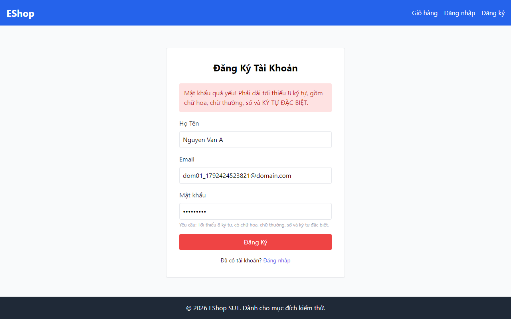
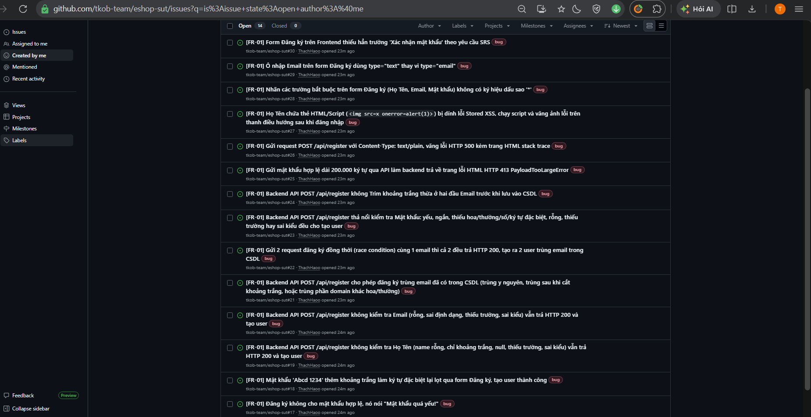
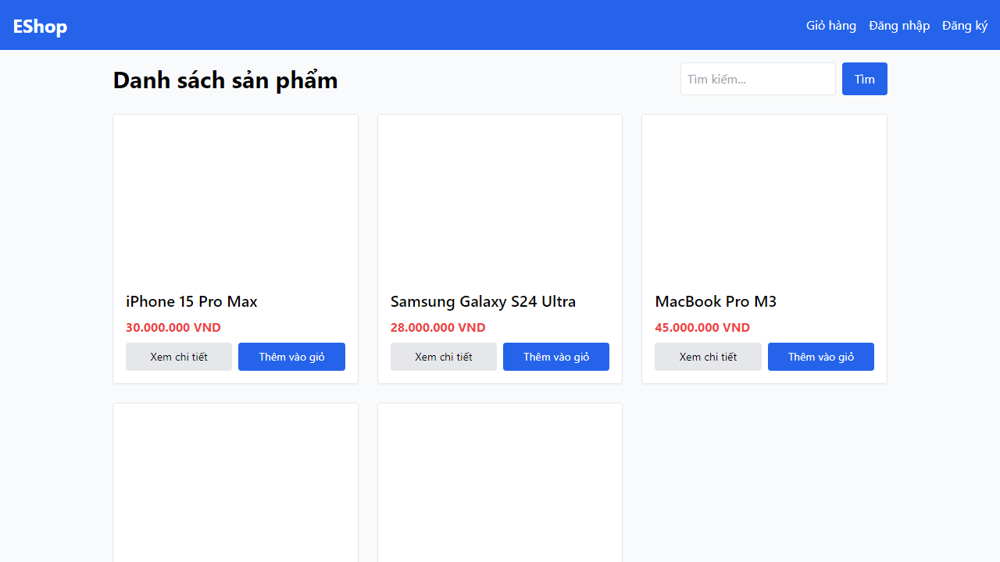
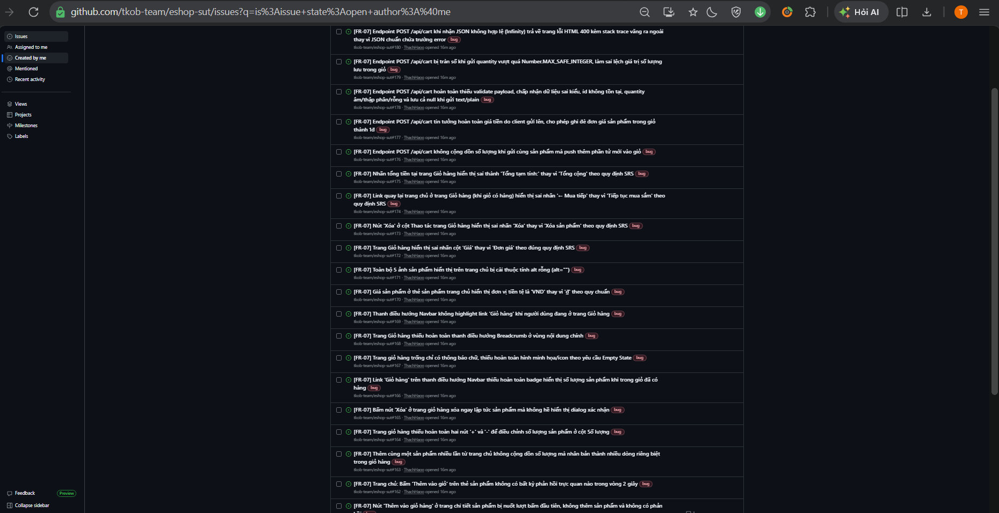
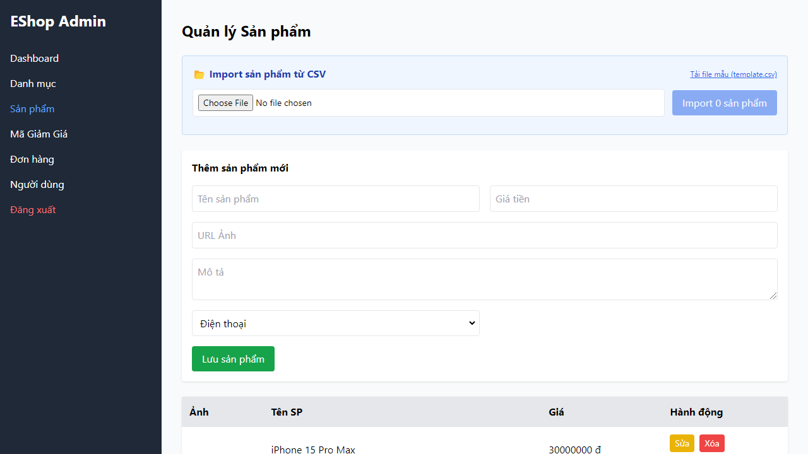
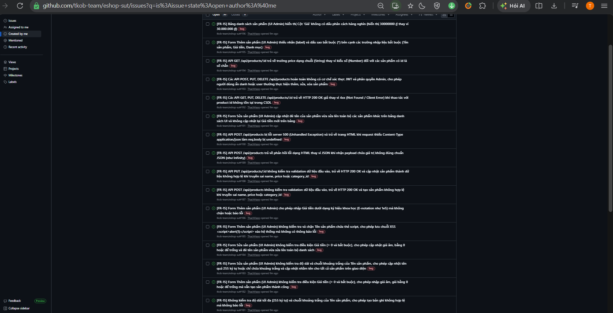
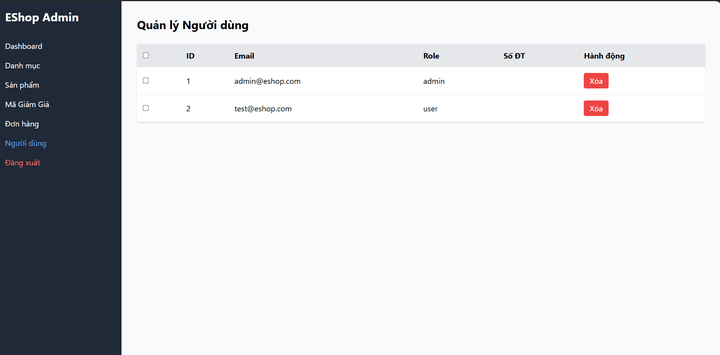
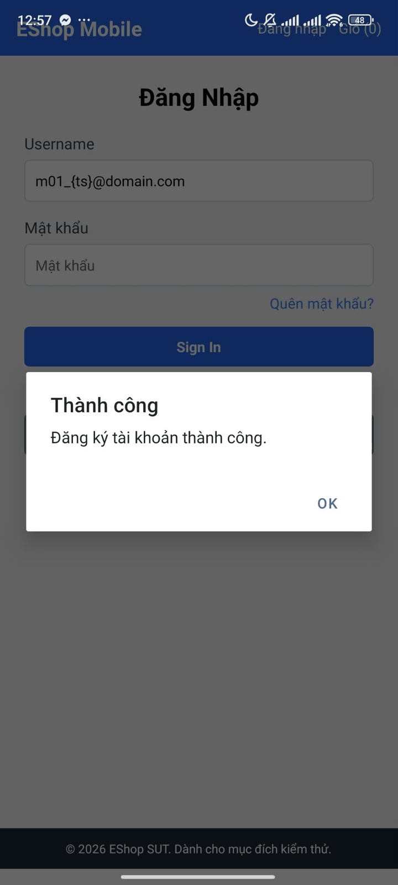
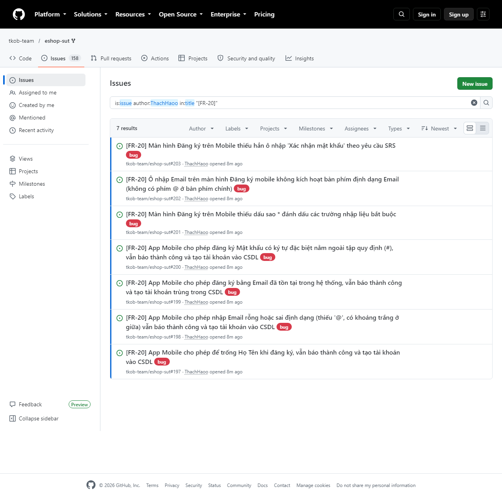

# HW02 – Domain Testing on EShop

> 📝 **Khung report.** Đề không quy định tên report chính → dùng `23120255_HW02_Report.md` theo CLAUDE.md §6 và README. Xoá mọi khối 📝 trước khi xuất PDF.
> 📝 Ký hiệu: `[...]` = ô cần điền · `<SV viết>` = em tự viết · 🔒 = em tự viết, AI không viết/nháp · bảng giữa marker `<!-- REPORT:… -->` sinh bằng `tools/report_tables.py` (theo feature) và `tools/audit_tables.py` (cấp bài), không sửa tay.

| Mục | Nội dung |
|---|---|
| Họ tên / MSSV / Lớp | Lê Tấn Hiệp – 23120255 – Software Testing 23_3 |
| Bài | HW02-AI – Domain Testing on EShop |
| Cấp độ AI | Cấp 4 (AI hỗ trợ sản xuất; em thiết kế, audit, tích hợp) |
| Bloom-AI | G9.2 (Apply), G9.3 (Analyse) |
| Công cụ AI | Claude Opus 5.5, Claude Sonnet 4.6 (Anthropic); một số lượt transcript không ghi model, prompt log ghi "Claude (không rõ model)" — danh sách theo header `appendix/A_prompt_log.md` |
| SUT | `tkob-team/eshop-sut` @ `de0f48f` (= `ttbhanh/eshop-sut` `85af3ba` + `.gitignore`) |
| Ngày nộp | [...] |

> 📝 AI nháp – SV xác nhận (câu tuyên bố phải khớp mục 12)

**Tuyên bố sử dụng AI (đề §9):** I use AI tools for the following tasks,

1. Dựng harness làm bài: `CLAUDE.md`, Agent Skill `domain-bva-testing` (kèm script `freeze.py`, `check_domain.py`, `render_md.py`, `merge_results.py`), script trích prompt log tự động, script tổng hợp và sinh bảng cho report (`summary.py`, `report_tables.py`, `audit_tables.py`), script nén ảnh.
2. Nháp từng bước Domain Testing và BVA (biến vào/ra, lớp tương đương, test case Domain, test case BVA) cho 4 feature; mỗi bản nháp được đóng băng ở `appendix/ai-outputs/` trước khi em review và sửa.
3. Trả lời "vì sao bản AI bỏ sót" sau khi em đã tự bổ sung case (`<feature>/ai_gap_answer.md`).
4. Viết script Playwright (A, B, C), hướng dẫn chạy `RUN.md` (B, C, D), gộp kết quả chạy vào JSON, chép kết quả chạy tay của em sang file lượt (D).
5. Gom dữ kiện bug (`bugs/_groups_*.md`), dựng khung bug trống chỉ có dữ kiện, sửa dữ kiện theo evidence, chạy `gh issue create` với nội dung em viết.
6. Dựng khung report, sinh bảng dữ kiện, nháp các khối giải thích từng bước (đánh dấu 📝 AI nháp) và các mục chung (1, 2, 7, 12) để em duyệt/sửa.

## Mục lục

1. Môi trường và SUT
2. Phương pháp chung
3. Feature A – FR-01 Đăng ký tài khoản (25 điểm)
4. Feature B – FR-07 Giỏ hàng (25 điểm)
5. Feature C – FR-15 Quản lý sản phẩm – CRUD admin (25 điểm)
6. Feature D – FR-20 Đăng ký trên Mobile (15 điểm)
7. Agent Skill (10 điểm)
8. Test summary
9. Bug report tổng hợp 🔒
10. AI Audit Report
11. AI Critique 🔒
12. Mandatory Disclosure
13. Tự đánh giá
14. Biểu mẫu AI
15. Phụ lục

> 📝 Thứ tự mục 3–7 theo rubric đề §15 (A 25 · B 25 · C 25 · D 15 · Agent Skills 10). Mỗi feature có 7 mục con theo 7 bước.

## 1. Môi trường và SUT

> 📝 AI nháp – SV duyệt/sửa, xoá dòng này khi xong. Giá trị lấy từ `env/environment.md`, `env/mobile_api_url.patch` và mục "Môi trường" của `bugs/BUG-01.md`, `BUG-15.md`, `BUG-35.md`, `BUG-51.md`.

| Thành phần | Giá trị |
|---|---|
| SUT | EShop, fork nhóm `tkob-team/eshop-sut` @ `de0f48f` (= `ttbhanh/eshop-sut` `85af3ba` + `.gitignore`, không đổi mã) |
| Test basis | SRS v2.0 (`eshop-sut/README.md`): FR-01 (dòng 30–36), FR-06/FR-07/FR-08 (dòng 83–108), FR-12/FR-14/FR-15 (dòng 174–198), FR-20 (dòng 231–236), FR-21/FR-22 (dòng 242–256), SEC-xx — chi tiết ở `meta.references` của từng feature |
| Máy | Windows 11 Home Single Language 10.0.26200, PowerShell |
| Node.js | [...] |
| Backend / web / admin | `node server.js` http://localhost:3000 · frontend-web http://localhost:5173 · frontend-admin http://localhost:5174 |
| Trình duyệt / Playwright | Chromium 130.0.6723.31 (Playwright 1.48.2); locale vi-VN ở lượt B_FR07, en-US ở lượt C_FR15 (mục Môi trường của BUG-15, BUG-35) |
| Mobile | POCO F5 · OS 1.0.5.0.UMRTWXM · Android 14 (UKQ1.230804.001); Expo Go 54.0.8 (SDK 54); locale/bàn phím Tiếng Việt (Việt Nam) · QWERTY |
| Thay đổi SUT | Chỉ `frontend-mobile/App.js` dòng 16: `API_URL = "http://192.168.2.12:3000/api"` (IP LAN của máy chạy backend; `env/mobile_api_url.patch`) |
| Tài khoản | admin `admin@eshop.com` / `Admin123!`, user `test@eshop.com` / `Test1234!` (setup_guide ghi `admin123`, không khớp seed) |
| Lượt chạy chính thức | A: 19/10/2026 22:42 (Playwright) · B: 20/10/2026 13:14 (lượt 2) · C: 20/10/2026 18:53 (lượt 6) · D: 21/10/2026 00:15 (chạy tay, lượt 1) |
| Đặc điểm ảnh hưởng thiết kế test | Mỗi lần `node server.js` khởi động, CSDL bị xoá và seed lại; giỏ hàng API nằm trong RAM; giỏ web là state React. Vì vậy mỗi lượt chính thức chạy sau khi restart backend, mỗi case dùng dữ liệu riêng (`{ts}`) và oracle tương đối (SAU so với TRƯỚC) |

## 2. Phương pháp chung

> 📝 AI nháp – SV duyệt/sửa, xoá dòng này khi xong. Nguồn duy nhất của mục này: `.claude/skills/domain-bva-testing/SKILL.md` (bản nộp: `skills/domain-bva-testing/SKILL.md`) và mục "Quyết định đã chốt" của `CLAUDE.md`.

### 2.1 Quy trình 7 bước, mỗi bước một commit

| Bước | Ai làm | Việc | Artifact |
|---|---|---|---|
| 1 | AI → em review | Biến vào/ra | `<feature>/testcases.json` (`domain.variables`, `meta.assumptions`); bản AI đóng băng `appendix/ai-outputs/<feature>_step1_*.json` |
| 2 | AI → em review | Lớp tương đương (Complete Set of Partitions) | `domain.partitions`; `appendix/ai-outputs/<feature>_step2_*.json` |
| 3 | AI → em review | TC Domain (coverage + minimum set) | suite `TS-DOM-*`, `TS-GUI`; `appendix/ai-outputs/<feature>_step3_*.json` |
| 4 | AI → em review | TC BVA | suite `TS-BVA-*`; `appendix/ai-outputs/<feature>_step4_*.json` |
| 5 | Em 🔒 rồi hỏi AI | Em bổ sung TC (`TS-SV`) trước, sau đó hỏi AI vì sao bỏ sót | `<feature>/sv_cases.md`, suite `TS-SV*`, `<feature>/ai_gap_answer.md` |
| 6 | AI viết script, em chạy | Playwright/API; mobile chạy tay | `tests/<feature>/`, `<feature>/RUN.md`, `<feature>/evidence/`, `actual_result`/`status` trong JSON |
| 7 | Em 🔒 | Bug report + GitHub Issues | `bugs/BUG-xx.md`, `bugs/issues_page_<feature>.png` |

Sau mỗi bước AI (1–4), bản nháp được đóng băng bằng `freeze.py` vào `appendix/ai-outputs/` trước khi em sửa; file đóng băng không bao giờ bị sửa. Sau đó chạy `check_domain.py` (mọi EC được phủ, không case nào phủ hai lớp không hợp lệ), linter `lint_testcases.py` và `render_md.py` sinh `testcases.md`.

### 2.2 Mô hình BVA 9 điểm (+ LARGE)

| Điểm | Ý nghĩa | Ghi chú |
|---|---|---|
| LB−1 | Cận dưới trừ một bước nhảy | Bước nhảy = đơn vị nhỏ nhất của miền (1 ký tự, 1 đơn vị tiền, 1 ngày) |
| LB | Cận dưới | |
| LB+1 | Cận dưới cộng một bước nhảy | |
| NOM | Giá trị danh nghĩa (nominal) hợp lệ | Các biến không xét giữ giá trị danh nghĩa hợp lệ |
| UB−1 | Cận trên trừ một bước nhảy | Chỉ có khi miền có cận trên |
| UB | Cận trên | |
| UB+1 | Cận trên cộng một bước nhảy | |
| MIN_UI | Giá trị nhỏ nhất nhập được qua giao diện | Chỉ dùng "khi có ý nghĩa" |
| MAX_UI | Giá trị lớn nhất nhập được qua giao diện | Chỉ dùng "khi có ý nghĩa" |
| LARGE | Đại diện giá trị lớn khi miền không có cận trên | Biến khai `no_upper_bound: "<mã giả định>"`; case có mã đó trong `assumptions` (`check_domain.py` báo lỗi nếu thiếu) |

Mỗi lớp có thứ tự (số, độ dài, ngày…) được xét theo các điểm trên; biến đang xét chạy qua các điểm biên, các biến khác giữ nominal hợp lệ. Mỗi case BVA có `bva_point`, `covers`, `technique: "BVA"`, `rationale`.

### 2.3 Quy tắc chia lớp (cột "Hướng dẫn" của bảng lớp)

| Giá trị | Nghĩa |
|---|---|
| `range` | Khoảng giá trị → 1 lớp hợp lệ + 2 lớp không hợp lệ |
| `count` | Số lượng → 1 + 2 |
| `set` | Tập giá trị được xử lý khác nhau → 1 lớp cho mỗi giá trị + 1 lớp ngoài tập |
| `must-be` | Điều kiện "phải là" → 1 + 1 |
| `type` | Sai kiểu |
| `split` | Tách lớp khi có lý do tin các phần tử của một lớp bị xử lý khác nhau; lý do ghi ở `note` của lớp |
| `output` | Lớp của biến đầu ra: mỗi biến ra có một lớp ứng với kết quả khi đầu vào hợp lệ (`valid: true`) và một lớp ứng với kết quả khi bị từ chối (`valid: false`) — định nghĩa ở SKILL.md Bước 2 (bổ sung theo cách `A_FR01`, `D_FR20` đã dùng). `B_FR07`, `C_FR15` gắn `set`/`must-be` cho lớp của biến ra |

### 2.4 Quy ước test case

| Quy ước | Nội dung |
|---|---|
| Dải mã TC | TS-DOM 01–59 · TS-BVA 60–89 (tràn từ 100) · TS-GUI 90–99 · TS-SV từ 200 |
| Nguồn TC (`origin`) | `AI` = AI đề xuất · `Human` = em thêm · `Both` = AI đề xuất rồi em sửa đáng kể |
| Tầng | Mỗi case thuộc đúng một tầng (UI hoặc API); ý "kiểm cả UI lẫn API" → hai case |
| Minimum set | Case hợp lệ phủ càng nhiều lớp hợp lệ càng tốt; mỗi case không hợp lệ phủ đúng một lớp không hợp lệ, các biến khác giữ giá trị hợp lệ |
| `ec_target` | ⊆ `covers`: lớp vào case cần thử + lớp ra mà Expected khẳng định; truy vết yêu cầu sinh từ `ec_target` |
| Trường SRS yêu cầu nhưng có thể vắng | Một case kiểm sự tồn tại; các case khác ghi trong `notes` cách xử lý khi vắng |
| Case em chọn từ mã nguồn | `technique` (EG…) + `approach: "gray-box"` |
| Evidence | `TC-xx_ui/_api/_req/_res/_failed/_manual_*`; giữ bản gốc, bản che để đăng issue ở `bugs/_issue_redacted/` |
| Severity / Priority | theo `bugs/README.md` |

### 2.5 Quy ước Expected

- Đặc tả (SRS) là oracle: Expected suy từ SRS, không suy từ việc code đang làm gì.
- SRS im lặng → ghi giả định (mã A/B/C/D…) trong `meta.assumptions`, em chốt trước khi dùng. Chưa có giả định → không viết Expected cho điểm đó, không tạo Fail không căn cứ.
- Giả định quyết định Expected mới → ghi vào `assumptions` của case và truy vết. Giả định phạm vi và giả định nới không bao giờ là "yêu cầu bị vi phạm" của bug.
- Thuộc tính chung (nhãn, định dạng tiền, badge, phản hồi khi thêm…) chỉ khẳng định ở một case; phần dữ liệu không đổi ghi tương đối (SAU = TRƯỚC), giá trị tuyệt đối chỉ cho đầu ra case thực sự kiểm.
- Expected của case API chỉ nói về phản hồi (mã HTTP, body) và dữ liệu lưu, không chứa yếu tố giao diện.
- Không đổi Expected sau khi có Actual; ngoại lệ duy nhất: điểm quan sát trong Expected không tồn tại trên hệ thống (ghi lý do vào `notes`).
- `api_specification.md` không dùng làm căn cứ Expected/Yêu cầu.

> 📝 em quyết có ghi việc đổi căn cứ api_specification.md từ C (C9) ở đây hay không

### 2.6 Quy ước verdict

| Verdict | Khi nào |
|---|---|
| Pass | Actual khớp Expected |
| Fail | Lệch Expected vì biến mục tiêu của case |
| Blocked | Không tới được điểm kiểm vì biến khác (lỗi đã kết luận ở case khác chặn đường) → ghi case gốc trong `notes`, không tính Fail lần hai. Trường SRS yêu cầu nhưng không có trên giao diện: case kiểm sự tồn tại Fail, các case cần nhập trường đó Blocked (A17). Bị chặn bởi hai lỗi → ghi cả hai case gốc |
| Pass hộp đen | Bị từ chối đúng như Expected nhưng thông báo/lý do không chứng minh được luật mục tiêu (lý do chung, do luật khác, hoặc đường thêm/nhập hỏng nên giá trị nào cũng bị từ chối) → Pass, `notes` ghi "Pass hộp đen" + case gốc |
| Fail do lỗi thiết kế TC | Expected em viết sai, phát hiện sau khi có Actual → không sửa Expected, không lập bug |

- `auto_status` giữ kết quả tự động gốc do `merge_results.py` ghi; em chỉnh `status` theo bảng trên; `merge_results.py` không ghi đè `status` đã chỉnh (trừ `--force`).
- Đường tự động bị chặn nhưng case vẫn kiểm được bằng đường khác (API, thao tác tay) → em kiểm tay, ghi bước và quan sát vào `notes`, ảnh `TC-xx_manual_*.png`; `status` theo kết quả kiểm tay, `auto_status` giữ Blocked.
- Mỗi lượt chạy ghi results riêng có timestamp; evidence chỉ giữ lượt mới nhất; lượt chính thức = lượt chạy toàn bộ sau khi restart backend (CSDL seed lại).

## 3. Feature A – FR-01

**Chức năng:** Đăng ký tài khoản (web + API `POST /api/register`) · **Thư mục:** `A_FR01/` · **Điểm:** 25

> 📝 Bảng giữa các marker `<!-- REPORT:A_FR01:… -->` sinh bằng `python tools/report_tables.py HW02 A_FR01 --report HW02/23120255_HW02_Report.md` (từ `A_FR01/testcases.json`, `bugs/BUG-xx.md`, `appendix/ai-outputs/`, git). Không sửa tay trong marker; sửa JSON/BUG rồi chạy lại. Bảng đầy đủ: [`A_FR01/testcases.md`](A_FR01/testcases.md).

### 3.0 Phạm vi và test basis

<!-- REPORT:A_FR01:scope:START -->
> Form 'Đăng Ký Tài Khoản' trên frontend-web (tầng UI) và endpoint POST /api/register (tầng API). Trong phạm vi: FR-01 (phân lớp + BVA) và FR-22.1–FR-22.4 (thuộc tính tĩnh của form — kiểm bằng suite GUI riêng, không phân lớp, vì không phải miền giá trị nhập). Ngoài phạm vi: FR-21 (tiêu chuẩn giao diện chung, áp dụng toàn hệ thống, không riêng form đăng ký) và SEC-01 (mật khẩu không lưu plaintext — yêu cầu bảo mật tham khảo, không thuộc FR-01 và không quan sát được qua UI/API đăng ký); đăng ký trên Mobile (Pool D, FR-20); đăng nhập (FR-02); các trang khác. TS-SV có kiểm thăm dò SEC-04, SEC-05, SEC-06* liên quan trực tiếp tới dữ liệu đăng ký.

*Nguồn: `A_FR01/testcases.json` → `meta.scope` (nguyên văn).*
<!-- REPORT:A_FR01:scope:END -->

<!-- REPORT:A_FR01:req:START -->
| Mã | Nội dung |
|---|---|
| FR-01.1 | Người dùng phải cung cấp Họ Tên (trường bắt buộc). |
| FR-01.2 | Người dùng phải cung cấp Email (trường bắt buộc). |
| FR-01.3 | Email phải có định dạng hợp lệ (user@domain.com). |
| FR-01.4 | Email phải là duy nhất trong hệ thống. |
| FR-01.5 | Người dùng phải cung cấp Mật khẩu (trường bắt buộc). |
| FR-01.6 | Mật khẩu tối thiểu 8 ký tự. |
| FR-01.7a | Mật khẩu có ít nhất 1 chữ hoa. |
| FR-01.7b | Mật khẩu có ít nhất 1 chữ thường. |
| FR-01.7c | Mật khẩu có ít nhất 1 chữ số. |
| FR-01.8 | Mật khẩu có ít nhất 1 ký tự đặc biệt thuộc tập @, $, !, %, *, ?, &. |
| FR-01.9 | Phải có trường Xác nhận mật khẩu; hệ thống từ chối nếu Mật khẩu và Xác nhận mật khẩu không khớp. |
| FR-01.10 | Sau khi đăng ký thành công, người dùng được chuyển tới trang Đăng nhập. |
| FR-22.1 | Trường bắt buộc có ký hiệu * bên cạnh nhãn. |
| FR-22.2 | Trường Email dùng type="email". |
| FR-22.3 | Trường Mật khẩu dùng type="password". |
| FR-22.4 | Thông báo lỗi xuất hiện phía trên nút submit. |
| API-REG | POST /api/register nhận body JSON {name, email, password}; thành công trả 200 {"message": "User registered successfully", "id": n} (api_specification.md dòng 14–21). |
| SEC-04 | Mọi dữ liệu từ user nhập vào khi hiển thị trên UI phải được escape đúng cách, không dùng innerHTML trực tiếp (README.md dòng 281). |
| SEC-05 | Truy vấn CSDL phải dùng Parameterized Query, không nối chuỗi trực tiếp (README.md dòng 282). |
| SEC-06* | API cập nhật hồ sơ không được cho phép thay đổi trường role từ client (README.md dòng 283) — mở rộng cho đăng ký, A23. |

*Nguồn: `A_FR01/testcases.json` → `requirements` (20 mục).*
<!-- REPORT:A_FR01:req:END -->

**Giả định khi SRS chưa nói rõ** (bản cuối trong JSON; ghi chú "SV chốt / SV duyệt / SV sửa" giữ nguyên văn)

<!-- REPORT:A_FR01:assum:START -->
| Mã | Nội dung (nguyên văn, gồm ghi chú chốt) | Nguồn gốc (ai-outputs + git) |
|---|---|---|
| A1 (Họ Tên) | FR-01 chỉ nói 'phải cung cấp'. SRS không nêu độ dài tối thiểu/tối đa hay tập ký tự → chỉ coi 'rỗng' là không hợp lệ. Chuỗi chỉ gồm khoảng trắng: giả định bị coi như rỗng (bị từ chối). Không có cận trên → không sinh UB/MAX_UI cho Họ Tên trừ khi SV quyết định khác. | AI nháp bước 1; giữ nguyên |
| A2 (Email – định dạng) | FR-01 chỉ đưa mẫu 'user@domain.com'. Giả định định dạng hợp lệ = <local>@<domain>.<tld>: đúng một '@', phần local không rỗng, phần domain có ít nhất một dấu '.' và không rỗng hai bên dấu chấm. FR-22 yêu cầu type="email" nên quy tắc HTML5 của trình duyệt dùng làm tham chiếu phụ. SRS không nêu độ dài tối đa → không kiểm cận trên độ dài email. | AI nháp bước 1; giữ nguyên |
| A3 (Email – duy nhất) | Email so sánh sau khi cắt khoảng trắng đầu/cuối; phần local phân biệt hoa/thường, phần domain không phân biệt (RFC 5321 §2.4). SV sửa ở bước 5. | AI nháp bước 1; đổi ở `4e30b25`, `1cfa163` (commit cuối = bản hiện tại) |
| A4 (Mật khẩu – độ dài) | chỉ có cận dưới 8 ký tự. SRS không có cận trên → không có UB; BVA độ dài chỉ quanh LB = 8 (7, 8, 9) và NOM. | AI nháp bước 1; giữ nguyên |
| A5 (Mật khẩu – ký tự đặc biệt) | hiểu danh sách (@, $, !, %, *, ?, &) là tập ĐÓNG: mật khẩu chỉ chứa ký tự đặc biệt ngoài tập này (ví dụ #, ^, -, khoảng trắng) bị coi là thiếu ký tự đặc biệt → bị từ chối. SRS không nói ký tự ngoài tập có được phép xuất hiện thêm hay không → giả định được phép nếu đã có ít nhất một ký tự trong tập. | AI nháp bước 1; giữ nguyên |
| A6 (Mật khẩu – chữ hoa/thường) | giả định chỉ tính chữ Latin A–Z / a–z; chữ có dấu tiếng Việt (Ă, ê…) không tính là chữ hoa/thường. SRS im lặng. Expected của EC27/EC30 phụ thuộc giả định này; kết quả lệch được phân tích là SRS mơ hồ trước khi kết luận lỗi. | AI nháp bước 1; đổi ở `d799b74` (commit cuối = bản hiện tại) |
| A7 (Xác nhận mật khẩu) | FR-01 yêu cầu trường này; so sánh phân biệt hoa/thường, khớp tuyệt đối với Mật khẩu. Bỏ trống trường này coi như không khớp → bị từ chối. | AI nháp bước 1; giữ nguyên |
| A8 (Xác nhận mật khẩu ở tầng API) | api_specification.md dòng 14–19 không có trường xác nhận trong body. Giả định yêu cầu 'khớp hai trường' chỉ kiểm ở tầng UI; ở tầng API biến này không áp dụng. Cần SV xác nhận. | AI nháp bước 1; giữ nguyên |
| A9 (Kiểm ở tầng API) | FR-01 là yêu cầu của hệ thống, không riêng giao diện → giả định API POST /api/register cũng phải từ chối dữ liệu vi phạm FR-01 khi gọi trực tiếp (bỏ qua UI). | AI nháp bước 1; giữ nguyên |
| A10 (Thông báo lỗi) | SRS không quy định nội dung chữ của thông báo lỗi. Oracle cho case nhập liệu không hợp lệ = có thông báo lỗi hiển thị trên form + vẫn ở trang /register + không tạo bản ghi user; nội dung chữ chỉ ghi lại làm Actual. Vị trí thông báo lỗi (phía trên nút 'Đăng Ký') chỉ kiểm ở case GUI của FR-22.4, không đưa vào oracle của case nhập liệu. | AI nháp bước 1; đổi ở `4e30b25` (commit cuối = bản hiện tại) |
| A11 (Mã lỗi API) | api_specification.md chỉ mô tả phản hồi thành công 200. Giả định dữ liệu không hợp lệ phải nhận mã 4xx (không phải 2xx, không phải 5xx) kèm trường error; không cố định mã cụ thể (400/409/422). | AI nháp bước 1; giữ nguyên |
| A12 (Quan sát bản ghi) | kiểm 'có/không tạo user' bằng GET /api/admin/users với token của admin@eshop.com / Admin123!, hoặc đăng nhập POST /api/login bằng tài khoản vừa tạo. | AI nháp bước 1; giữ nguyên |
| A13 (Dữ liệu sẵn có) | email đã tồn tại dùng tài khoản seed test@eshop.com (database.js dòng 93). Backend khởi động lại → CSDL seed lại, tài khoản tạo trong lúc test mất; mỗi case dùng email mới (ví dụ gắn timestamp) để case độc lập. | AI nháp bước 1; giữ nguyên |
| A14 (FR-22 thuộc tính form) | ký hiệu '*', type="email", type="password", vị trí thông báo lỗi là thuộc tính tĩnh của form, không phải miền giá trị nhập → không phân lớp ở bước 2; kiểm bằng suite GUI riêng (SV chốt 2026-10-19). | AI nháp bước 1; đổi ở `4e30b25` (commit cuối = bản hiện tại) |
| A15 (Sai kiểu / thiếu trường ở tầng API) | SRS không nói gì về body JSON. Giả định trường name/email/password bị thiếu, bằng null hoặc không phải chuỗi JSON (ví dụ số 123) là dữ liệu không hợp lệ → phải bị từ chối với 4xx, không tạo user (theo A9, A11). Các lớp này chỉ tạo được ở tầng API vì ô nhập trên UI luôn gửi chuỗi. | AI nháp bước 2; giữ nguyên |
| A16 (Thông báo kiểm tra HTML5) | khi trình duyệt chặn submit bằng bong bóng kiểm tra của thuộc tính required/type, bong bóng đó được coi là 'thông báo lỗi trên form' trong oracle của V6. SRS không phân biệt cơ chế hiển thị (SV xác nhận 2026-10-19). Cách quan sát: bong bóng HTML5 không nằm trong DOM → oracle = form không gửi request POST /api/register + ô liên quan ở trạng thái :invalid / validationMessage không rỗng. | AI nháp bước 2; đổi ở `d799b74` (commit cuối = bản hiện tại) |
| A17 (Thiếu ô Xác nhận mật khẩu) | nếu form không có ô Xác nhận mật khẩu (xem note V5): case kiểm sự tồn tại của trường (TC-FR01-94) → Fail; case có V5 = EC39 bỏ qua bước nhập V5 và ghi notes; chỉ các case EC40–EC42 → Blocked kèm mã bug. Không xoá case. | Không có trong bản AI đóng băng trước đó; thêm ở `d799b74`; đổi ở `448b10d` (commit cuối = bản hiện tại) |
| A18 (FR-22.3 cho ô Xác nhận mật khẩu) | FR-22.3 chỉ nêu 'Trường Mật khẩu'. Giả định ô Xác nhận mật khẩu cũng là trường mật khẩu → cũng phải dùng type="password" (kiểm ở TC-FR01-92). | AI nháp bước 3; giữ nguyên |
| A19 (Độc lập giữa các case) | tính độc lập giữa các case dựa trên dữ liệu riêng ({ts}) và oracle tương đối; cleanup là lớp bảo vệ thứ hai, vì API xoá user (FR-19) nằm ngoài phạm vi và có thể có lỗi. | Không có trong bản AI đóng băng trước đó; thêm ở `448b10d`; giữ nguyên |
| A20 (lỗi đã biết chặn case khác) | Khi một case không kiểm được đúng mục đích của nó vì một lỗi đã được case khác kết luận, case đó ghi Blocked và notes ghi mã case hoặc bug gây chặn. Mục đích của case được kiểm ở bản tầng API nếu có. Chỉ case kết luận nguyên nhân gốc mới ghi Fail. (Cùng nguyên tắc với A17.) (AI đề xuất, SV duyệt 2026-10-19) | Không có trong bản AI đóng băng trước đó; thêm ở `1cfa163`; giữ nguyên |
| A21 (email chỉ gồm ký tự ASCII) | FR-22.2 bắt ô Email dùng type="email". A2 lấy quy tắc HTML5 làm tham chiếu phụ, và theo định nghĩa “valid e-mail address” của HTML5, phần local chỉ gồm ký tự ASCII. Vì vậy email có ký tự ngoài ASCII là sai định dạng. → TC-219: tеst@eshop.com (chữ е Cyrillic) phải bị từ chối, 4xx, không tạo user. Thêm EC52 “Email có ký tự ngoài ASCII” (không hợp lệ), do TC-219 phủ. Nay case này có oracle, không còn là quan sát suông. (AI đề xuất, SV duyệt 2026-10-19) | Không có trong bản AI đóng băng trước đó; thêm ở `1cfa163`; đổi ở `f3126b0` (commit cuối = bản hiện tại) |
| A22 (đăng ký khi đang đăng nhập) | SRS không hạn chế việc này. Giả định ít suy diễn nhất: form vẫn dùng được, đăng ký tài khoản mới thành công, chuyển tới /login (FR-01.10), tạo đúng 1 user mới, và tài khoản test@eshop.com không bị thay đổi. → Expected của TC-223. (AI đề xuất, SV duyệt 2026-10-19) | Không có trong bản AI đóng băng trước đó; thêm ở `1cfa163`; giữ nguyên |
| A23 (role khi đăng ký) | tài khoản tạo qua đăng ký luôn có role user; trường không có trong api_specification bị bỏ qua (mở rộng SEC-06 và FR-04). → TC-222 giữ nguyên Expected, chỉ thêm căn cứ. (AI đề xuất, SV duyệt 2026-10-19) | Không có trong bản AI đóng băng trước đó; thêm ở `1cfa163`; giữ nguyên |

*Nguồn: `A_FR01/testcases.json` → `meta.assumptions` (bản HEAD); cột cuối so với `appendix/ai-outputs/A_FR01_step*.json` và `git log -- A_FR01/testcases.json`.*
<!-- REPORT:A_FR01:assum:END -->

### 3.1 Bước 1 – Biến vào/ra

> 📝 AI nháp – SV duyệt/sửa, xoá dòng này khi xong

Em xác định biến từ test basis là SRS v2.0 mục FR-01 (`eshop-sut/README.md` dòng 30–36) và FR-22 (dòng 250–256); mã nguồn (`Register.jsx`, `server.js`, `database.js`) chỉ dùng để biết tên trường, nhãn và endpoint thật. Biến vào gồm ba ô của form (V1, V2, V4), trạng thái "email đã tồn tại" trong CSDL (V3) và ô Xác nhận mật khẩu mà FR-01.9 yêu cầu (V5). Biến ra gồm thông báo lỗi trên form, trang đích, phản hồi API và bản ghi trong CSDL (V6–V9), để mỗi case có điểm quan sát ở cả tầng UI và tầng API. Chỗ SRS im lặng được ghi thành giả định (bảng ở 3.0). Hai quan sát mã nguồn (ô Email `type="text"`, form không có ô Xác nhận mật khẩu) chỉ ghi chú ở V2, V5, chưa kết luận lỗi trước bước 6.

Review so với bản AI đóng băng `appendix/ai-outputs/A_FR01_step1_20261019-1613.json`: ràng buộc của V4 tách FR-01.7 thành FR-01.7a/7b/7c; ràng buộc của V6 bỏ vị trí thông báo khỏi oracle (chỉ kiểm ở case FR-22.4); giả định A3, A10, A14 đổi ở `4e30b25` (cột "Nguồn gốc" ở 3.0).

<!-- REPORT:A_FR01:vars:START -->
| Mã | Biến | Vào/Ra | Kiểu | Ràng buộc (đặc tả) | Ghi chú |
|---|---|---|---|---|---|
| V1 | Họ Tên | Vào | string | Bắt buộc (FR-01.1). SRS không nêu độ dài/tập ký tự → xem A1. |  |
| V2 | Email | Vào | string | Bắt buộc (FR-01.2); định dạng user@domain.com (FR-01.3, xem A2); FR-22.2 yêu cầu type="email". | Quan sát mã nguồn: ô Email type=text. Chưa kết luận lỗi, xác nhận khi thực thi (bước 6). |
| V3 | Email đã tồn tại trong hệ thống | Vào | boolean (trạng thái CSDL) | Email nhập vào phải chưa tồn tại (FR-01.4). Cách so sánh hoa/thường, khoảng trắng → xem A3. |  |
| V4 | Mật khẩu | Vào | string | Bắt buộc (FR-01.5); độ dài ≥ 8 (FR-01.6, không có cận trên – A4); ≥1 chữ hoa (FR-01.7a), ≥1 chữ thường (FR-01.7b), ≥1 chữ số (FR-01.7c) (A6); ≥1 ký tự thuộc {@ $ ! % * ? &} (FR-01.8, A5). |  |
| V5 | Xác nhận mật khẩu | Vào | string | Phải bằng đúng V4 (FR-01.9, A7). Tầng API: xem A8. | Quan sát mã nguồn: form không có ô Xác nhận mật khẩu. Chưa kết luận lỗi, xác nhận khi thực thi (bước 6). |
| V6 | Thông báo lỗi trên form | Ra | message \| none | Dữ liệu không hợp lệ → có thông báo lỗi trên form; hợp lệ → không có lỗi. Nội dung chữ không được SRS quy định (A10). Vị trí thông báo chỉ kiểm ở case FR-22.4. |  |
| V7 | Trang đích sau khi bấm 'Đăng Ký' | Ra | enum {/login, /register} | Thành công → chuyển tới trang Đăng nhập /login (FR-01.10); thất bại → ở lại /register (A10). |  |
| V8 | Phản hồi API | Ra | HTTP status + JSON | Hợp lệ → 200 {"message": "User registered successfully", "id": n}; không hợp lệ → 4xx kèm trường error (A11). |  |
| V9 | Bản ghi tài khoản trong CSDL | Ra | enum {tạo đúng 1 bản ghi, không tạo} | Hợp lệ → tạo đúng 1 user mới với name/email đã nhập, đăng nhập được; không hợp lệ → số user không đổi. |  |

*5 biến vào, 4 biến ra. Cột "Nguồn" (tên trường, dòng code) bỏ cho gọn — xem `A_FR01/testcases.md` mục Bước 1.*
<!-- REPORT:A_FR01:vars:END -->

### 3.2 Bước 2 – Lớp tương đương (Complete Set of Partitions)

> 📝 AI nháp – SV duyệt/sửa, xoá dòng này khi xong

Mỗi biến vào được chia lớp hợp lệ/không hợp lệ theo từng ràng buộc của SRS và giả định: bắt buộc (rỗng/chỉ khoảng trắng), định dạng email (A2), email duy nhất theo cách so sánh của A3, độ dài mật khẩu (A4) và từng loại ký tự bắt buộc (A5, A6), khớp Xác nhận mật khẩu (A7). Các lớp chỉ tạo được ở tầng API (thiếu trường, `null`, sai kiểu JSON) có căn cứ A15. Biến ra cũng được phân lớp (thành công ↔ bị từ chối) để Expected của mỗi case khẳng định được ở V6–V9. Cột "Hướng dẫn" trong `A_FR01/testcases.md` ghi quy tắc chia lớp đã áp dụng cho từng lớp (`split`, `must-be`, `set`, `type`, `range`, `output`).

Review so với bản AI đóng băng `appendix/ai-outputs/A_FR01_step2_20261019-1641.json`: giả định A6, A16 và lớp EC19 đổi ở `d799b74`; A17 thêm ở `d799b74`. EC51 (email chỉ khác hoa/thường ở phần domain) và EC52 (email có ký tự ngoài ASCII) không có trong bản AI, thêm ở bước 5 (`1cfa163`); EC19 đổi lần nữa ở `1cfa163` theo A3.

<!-- REPORT:A_FR01:parts:START -->
| EC | Biến | Lớp tương đương | Hợp lệ | Số TC phủ | TC phủ (số cuối mã TC-xx) |
|---|---|---|---|---|---|
| EC1 | V1 Họ Tên | Không rỗng, chỉ chữ Latin không dấu và khoảng trắng (ví dụ 'Nguyen Van A') | Có | 11 | 01, 28, 61, 62 … (+7) |
| EC2 | V1 Họ Tên | Không rỗng, có chữ tiếng Việt có dấu (ví dụ 'Nguyễn Văn Ánh') | Có | 4 | 02, 29, 217, 231 |
| EC3 | V1 Họ Tên | Rỗng (0 ký tự) | Không | 4 | 05, 32, 60, 79 |
| EC4 | V1 Họ Tên | Chỉ gồm khoảng trắng (ví dụ '   ') | Không | 2 | 06, 33 |
| EC5 | V1 Họ Tên | Tầng API: trường name thiếu trong body hoặc bằng null | Không | 1 | 52 |
| EC6 | V1 Họ Tên | Tầng API: name không phải chuỗi (ví dụ số 123) | Không | 1 | 53 |
| EC7 | V2 Email | Đúng định dạng <local>@<domain>.<tld> (ví dụ 'newuser@domain.com') | Có | 6 | 01, 02, 28, 29 … (+2) |
| EC8 | V2 Email | Đúng định dạng nhưng có khoảng trắng đầu/cuối (ví dụ '  newuser@domain.com  ') | Có | 2 | 03, 30 |
| EC9 | V2 Email | Rỗng (0 ký tự) | Không | 2 | 07, 34 |
| EC10 | V2 Email | Không có ký tự '@' (ví dụ 'newuserdomain.com') | Không | 4 | 08, 35, 200, 201 |
| EC11 | V2 Email | Có nhiều hơn một '@' (ví dụ 'new@user@domain.com') | Không | 2 | 09, 36 |
| EC12 | V2 Email | Phần local rỗng (ví dụ '@domain.com') | Không | 2 | 10, 37 |
| EC13 | V2 Email | Phần domain rỗng (ví dụ 'newuser@') | Không | 2 | 11, 38 |
| EC14 | V2 Email | Phần domain không có dấu '.' (ví dụ 'newuser@domain') | Không | 2 | 12, 39 |
| EC15 | V2 Email | Có khoảng trắng bên trong (ví dụ 'new user@domain.com') | Không | 3 | 13, 40, 220 |
| EC16 | V2 Email | Tầng API: trường email thiếu trong body hoặc bằng null | Không | 1 | 54 |
| EC17 | V2 Email | Tầng API: email không phải chuỗi (ví dụ số 123) | Không | 1 | 55 |
| EC18 | V3 Email đã tồn tại trong hệ thống | Email chưa tồn tại trong bảng users | Có | 4 | 01, 02, 28, 29 |
| EC19 | V3 Email đã tồn tại trong hệ thống | Chỉ khác hoa/thường ở phần local (ví dụ 'Test@eshop.com' khi đã có 'test@eshop.com') | Có | 2 | 04, 31 |
| EC20 | V3 Email đã tồn tại trong hệ thống | Trùng chính xác email đã có (ví dụ 'test@eshop.com') | Không | 2 | 14, 41 |
| EC21 | V3 Email đã tồn tại trong hệ thống | Trùng email đã có sau khi cắt khoảng trắng đầu/cuối (ví dụ ' test@eshop.com ') | Không | 2 | 15, 42 |
| EC22 | V4 Mật khẩu | Độ dài ≥ 8 ký tự (các điều kiện khác thoả) | Có | 11 | 01, 02, 28, 29 … (+7) |
| EC23 | V4 Mật khẩu | Độ dài 1–7 ký tự (các điều kiện khác thoả) | Không | 4 | 16, 43, 63, 82 |
| EC24 | V4 Mật khẩu | Rỗng (0 ký tự) | Không | 2 | 17, 44 |
| EC25 | V4 Mật khẩu | Có ≥ 1 chữ hoa A–Z | Có | 8 | 01, 02, 28, 29 … (+4) |
| EC26 | V4 Mật khẩu | Không có chữ hoa nào (các điều kiện khác thoả) | Không | 4 | 18, 45, 67, 86 |
| EC27 | V4 Mật khẩu | Chữ hoa duy nhất là chữ có dấu tiếng Việt, ví dụ 'Ê' (các điều kiện khác thoả) | Không | 2 | 19, 46 |
| EC28 | V4 Mật khẩu | Có ≥ 1 chữ thường a–z | Có | 8 | 01, 02, 28, 29 … (+4) |
| EC29 | V4 Mật khẩu | Không có chữ thường nào (các điều kiện khác thoả) | Không | 4 | 20, 47, 70, 89 |
| EC30 | V4 Mật khẩu | Chữ thường duy nhất là chữ có dấu tiếng Việt, ví dụ 'ê' (các điều kiện khác thoả) | Không | 2 | 21, 48 |
| EC31 | V4 Mật khẩu | Có ≥ 1 chữ số 0–9 | Có | 8 | 01, 02, 28, 29 … (+4) |
| EC32 | V4 Mật khẩu | Không có chữ số nào (các điều kiện khác thoả) | Không | 4 | 22, 49, 73, 102 |
| EC33 | V4 Mật khẩu | Có ≥ 1 ký tự thuộc {@ $ ! % * ? &}, không có ký tự đặc biệt ngoài tập | Có | 6 | 01, 28, 77, 78 … (+2) |
| EC34 | V4 Mật khẩu | Có ≥ 1 ký tự thuộc tập và thêm ký tự đặc biệt ngoài tập (ví dụ '!' và '#') | Có | 4 | 02, 29, 211, 229 |
| EC35 | V4 Mật khẩu | Không có ký tự đặc biệt nào (các điều kiện khác thoả) | Không | 4 | 23, 50, 76, 105 |
| EC36 | V4 Mật khẩu | Chỉ có ký tự đặc biệt ngoài tập, ví dụ '#', '^', '-', khoảng trắng (các điều kiện khác thoả) | Không | 6 | 24, 51, 202, 210 … (+2) |
| EC37 | V4 Mật khẩu | Tầng API: trường password thiếu trong body hoặc bằng null | Không | 1 | 56 |
| EC38 | V4 Mật khẩu | Tầng API: password không phải chuỗi (ví dụ số 12345678) | Không | 1 | 57 |
| EC39 | V5 Xác nhận mật khẩu | Khớp chính xác với Mật khẩu | Có | 17 | 01, 02, 03, 04 … (+13) |
| EC40 | V5 Xác nhận mật khẩu | Rỗng | Không | 1 | 25 |
| EC41 | V5 Xác nhận mật khẩu | Khác Mật khẩu ít nhất một ký tự (không chỉ khác hoa/thường) | Không | 1 | 26 |
| EC42 | V5 Xác nhận mật khẩu | Chỉ khác Mật khẩu ở chữ hoa/thường (ví dụ 'Abcd1234!' và 'abcd1234!') | Không | 1 | 27 |
| EC43 | V6 Thông báo lỗi trên form | Không có thông báo lỗi | Có | 17 | 01, 02, 03, 04 … (+13) |
| EC44 | V6 Thông báo lỗi trên form | Có thông báo lỗi trên form (hộp lỗi hoặc bong bóng HTML5) | Không | 29 | 05, 06, 07, 08 … (+25) |
| EC45 | V7 Trang đích sau khi bấm 'Đăng Ký' | Chuyển tới trang Đăng nhập /login | Có | 17 | 01, 02, 03, 04 … (+13) |
| EC46 | V7 Trang đích sau khi bấm 'Đăng Ký' | Ở lại trang /register | Không | 29 | 05, 06, 07, 08 … (+25) |
| EC47 | V8 Phản hồi API | HTTP 200, body {"message": "User registered successfully", "id": n} | Có | 17 | 28, 29, 30, 31 … (+13) |
| EC48 | V8 Phản hồi API | HTTP 4xx, body có trường error | Không | 32 | 32, 33, 34, 35 … (+28) |
| EC49 | V9 Bản ghi tài khoản trong CSDL | Tạo đúng 1 bản ghi user mới với name/email đã nhập | Có | 35 | 01, 02, 03, 04 … (+31) |
| EC50 | V9 Bản ghi tài khoản trong CSDL | Không tạo bản ghi (số user không đổi) | Không | 61 | 05, 06, 07, 08 … (+57) |
| EC51 | V3 Email đã tồn tại trong hệ thống | Chỉ khác hoa/thường ở phần domain (ví dụ 'test@ESHOP.COM' khi đã có 'test@eshop.com') | Không | 1 | 206 |
| EC52 | V2 Email | Email có ký tự ngoài ASCII (vd chữ Cyrillic giống Latin) | Không | 1 | 219 |

*52 lớp: 17 hợp lệ, 35 không hợp lệ. Lớp chưa có TC phủ: không có. Cột "Hướng dẫn", "Ghi chú" và danh sách TC phủ đầy đủ: `A_FR01/testcases.md` mục Bước 2, Bước 3a.*
<!-- REPORT:A_FR01:parts:END -->

### 3.3 Bước 3 – Test case Domain

> 📝 AI nháp – SV duyệt/sửa, xoá dòng này khi xong

Quy tắc chọn minimum set (mô tả suite TS-DOM-UI, nguyên văn): "case hợp lệ phủ nhiều lớp hợp lệ có căn cứ SRS nhất; lớp dựa trên giả định A3 (EC8, EC19) có case hợp lệ riêng; mỗi case không hợp lệ phủ đúng một lớp không hợp lệ đầu vào, các biến khác giữ giá trị danh nghĩa". Bộ case được lặp ở tầng API (TS-DOM-API) vì FR-01 là yêu cầu của hệ thống, không riêng giao diện (A9); V5 không áp dụng ở API (A8). Thuộc tính tĩnh của form (FR-22.1–22.4) và sự tồn tại ô Xác nhận mật khẩu được kiểm bằng suite TS-GUI riêng, không gắn lớp (A14, A17). Bảng 3a (cột "Số TC phủ" ở bảng lớp phía trên) cho thấy mọi lớp đều có ít nhất một case phủ.

Review so với bản AI đóng băng `appendix/ai-outputs/A_FR01_step3_20261019-1656.json`: bản AI gom case UI và API trong một suite TS-DOM có cột Tầng; bản commit `448b10d` tách thành TS-DOM-UI và TS-DOM-API; A17 đổi và A19 thêm ở `448b10d`.

**3a. Test Cases Providing Coverage of Partitions** – cột "Số TC phủ" và "TC phủ" trong bảng lớp ở 3.2; danh sách đầy đủ: `A_FR01/testcases.md` mục Bước 3a.

**3b. Minimum Set of Test Cases**

<!-- REPORT:A_FR01:min:START -->
**TS-DOM-UI — Domain — minimum set, tầng UI (FR-01)** (27 case; trích 3 case đầu)

| #TC | Tiêu đề | EC phủ | Họ Tên | Email | Email trong CSDL | Mật khẩu | Xác nhận mật khẩu | Expected | Nguồn |
|---|---|---|---|---|---|---|---|---|---|
| TC-FR01-01 | Kiểm tra đăng ký thành công qua UI khi Họ Tên không dấu, email mới và mật khẩu mạnh | EC1, EC7, EC18, EC22, EC25, EC28, EC31, EC33, EC39, EC43, EC45, EC49 | Nguyen Van A | dom01_{ts}@domain.com | chưa có | Abcd1234! | Abcd1234! | Không có thông báo lỗi; trình duyệt chuyển tới /login (FR-01.10); so với danh sách lấy ở bước 1 của chính case: đúng 1 user mới, có name 'Nguyen Van A' và email 'dom01_{ts}@domain.com' như cột dữ liệu. | AI |
| TC-FR01-02 | Kiểm tra đăng ký thành công qua UI khi Họ Tên có dấu và mật khẩu có thêm ký tự đặc biệt ngoài tập | EC2, EC7, EC18, EC22, EC25, EC28, EC31, EC34, EC39, EC43, EC45, EC49 | Nguyễn Văn Ánh | dom02_{ts}@domain.com | chưa có | Abcd1234!# | Abcd1234!# | Không có thông báo lỗi; trình duyệt chuyển tới /login (FR-01.10); so với danh sách lấy ở bước 1 của chính case: đúng 1 user mới, có name 'Nguyễn Văn Ánh' và email 'dom02_{ts}@domain.com' như cột dữ liệu. | AI |
| TC-FR01-03 | Kiểm tra đăng ký thành công qua UI khi email có khoảng trắng đầu/cuối | EC8, EC39, EC43, EC45, EC49 | Nguyen Van A | `␣␣dom03_{ts}@domain.com␣␣` | chưa có | Abcd1234! | Abcd1234! | Không có thông báo lỗi; trình duyệt chuyển tới /login (FR-01.10); so với danh sách lấy ở bước 1 của chính case: đúng 1 user mới, có name 'Nguyen Van A' và email 'dom03_{ts}@domain.com' như cột dữ liệu. Email lưu đã được cắt khoảng trắng (A3). | AI |

**TS-DOM-API — Domain — minimum set, tầng API (FR-01)** (30 case; trích 3 case đầu)

| #TC | Tiêu đề | EC phủ | Họ Tên | Email | Email trong CSDL | Mật khẩu | Expected | Nguồn |
|---|---|---|---|---|---|---|---|---|
| TC-FR01-28 | Kiểm tra đăng ký thành công qua API khi Họ Tên không dấu, email mới và mật khẩu mạnh | EC1, EC7, EC18, EC22, EC25, EC28, EC31, EC33, EC47, EC49 | Nguyen Van A | api28_{ts}@domain.com | chưa có | Abcd1234! | HTTP 200, body {"message": "User registered successfully", "id": n}; so với danh sách lấy ở bước 1 của chính case: đúng 1 user mới, có name 'Nguyen Van A' và email 'api28_{ts}@domain.com' như cột dữ liệu. | AI |
| TC-FR01-29 | Kiểm tra đăng ký thành công qua API khi Họ Tên có dấu và mật khẩu có thêm ký tự đặc biệt ngoài tập | EC2, EC7, EC18, EC22, EC25, EC28, EC31, EC34, EC47, EC49 | Nguyễn Văn Ánh | api29_{ts}@domain.com | chưa có | Abcd1234!# | HTTP 200, body {"message": "User registered successfully", "id": n}; so với danh sách lấy ở bước 1 của chính case: đúng 1 user mới, có name 'Nguyễn Văn Ánh' và email 'api29_{ts}@domain.com' như cột dữ liệu. | AI |
| TC-FR01-30 | Kiểm tra đăng ký thành công qua API khi email có khoảng trắng đầu/cuối | EC8, EC47, EC49 | Nguyen Van A | `␣␣api30_{ts}@domain.com␣␣` | chưa có | Abcd1234! | HTTP 200, body {"message": "User registered successfully", "id": n}; so với danh sách lấy ở bước 1 của chính case: đúng 1 user mới, có name 'Nguyen Van A' và email 'api30_{ts}@domain.com' như cột dữ liệu. Email lưu đã được cắt khoảng trắng (A3). | AI |

*Đủ các case và cột "Lý do chọn input": `A_FR01/testcases.md` mục Bước 3b.*
<!-- REPORT:A_FR01:min:END -->

### 3.4 Bước 4 – Boundary Value Analysis

> 📝 AI nháp – SV duyệt/sửa, xoá dòng này khi xong

BVA dùng mô hình 9 điểm của slide (LB−1, LB, LB+1, NOM, UB−1, UB, UB+1, MIN_UI, MAX_UI), bước nhảy 1 ký tự. Các chiều có biên: độ dài Họ Tên (LB = 1 ký tự, vì chỉ "rỗng" là không hợp lệ – A1), độ dài Mật khẩu (LB = 8 – FR-01.6) và số ký tự tối thiểu của từng loại chữ hoa, chữ thường, chữ số, ký tự đặc biệt (LB = 1 – FR-01.7a/7b/7c, FR-01.8). Khi một chiều chạy qua các điểm biên, các biến khác giữ giá trị danh nghĩa hợp lệ. UB−1/UB/UB+1 không áp dụng vì SRS không có cận trên (A1, A4); MIN_UI/MAX_UI không thêm vì form không có `maxlength`/`minlength`; Email không có điểm biên vì SRS chỉ quy định định dạng (A2) – ghi chú suite bên dưới. Bộ BVA cũng được lặp ở tầng API (A9).

Review so với bản AI đóng băng `appendix/ai-outputs/A_FR01_step4_20261019-1719.json`: các case TS-BVA giữ nguyên; trong bước 4 em sửa TC-FR01-90 và TC-FR01-92 của TS-GUI để cô lập nguyên nhân thiếu ô Xác nhận mật khẩu (`6a5a17e`).

<!-- REPORT:A_FR01:bva:START -->
**TS-BVA-UI — Boundary values — tầng UI (FR-01)** (19 case)

| Chiều (biến – lớp hợp lệ ở LB) | LB−1 | LB | LB+1 | NOM | UB−1 | UB | UB+1 | LARGE | MIN_UI | MAX_UI |
|---|---|---|---|---|---|---|---|---|---|---|
| Họ Tên – EC1 Không rỗng, chỉ chữ Latin không dấu và khoảng trắng (ví dụ 'Nguyen Van A') | 60: `''` (rỗng) | 61: `A` | 62: `An` | — | — | — | — | — | — | — |
| Mật khẩu – EC22 Độ dài ≥ 8 ký tự (các điều kiện khác thoả) | 63: `Abc12!x` | 64: `Abc12!xy` | 65: `Abc12!xyz` | 66: `Abc12!xyz345` | — | — | — | — | — | — |
| Số chữ hoa – EC25 Có ≥ 1 chữ hoa A–Z | 67: `abcd1234!` | 68: `Abcd1234!` | 69: `ABcd1234!` | — | — | — | — | — | — | — |
| Số chữ thường – EC28 Có ≥ 1 chữ thường a–z | 70: `ABCD1234!` | 71: `ABCd1234!` | 72: `ABCde123!` | — | — | — | — | — | — | — |
| Số chữ số – EC31 Có ≥ 1 chữ số 0–9 | 73: `Abcdefgh!` | 74: `Abcdefg1!` | 75: `Abcdef12!` | — | — | — | — | — | — | — |
| Số ký tự đặc biệt – EC33 Có ≥ 1 ký tự thuộc {@ $ ! % * ? &}, không có ký tự đặc biệt ngoài tập | 76: `Abcd12345` | 77: `Abcd1234@` | 78: `Abcd123!@` | — | — | — | — | — | — | — |

Ghi chú suite (nguyên văn): Mô hình 9 điểm, bước nhảy 1 ký tự; biến đang xét chạy qua điểm biên, biến khác giữ danh nghĩa hợp lệ (Họ Tên 'Nguyen Van A', Email mới, Mật khẩu 'Abcd1234!', Xác nhận mật khẩu = Mật khẩu). UB-1/UB/UB+1: không áp dụng vì SRS không có cận trên cho độ dài Họ Tên, độ dài Mật khẩu và số ký tự mỗi loại (A1, A4). MIN_UI/MAX_UI: không thêm vì Register.jsx dòng 37–63 không có maxlength/minlength — giao diện không giới hạn số ký tự nhập. Email không có điểm biên: SRS chỉ quy định định dạng, không có ràng buộc độ dài/thứ tự (A2). Điểm NOM chỉ xét cho độ dài Mật khẩu; với các chiều còn lại NOM trùng giá trị danh nghĩa của case hợp lệ TS-DOM.

**TS-BVA-API — Boundary values — tầng API (FR-01)** (19 case)

| Chiều (biến – lớp hợp lệ ở LB) | LB−1 | LB | LB+1 | NOM | UB−1 | UB | UB+1 | LARGE | MIN_UI | MAX_UI |
|---|---|---|---|---|---|---|---|---|---|---|
| Họ Tên – EC1 Không rỗng, chỉ chữ Latin không dấu và khoảng trắng (ví dụ 'Nguyen Van A') | 79: `''` (rỗng) | 80: `A` | 81: `An` | — | — | — | — | — | — | — |
| Mật khẩu – EC22 Độ dài ≥ 8 ký tự (các điều kiện khác thoả) | 82: `Abc12!x` | 83: `Abc12!xy` | 84: `Abc12!xyz` | 85: `Abc12!xyz345` | — | — | — | — | — | — |
| Số chữ hoa – EC25 Có ≥ 1 chữ hoa A–Z | 86: `abcd1234!` | 87: `Abcd1234!` | 88: `ABcd1234!` | — | — | — | — | — | — | — |
| Số chữ thường – EC28 Có ≥ 1 chữ thường a–z | 89: `ABCD1234!` | 100: `ABCd1234!` | 101: `ABCde123!` | — | — | — | — | — | — | — |
| Số chữ số – EC31 Có ≥ 1 chữ số 0–9 | 102: `Abcdefgh!` | 103: `Abcdefg1!` | 104: `Abcdef12!` | — | — | — | — | — | — | — |
| Số ký tự đặc biệt – EC33 Có ≥ 1 ký tự thuộc {@ $ ! % * ? &}, không có ký tự đặc biệt ngoài tập | 105: `Abcd12345` | 106: `Abcd1234@` | 107: `Abcd123!@` | — | — | — | — | — | — | — |

Ghi chú suite (nguyên văn): Mô hình 9 điểm, bước nhảy 1 ký tự; biến đang xét chạy qua điểm biên, biến khác giữ danh nghĩa hợp lệ (Họ Tên 'Nguyen Van A', Email mới, Mật khẩu 'Abcd1234!', Xác nhận mật khẩu = Mật khẩu). UB-1/UB/UB+1: không áp dụng vì SRS không có cận trên cho độ dài Họ Tên, độ dài Mật khẩu và số ký tự mỗi loại (A1, A4). MIN_UI/MAX_UI: không thêm vì Register.jsx dòng 37–63 không có maxlength/minlength — giao diện không giới hạn số ký tự nhập. Email không có điểm biên: SRS chỉ quy định định dạng, không có ràng buộc độ dài/thứ tự (A2). Điểm NOM chỉ xét cho độ dài Mật khẩu; với các chiều còn lại NOM trùng giá trị danh nghĩa của case hợp lệ TS-DOM.

*Ô = số cuối mã TC: giá trị của biến đang xét; chiều chỉ có một case thì ô chỉ ghi mã TC (giá trị xem tiêu đề case). "—" = không có case ở điểm này. Expected từng case: `A_FR01/testcases.md` mục Bước 4.*
<!-- REPORT:A_FR01:bva:END -->

### 3.5 Bước 5 – Em bổ sung TC + AI gap analysis 🔒

**Case em bổ sung (suite TS-SV*, chép từ JSON)**

<!-- REPORT:A_FR01:sv:START -->
| #TC | Tiêu đề | Tầng | Kỹ thuật | EC (ec_target / covers) | Expected | Nguồn | Verdict | Bug |
|---|---|---|---|---|---|---|---|---|
| TC-FR01-200 | Kiểm tra từ chối đăng ký qua UI khi Email là '1' và mật khẩu hợp lệ theo SRS | UI | EP | EC10 | Hệ thống báo email không có định dạng hợp lệ; ở lại /register; không tạo tài khoản | Human | Blocked | BUG-01 |
| TC-FR01-201 | Kiểm tra từ chối đăng ký qua API khi Email là '1' và mật khẩu hợp lệ theo SRS | API | EP | EC10 | HTTP 4xx kèm trường error; không tạo tài khoản | Human | Fail | BUG-04 |
| TC-FR01-202 | Kiểm tra từ chối đăng ký qua UI khi mật khẩu chỉ có khoảng trắng làm ký tự đặc biệt | UI | EG | EC36 | Hệ thống báo mật khẩu thiếu ký tự đặc biệt; không tạo tài khoản | Human | Fail | BUG-02 |
| TC-FR01-203 | Kiểm tra từ chối đăng ký qua UI khi domain của email có hai dấu chấm liền nhau | UI | EP | lớp mới: domain có nhãn rỗng giữa hai dấu chấm (A2) | Hệ thống báo email không hợp lệ; không tạo tài khoản | Human | Blocked | BUG-01 |
| TC-FR01-204 | Kiểm tra từ chối đăng ký qua UI khi domain của email bắt đầu bằng dấu chấm | UI | EP | lớp mới: domain có nhãn rỗng ở đầu (A2) | Hệ thống báo email không hợp lệ; không tạo tài khoản | Human | Blocked | BUG-01 |
| TC-FR01-205 | Kiểm tra đăng ký thành công qua UI khi email có '.', '+' ở phần local và nhiều cấp subdomain | UI | EP | EC7 | Đăng ký thành công; chuyển tới /login; tạo đúng 1 tài khoản | Human | Blocked | BUG-01 |
| TC-FR01-206 | Kiểm tra từ chối đăng ký qua API khi email chỉ khác tài khoản đã có ở chữ hoa của phần domain | API | EP | EC51 | Hệ thống báo email đã tồn tại; không tạo tài khoản | Human | Fail | BUG-05 |
| TC-FR01-207 | Kiểm tra đăng nhập bằng tài khoản vừa đăng ký qua API khi dữ liệu hợp lệ | API | EP | EC49 | Đăng ký thành công; sau đó đăng nhập bằng hiep.sv08@domain.com / Hiep123$ thành công | Human | Pass | — |
| TC-FR01-208 | Kiểm tra số tài khoản được tạo qua UI khi bấm nút 'Đăng Ký' 2 lần liên tiếp thật nhanh | UI | EG | lớp mới: submit 2 lần liên tiếp | Bấm nút 'Đăng Ký' 2 lần thật nhanh → chỉ tạo đúng 1 tài khoản | Human | Blocked | BUG-01 |
| TC-FR01-209 | Kiểm tra số tài khoản được tạo qua API khi gửi 2 request đồng thời cùng email | API | EG | lớp mới: request đồng thời cùng email | Gửi 2 request đồng thời cùng email → đúng 1 request thành công, request còn lại 4xx báo email đã tồn tại | Human | Fail | BUG-06 |
| TC-FR01-210 | Kiểm tra từ chối đăng ký qua UI khi mật khẩu dùng ký tự '＄' full-width thay cho '$' | UI | EG | EC36 | Hệ thống báo mật khẩu thiếu ký tự đặc biệt; không tạo tài khoản | Human | Pass | — |
| TC-FR01-211 | Kiểm tra đăng ký và đăng nhập lại qua UI khi mật khẩu có khoảng trắng ở đầu | UI | EG | EC34 | Đăng ký thành công; đăng nhập lại bằng đúng chuỗi ␣Hiep123$ thành công | Human | Fail | BUG-01 |
| TC-FR01-212 | Kiểm tra đăng ký qua API khi mật khẩu hợp lệ dài 200.000 ký tự | API | EG | EC22 | Đăng ký thành công | Human | Fail | BUG-09 |
| TC-FR01-213 | Kiểm tra từ chối đăng ký qua API khi body JSON rỗng | API | EG | lớp mới: tổ hợp EC5 + EC16 + EC37 (thiếu cả 3 trường) | HTTP 4xx kèm trường error; không tạo tài khoản | Human | Fail | BUG-04 |
| TC-FR01-214 | Kiểm tra từ chối đăng ký qua API khi header Content-Type là text/plain | API | EG | lớp mới: Content-Type khác application/json | HTTP 4xx (ví dụ 400/415); không tạo tài khoản | Human | Fail | BUG-10 |
| TC-FR01-215 | Kiểm tra đăng ký thành công qua UI khi Họ Tên là chuỗi SQL injection | UI | EG | EC1 | Đăng ký thành công; Họ Tên lưu nguyên văn; bảng users vẫn còn đủ dữ liệu | Human | Blocked | BUG-01 |
| TC-FR01-216 | Kiểm tra cách hiển thị Họ Tên sau khi đăng ký khi Họ Tên chứa thẻ HTML có script | UI | EG | EC1 | Họ Tên hiển thị nguyên văn dạng chữ ở mọi nơi; không chạy script, không render thẻ  (SEC-04). | Human | Fail | BUG-11 |
| TC-FR01-217 | Kiểm tra đăng ký thành công qua UI khi Họ Tên chứa emoji | UI | EG | EC2 | Đăng ký thành công; Họ Tên lưu và hiển thị đúng emoji | Human | Blocked | BUG-01 |
| TC-FR01-218 | Kiểm tra đăng ký thành công qua UI khi Họ Tên là chuỗi 'null' | UI | EG | EC1 | Đăng ký thành công; Họ Tên lưu đúng chuỗi `null`, không bị biến thành giá trị rỗng | Human | Blocked | BUG-01 |
| TC-FR01-219 | Kiểm tra từ chối đăng ký qua API khi email chứa chữ Cyrillic nhìn giống tài khoản đã có | API | EG | EC52 | HTTP 4xx kèm trường error; so với danh sách bước 1: không có user mới (A21, A11) | Both | Fail | BUG-04 |
| TC-FR01-220 | Kiểm tra từ chối đăng ký qua API khi phần local của email nằm trong ngoặc kép và có khoảng trắng | API | EG | EC15 | Hệ thống báo email không hợp lệ; không tạo tài khoản | Human | Fail | BUG-04 |
| TC-FR01-221 | Kiểm tra từ chối đăng ký qua API khi domain của email là địa chỉ IP trong ngoặc vuông | API | EG | lớp mới: domain dạng địa chỉ IP trong ngoặc vuông | Hệ thống báo email không hợp lệ; không tạo tài khoản | Human | Fail | BUG-04 |
| TC-FR01-222 | Kiểm tra role của tài khoản mới qua API khi body gửi thêm trường role là admin | API | EG | lớp mới: body có trường thừa role | Đăng ký thành công; tài khoản mới có role 'user', không phải 'admin' | Human | Pass | — |
| TC-FR01-223 | Kiểm tra truy cập form Đăng ký khi đang đăng nhập bằng tài khoản test@eshop.com | UI | EG | lớp mới: trạng thái đã đăng nhập | Form dùng được; đăng ký thành công, chuyển tới /login (FR-01.10); so với danh sách bước 1: đúng 1 user mới; tài khoản test@eshop.com không đổi name/email/role (A22). | Both | Blocked | BUG-01 |
| TC-FR01-224 | Kiểm tra từ chối đăng ký qua API khi mật khẩu chỉ có khoảng trắng làm ký tự đặc biệt | API | EG | EC36 | HTTP 4xx (không phải 2xx, không phải 5xx), body JSON có trường error (A11); so với danh sách bước 1: không có user mới. | Both | Fail | BUG-07 |
| TC-FR01-225 | Kiểm tra từ chối đăng ký qua API khi domain của email có hai dấu chấm liền nhau | API | EP | lớp mới: domain có nhãn rỗng giữa hai dấu chấm (A2) | HTTP 4xx (không phải 2xx, không phải 5xx), body JSON có trường error (A11); so với danh sách bước 1: không có user mới. | Both | Fail | BUG-04 |
| TC-FR01-226 | Kiểm tra từ chối đăng ký qua API khi domain của email bắt đầu bằng dấu chấm | API | EP | lớp mới: domain có nhãn rỗng ở đầu (A2) | HTTP 4xx (không phải 2xx, không phải 5xx), body JSON có trường error (A11); so với danh sách bước 1: không có user mới. | Both | Fail | BUG-04 |
| TC-FR01-227 | Kiểm tra đăng ký thành công qua API khi email có '.', '+' ở phần local và nhiều cấp subdomain | API | EP | EC7 | HTTP 200, body {"message": "User registered successfully", "id": n}; so với danh sách bước 1: đúng 1 user mới, có name 'Lê Tấn Hiệp' và email 'nguyen.van+sv06@mail.domain.com.vn'. | Both | Pass | — |
| TC-FR01-228 | Kiểm tra từ chối đăng ký qua API khi mật khẩu dùng ký tự '＄' full-width thay cho '$' | API | EG | EC36 | HTTP 4xx (không phải 2xx, không phải 5xx), body JSON có trường error (A11); so với danh sách bước 1: không có user mới. | Both | Fail | BUG-07 |
| TC-FR01-229 | Kiểm tra đăng ký và đăng nhập lại qua API khi mật khẩu có khoảng trắng ở đầu | API | EG | EC34 | Đăng ký thành công; đăng nhập lại bằng đúng chuỗi ␣Hiep123$ thành công | Human | Pass | — |
| TC-FR01-230 | Kiểm tra đăng ký thành công qua API khi Họ Tên là chuỗi SQL injection | API | EG | EC1 | Đăng ký thành công; Họ Tên lưu nguyên văn; bảng users vẫn còn đủ dữ liệu | Human | Pass | — |
| TC-FR01-231 | Kiểm tra đăng ký thành công qua API khi Họ Tên chứa emoji | API | EG | EC2 | HTTP 200, body {"message": "User registered successfully", "id": n}; so với danh sách bước 1: đúng 1 user mới, name lưu đúng '🐻 Hiệp 🐻'. | Both | Pass | — |
| TC-FR01-232 | Kiểm tra đăng ký thành công qua API khi Họ Tên là chuỗi 'null' | API | EG | EC1 | Đăng ký thành công; Họ Tên lưu đúng chuỗi `null`, không bị biến thành giá trị rỗng | Human | Pass | — |

Số TC em bổ sung (`origin: Human` trong cả feature = cột "TC SV thêm" của `summary.py`): **25**. Suite TS-SV*: 33 case (Both 8, Human 25).

*Nguồn: `A_FR01/testcases.json` (suite TS-SV*), chép nguyên văn. Lý do chọn input, bước, notes: `A_FR01/testcases.md` mục Bước 5, `A_FR01/sv_cases.md`.*
<!-- REPORT:A_FR01:sv:END -->

**Vì sao AI bỏ sót** 🔒

Dữ kiện – AI tự nhận (chép từ `A_FR01/ai_gap_answer.md`):

<!-- REPORT:A_FR01:gap:START -->
| TC | BUG-xx | AI tự nhận |
|---|---|---|
| TC-FR01-200 | BUG-01 | (b) không nghĩ tới · (c) Độ phức tạp + Công cụ. |
| TC-FR01-201 | BUG-04 | (b) Không phải bỏ sót · (c) — AI chọn đại diện "lệch ít nhất so với danh nghĩa" có chủ đích (rationale của TC-35) |
| TC-FR01-202 | BUG-02 | (b) Đã nghĩ tới · (c) Prompt. |
| TC-FR01-203 | BUG-01 | (b) Đã nghĩ tới: · (c) Độ phức tạp. |
| TC-FR01-204 | BUG-01 | (b) Đã nghĩ tới · (c) Độ phức tạp |
| TC-FR01-205 | BUG-01 | (b) Không nghĩ tới · (c) Độ phức tạp. |
| TC-FR01-206 | BUG-05 | (b) Một phần: · (c) Prompt. |
| TC-FR01-207 | — | (b) Đã nghĩ tới · (c) Prompt. |
| TC-FR01-208 | BUG-01 | (b) Không nghĩ tới. · (c) Độ phức tạp. |
| TC-FR01-209 | BUG-06 | (b) Không nghĩ tới. · (c) Độ phức tạp. |
| TC-FR01-210 | — | (b) Không nghĩ tới · (c) Độ phức tạp. |
| TC-FR01-211 | BUG-01 | (b) Không nghĩ tới · (c) Prompt. |
| TC-FR01-212 | BUG-09 | (b) Đã nghĩ tới một phần: · (c) Prompt. |
| TC-FR01-213 | BUG-04 | (b) Đã nghĩ tới · (c) Prompt. |
| TC-FR01-214 | BUG-10 | (b) Không nghĩ tới · (c) Prompt. |
| TC-FR01-215 | BUG-01 | (b) Đã nghĩ tới: · (c) Prompt. |
| TC-FR01-216 | BUG-11 | (b) Không nghĩ tới: · (c) Prompt + Công cụ. |
| TC-FR01-217 | BUG-01 | (b) Đã nghĩ tới … không nghĩ tới · (c) Độ phức tạp. |
| TC-FR01-218 | BUG-01 | (b) Không nghĩ tới. · (c) Độ phức tạp. |
| TC-FR01-219 | BUG-04 | (b) Không nghĩ tới · (c) Prompt. |
| TC-FR01-220 | BUG-04 | (b) Không nghĩ tới · (c) Prompt. |
| TC-FR01-221 | BUG-04 | (b) Không nghĩ tới. · (c) Prompt |
| TC-FR01-222 | — | (b) Không nghĩ tới · (c) Prompt. |
| TC-FR01-223 | BUG-01 | (b) Không nghĩ tới · (c) Prompt. |

*Cột "AI tự nhận": chép nguyên văn nhãn phân loại trong `A_FR01/ai_gap_answer.md` (chữ đậm ở cột (b)/(c), hoặc tên nhóm chứa dòng). Đây là lời AI tự nhận, không phải phân tích của em. BUG-xx: `bug_id` của case và các `bugs/BUG-xx.md` có TC trong mục "TC liên quan".*
<!-- REPORT:A_FR01:gap:END -->

Phân tích của em (ngoài marker, script không ghi đè):

**Đối chiếu SV-xx → TC-FR01-2xx (AI chép từ notes trong testcases.json)**

| SV-xx | TC trong `testcases.json` |
|---|---|
| SV-01 | TC-FR01-200 |
| SV-02 | TC-FR01-201 |
| SV-03 | TC-FR01-202, TC-FR01-224 |
| SV-04 | TC-FR01-203, TC-FR01-225 |
| SV-05 | TC-FR01-204, TC-FR01-226 |
| SV-06 | TC-FR01-205, TC-FR01-227 |
| SV-07 | TC-FR01-206 |
| SV-08 | TC-FR01-207 |
| SV-09 | TC-FR01-208 |
| SV-10 | TC-FR01-209 |
| SV-11 | TC-FR01-210, TC-FR01-228 |
| SV-12 | TC-FR01-211, TC-FR01-229 |
| SV-13 | TC-FR01-212 |
| SV-14 | TC-FR01-213 |
| SV-15 | TC-FR01-214 |
| SV-16 | TC-FR01-215, TC-FR01-230 |
| SV-17 | TC-FR01-216 |
| SV-18 | TC-FR01-217, TC-FR01-231 |
| SV-19 | TC-FR01-218, TC-FR01-232 |
| SV-20 | TC-FR01-219 |
| SV-21 | TC-FR01-220 |
| SV-22 | TC-FR01-221 |
| SV-23 | TC-FR01-222 |
| SV-24 | TC-FR01-223 |

<!-- SV-COPY:A_FR01:START — nguyên văn `A_FR01/gap_analysis_sv.md`, bỏ bảng case thứ nhất (G2=a) -->
Feature A - AI gap analysis


*Ghi chú:* Danh sách trên gồm **24 ý đề xuất bổ sung từ sinh viên** (`sv_cases.md`). Sau khi tách riêng từng tầng UI và API theo quy tắc một test case chỉ thuộc một tầng, số lượng thực tế là **33 TC** (bao gồm 25 TC đơn tầng và 8 TC kiểm tra song song cả 2 tầng).

**Vì sao AI bỏ sót** 

| Case/bug AI bỏ sót | Loại nguyên nhân (prompt / giới hạn công cụ / độ phức tạp feature) | AI đã nghĩ tới nhưng không đưa vào? | Giải thích |
|---|---|---|---|
| SV-01, SV-02, SV-06 | Prompt (Cơ chế Minimum Set / Tối ưu số lượng case) | Có | AI đã chia sẵn các nhóm email đúng hay sai rồi. Nhưng vì nó bị bắt phải chọn ít case nhất có thể, nên nó chỉ bốc đúng một trường hợp đơn giản nhất đại diện cho cả nhóm chứ không chịu ghép thêm các kiểu dữ liệu thực tế hơn. |
| SV-08, SV-14, SV-21, SV-22 | Prompt (Bám quá sát Oracle SRS & Minimum Set) | Có | AI chỉ chăm chăm nhìn vào tài liệu yêu cầu và kiểm tra từng ô rỗng riêng lẻ. Mấy bước cẩn thận như đăng nhập thử lại để kiểm tra hay mấy trường hợp dữ liệu dư thừa đều bị nó gạt đi cho gọn bộ test. |
| SV-03, SV-11, SV-12, SV-19 | Độ phức tạp feature (Thiếu Error Guessing) | Không | AI chưa có mẹo đoán lỗi linh hoạt như người thật để nghĩ ra các kiểu gõ "quái chiêu", ví dụ như gõ dấu cách rải rác, dùng ký tự gõ tiếng Trung/Nhật nhìn y hệt ký tự thật, hay gõ mấy chữ dễ làm máy tính hiểu nhầm như chữ "null". |
| SV-04, SV-05, SV-07, SV-20 | Độ phức tạp feature (Mô hình miền Email) | Không | AI thiếu hiểu biết thực tế về các luật ngầm của email, như việc không được có hai dấu chấm sát nhau, tên miền không phân biệt chữ hoa chữ thường, hay mấy trò xài chữ nước ngoài nhìn giống hệt chữ tiếng Anh để đi lừa đảo. |
| SV-09, SV-10 | Độ phức tạp feature (Yếu tố thời gian & Tương tranh) | Không | AI chỉ nhìn ứng dụng theo kiểu một người thao tác thong thả từng bước một. Nó hoàn toàn không hình dung ra cảnh người dùng bấm nút điên cuồng vì mạng lag hay hai người cùng nhấn đăng ký trùng một thời điểm. |
| SV-13, SV-15 | Giới hạn công cụ (Không chạy thử app thật) | Không | AI chỉ ngồi đọc tài liệu chứ không hề bật chương trình lên chạy thử, nên nó không thể biết được những giới hạn ẩn của hệ thống khi chạy thực tế (như việc gửi gói tin quá bự hay sai nhãn là hệ thống tự động ngắt kết nối). |
| SV-16, SV-17, SV-23 | Độ phức tạp feature (Mảng Security / Injection) | Không | AI nghĩ trang web chạy trong một thế giới màu hồng không có kẻ xấu, nên nếu tài liệu không dặn dò kiểm tra an toàn bảo mật thì nó sẽ không bao giờ tự nghĩ ra các kịch bản bị phá hoại hay hack quyền. |
| SV-18 | Giới hạn công cụ & Kỹ thuật Biên Unicode | Không | AI không bật thử cơ sở dữ liệu thật lên để lưu dữ liệu, nên nó không lường trước được vụ chèn mấy hình cảm xúc (emoji) vào tên lại có thể làm hệ thống bị lỗi không lưu được. |
| SV-24 | Độ phức tạp feature (Chuyển đổi trạng thái Session) | Không | AI chỉ kiểm tra từng màn hình một cách riêng rẽ, không hình dung được luồng đi của người dùng khi đang ở trạng thái đã đăng nhập mà lại cố tình quay lại trang đăng ký ban đầu. |
<!-- SV-COPY:A_FR01:END -->

> 📝 Dữ kiện: `A_FR01/sv_cases.md`, `A_FR01/ai_gap_answer.md`.

### 3.6 Bước 6 – Thực thi

> 📝 AI nháp – SV duyệt/sửa, xoá dòng này khi xong

Script Playwright `tests/A_FR01/A_FR01.spec.ts` (+ `lib.ts`, AI viết ở `d840b73`) đọc trực tiếp `A_FR01/testcases.json`, mỗi suite một `describe`, chạy cả case UI và API. Em chạy trên máy mình sau khi khởi động lại backend để CSDL seed sạch (A13); lượt tự động ngày 19/10/2026 bắt đầu 22:42 (mục Môi trường của `bugs/BUG-01.md`). Kết quả gộp vào JSON bằng `merge_results.py`; `auto_status` giữ kết quả tự động gốc. Verdict cuối theo A17/A20: case không kiểm được mục đích vì lỗi đã kết luận ở case khác ghi Blocked kèm case gốc trong notes. TC-FR01-216 kiểm tay (lượt tự động bị form chặn do mật khẩu – A20): đăng ký qua API, rồi đăng nhập web quan sát header và trang Hồ sơ; trang Quản lý Người dùng của admin không hiển thị Họ Tên nên không dùng làm điểm quan sát (notes của case; `32390b1`, `a6cd0ef`).

<!-- REPORT:A_FR01:exec:START -->
| Suite | Thiết kế | Đã chạy (Pass+Fail) | Pass | Fail | Blocked | Chưa chạy | Nguồn TC |
|---|---|---|---|---|---|---|---|
| TS-DOM-UI | 27 | 13 | 11 | 2 | 14 | 0 | AI 27 |
| TS-DOM-API | 30 | 30 | 3 | 27 | 0 | 0 | AI 30 |
| TS-BVA-UI | 19 | 17 | 6 | 11 | 2 | 0 | AI 19 |
| TS-BVA-API | 19 | 19 | 13 | 6 | 0 | 0 | AI 19 |
| TS-GUI | 5 | 5 | 2 | 3 | 0 | 0 | AI 3, Both 2 |
| TS-SV | 33 | 24 | 8 | 16 | 9 | 0 | Both 8, Human 25 |
| **Tổng** | 133 | 108 | 43 | 65 | 25 | 0 | AI 98, Both 10, Human 25 |

Verdict cuối khác kết quả tự động gốc (`auto_status`): 19 case — Blocked→Fail: 1; Fail→Blocked: 9; Pass→Blocked: 9 (03, 04, 06, 08, 09, 10, 11, 12, 13, 14, 15, 61, 62, 205, 215, 216, 217, 218, 223).

*Nguồn: `A_FR01/testcases.json` (`status`, `auto_status`, `origin`); tổng khớp dòng A_FR01 của `python tools/summary.py HW02`.*
<!-- REPORT:A_FR01:exec:END -->



> 📝 Bảng "Kết quả thực thi" đầy đủ (Expected, Actual, Verdict, bằng chứng, bug) ở `A_FR01/testcases.md`.

### 3.7 Bước 7 – Bug report 🔒

<!-- REPORT:A_FR01:bugs:START -->
| Bug ID | TC liên quan (dòng "Fail") | Tiêu đề | Severity | Priority | GitHub Issue |
|---|---|---|---|---|---|
| [BUG-01](bugs/BUG-01.md) | Fail (14): TC-FR01-01, TC-FR01-02, TC-FR01-64, TC-FR01-65, TC-FR01-66, TC-FR01-68, TC-FR01-69, TC-FR01-71, TC-FR01-72, TC-FR01-74, TC-FR01-75, TC-FR01-77, TC-FR01-78, TC-FR01-211 | Đăng ký không cho mật khẩu hợp lệ, nó nói "Mật khẩu quá yếu!" | Critical | High | [#17](https://github.com/tkob-team/eshop-sut/issues/17) |
| [BUG-02](bugs/BUG-02.md) | Fail (1): TC-FR01-202 | Mật khẩu 'Abcd 1234' thêm khoảng trắng làm ký tự đặc biệt lại lọt qua form Đăng ký, tạo user thành công | Critical | High | [#18](https://github.com/tkob-team/eshop-sut/issues/18) |
| [BUG-03](bugs/BUG-03.md) | Fail (5): TC-FR01-32, TC-FR01-33, TC-FR01-52, TC-FR01-53, TC-FR01-79 | Backend API POST /api/register không kiểm tra Họ Tên (name rỗng, chỉ khoảng trắng, null, thiếu trường, sai kiểu) vẫn trả HTTP 200 và tạo user | Critical | High | [#19](https://github.com/tkob-team/eshop-sut/issues/19) |
| [BUG-04](bugs/BUG-04.md) | Fail (16): TC-FR01-34, TC-FR01-35, TC-FR01-36, TC-FR01-37, TC-FR01-38, TC-FR01-39, TC-FR01-40, TC-FR01-54, TC-FR01-55, TC-FR01-201, TC-FR01-213, TC-FR01-219, TC-FR01-220, TC-FR01-221, TC-FR01-225, TC-FR01-226 | Backend API POST /api/register không kiểm tra Email (rỗng, sai định dạng, thiếu trường, sai kiểu) vẫn trả HTTP 200 và tạo user | Critical | High | [#20](https://github.com/tkob-team/eshop-sut/issues/20) |
| [BUG-05](bugs/BUG-05.md) | Fail (3): TC-FR01-41, TC-FR01-42, TC-FR01-206 | Backend API POST /api/register cho phép đăng ký trùng email đã có trong CSDL (trùng y nguyên, trùng sau khi cắt khoảng trắng, hoặc trùng phần domain khác hoa/thường) | Critical | High | [#21](https://github.com/tkob-team/eshop-sut/issues/21) |
| [BUG-06](bugs/BUG-06.md) | Fail (1): TC-FR01-209 | Gửi 2 request đăng ký đồng thời (race condition) cùng 1 email thì cả 2 đều trả HTTP 200, tạo ra 2 user trùng email trong CSDL | High | High | [#22](https://github.com/tkob-team/eshop-sut/issues/22) |
| [BUG-07](bugs/BUG-07.md) | Fail (18): TC-FR01-43, TC-FR01-44, TC-FR01-45, TC-FR01-46, TC-FR01-47, TC-FR01-48, TC-FR01-49, TC-FR01-50, TC-FR01-51, TC-FR01-56, TC-FR01-57, TC-FR01-82, TC-FR01-86, TC-FR01-89, TC-FR01-102, TC-FR01-105, TC-FR01-224, TC-FR01-228 | Backend API POST /api/register thả nổi kiểm tra Mật khẩu: yếu, ngắn, thiếu hoa/thường/số/ký tự đặc biệt, rỗng, thiếu trường hay sai kiểu đều cho tạo user | High | High | [#23](https://github.com/tkob-team/eshop-sut/issues/23) |
| [BUG-08](bugs/BUG-08.md) | Fail (1): TC-FR01-30 | Backend API POST /api/register không Trim khoảng trắng thừa ở hai đầu Email trước khi lưu vào CSDL | Medium | Medium | [#24](https://github.com/tkob-team/eshop-sut/issues/24) |
| [BUG-09](bugs/BUG-09.md) | Fail (1): TC-FR01-212 | Gửi mật khẩu hợp lệ dài 200.000 ký tự qua API làm backend trả về trang lỗi HTML HTTP 413 PayloadTooLargeError | Medium | Medium | [#25](https://github.com/tkob-team/eshop-sut/issues/25) |
| [BUG-10](bugs/BUG-10.md) | Fail (1): TC-FR01-214 | Gửi request POST /api/register với Content-Type: text/plain, văng lỗi HTTP 500 kèm trang HTML stack trace | Medium | Medium | [#26](https://github.com/tkob-team/eshop-sut/issues/26) |
| [BUG-11](bugs/BUG-11.md) | Fail (1): TC-FR01-216 | Họ Tên chứa thẻ HTML/Script (``) bị dính lỗi Stored XSS, chạy script và văng ảnh lỗi trên thanh điều hướng sau khi đăng nhập | Medium | Medium | [#27](https://github.com/tkob-team/eshop-sut/issues/27) |
| [BUG-12](bugs/BUG-12.md) | Fail (1): TC-FR01-90 | Nhãn các trường bắt buộc trên form Đăng ký (Họ Tên, Email, Mật khẩu) không có ký hiệu dấu sao '*' | Medium | Medium | [#28](https://github.com/tkob-team/eshop-sut/issues/28) |
| [BUG-13](bugs/BUG-13.md) | Fail (1): TC-FR01-91 | Ô nhập Email trên form Đăng ký dùng type="text" thay vì type="email" | Low | Low | [#29](https://github.com/tkob-team/eshop-sut/issues/29) |
| [BUG-14](bugs/BUG-14.md) | Fail (1): TC-FR01-94 | Form Đăng ký trên Frontend thiếu hẳn trường 'Xác nhận mật khẩu' theo yêu cầu SRS | Critical | High | [#30](https://github.com/tkob-team/eshop-sut/issues/30) |

*(AI chép) nguyên văn các trường `ID`, `Tiêu đề`, `Severity`, `Priority`, dòng "Fail" của mục "TC liên quan" và "Link GitHub Issue" từ `bugs/BUG-xx.md`; danh sách bug = mã `BUG-xx` trong `bug_id` của `A_FR01/testcases.json` hoặc có TC của feature trong mục "TC liên quan" (cùng cách đếm với `summary.py`; 14 bug).*
<!-- REPORT:A_FR01:bugs:END -->



> 📝 Dữ kiện: `bugs/_groups_A_FR01.md`, `bugs/BUG-xx.md`.

## 4. Feature B – FR-07

**Chức năng:** Giỏ hàng (web + API `/api/cart`) · **Thư mục:** `B_FR07/` · **Điểm:** 25

> 📝 Bảng giữa các marker `<!-- REPORT:B_FR07:… -->` sinh bằng `python tools/report_tables.py HW02 B_FR07 --report HW02/23120255_HW02_Report.md`. Không sửa tay trong marker. Bảng đầy đủ: [`B_FR07/testcases.md`](B_FR07/testcases.md). Ghi chú bước 1 (trích SRS, khảo sát SUT, giả định): [`B_FR07/notes_step1.md`](B_FR07/notes_step1.md).

### 4.0 Phạm vi và test basis

<!-- REPORT:B_FR07:scope:START -->
> Trang 'Giỏ Hàng' (/cart) và các điểm thêm vào giỏ trên frontend-web (tầng UI), endpoint GET/POST /api/cart (tầng API, suite riêng — B7 SV chốt). Trong phạm vi: FR-07 (phân lớp + BVA); FR-06.2/FR-06.3 ô 'Số lượng' và phản hồi khi thêm (B6 SV chốt); badge FR-23.2 (B9). Thuộc tính GUI (FR-07.2 sự tồn tại nút +/-, nhãn chính xác của FR-07 (FR-07.1, FR-07.4, FR-07.5, FR-07.6 — B12), phản hồi khi bấm 'Thêm vào giỏ' ở trang chủ (FR-24.1, B21), FR-21 ₫, FR-23 breadcrumb/highlight, FR-24 alt) kiểm bằng suite TS-GUI riêng, không phân lớp, giới hạn trang giỏ và các điểm thêm vào giỏ (B16 SV chốt). Ngoài phạm vi: thanh toán (FR-08, chỉ dùng FR-08.1 để suy ra B11), mã giảm giá (FR-09), giỏ hàng trên Mobile (FR-20), giữ giỏ khi tải lại trang/đăng nhập/đăng xuất (B10 SV chốt).

*Nguồn: `B_FR07/testcases.json` → `meta.scope` (nguyên văn).*
<!-- REPORT:B_FR07:scope:END -->

<!-- REPORT:B_FR07:req:START -->
| Mã | Nội dung |
|---|---|
| FR-07.1 | Giỏ hàng hiển thị danh sách sản phẩm với các cột: Sản phẩm, Đơn giá, Số lượng, Thành tiền, Thao tác. |
| FR-07.2 | Cột Số lượng có nút +/- để chỉnh số lượng. |
| FR-07.3 | Thêm cùng một sản phẩm vào giỏ sẽ tăng số lượng, không tạo dòng mới. |
| FR-07.4 | Nút Xóa sản phẩm phải có dialog xác nhận trước khi thực hiện. |
| FR-07.5 | Có nút Tiếp tục mua sắm để quay về trang chủ. |
| FR-07.6 | Tổng tiền hiển thị nhãn chính xác "Tổng cộng" (không phải "Tổng tạm tính"). |
| FR-07.7 | Giỏ hàng trống phải có hình minh họa và thông báo rõ ràng. |
| FR-06.2 | (B6 SV chốt) Trang chi tiết có ô nhập Số lượng, chỉ nhận số nguyên dương, tối thiểu là 1. |
| FR-06.3 | (B6 SV chốt) Nút Thêm vào giỏ hàng — sau khi bấm hiển thị phản hồi trực quan (toast notification hoặc badge cập nhật). |
| FR-08.1 | (liên quan) Chỉ người dùng đã đăng nhập mới tiến hành thanh toán được — dùng để suy ra B11. |
| FR-08.2 | Tổng tiền thanh toán được tính tự động từ giỏ hàng và không cho phép người dùng chỉnh sửa trực tiếp (README.md dòng 105) — căn cứ của B8. |
| FR-21.3 | (GUI, B16) Luôn dùng ký hiệu ₫ với định dạng phân cách hàng nghìn. |
| FR-23.1 | (GUI, B16) Thanh điều hướng (Navbar) phải highlight trang đang được chọn — xét trên trang Giỏ hàng. |
| FR-23.2 | (GUI, B16) Link "Giỏ hàng" phải hiển thị badge số lượng sản phẩm trong giỏ. |
| FR-23.4 | (GUI, B16) Breadcrumb bắt buộc có ở trang con Giỏ hàng. |
| FR-24.1 | (GUI, B16) Sau khi bấm "Thêm vào giỏ", phải có phản hồi trực quan (toast/badge). |
| FR-24.2 | Khi xóa item khỏi giỏ phải có dialog xác nhận (trùng FR-07.4). |
| FR-24.3 | Trang trống (Empty State) phải có icon/hình minh họa và message thân thiện (bổ sung FR-07.7). |
| FR-24.4 | (GUI, B16) Tất cả ảnh sản phẩm phải có thuộc tính alt mô tả nội dung (không rỗng). |
| API-CART | GET /api/cart lấy giỏ; POST /api/cart body JSON {id, name, price, quantity}; yêu cầu header Authorization: Bearer <token> (api_specification.md dòng 110–127). Không có endpoint sửa/xoá dòng giỏ. |
| SEC-02 | Các API có tính bảo mật phải yêu cầu JWT Token hợp lệ (README.md dòng 279). |
| SEC-04 | Mọi dữ liệu từ user nhập vào khi hiển thị trên UI phải được escape đúng cách, không dùng `innerHTML` trực tiếp. (README.md dòng 281) — Phạm vi B_FR07 (SV chốt 5/7c): giá trị người dùng nhập ở ô Số lượng hiển thị trong giỏ. |

*Nguồn: `B_FR07/testcases.json` → `requirements` (22 mục).*
<!-- REPORT:B_FR07:req:END -->

**Giả định khi SRS chưa nói rõ** (bản cuối trong JSON; ghi chú "SV chốt / theo đề xuất AI" giữ nguyên văn)

<!-- REPORT:B_FR07:assum:START -->
| Mã | Nội dung (nguyên văn, gồm ghi chú chốt) | Nguồn gốc (ai-outputs + git) |
|---|---|---|
| B0a (độc lập, đã chốt từ phiên thảo luận) | mỗi case dùng user riêng tạo qua POST /api/register với email chứa {ts}, đăng nhập lấy token riêng → userCarts[userId] riêng (server.js dòng 14, 291–293). Case UI chạy trong browser context mới (giỏ web là state React, rỗng khi mở trang). | AI nháp bước 1; giữ nguyên |
| B0b (oracle tương đối, đã chốt) | oracle so giỏ trước/sau trong chính case (số dòng, số lượng, Thành tiền, Tổng cộng) — không giả định giỏ rỗng tuyệt đối ngoài tiền điều kiện của case. | AI nháp bước 1; giữ nguyên |
| B0c (cleanup 2 lớp, như A19) | lớp 1 — dữ liệu riêng {ts} + oracle tương đối nên case không phụ thuộc cleanup; lớp 2 — cuối suite xoá user test bằng DELETE /api/admin/users/:id (token admin); khởi động lại backend xoá toàn bộ userCarts và seed lại CSDL. | AI nháp bước 1; giữ nguyên |
| B0d (quan sát, không phải yêu cầu) | giỏ web nằm trong state React, không gọi /api/cart và không lưu localStorage (CartContext.jsx dòng 6; grep 'api/cart' trong frontend-web không có kết quả) → tải lại trang/page.goto làm mất giỏ. Script UI phải điều hướng bằng link trong app sau khi đã thêm hàng. | AI nháp bước 1; giữ nguyên |
| B1 (cận trên Số lượng) (SV chốt 2026-10-20) | KHÔNG có cận trên. Lý do: SRS chỉ quy định ≥ 1 (FR-06). BVA phía trên dùng 1 đại diện 'giá trị lớn' hợp lệ thay cho UB/UB±1. | AI nháp bước 1; đổi ở `5badc45` (commit cuối = bản hiện tại) |
| B2 (Số lượng không hợp lệ khi thêm) (SV chốt 2026-10-20) | oracle từ chối = giỏ không đổi (số dòng, Số lượng, Tổng). Không yêu cầu thông báo lỗi — lý do: FR-06 chỉ nói 'chỉ nhận số nguyên dương', không yêu cầu thông báo. Bỏ EC52 và biến V21; nội dung thông báo (nếu có) chỉ ghi làm Actual. | AI nháp bước 1; đổi ở `5badc45`, `4c69716`, `3013c2f` (commit cuối = bản hiện tại) |
| B3 (nút '-' khi Số lượng = 1) (SV chốt 2026-10-20) | giữ nguyên 1. Lý do: FR-06 'tối thiểu là 1'; xoá dòng phải qua dialog FR-07.4. Ghi chú: SUT chưa thấy nút +/− (Cart.jsx dòng 47) → xử lý theo quy tắc A17 ở bước 3 (1 case kiểm sự tồn tại, case phụ thuộc → Blocked). | AI nháp bước 1; đổi ở `5badc45` (commit cuối = bản hiện tại) |
| B4 (Thành tiền và Tổng cộng) (SV chốt 2026-10-20, theo đề xuất AI) | SRS không ghi công thức. Nguồn gợi ý — thông lệ: Thành tiền = Đơn giá × Số lượng; Tổng cộng = Σ Thành tiền các dòng; FR-08 'tổng tiền tính tự động từ giỏ hàng'. | AI nháp bước 1; đổi ở `444474a` (commit cuối = bản hiện tại) |
| B5 ('cùng một sản phẩm') (SV chốt 2026-10-20) | cùng id = cùng sản phẩm; tách lớp EC9 (thêm lại từ cùng trang) và EC10 (thêm lại từ trang khác) — lý do: hai điểm thêm vào giỏ (Trang chủ 'Thêm vào giỏ', Chi tiết 'Thêm vào giỏ hàng') đều thấy được trên UI. | AI nháp bước 1; đổi ở `5badc45`, `4c69716` (commit cuối = bản hiện tại) |
| B6 (phạm vi FR-06) (SV chốt 2026-10-20) | CÓ — ô Số lượng và phản hồi khi thêm (FR-06.2, FR-06.3) nằm trong phạm vi. Bug thuộc FR-06 đặt tiêu đề [FR-06] (quy ước ban đầu, đã thay — xem ghi chú dưới). Tiền tố issue: theo feature đang kiểm ([FR-07]) — SV đổi 2026-10-20, thay quy ước '[FR-06]' ban đầu. | AI nháp bước 1; đổi ở `5badc45`, `352a34d` (commit cuối = bản hiện tại) |
| B7 (tầng API) (SV chốt 2026-10-20) | CÓ — /api/cart là tầng riêng, suite riêng (UI / API). | AI nháp bước 1; đổi ở `5badc45` (commit cuối = bản hiện tại) |
| B8 (giá do client gửi ở POST /api/cart) (SV chốt 2026-10-20) | giá lấy từ CSDL, không tin giá client — lý do: FR-08.2 'tổng tiền được tính tự động từ giỏ hàng và không cho phép người dùng chỉnh sửa trực tiếp'. EC16 hợp lệ, oracle = giá CSDL. | AI nháp bước 1; đổi ở `5badc45`, `4c69716`, `444474a` (commit cuối = bản hiện tại) |
| B9 (badge 'Giỏ hàng') (SV chốt 2026-10-20) | badge đếm TỔNG Số lượng. Giả định của SV, lý do: FR-23 'badge số lượng sản phẩm trong giỏ'. Câu SRS vẫn có thể hiểu là số dòng (số sản phẩm khác nhau) — ghi nhận độ mơ hồ. | AI nháp bước 1; đổi ở `5badc45` (commit cuối = bản hiện tại) |
| B10 (giữ giỏ khi tải lại trang / đăng nhập / đăng xuất) (SV chốt 2026-10-20) | NGOÀI phạm vi — lý do: SRS im lặng. Không phân lớp; procedure UI vẫn tránh tải lại trang giữa chừng (B0d). | AI nháp bước 1; đổi ở `5badc45`, `4c69716` (commit cuối = bản hiện tại) |
| B11 (khách chưa đăng nhập dùng giỏ) (SV chốt 2026-10-20) | chấp nhận. UI: khách thêm/xem/sửa giỏ được — suy luận từ FR-08.1. Căn cứ trích nguyên văn: "Chỉ người dùng **đã đăng nhập** mới tiến hành thanh toán được." (README.md dòng 104). Grep README.md và api_specification.md ('khách', 'đăng nhập', 'guest', 'login', 'token'): không có câu nào nói trực tiếp về giỏ hàng của khách. API: thiếu/sai token bị từ chối — căn cứ: "*Yêu cầu Header: `Authorization: Bearer <token>`*" (api_specification.md dòng 112) và "Các API có tính bảo mật phải yêu cầu JWT Token hợp lệ." (README.md dòng 279, SEC-02). Không dùng hành vi SUT làm căn cứ. | AI nháp bước 1; đổi ở `444474a` (commit cuối = bản hiện tại) |
| B12 (nhãn chính xác) (SV chốt 2026-10-20) | các cụm in đậm trong FR-07 là nhãn — 'Sản phẩm', 'Đơn giá', 'Số lượng', 'Thành tiền', 'Thao tác', 'Xóa sản phẩm', 'Tiếp tục mua sắm', 'Tổng cộng'. So khớp đúng chữ, PHÂN BIỆT hoa/thường, chuẩn hoá Unicode NFC trước khi so; coi hai cách đặt dấu 'óa'/'oá' là như nhau (vd 'Xóa' = 'Xoá'). Chỉ kiểm ở TC-FR07-95…98; case chức năng định vị nút/link không dựa vào chữ. | AI nháp bước 1; đổi ở `444474a`, `8c72dcc` (commit cuối = bản hiện tại) |
| B13 (định dạng tiền) (SV chốt 2026-10-20) | chấp nhận ký tự phân cách hàng nghìn '.' hoặc ','. Locale trình duyệt ghi trong meta.environment. Chỉ kiểm ở TC-FR07-93. | AI nháp bước 1; đổi ở `444474a` (commit cuối = bản hiện tại) |
| B14 (dialog xoá) (SV chốt 2026-10-20, theo đề xuất AI) | FR-07/FR-24 chỉ yêu cầu có dialog. Đề xuất: chọn Hủy → giỏ giữ nguyên; chọn Đồng ý → dòng bị xoá, Tổng cộng cập nhật; dialog native (window.confirm) hay modal đều chấp nhận. | AI nháp bước 1; đổi ở `444474a` (commit cuối = bản hiện tại) |
| B15 (empty state) (SV chốt 2026-10-20, theo đề xuất AI) | 'hình minh họa và thông báo rõ ràng' — oracle đề xuất: có phần tử ảnh/icon (img/svg) và có dòng chữ báo giỏ trống; không cố định nội dung chữ. | AI nháp bước 1; đổi ở `444474a` (commit cuối = bản hiện tại) |
| B16 (GUI liên quan) (SV chốt 2026-10-20) | có suite TS-GUI riêng, giới hạn trang Giỏ hàng (/cart) và các điểm thêm vào giỏ (Trang chủ /, Chi tiết /product/:id): sự tồn tại nút +/- (A17), nhãn chính xác của FR-07 (B12), phản hồi khi bấm 'Thêm vào giỏ' ở trang chủ (B21), breadcrumb, highlight navbar, ký hiệu ₫ + phân cách hàng nghìn, alt ảnh. Không phân lớp. | AI nháp bước 1; đổi ở `5badc45`, `4c69716`, `8c72dcc` (commit cuối = bản hiện tại) |
| B17 (mã lỗi API) (SV chốt 2026-10-20, theo đề xuất AI) | api_specification §4 không mô tả lỗi. Đề xuất như A11: dữ liệu không hợp lệ → 4xx (không 2xx, không 5xx) kèm trường error; không cố định mã. Quan sát code: thiếu token → 401, token sai → 403 (server.js dòng 103, 106). | AI nháp bước 1; đổi ở `444474a` (commit cuối = bản hiện tại) |
| B18 (sai kiểu / id không tồn tại ở API) (SV chốt 2026-10-20) | giữ 5 lớp chỉ có ở tầng API — EC6, EC7 (quantity) và EC12, EC13, EC53 (id) — phải bị từ chối 4xx, giỏ không đổi. EC53 tách từ EC13 ở review bước 3. | AI nháp bước 1; đổi ở `5badc45`, `4c69716`, `3013c2f` (commit cuối = bản hiện tại) |
| B19 (đại diện id chẵn/lẻ ở API) (SV chốt 2026-10-20) | suite TS-DOM-API lấy đại diện cả sản phẩm id chẵn và id lẻ. Đại diện chọn theo code server.js:162 (gray-box), không phải lớp mới. | AI nháp bước 3; giữ nguyên |
| B20 (A17/A20 áp cho B_FR07) (AI đề xuất theo quy ước đã chốt từ A_FR01) | nút +/- thiếu → TC-FR07-90 (kiểm sự tồn tại) Fail; các case cần bấm +/- → Blocked, case gốc TC-FR07-90. Giỏ ban đầu không dựng được đúng như cột (do lỗi đã có ở case khác) → Blocked, ghi case gốc. | AI nháp bước 3; giữ nguyên |
| B21 (phản hồi trực quan khi thêm) (SV chốt 2026-10-20) | hiểu theo nghĩa rộng — lý do: FR-06.3/FR-24.1 ghi '(toast notification hoặc badge cập nhật)' như ví dụ minh hoạ, không phải danh sách đóng. Oracle: trong ≤ 2 giây sau khi bấm, có ít nhất một thay đổi nhìn thấy được gắn với lần thêm (toast; badge đổi; chữ/trạng thái nút thêm đổi; thông báo trên trang); ghi rõ loại phản hồi quan sát được vào Actual. | AI nháp bước 3; giữ nguyên |
| B22 (badge khi giỏ trống) (SV chốt 2026-10-20) | badge ẩn hoặc hiển thị 0 đều chấp nhận — lý do: SRS im lặng. Gắn EC44. | AI nháp bước 3; giữ nguyên |
| B23 (cách viết số nguyên dương) (SV chốt 2026-10-20) | Chuỗi biểu diễn một số nguyên dương theo cách khác (ký hiệu số mũ, số 0 đứng đầu) được hiểu theo giá trị số của nó; Số lượng hiển thị và tính tiền theo giá trị đó. Lý do: FR-06.2 chỉ nói "số nguyên dương", không quy định cách viết. Gắn TC-FR07-203, TC-FR07-206. | Không có trong bản AI đóng băng trước đó; thêm ở `21a989a`; giữ nguyên |

*Nguồn: `B_FR07/testcases.json` → `meta.assumptions` (bản HEAD); cột cuối so với `appendix/ai-outputs/B_FR07_step*.json` và `git log -- B_FR07/testcases.json`.*
<!-- REPORT:B_FR07:assum:END -->

### 4.1 Bước 1 – Biến vào/ra

> 📝 AI nháp – SV duyệt/sửa, xoá dòng này khi xong

Test basis là SRS v2.0 mục FR-07 (`eshop-sut/README.md` dòng 93–100), cùng FR-06 dòng 83–87 (ô 'Số lượng', nút 'Thêm vào giỏ hàng') và FR-08 dòng 102–108 (`meta.references`). Biến vào gồm số lượng khi thêm, sản phẩm được thêm, đơn giá, các thao tác trên trang Giỏ hàng (chỉnh Số lượng, xoá dòng và lựa chọn trong dialog, 'Tiếp tục mua sắm'), trạng thái giỏ và trạng thái đăng nhập/token; ở tầng API (B7) thêm tên sản phẩm trong body và định dạng request. Biến ra gồm danh sách dòng, Số lượng, Thành tiền, Tổng cộng, badge trên link 'Giỏ hàng', phản hồi trực quan khi thêm, dialog xác nhận xoá, empty state, trang đích sau 'Tiếp tục mua sắm' và phản hồi API. Ghi chú bước 1 tách riêng ở `notes_step1.md` (`e9ca12c`, 1/7b).

Review so với bản AI đóng băng `appendix/ai-outputs/B_FR07_step1_20261020-1018.json`: V1, V9, V16 đổi; V21 ("Thông báo lỗi khi Số lượng không hợp lệ") bỏ; V22 ("Định dạng request POST /api/cart (API)") thêm ở `21a989a` (5/7c).

<!-- REPORT:B_FR07:vars:START -->
| Mã | Biến | Vào/Ra | Kiểu | Ràng buộc (đặc tả) | Ghi chú |
|---|---|---|---|---|---|
| V1 | Số lượng khi thêm | Vào | integer | Nguyên dương, tối thiểu 1 (FR-06.2). Cận trên: SRS im lặng → B1. Cách từ chối giá trị sai → B2. | Ô nhập trên UI nhận chuỗi; giá trị rỗng, thập phân, âm, ký tự e/E/+/- là chuỗi gõ được vào input number. |
| V2 | Sản phẩm được thêm (so với nội dung giỏ hiện có) | Vào | enum | Chưa có trong giỏ → tạo dòng mới; đã có (cùng sản phẩm, B5) → tăng Số lượng, không tạo dòng mới (FR-07.3). API: id phải là sản phẩm tồn tại → B18. |  |
| V3 | Đơn giá sản phẩm | Vào | integer (₫) | Không do người dùng nhập ở UI. Dùng tính Thành tiền/Tổng cộng (B4). Giá do client gửi ở API → B8. | Quan sát code: GET /api/products/:id trả price dạng chuỗi khi id chẵn (server.js dòng 162). Chỉ ghi nhận, chưa kết luận; xác nhận ở bước 6. |
| V4 | Thao tác chỉnh Số lượng trong giỏ | Vào | enum {+, -} | '+' tăng 1, '-' giảm 1 (FR-07.2, bước nhảy 1 theo thông lệ). '-' tại Số lượng = 1 → B3; '+' tại cận trên → B1. | Quan sát code: Cart.jsx dòng 47 hiển thị Số lượng dạng chữ, chưa thấy nút +/-. Chưa kết luận lỗi, xác nhận khi thực thi (bước 6); xử lý như A17 nếu thiếu. |
| V5 | Số lượng hiện tại của dòng (trước thao tác +/- hoặc thêm trùng) | Vào | integer | ≥ 1 (FR-06.2). Điểm đặc biệt: = 1 (biên cho '-'), = cận trên (biên cho '+', B1). |  |
| V6 | Thao tác xoá dòng và lựa chọn trong dialog | Vào | enum {Xác nhận, Hủy} | Phải có dialog trước khi xoá (FR-07.4). Hủy → giữ nguyên; Xác nhận → xoá dòng (B14). | Quan sát code: onClick gọi removeFromCart(index) trực tiếp (Cart.jsx dòng 51). Chưa kết luận lỗi, xác nhận ở bước 6. |
| V7 | Số dòng trong giỏ (trạng thái) | Vào | integer | 0 → hiển thị empty state (FR-07.7); ≥ 1 → hiển thị bảng. Không có cận trên trong SRS. |  |
| V8 | Trạng thái đăng nhập / token | Vào | enum | UI: khách chưa đăng nhập vẫn dùng giỏ (suy từ FR-08.1, B11). API: thiếu/sai token → từ chối (SEC-02, B17). |  |
| V9 | Tên sản phẩm trong body (API) | Vào | string | SRS im lặng; client tự gửi tên. Không có điểm quan sát cho tên khác CSDL (giỏ web không hiển thị dữ liệu /api/cart) → chỉ còn lớp hợp lệ EC31. |  |
| V10 | Thao tác 'Tiếp tục mua sắm' | Vào | enum {bấm} | Bấm → quay về trang chủ (FR-07.5). Nhãn chính xác → B12. |  |
| V11 | Danh sách dòng trong giỏ | Ra | list | Đủ 5 cột Sản phẩm, Đơn giá, Số lượng, Thành tiền, Thao tác (FR-07.1); số dòng = số sản phẩm khác nhau (FR-07.3). |  |
| V12 | Số lượng của dòng sau thao tác | Ra | integer | Thêm trùng → cộng dồn (FR-07.3); '+'/'-' → ±1 (FR-07.2); luôn ≥ 1 (FR-06.2, B3). |  |
| V13 | Thành tiền của dòng | Ra | integer (₫) | = Đơn giá × Số lượng (B4); hiển thị ₫ + phân cách hàng nghìn (FR-21.3, B13). |  |
| V14 | Tổng cộng | Ra | integer (₫) | Nhãn đúng 'Tổng cộng' (FR-07.6); giá trị = Σ Thành tiền (B4); định dạng ₫ (FR-21.3). |  |
| V15 | Badge số lượng trên link 'Giỏ hàng' | Ra | integer | Hiển thị badge số lượng sản phẩm trong giỏ (FR-23.2); nghĩa 'số lượng' → B9. |  |
| V16 | Phản hồi trực quan sau khi thêm | Ra | enum | Có phản hồi trực quan sau mỗi lần thêm (FR-06.3, FR-24.1), hiểu theo nghĩa rộng (B21): toast, badge đổi, chữ/trạng thái nút thêm đổi, hoặc thông báo trên trang, trong ≤ 2 giây. |  |
| V17 | Dialog xác nhận xoá | Ra | enum {hiện, không hiện} | Phải hiện trước khi xoá (FR-07.4, FR-24.2); kết quả theo lựa chọn ở V6 (B14). |  |
| V18 | Trạng thái giỏ trống (empty state) | Ra | enum | Có hình minh hoạ/icon và thông báo rõ ràng (FR-07.7, FR-24.3, B15). |  |
| V19 | Trang đích sau 'Tiếp tục mua sắm' | Ra | string | URL = trang chủ '/' (FR-07.5). |  |
| V20 | Phản hồi API giỏ hàng | Ra | HTTP | Dữ liệu hợp lệ → 2xx và GET phản ánh thay đổi; dữ liệu/token không hợp lệ → 4xx, giỏ không đổi (B7, B17, B18). |  |
| V22 | Định dạng request POST /api/cart (API) | Vào | HTTP request | api_specification.md §4.2 dòng 119: 'Body (JSON)'. SRS không nói cách xử lý request sai định dạng → 4xx (B17). | SV thêm ở 5/7c (TC-FR07-209, TC-FR07-214). Mã V21 bỏ trống (đã gỡ ở bước trước). |

*11 biến vào, 10 biến ra. Cột "Nguồn" (tên trường, dòng code) bỏ cho gọn — xem `B_FR07/testcases.md` mục Bước 1.*
<!-- REPORT:B_FR07:vars:END -->

### 4.2 Bước 2 – Lớp tương đương (Complete Set of Partitions)

> 📝 AI nháp – SV duyệt/sửa, xoá dòng này khi xong

Số lượng được chia theo FR-06 (nguyên dương, tối thiểu 1) với B1 (không có cận trên) và B23 (cách viết khác của số nguyên dương); sản phẩm theo B5 ("cùng id = cùng sản phẩm", tách thêm lại từ cùng trang và từ trang khác); các thao tác trên giỏ theo tập giá trị (`set`); lớp chỉ có ở tầng API (quantity/id sai kiểu, id không tồn tại) theo B18, giá do client gửi theo B8. Biến ra được phân lớp để Expected khẳng định được (B4 Thành tiền/Tổng cộng, B9 badge, B21 phản hồi khi thêm).

Review so với bản AI đóng băng `appendix/ai-outputs/B_FR07_step2_20261020-1031.json`: phần lớn lớp đổi mô tả qua các vòng sửa bước 3; EC54, EC55 thêm ở `8c72dcc` (3/7d); EC56, EC57 (body không phải JSON hợp lệ; Content-Type không phải `application/json`) thêm ở `21a989a` (5/7c).

<!-- REPORT:B_FR07:parts:START -->
| EC | Biến | Lớp tương đương | Hợp lệ | Số TC phủ | TC phủ (số cuối mã TC-xx) |
|---|---|---|---|---|---|
| EC1 | V1 Số lượng khi thêm | Số nguyên ≥ 1 (vd 2) | Có | 25 | 02, 03, 04, 20 … (+21) |
| EC2 | V1 Số lượng khi thêm | Số nguyên ≤ 0 (vd 0, -3) | Không | 5 | 10, 30, 60, 70 … (+1) |
| EC3 | V1 Số lượng khi thêm | Số không nguyên (vd 1.5) | Không | 2 | 11, 31 |
| EC4 | V1 Số lượng khi thêm | Rỗng (không nhập gì) | Không | 2 | 12, 32 |
| EC5 | V1 Số lượng khi thêm | Không phải số (vd 'abc') | Không | 3 | 13, 33, 200 |
| EC6 | V1 Số lượng khi thêm | API: quantity là chuỗi số (vd "2") | Không | 1 | 34 |
| EC7 | V1 Số lượng khi thêm | API: thiếu trường quantity hoặc null | Không | 1 | 35 |
| EC8 | V2 Sản phẩm được thêm (so với nội dung giỏ hiện có) | UI: sản phẩm chưa có trong giỏ | Có | 12 | 02, 10, 11, 12 … (+8) |
| EC55 | V2 Sản phẩm được thêm (so với nội dung giỏ hiện có) | API: id chưa có trong giỏ | Có | 15 | 20, 22, 30, 31 … (+11) |
| EC9 | V2 Sản phẩm được thêm (so với nội dung giỏ hiện có) | Sản phẩm đã có trong giỏ, thêm lại từ cùng một trang | Có | 2 | 03, 205 |
| EC10 | V2 Sản phẩm được thêm (so với nội dung giỏ hiện có) | Sản phẩm đã có trong giỏ, thêm lại từ trang khác (Trang chủ ↔ Chi tiết) | Có | 1 | 04 |
| EC11 | V2 Sản phẩm được thêm (so với nội dung giỏ hiện có) | API: id đã có trong giỏ (POST lần 2 cùng id) | Có | 1 | 21 |
| EC12 | V2 Sản phẩm được thêm (so với nội dung giỏ hiện có) | API: id không tồn tại trong products (vd 99999) | Không | 1 | 36 |
| EC13 | V2 Sản phẩm được thêm (so với nội dung giỏ hiện có) | API: id sai kiểu (vd "abc") | Không | 3 | 37, 211, 212 |
| EC53 | V2 Sản phẩm được thêm (so với nội dung giỏ hiện có) | API: thiếu trường id hoặc id = null | Không | 1 | 40 |
| EC14 | V3 Đơn giá sản phẩm | UI: sản phẩm seed, đơn giá nguyên dương (4.000.000–45.000.000) | Có | 19 | 02, 03, 04, 05 … (+15) |
| EC15 | V3 Đơn giá sản phẩm | API: body.price khớp giá CSDL | Có | 15 | 20, 21, 30, 31 … (+11) |
| EC16 | V3 Đơn giá sản phẩm | API: body.price khác giá CSDL (khác số, ≤ 0, sai kiểu, thiếu) | Có | 2 | 22, 210 |
| EC17 | V4 Thao tác chỉnh Số lượng trong giỏ | Bấm '+' | Có | 1 | 05 |
| EC18 | V4 Thao tác chỉnh Số lượng trong giỏ | Bấm '-' | Có | 3 | 06, 07, 65 |
| EC19 | V5 Số lượng hiện tại của dòng (trước thao tác +/- hoặc thêm trùng) | Số lượng hiện tại = 1 | Có | 2 | 05, 07 |
| EC20 | V5 Số lượng hiện tại của dòng (trước thao tác +/- hoặc thêm trùng) | Số lượng hiện tại ≥ 2 | Có | 2 | 06, 65 |
| EC21 | V6 Thao tác xoá dòng và lựa chọn trong dialog | Bấm nút xoá rồi chọn Xác nhận trong dialog | Có | 2 | 08, 66 |
| EC22 | V6 Thao tác xoá dòng và lựa chọn trong dialog | Bấm nút xoá rồi chọn Hủy trong dialog | Có | 1 | 09 |
| EC23 | V7 Số dòng trong giỏ (trạng thái) | Giỏ có 0 dòng | Có | 11 | 01, 02, 20, 61 … (+7) |
| EC24 | V7 Số dòng trong giỏ (trạng thái) | Giỏ có đúng 1 dòng | Có | 25 | 03, 05, 06, 07 … (+21) |
| EC25 | V7 Số dòng trong giỏ (trạng thái) | Giỏ có ≥ 2 dòng | Có | 3 | 04, 08, 22 |
| EC26 | V8 Trạng thái đăng nhập / token | UI: chưa đăng nhập | Có | 5 | 01, 03, 05, 07 … (+1) |
| EC27 | V8 Trạng thái đăng nhập / token | UI: đã đăng nhập (user {ts}) | Có | 15 | 02, 04, 06, 08 … (+11) |
| EC28 | V8 Trạng thái đăng nhập / token | API: token hợp lệ | Có | 11 | 20, 21, 22, 36 … (+7) |
| EC29 | V8 Trạng thái đăng nhập / token | API: thiếu header Authorization | Không | 1 | 38 |
| EC30 | V8 Trạng thái đăng nhập / token | API: token sai/giả mạo | Không | 1 | 39 |
| EC31 | V9 Tên sản phẩm trong body (API) | API: body.name khớp tên CSDL | Có | 16 | 20, 21, 22, 30 … (+12) |
| EC33 | V10 Thao tác 'Tiếp tục mua sắm' | Bấm 'Tiếp tục mua sắm' | Có | 2 | 01, 02 |
| EC34 | V11 Danh sách dòng trong giỏ | Bảng giỏ có 5 cột với nhãn 'Sản phẩm', 'Đơn giá', 'Số lượng', 'Thành tiền', 'Thao tác' | Có | 1 | 95 |
| EC35 | V11 Danh sách dòng trong giỏ | Không có bảng (giỏ trống) | Có | 2 | 01, 66 |
| EC36 | V11 Danh sách dòng trong giỏ | API: GET /api/cart trả mảng, mỗi id một phần tử, chỉ chứa hàng của user sở hữu token | Có | 2 | 20, 21 |
| EC37 | V12 Số lượng của dòng sau thao tác | Số lượng tăng đúng bằng số lượng thêm (cộng dồn) | Có | 6 | 03, 04, 21, 201 … (+2) |
| EC38 | V12 Số lượng của dòng sau thao tác | Số lượng tăng 1 | Có | 1 | 05 |
| EC39 | V12 Số lượng của dòng sau thao tác | Số lượng giảm 1 | Có | 2 | 06, 65 |
| EC40 | V12 Số lượng của dòng sau thao tác | Số lượng giữ nguyên do bấm '-' tại Số lượng 1 | Có | 1 | 07 |
| EC54 | V12 Số lượng của dòng sau thao tác | Số lượng/giỏ giữ nguyên do lần thêm bị từ chối | Có | 5 | 10, 11, 12, 13 … (+1) |
| EC41 | V13 Thành tiền của dòng | Thành tiền = Đơn giá × Số lượng (so giá trị số) | Có | 11 | 02, 03, 04, 05 … (+7) |
| EC42 | V14 Tổng cộng | Tổng = Σ Thành tiền các dòng (so giá trị số) | Có | 11 | 02, 03, 04, 05 … (+7) |
| EC43 | V15 Badge số lượng trên link 'Giỏ hàng' | Badge = tổng Số lượng trong giỏ (≥ 1) | Có | 1 | 04 |
| EC44 | V15 Badge số lượng trên link 'Giỏ hàng' | Giỏ trống: badge ẩn hoặc hiển thị 0 | Có | 1 | 01 |
| EC45 | V16 Phản hồi trực quan sau khi thêm | Trong ≤ 2 giây sau lần thêm hợp lệ có ít nhất một phản hồi nhìn thấy được (toast; badge đổi; chữ/trạng thái nút thêm đổi; thông báo trên trang) | Có | 3 | 02, 99, 205 |
| EC46 | V16 Phản hồi trực quan sau khi thêm | Không báo 'đã thêm' khi lần thêm bị từ chối | Có | 4 | 10, 11, 12, 13 |
| EC47 | V17 Dialog xác nhận xoá | Dialog xác nhận hiện ra trước khi xoá | Có | 2 | 08, 09 |
| EC48 | V18 Trạng thái giỏ trống (empty state) | Empty state có hình minh hoạ/icon và thông báo giỏ trống | Có | 1 | 01 |
| EC49 | V19 Trang đích sau 'Tiếp tục mua sắm' | URL sau khi bấm là trang chủ '/' | Có | 2 | 01, 02 |
| EC50 | V20 Phản hồi API giỏ hàng | API: 2xx và GET /api/cart phản ánh thay đổi | Có | 10 | 20, 21, 22, 71 … (+6) |
| EC51 | V20 Phản hồi API giỏ hàng | API: 4xx kèm trường error, giỏ không đổi | Có | 17 | 30, 31, 32, 33 … (+13) |
| EC56 | V22 Định dạng request POST /api/cart (API) | API: body không phải JSON hợp lệ | Không | 1 | 209 |
| EC57 | V22 Định dạng request POST /api/cart (API) | API: Content-Type không phải application/json | Không | 1 | 214 |

*55 lớp: 42 hợp lệ, 13 không hợp lệ. Lớp chưa có TC phủ: không có. Cột "Hướng dẫn", "Ghi chú" và danh sách TC phủ đầy đủ: `B_FR07/testcases.md` mục Bước 2, Bước 3a.*
<!-- REPORT:B_FR07:parts:END -->

### 4.3 Bước 3 – Test case Domain

> 📝 AI nháp – SV duyệt/sửa, xoá dòng này khi xong

Quy tắc chọn (mô tả suite TS-DOM-UI, nguyên văn): "case hợp lệ gộp nhiều lớp hợp lệ; lớp có kết quả riêng (EC19 với '-', EC22 Hủy) có case riêng; mỗi case không hợp lệ phủ đúng một lớp không hợp lệ của Số lượng, các biến khác giữ danh nghĩa". Giỏ trên web là state React (B0d), nên quy trình UI chỉ mở URL trực tiếp ở bước đầu rồi điều hướng bằng link trong app. Mỗi case dùng user riêng tạo qua API (B0a) và oracle so giỏ trước/sau trong chính case (B0b). TS-DOM-API lấy đại diện cả sản phẩm id chẵn và lẻ (B19). Thuộc tính giao diện (nhãn, định dạng tiền, badge, empty state, hộp thoại xoá) kiểm ở TS-GUI riêng (B16), mỗi thuộc tính khẳng định ở một case.

Review: bản AI bước 3 được đóng băng 4 lần (`B_FR07_step3_20261020-1037.json`, `-1050`, `-1058`, `-1102`), tương ứng `4c69716` (3/7), `444474a` (3/7b sửa theo review), `3013c2f` (3/7c `ec_target`, tách nhãn, B21), `8c72dcc` (3/7d làm sạch truy vết). Theo `B_FR07/ai_gap_answer.md`, EC32 và SEC-04 bị gỡ ở vòng sửa thứ nhất.

**3a. Test Cases Providing Coverage of Partitions** – cột "Số TC phủ" và "TC phủ" trong bảng lớp ở 4.2; danh sách đầy đủ: `B_FR07/testcases.md` mục Bước 3a.

**3b. Minimum Set of Test Cases**

<!-- REPORT:B_FR07:min:START -->
**TS-DOM-UI — Domain — minimum set, tầng UI (FR-07, FR-06)** (13 case; trích 3 case đầu)

| #TC | Tiêu đề | EC phủ | EC mục tiêu | Đăng nhập | Giỏ ban đầu | Thao tác | Expected | Nguồn |
|---|---|---|---|---|---|---|---|---|
| TC-FR07-01 | Kiểm tra trang giỏ trống và việc quay về trang chủ khi khách chưa đăng nhập mở giỏ rỗng | EC23, EC26, EC33, EC35, EC44, EC48, EC49 | EC23, EC33, EC35, EC44, EC48, EC49 | khách | — | Ở trang giỏ: bấm link về trang chủ | Bước 3: không có bảng sản phẩm; có hình minh hoạ/icon (img hoặc svg) và dòng chữ báo giỏ trống; badge ẩn hoặc 0. Sau thao tác: URL = http://localhost:5173/. | AI |
| TC-FR07-02 | Kiểm tra thêm sản phẩm mới với số lượng 2 từ trang chi tiết khi user đã đăng nhập và giỏ rỗng | EC1, EC8, EC14, EC23, EC27, EC33, EC41, EC42, EC45, EC49 | EC1, EC8, EC27, EC33, EC41, EC42, EC45, EC49 | user {ts} | — | CT: id 2 × 2, rồi ở trang giỏ bấm link về trang chủ | Trong ≤ 2 giây sau khi bấm 'Thêm vào giỏ hàng': có ít nhất một phản hồi nhìn thấy được gắn với lần thêm (toast; badge đổi; chữ/trạng thái nút đổi; thông báo trên trang) — ghi loại phản hồi vào Actual (B21). TRƯỚC → SAU: 0 → 1 dòng 'Samsung Galaxy S24 Ultra', Đơn giá 28000000, Số lượng 2, Thành tiền 56000000; Tổng 56000000. Sau khi bấm link về trang chủ (giỏ có hàng): URL = http://localhost:5173/. | AI |
| TC-FR07-03 | Kiểm tra thêm lại cùng sản phẩm từ trang chi tiết khi sản phẩm đã có trong giỏ | EC1, EC9, EC14, EC24, EC26, EC37, EC41, EC42 | EC9, EC26, EC37, EC41, EC42 | khách | CT: id 5 × 1 | CT: id 5 × 3 | TRƯỚC → SAU: vẫn 1 dòng (không tạo dòng mới); 'Bàn phím cơ Keychron Q1' Số lượng 1 → 4; Thành tiền 16000000; Tổng 16000000. | AI |

**TS-DOM-API — Domain — minimum set, tầng API /api/cart (FR-07, FR-06)** (14 case; trích 3 case đầu)

| #TC | Tiêu đề | EC phủ | EC mục tiêu | Token | Giỏ ban đầu | id | name | price | quantity | Expected | Nguồn |
|---|---|---|---|---|---|---|---|---|---|---|---|
| TC-FR07-20 | Kiểm tra thêm sản phẩm mới số lượng 2 qua API khi giỏ rỗng (sản phẩm id lẻ) | EC1, EC55, EC15, EC23, EC28, EC31, EC36, EC50 | EC1, EC55, EC15, EC28, EC31, EC36, EC50 | T | — | 1 | CSDL | CSDL | 2 | HTTP 2xx. TRƯỚC → SAU: [] → đúng 1 phần tử id 1, name 'iPhone 15 Pro Max', price 30000000, quantity 2. | AI |
| TC-FR07-21 | Kiểm tra thêm lại cùng sản phẩm qua API khi sản phẩm đã có trong giỏ (sản phẩm id chẵn) | EC1, EC11, EC15, EC24, EC28, EC31, EC36, EC37, EC50 | EC11, EC36, EC37, EC50 | T | id 2 × 1 | 2 | CSDL | CSDL | 3 | HTTP 2xx. TRƯỚC → SAU: vẫn 1 phần tử id 2 (không thêm phần tử mới); quantity 1 → 4. | AI |
| TC-FR07-22 | Kiểm tra thêm qua API khi price trong body khác giá CSDL và giỏ có 2 dòng (sản phẩm id chẵn) | EC1, EC55, EC16, EC25, EC28, EC31, EC50 | EC16, EC50 | T | id 1 × 1; id 5 × 1 | 4 | CSDL | 1 | 1 | HTTP 2xx. TRƯỚC → SAU: 2 → 3 phần tử; phần tử id 4 có price 6000000 (giá CSDL, không phải 1); id 1 và id 5 không đổi. | AI |

*Đủ các case và cột "Lý do chọn input": `B_FR07/testcases.md` mục Bước 3b.*
<!-- REPORT:B_FR07:min:END -->

### 4.4 Bước 4 – Boundary Value Analysis

> 📝 AI nháp – SV duyệt/sửa, xoá dòng này khi xong

BVA chỉ áp cho biến có thứ tự: Số lượng khi thêm (LB = 1 theo FR-06), Số lượng hiện tại khi bấm '-' (LB = 2 của EC20) và số dòng của giỏ khi xoá dòng cuối. Số lượng không có cận trên (B1) nên không có UB−1/UB/UB+1; phía trên dùng một đại diện giá trị lớn gán nhãn LARGE. Không làm BVA cho đơn giá, id sản phẩm và các thao tác dạng tập (ghi chú suite, nguyên văn, bên dưới). Ở tầng API chỉ làm BVA cho `quantity`.

Review: bản AI bước 4 đóng băng 3 lần (`B_FR07_step4_20261020-1103.json`, `-110812`, `-111050`), tương ứng `7dcb0a7` (4/7), `2572dc9` (4/7b sửa theo review), `1519b82` (4/7c oracle tương đối cho phần không đổi). Các case TS-DOM/TS-BVA/TS-GUI bản cuối giống bản `-111050`.

<!-- REPORT:B_FR07:bva:START -->
**TS-BVA-UI — Boundary values — tầng UI (FR-06.2, FR-07)** (7 case)

| Chiều (biến – lớp hợp lệ ở LB) | LB−1 | LB | LB+1 | NOM | UB−1 | UB | UB+1 | LARGE | MIN_UI | MAX_UI |
|---|---|---|---|---|---|---|---|---|---|---|
| Thao tác – EC1 Số nguyên ≥ 1 (vd 2) | 60: `CT: id 5 × 0` | 61: `CT: id 5 × 1` | 62: `CT: id 5 × 2` | 63: `CT: id 5 × 5` | — | — | — | 64: `CT: id 5 × 1000` | — | — |
| Kiểm tra nút '-' khi dòng có số lượng 2 – EC20 Số lượng hiện tại ≥ 2 | — | 65 | — | — | — | — | — | — | — | — |
| Kiểm tra xoá và xác nhận dòng cuối cùng khi giỏ có đúng 1 dòng – EC24 Giỏ có đúng 1 dòng | — | 66 | — | — | — | — | — | — | — | — |

Ghi chú suite (nguyên văn): Mô hình 9 điểm (B1: không có cận trên). Đã làm BVA: V1 Số lượng khi thêm (LB-1 = 0, LB = 1, LB+1 = 2, NOM = 5, giá trị lớn 1000 gán nhãn LARGE; UB-1/UB/UB+1 không áp dụng); V5 Số lượng hiện tại với '-' (LB = 2 của EC20; LB-1, LB+1 trùng TC-07, TC-06); V7 Số dòng (xoá 1 → 0). Không làm BVA: V3 Đơn giá (không do người dùng nhập, giá seed cố định; giá client bị bỏ qua — B8); V2 id sản phẩm (tập định danh, SRS không cho thứ tự); V4, V6, V8, V9, V10 (tập giá trị/thao tác, không có thứ tự); '+' (không có cận trên, B1). Biến khác giữ danh nghĩa: user {ts}, sản phẩm id 5. Không khẳng định lại nhãn, định dạng ₫, badge, phản hồi khi thêm (kiểm một nơi ở TS-GUI / TC domain). | Nhật ký chạy: lượt 1 (≈12:56, 20/10/2026, toàn bộ 62 case, script 6/7a) — kết quả chính thức ban đầu, results + evidence bị ghi đè do chạy nhầm, chỉ còn số liệu trong notes/báo cáo 6b; lượt 2 (13:14, toàn bộ 62 case, script đã sửa ở 6b: TC-201 element.click(), body API dạng Buffer); lượt 3 (13:17, chỉ TC-201, TC-209). Lượt chính thức = lượt 2 (SV xác nhận đã restart backend trước mọi lượt); lượt 3 = chạy lại TC-201, TC-209, kết quả trùng lượt 2, evidence của hai case này lấy từ lượt 3. Evidence chỉ giữ của lượt mới nhất (merge chép đè cùng tên file) — không vá do giới hạn 20 MB của bài nộp.

**TS-BVA-API — Boundary values — tầng API /api/cart (FR-06.2)** (5 case)

| Chiều (biến – lớp hợp lệ ở LB) | LB−1 | LB | LB+1 | NOM | UB−1 | UB | UB+1 | LARGE | MIN_UI | MAX_UI |
|---|---|---|---|---|---|---|---|---|---|---|
| quantity – EC1 Số nguyên ≥ 1 (vd 2) | 70: `0` | 71: `1` | 72: `2` | 73: `5` | — | — | — | 74: `1000` | — | — |

Ghi chú suite (nguyên văn): Mô hình 9 điểm (B1: không có cận trên). Tầng API chỉ làm BVA cho V1 Số lượng (body.quantity): LB-1 = 0, LB = 1, LB+1 = 2, NOM = 5, giá trị lớn 1000 gán nhãn LARGE; UB-1/UB/UB+1 không áp dụng. Biến khác giữ danh nghĩa: token T của user {ts}, sản phẩm id 5 (tên/giá CSDL). Không làm BVA ở API: id (tập định danh, SRS không cho thứ tự), price/name (bị bỏ qua — B8), token (không có thứ tự); API không có endpoint sửa/xoá nên không có V5/V7. | Nhật ký chạy: lượt 1 (≈12:56, 20/10/2026, toàn bộ 62 case, script 6/7a) — kết quả chính thức ban đầu, results + evidence bị ghi đè do chạy nhầm, chỉ còn số liệu trong notes/báo cáo 6b; lượt 2 (13:14, toàn bộ 62 case, script đã sửa ở 6b: TC-201 element.click(), body API dạng Buffer); lượt 3 (13:17, chỉ TC-201, TC-209). Lượt chính thức = lượt 2 (SV xác nhận đã restart backend trước mọi lượt); lượt 3 = chạy lại TC-201, TC-209, kết quả trùng lượt 2, evidence của hai case này lấy từ lượt 3. Evidence chỉ giữ của lượt mới nhất (merge chép đè cùng tên file) — không vá do giới hạn 20 MB của bài nộp.

*Ô = số cuối mã TC: giá trị của biến đang xét; chiều chỉ có một case thì ô chỉ ghi mã TC (giá trị xem tiêu đề case). "—" = không có case ở điểm này. Expected từng case: `B_FR07/testcases.md` mục Bước 4.*
<!-- REPORT:B_FR07:bva:END -->

### 4.5 Bước 5 – Em bổ sung TC + AI gap analysis 🔒

**Case em bổ sung (suite TS-SV*, chép từ JSON)**

<!-- REPORT:B_FR07:sv:START -->
| #TC | Tiêu đề | Tầng | Kỹ thuật | EC (ec_target / covers) | Expected | Nguồn | Verdict | Bug |
|---|---|---|---|---|---|---|---|---|
| TC-FR07-200 | Kiểm tra nhập payload XSS <script>alert(1)</script> vào ô Số lượng ở trang chi tiết sản phẩm | UI | EG | EC5 | Ngay khi gõ/paste: ô input chặn hoặc không thực thi script. Bấm thêm: không bật alert XSS, giỏ không đổi. | Human | Pass | BUG-15 |
| TC-FR07-201 | Kiểm tra bấm liên tục 20 lần nút 'Thêm vào giỏ' của cùng sản phẩm ở Trang chủ | UI | EG | EC37 | /cart có đúng 1 dòng id 4, Số lượng = 20, Thành tiền = 20 × Đơn giá (FR-07.3, B4). | Human | Fail | BUG-17 |
| TC-FR07-203 | Kiểm tra nhập số lượng dạng Exponential/E-notation 1e5 vào ô Số lượng ở trang chi tiết | UI | EG | EC1 | Số lượng = 100000, Thành tiền = 100000 × Đơn giá. Fail nếu Số lượng khác 100000 (ví dụ 1) hoặc NaN. | Human | Blocked | BUG-15 |
| TC-FR07-205 | Kiểm tra đổi Số lượng giữa hai lần bấm 'Thêm vào giỏ hàng' ở trang chi tiết | UI | EG (gray-box) | EC9, EC37, EC45 | Sau lần 1: id 5 × 2 và có phản hồi trong ≤ 2 s (B21). Sau lần 2: 1 dòng id 5 × 7 (FR-07.3). | Human | Fail | BUG-15 |
| TC-FR07-206 | Kiểm tra nhập Số lượng có số 0 đứng đầu 007 | UI | EG | EC1 | 1 dòng id 2, Số lượng hiển thị `7`, Thành tiền = 7 × Đơn giá. | Human | Blocked | BUG-15 |
| TC-FR07-208 | Kiểm tra thêm qua API khi quantity = 1e-324 (JSON đọc thành 0) | API | EG | EC2, EC51 | HTTP 4xx kèm trường error; giỏ không đổi. | Human | Fail | BUG-32 |
| TC-FR07-209 | Kiểm tra thêm qua API khi quantity = Infinity | API | EG | EC51, EC56 | HTTP 4xx kèm trường error; giỏ không đổi. | Human | Fail | BUG-34 |
| TC-FR07-210 | Kiểm tra gửi price là số âm cực đại -999999999999 để cố tình làm âm Tổng tiền giỏ hàng | API | EG | EC16, EC50 | HTTP 2xx; khi GET /api/cart, backend BẮT BUỘC dùng giá từ CSDL (28.000.000 ₫), phớt lờ hoàn toàn giá âm client gửi (B8). | Human | Fail | BUG-31 |
| TC-FR07-211 | Kiểm tra gửi id dạng mảng [1, 2, 3] thay vì số nguyên | API | EG (gray-box) | EC13, EC51 | HTTP 4xx kèm trường error; giỏ không đổi. | Human | Fail | BUG-32 |
| TC-FR07-212 | Kiểm tra gửi id dạng object {"id": 1} thay vì số nguyên | API | EG (gray-box) | EC13, EC51 | HTTP 4xx kèm trường error; giỏ không đổi. | Human | Fail | BUG-32 |
| TC-FR07-213 | Kiểm tra bắn 50 request POST /api/cart song song đồng thời | API | EG | EC37, EC50 | Cả 50 request xử lý xong; GET /api/cart trả đúng 1 phần tử với `quantity = 50` (hoặc tính đúng tổng dồn), không làm mất mát request (Lost Updates). | Human | Blocked | BUG-30 |
| TC-FR07-214 | Kiểm tra gửi Header Content-Type: text/plain nhưng body chứa chuỗi JSON hợp lệ | API | EG | EC51, EC57 | HTTP 4xx (400 hoặc 415); giỏ không đổi. | Human | Fail | BUG-32 |
| TC-FR07-215 | Kiểm tra gửi quantity dưới dạng số nguyên vượt giới hạn Number.MAX_SAFE_INTEGER (9007199254740993) | API | EG | EC1, EC50 | HTTP 2xx và GET /api/cart trả quantity đúng bằng giá trị đã gửi (9007199254740993) | Human | Fail | BUG-33 |

Số TC em bổ sung (`origin: Human` trong cả feature = cột "TC SV thêm" của `summary.py`): **13**. Suite TS-SV*: 13 case (Human 13).

*Nguồn: `B_FR07/testcases.json` (suite TS-SV*), chép nguyên văn. Lý do chọn input, bước, notes: `B_FR07/testcases.md` mục Bước 5, `B_FR07/sv_cases.md`.*
<!-- REPORT:B_FR07:sv:END -->

**Vì sao AI bỏ sót** 🔒

Dữ kiện – AI tự nhận (chép từ `B_FR07/ai_gap_answer.md`):

<!-- REPORT:B_FR07:gap:START -->
| TC | BUG-xx | AI tự nhận |
|---|---|---|
| TC-FR07-205 | BUG-15 | Nhóm 1 – Đã nghĩ tới nhưng không đưa vào |
| TC-FR07-210 | BUG-31 | Nhóm 1 – Đã nghĩ tới nhưng không đưa vào |
| TC-FR07-200 | BUG-15 | Nhóm 2 – Không nghĩ tới |
| TC-FR07-201 | BUG-17 | Nhóm 2 – Không nghĩ tới |
| TC-FR07-203 | BUG-15 | Nhóm 2 – Không nghĩ tới |
| TC-FR07-206 | BUG-15 | Nhóm 2 – Không nghĩ tới |
| TC-FR07-208 | BUG-32 | Nhóm 2 – Không nghĩ tới |
| TC-FR07-209 | BUG-34 | Nhóm 2 – Không nghĩ tới |
| TC-FR07-211 | BUG-32 | Nhóm 2 – Không nghĩ tới |
| TC-FR07-212 | BUG-32 | Nhóm 2 – Không nghĩ tới |
| TC-FR07-213 | BUG-30 | Nhóm 2 – Không nghĩ tới |
| TC-FR07-214 | BUG-32 | Nhóm 2 – Không nghĩ tới |
| TC-FR07-215 | BUG-33 | Nhóm 2 – Không nghĩ tới |

Case em đề xuất rồi bỏ (không chạy): TC-FR07-207 — `21a989a` HW02[B-FR07] 5/7c: áp trả lời SV

Case em đề xuất rồi bỏ (không chạy): TC-FR07-202 — `21a989a` HW02[B-FR07] 5/7c: áp trả lời SV

Case em đề xuất rồi bỏ (không chạy): TC-FR07-204 — `21a989a` HW02[B-FR07] 5/7c: áp trả lời SV

*Cột "AI tự nhận": chép nguyên văn nhãn phân loại trong `B_FR07/ai_gap_answer.md` (chữ đậm ở cột (b)/(c), hoặc tên nhóm chứa dòng). Đây là lời AI tự nhận, không phải phân tích của em. BUG-xx: `bug_id` của case và các `bugs/BUG-xx.md` có TC trong mục "TC liên quan".*
<!-- REPORT:B_FR07:gap:END -->

Phân tích của em (ngoài marker, script không ghi đè):

<!-- SV-COPY:B_FR07:START — nguyên văn `B_FR07/gap_analysis_sv.md`, bỏ bảng case thứ nhất (G2=a) -->
Feature B - AI gap analysis


Số TC em bổ sung: **13**

---

**Các kịch bản đề xuất nhưng gạt bỏ / không thực thi:**
- **TC-FR07-202 (Multi-tab Concurrency):** Bỏ qua do không thực thi chạy thực tế trên môi trường đa phiên.
- **TC-FR07-204 (localStorage JSON rác):** Bỏ qua do hệ thống giỏ hàng phía Web thực tế không dùng `localStorage` để lưu giỏ (B0d).
- **TC-FR07-207 (API XSS name):** Bỏ qua do tách riêng phạm vi kiểm thử API thuần túy.

---

**Vì sao AI bỏ sót** 

| Case/bug AI bỏ sót | Loại nguyên nhân (prompt / giới hạn công cụ / độ phức tạp feature) | AI đã nghĩ tới nhưng không đưa vào? | Giải thích |
|---|---|---|---|
| TC-FR07-205, TC-FR07-206, TC-FR07-210 | Prompt (Cơ chế Minimum Set / Giả định B8) | Có | AI vốn đã hình dung ra các bước thêm hàng và đinh ninh server sẽ tự lấy giá chuẩn trong máy. Nhưng vì bị dặn chỉ chọn ít case nhất có thể nên nó tiện tay gọt bỏ hết các trường hợp dữ liệu biến tấu này. |
| TC-FR07-200 | Độ phức tạp feature (Mảng Security / Injection) | Không | AI nghĩ trang web chạy trong một thế giới màu hồng và người dùng ai cũng đàng hoàng, nên nếu tài liệu không dặn check bảo mật thì nó không bao giờ tự nghĩ ra các trò chèn mã độc phá hoại. |
| TC-FR07-201, TC-FR07-213 | Độ phức tạp feature (Yếu tố thời gian & Tương tranh) | Không | AI chỉ nhìn ứng dụng theo kiểu một người thao tác thong thả từng bước một. Nó không thể hình dung ra cảnh người dùng nhấp chuột điên cuồng do mạng lag hay hàng chục yêu cầu bắn vào máy chủ cùng một lúc. |
| TC-FR07-203, TC-FR07-208, TC-FR07-209, TC-FR07-215 | Giới hạn công cụ (Không chạy thử app thật) | Không | AI không bật chương trình thật lên để bấm thử, nên nó hoàn toàn không biết được những trò lắt léo của máy tính khi xử lý số (như vụ gõ chữ 'e' vào ô số, số quá nhỏ tự biến thành 0, hay số quá bự làm tính sai tiền). |
| TC-FR07-211, TC-FR07-212 | Độ phức tạp feature (Trò Type Confusion Exploit) | Không | AI chưa từng trải qua mấy trò cố tình gửi sai kiểu dữ liệu (như gửi nguyên một danh sách thay vì một số đơn lẻ) để làm máy chủ bị lúng túng rồi xử lý lỗi. |
| TC-FR07-214 | Giới hạn công cụ (Tầng Middleware Parser) | Không | AI chỉ chăm chăm nhìn vào phần nội dung nghiệp vụ bên trong gói tin, chứ không hề kiểm tra xem nếu dán nhãn sai cho gói tin thì các bộ lọc bên ngoài của máy chủ có biết đường chặn lại hay không. |
<!-- SV-COPY:B_FR07:END -->

> 📝 Dữ kiện: `B_FR07/sv_cases.md`, `B_FR07/sv_questions.md`, `B_FR07/ai_gap_answer.md`.

### 4.6 Bước 6 – Thực thi

> 📝 AI nháp – SV duyệt/sửa, xoá dòng này khi xong

Script Playwright `tests/B_FR07/B_FR07.spec.ts` (+ `lib.ts`, `1abe0a1` 6/7a) đọc `B_FR07/testcases.json`; lệnh chạy và gộp ở [`B_FR07/RUN.md`](B_FR07/RUN.md). Theo nhật ký lượt chạy (RUN.md, notes suite): lượt 1 (≈ 12:56, 20/10/2026, toàn bộ case) bị lượt 2 ghi đè results và evidence do chạy nhầm; lượt 2 (13:14, toàn bộ case, script đã sửa ở 6b: TC-201 `element.click()`, body API dạng Buffer) là lượt chính thức, em xác nhận đã restart backend trước mọi lượt; lượt 3 (13:17) chỉ chạy lại TC-201, TC-209, kết quả trùng lượt 2. Verdict cuối theo A20 (`4ba84b8`).

<!-- REPORT:B_FR07:exec:START -->
| Suite | Thiết kế | Đã chạy (Pass+Fail) | Pass | Fail | Blocked | Chưa chạy | Nguồn TC |
|---|---|---|---|---|---|---|---|
| TS-DOM-UI | 13 | 8 | 4 | 4 | 5 | 0 | AI 13 |
| TS-DOM-API | 14 | 14 | 3 | 11 | 0 | 0 | AI 14 |
| TS-BVA-UI | 7 | 6 | 2 | 4 | 1 | 0 | AI 7 |
| TS-BVA-API | 5 | 5 | 4 | 1 | 0 | 0 | AI 5 |
| TS-GUI | 10 | 10 | 0 | 10 | 0 | 0 | AI 10 |
| TS-SV-UI | 5 | 3 | 1 | 2 | 2 | 0 | Human 5 |
| TS-SV-API | 8 | 7 | 0 | 7 | 1 | 0 | Human 8 |
| **Tổng** | 62 | 53 | 14 | 39 | 9 | 0 | AI 49, Human 13 |

Verdict cuối khác kết quả tự động gốc (`auto_status`): 4 case — Fail→Blocked: 4 (09, 203, 206, 213).

*Nguồn: `B_FR07/testcases.json` (`status`, `auto_status`, `origin`); tổng khớp dòng B_FR07 của `python tools/summary.py HW02`.*
<!-- REPORT:B_FR07:exec:END -->



> 📝 Bảng "Kết quả thực thi" đầy đủ ở `B_FR07/testcases.md`.

### 4.7 Bước 7 – Bug report 🔒

<!-- REPORT:B_FR07:bugs:START -->
| Bug ID | TC liên quan (dòng "Fail") | Tiêu đề | Severity | Priority | GitHub Issue |
|---|---|---|---|---|---|
| [BUG-15](bugs/BUG-15.md) | Fail (6): TC-FR07-02, TC-FR07-61, TC-FR07-62, TC-FR07-63, TC-FR07-64, TC-FR07-205 | Nút 'Thêm vào giỏ hàng' ở trang chi tiết sản phẩm bị nuốt lượt bấm đầu tiên, không thêm sản phẩm và không có phản hồi | High | High | [#161](https://github.com/tkob-team/eshop-sut/issues/161) |
| [BUG-16](bugs/BUG-16.md) | Fail (1): TC-FR07-99 | Trang chủ: Bấm 'Thêm vào giỏ' trên thẻ sản phẩm không có bất kỳ phản hồi trực quan nào trong vòng 2 giây | Medium | Medium | [#162](https://github.com/tkob-team/eshop-sut/issues/162) |
| [BUG-17](bugs/BUG-17.md) | Fail (1): TC-FR07-201 | Thêm cùng một sản phẩm nhiều lần từ trang chủ không cộng dồn số lượng mà nhân bản thành nhiều dòng riêng biệt trong giỏ hàng | High | High | [#163](https://github.com/tkob-team/eshop-sut/issues/163) |
| [BUG-18](bugs/BUG-18.md) | Fail (1): TC-FR07-90 | Trang giỏ hàng thiếu hoàn toàn hai nút '+' và '-' để điều chỉnh số lượng sản phẩm ở cột Số lượng | High | High | [#164](https://github.com/tkob-team/eshop-sut/issues/164) |
| [BUG-19](bugs/BUG-19.md) | Fail (1): TC-FR07-08 | Bấm nút 'Xóa' ở trang giỏ hàng xóa ngay lập tức sản phẩm mà không hề hiển thị dialog xác nhận | Medium | Medium | [#165](https://github.com/tkob-team/eshop-sut/issues/165) |
| [BUG-20](bugs/BUG-20.md) | Fail (1): TC-FR07-04 | Link 'Giỏ hàng' trên thanh điều hướng Navbar thiếu hoàn toàn badge hiển thị số lượng sản phẩm khi trong giỏ đã có hàng | Medium | Medium | [#166](https://github.com/tkob-team/eshop-sut/issues/166) |
| [BUG-21](bugs/BUG-21.md) | Fail (1): TC-FR07-01 | Trang giỏ hàng trống chỉ có thông báo chữ, thiếu hoàn toàn hình minh họa/icon theo yêu cầu Empty State | Low | Low | [#167](https://github.com/tkob-team/eshop-sut/issues/167) |
| [BUG-22](bugs/BUG-22.md) | Fail (1): TC-FR07-91 | Trang Giỏ hàng thiếu hoàn toàn thanh điều hướng Breadcrumb ở vùng nội dung chính | Low | Low | [#168](https://github.com/tkob-team/eshop-sut/issues/168) |
| [BUG-23](bugs/BUG-23.md) | Fail (1): TC-FR07-92 | Thanh điều hướng Navbar không highlight link 'Giỏ hàng' khi người dùng đang ở trang Giỏ hàng | Low | Low | [#169](https://github.com/tkob-team/eshop-sut/issues/169) |
| [BUG-24](bugs/BUG-24.md) | Fail (1): TC-FR07-93 | Giá sản phẩm ở thẻ sản phẩm trang chủ hiển thị đơn vị tiền tệ là 'VND' thay vì '₫' theo quy chuẩn | Low | Low | [#170](https://github.com/tkob-team/eshop-sut/issues/170) |
| [BUG-25](bugs/BUG-25.md) | Fail (1): TC-FR07-94 | Toàn bộ 5 ảnh sản phẩm hiển thị trên trang chủ bị cài thuộc tính alt rỗng (alt="") | Low | Low | [#171](https://github.com/tkob-team/eshop-sut/issues/171) |
| [BUG-26](bugs/BUG-26.md) | Fail (1): TC-FR07-95 | Trang Giỏ hàng hiển thị sai nhãn cột 'Giá' thay vì 'Đơn giá' theo đúng quy định SRS | Low | Low | [#172](https://github.com/tkob-team/eshop-sut/issues/172) |
| [BUG-27](bugs/BUG-27.md) | Fail (1): TC-FR07-96 | Nút 'Xóa' ở cột Thao tác trang Giỏ hàng hiển thị sai nhãn 'Xóa' thay vì 'Xóa sản phẩm' theo quy định SRS | Low | Low | [#173](https://github.com/tkob-team/eshop-sut/issues/173) |
| [BUG-28](bugs/BUG-28.md) | Fail (1): TC-FR07-97 | Link quay lại trang chủ ở trang Giỏ hàng (khi giỏ có hàng) hiển thị sai nhãn '← Mua tiếp' thay vì 'Tiếp tục mua sắm' theo quy định SRS | Low | Low | [#174](https://github.com/tkob-team/eshop-sut/issues/174) |
| [BUG-29](bugs/BUG-29.md) | Fail (1): TC-FR07-98 | Nhãn tổng tiền tại trang Giỏ hàng hiển thị sai thành 'Tổng tạm tính:' thay vì 'Tổng cộng' theo quy định SRS | Low | Low | [#175](https://github.com/tkob-team/eshop-sut/issues/175) |
| [BUG-30](bugs/BUG-30.md) | Fail (1): TC-FR07-21 | Endpoint POST /api/cart không cộng dồn số lượng khi gửi cùng sản phẩm mà push thêm phần tử mới vào giỏ | High | High | [#176](https://github.com/tkob-team/eshop-sut/issues/176) |
| [BUG-31](bugs/BUG-31.md) | Fail (2): TC-FR07-22, TC-FR07-210 | Endpoint POST /api/cart tin tưởng hoàn toàn giá tiền do client gửi lên, cho phép ghi đè đơn giá sản phẩm trong giỏ thành 1đ | High | High | [#177](https://github.com/tkob-team/eshop-sut/issues/177) |
| [BUG-32](bugs/BUG-32.md) |  | Endpoint POST /api/cart hoàn toàn thiếu validate payload, chấp nhận dữ liệu sai kiểu, id không tồn tại, quantity âm/thập phân/rỗng và lưu cả null khi gửi text/plain | High | High | [#178](https://github.com/tkob-team/eshop-sut/issues/178) |
| [BUG-33](bugs/BUG-33.md) | Fail (1): TC-FR07-215 | Endpoint POST /api/cart bị tràn số khi gửi quantity vượt quá Number.MAX_SAFE_INTEGER, làm sai lệch giá trị số lượng lưu trong giỏ | High | High | [#179](https://github.com/tkob-team/eshop-sut/issues/179) |
| [BUG-34](bugs/BUG-34.md) | Fail (1): TC-FR07-209 | Endpoint POST /api/cart khi nhận JSON không hợp lệ (Infinity) trả về trang lỗi HTML 400 kèm stack trace văng ra ngoài thay vì JSON chuẩn chứa trường error | Low | Low | [#180](https://github.com/tkob-team/eshop-sut/issues/180) |

*(AI chép) nguyên văn các trường `ID`, `Tiêu đề`, `Severity`, `Priority`, dòng "Fail" của mục "TC liên quan" và "Link GitHub Issue" từ `bugs/BUG-xx.md`; danh sách bug = mã `BUG-xx` trong `bug_id` của `B_FR07/testcases.json` hoặc có TC của feature trong mục "TC liên quan" (cùng cách đếm với `summary.py`; 20 bug).*
<!-- REPORT:B_FR07:bugs:END -->



> 📝 Dữ kiện: `bugs/_groups_B_FR07.md`, `bugs/BUG-xx.md`.

## 5. Feature C – FR-15

**Chức năng:** Quản lý sản phẩm – CRUD admin (`frontend-admin` + API `/api/products`) · **Thư mục:** `C_FR15/` · **Điểm:** 25

> 📝 Bảng giữa các marker `<!-- REPORT:C_FR15:… -->` sinh bằng `python tools/report_tables.py HW02 C_FR15 --report HW02/23120255_HW02_Report.md`. Không sửa tay trong marker. Bảng đầy đủ: [`C_FR15/testcases.md`](C_FR15/testcases.md).

### 5.0 Phạm vi và test basis

<!-- REPORT:C_FR15:scope:START -->
> SV chốt 2026-10-20 (C5=a, C6=a, C8=a, C12, C13). form 'Thêm sản phẩm mới' / 'Sửa sản phẩm', nút 'Sửa', 'Xóa' và bảng sản phẩm ở tab 'Sản phẩm' của web admin (tầng UI); endpoint POST /api/products, PUT /api/products/:id, DELETE /api/products/:id, GET /api/products(/:id) (tầng API, suite riêng). Trong phạm vi: FR-15 (phân lớp + BVA); kiểm soát quyền của FR-12.2 cho 3 endpoint ghi của /api/products (C5); thuộc tính GUI của form/bảng sản phẩm (FR-21.3, FR-22.1, FR-22.4, FR-24.4, SEC-04) kiểm bằng suite TS-GUI riêng, không phân lớp (C12). Ngoài phạm vi: import CSV (FR-16), Category CRUD (FR-14, của thành viên khác), Dashboard (FR-13), hiển thị sản phẩm trên frontend-web/mobile (FR-05, FR-06, FR-20) (C13).

*Nguồn: `C_FR15/testcases.json` → `meta.scope` (nguyên văn).*
<!-- REPORT:C_FR15:scope:END -->

<!-- REPORT:C_FR15:req:START -->
| Mã | Nội dung |
|---|---|
| FR-15.1 | Admin có thể Thêm / Xem / Sửa / Xóa sản phẩm. |
| FR-15.2 | Tên sản phẩm: bắt buộc, tối đa 255 ký tự. |
| FR-15.3 | Giá: bắt buộc, phải là số dương (> 0). |
| FR-15.4 | Danh mục: bắt buộc, phải chọn từ danh sách có sẵn. |
| FR-15.5 | Khi Sửa một sản phẩm, chỉ sản phẩm đó bị thay đổi — các sản phẩm khác giữ nguyên. |
| FR-12.2 | (liên quan, C5) Các API có tính ảnh hưởng dữ liệu POST/PUT/DELETE /api/products phải yêu cầu (1) Token JWT hợp lệ, (2) role = 'admin' trong Token. |
| API-PROD | GET /api/products, GET /api/products/:id, POST /api/products, PUT /api/products/:id, DELETE /api/products/:id; body Thêm/Sửa JSON {name, price, description, imageUrl, category_id} (api_specification.md dòng 78–100). Không mô tả phản hồi lỗi. |
| SEC-02 | (liên quan, C5) Các API có tính bảo mật phải yêu cầu JWT Token hợp lệ (README.md dòng 279). |
| SEC-03 | (liên quan, C5) API Admin phải kiểm tra role = 'admin' trong Token, không chỉ kiểm tra sự tồn tại của Token (README.md dòng 280). |
| FR-21.3 | (GUI, C12) Luôn dùng ký hiệu ₫ với định dạng phân cách hàng nghìn — áp cho cột 'Giá' của bảng sản phẩm. |
| FR-22.1 | (GUI, C12) Tất cả trường bắt buộc phải có ký hiệu * bên cạnh nhãn — áp cho Tên, Giá, Danh mục. |
| FR-22.4 | (GUI, C12) Thông báo lỗi phải xuất hiện trên nút submit, không phải bên dưới. |
| FR-24.4 | (GUI, C12) Tất cả ảnh sản phẩm phải có thuộc tính alt mô tả nội dung ảnh (không để rỗng). |
| SEC-04 | (GUI, C12) Mọi dữ liệu từ user nhập vào khi hiển thị trên UI phải được escape đúng cách, không dùng innerHTML trực tiếp (README.md dòng 281) — áp cho tên sản phẩm trong bảng. |

*Nguồn: `C_FR15/testcases.json` → `requirements` (14 mục).*
<!-- REPORT:C_FR15:req:END -->

**Giả định khi SRS chưa nói rõ** (bản cuối trong JSON; nhãn `[loại · truy vết · căn cứ · SV chốt …]` giữ nguyên văn)

<!-- REPORT:C_FR15:assum:START -->
| Mã | Nội dung (nguyên văn, gồm ghi chú chốt) | Nguồn gốc (ai-outputs + git) |
|---|---|---|
| C0 (độc lập và điểm quan sát) [loại: quy trình · truy vết: không · căn cứ: CLAUDE.md (backend khởi động lại → CSDL seed lại), tiền lệ A19/B0b · SV chốt 2026-10-20, chấp nhận đề xuất AI] | mỗi case tạo sản phẩm riêng có tên chứa {ts}; Sửa/Xóa chỉ thao tác trên sản phẩm do case tạo; oracle tương đối (danh sách/bản ghi SAU so với TRƯỚC trong chính case). Điểm quan sát dữ liệu: GET /api/products và GET /api/products/:id (api_specification dòng 80–85, không yêu cầu token). Cleanup lớp 2: DELETE /api/products/:id bằng token admin cuối suite; khởi động lại backend seed lại toàn bộ. | AI nháp bước 1; đổi ở `1012f71` (commit cuối = bản hiện tại) |
| C1 (Giá – số thực dương) [loại: quyết định Expected · truy vết: có · căn cứ: FR-15.3 'phải là số dương (> 0)' · SV chốt 2026-10-20, phương án a] | mọi số thực > 0 hợp lệ, kể cả số thập phân (vd 0.5) — lý do SV: FR-15 chỉ quy định > 0. Bước nhảy 0.1 do SV chọn → LB = 0.1 (LB−1 = 0, LB+1 = 0.2). Ghi chú SV: thực tế giá thường ≥ 1000 đồng — chỉ dùng để chọn đại diện hợp lệ điển hình, KHÔNG phải cận dưới, KHÔNG quyết định Expected. | AI nháp bước 1; đổi ở `1012f71` (commit cuối = bản hiện tại) |
| C2 (Giá – cận trên) [loại: quyết định Expected · truy vết: có · căn cứ: SRS im lặng (FR-15.3 chỉ có > 0) · SV chốt 2026-10-20, phương án a theo khuyến nghị] | không có cận trên → biến V3 khai no_upper_bound = C2; BVA phía trên dùng 1 điểm LARGE hợp lệ (như B1). | AI nháp bước 1; đổi ở `1012f71` (commit cuối = bản hiện tại) |
| C3 (Tên – chuỗi chỉ gồm khoảng trắng) [loại: quyết định Expected · truy vết: có · căn cứ: FR-15.2 'bắt buộc', SRS im lặng về khoảng trắng; tiền lệ A1 · SV chốt 2026-10-20, phương án a theo khuyến nghị] | chuỗi chỉ gồm khoảng trắng coi như trống → bị từ chối; tách lớp riêng với chuỗi rỗng. | AI nháp bước 1; đổi ở `1012f71` (commit cuối = bản hiện tại) |
| C4 (Tên – đơn vị đếm 255 ký tự) [loại: chọn đại diện · truy vết: không · căn cứ: FR-15.2 'tối đa 255 ký tự', không nói đơn vị · SV chốt 2026-10-20, chấp nhận đề xuất AI] | 1 ký tự = 1 Unicode code point (dạng NFC). Điểm biên độ dài dùng chuỗi ASCII không có khoảng trắng đầu/cuối để tránh phụ thuộc cách đếm/cắt; 1 đại diện NOM có chữ tiếng Việt có dấu. | AI nháp bước 1; đổi ở `1012f71` (commit cuối = bản hiện tại) |
| C5 (phạm vi FR-12 – quyền) [loại: phạm vi · truy vết: không · căn cứ: FR-12.2 nêu đích danh POST/PUT/DELETE /api/products; SEC-02, SEC-03 · SV chốt 2026-10-20, phương án a theo khuyến nghị; không mở rộng sang cổng 'Admin Login'] | tầng API, biến V8 (không token / token sai / token role user / token admin) cho 3 endpoint ghi; không đủ quyền → 4xx, dữ liệu không đổi (theo C6). FR-12.1 (cổng đăng nhập UI) ngoài phạm vi — đã bỏ biến ra V15 và dòng yêu cầu FR-12.1. | AI nháp bước 1; đổi ở `1012f71` (commit cuối = bản hiện tại) |
| C6 (tầng API áp FR-15) [loại: quyết định Expected · truy vết: có · căn cứ: FR-15 là yêu cầu hệ thống; tiền lệ A9, A11, B7, B17 · SV chốt 2026-10-20, phương án a theo khuyến nghị] | API là tầng riêng, suite riêng: POST/PUT gọi trực tiếp với dữ liệu vi phạm FR-15.2–15.4 → 4xx (không 2xx, không 5xx) kèm trường error, không tạo/không đổi bản ghi; không cố định mã cụ thể. | AI nháp bước 1; đổi ở `1012f71` (commit cuối = bản hiện tại) |
| C7 (oracle khi UI từ chối) [loại: quyết định Expected · truy vết: có · căn cứ: FR-22.4 'Thông báo lỗi phải xuất hiện trên nút submit' (README.md dòng 255) — quy định vị trí, ngụ ý form có thông báo lỗi; tiền lệ A10/A16 · SV chốt 2026-10-20, phương án a theo khuyến nghị] | dữ liệu không đổi (GET trước/sau) + có thông báo lỗi (bong bóng HTML5 hoặc hộp thoại đều tính); vị trí kiểm riêng ở TC-91 theo FR-22.4; nội dung chữ chỉ ghi làm Actual (sửa theo C16, SV chốt 2026-10-20). Câu cũ (đã thay): 'dữ liệu không đổi (GET trước/sau) + có thông báo lỗi trên form (bong bóng kiểm tra HTML5 được tính như A16); nội dung chữ chỉ ghi làm Actual. Vị trí thông báo kiểm riêng ở TS-GUI (C12).' | AI nháp bước 1; đổi ở `1012f71`, `af3946f` (commit cuối = bản hiện tại) |
| C8 (ràng buộc khi Sửa) [loại: quyết định Expected · truy vết: có · căn cứ: FR-15 đặt 'Ràng buộc đầu vào' chung cho Thêm/Sửa · SV chốt 2026-10-20, phương án a] | FR-15.2–15.4 áp cho cả Thêm và Sửa; tách lớp theo thao tác — lý do SV: Thêm và Sửa là hai thao tác khác nhau, không gộp lớp. Mỗi lớp của Tên/Giá/Danh mục có bản Thêm và bản Sửa. | AI nháp bước 1; đổi ở `1012f71` (commit cuối = bản hiện tại) |
| C9 (thiếu trường / sai kiểu ở API) [loại: quyết định Expected · truy vết: có · căn cứ: SRS im lặng về body JSON; tiền lệ A15, B18 · SV chốt 2026-10-20, phương án a — SV chốt: phân biệt rạch ròi giữa số và chuỗi] | name/price/category_id thiếu, null hoặc sai kiểu JSON (name là số; price là chuỗi — kể cả chuỗi số như "100000"; category_id là chuỗi chữ) → 4xx, không tạo/không đổi bản ghi. | AI nháp bước 1; đổi ở `1012f71`, `f982e3b`, `b889942` (commit cuối = bản hiện tại) |
| C10 (id không tồn tại khi Xem/Sửa/Xóa) [loại: quyết định Expected · truy vết: có · căn cứ: SRS im lặng; api_specification không mô tả lỗi; tiền lệ A11 · SV chốt 2026-10-20, chấp nhận đề xuất AI] | GET/PUT/DELETE /api/products/:id với id không có trong CSDL → 4xx (không 2xx, không 5xx), không tạo bản ghi mới, các sản phẩm khác không đổi. Chỉ tạo được ở tầng API (UI chỉ chọn được sản phẩm đang hiển thị). | AI nháp bước 1; đổi ở `1012f71` (commit cuối = bản hiện tại) |
| C11 (Danh mục – 'danh sách có sẵn') [loại: quyết định Expected · truy vết: có · căn cứ: FR-15.4 'phải chọn từ danh sách có sẵn' · SV chốt 2026-10-20, chấp nhận đề xuất AI] | danh sách có sẵn = các danh mục tồn tại trong bảng categories (GET /api/categories) tại thời điểm lưu. category_id không có trong danh sách hoặc thiếu → không hợp lệ. Quan sát (gray-box): ô chọn danh mục trên UI luôn có giá trị, mặc định category_id 1 (App.jsx dòng 101, 528–543) → lớp 'không chọn'/'ngoài danh sách' chỉ tạo được qua API. | AI nháp bước 1; đổi ở `1012f71` (commit cuối = bản hiện tại) |
| C12 (GUI liên quan) [loại: phạm vi · truy vết: không · căn cứ: tiền lệ A14, B16 (SV chốt) · SV chốt 2026-10-20, chấp nhận đề xuất AI] | thuộc tính tĩnh/hiển thị của form và bảng sản phẩm — FR-22.1 ('*' cạnh nhãn Tên, Giá, Danh mục), FR-22.4 (thông báo lỗi trên nút 'Lưu sản phẩm'), FR-21.3 (cột 'Giá' dùng ₫ + phân cách hàng nghìn), FR-24.4 (alt ảnh trong cột 'Ảnh'), SEC-04 (tên sản phẩm hiển thị an toàn) — kiểm bằng suite TS-GUI riêng, mỗi thuộc tính khẳng định ở đúng 1 case, không phân lớp. Quan sát: form chỉ có placeholder, không có phần tử nhãn (App.jsx dòng 491–543) — xử lý ở bước 3 theo A17. | AI nháp bước 1; đổi ở `1012f71` (commit cuối = bản hiện tại) |
| C13 (ngoài phạm vi / SRS im lặng) [loại: phạm vi · truy vết: không · căn cứ: SRS · SV chốt 2026-10-20, chấp nhận đề xuất AI] | ngoài phạm vi — FR-16 (import CSV), FR-14 (Category CRUD, chỉ dùng 3 danh mục seed làm dữ liệu), FR-13, hiển thị sản phẩm trên frontend-web/mobile (FR-05, FR-06, FR-20). SRS im lặng – chấp nhận mọi cách hợp lý, không đặt Expected: tên trùng với sản phẩm khác; Mô tả và URL Ảnh (giữ giá trị nominal hợp lệ); hộp xác nhận trước khi Xóa sản phẩm (FR-24.2 chỉ nói giỏ hàng); nội dung thông báo khi lưu/xóa thành công; nút 'Hủy sửa'. | AI nháp bước 1; đổi ở `1012f71` (commit cuối = bản hiện tại) |
| C14 (quy tắc verdict) [loại: quy trình · truy vết: không · căn cứ: quy ước đã chốt từ A_FR01/B_FR07 (A17, A20) · SV chốt 2026-10-20, chấp nhận đề xuất AI] | lệch Expected do biến mục tiêu → Fail; bị chặn bởi lỗi đã có ở case khác → Blocked, ghi case gốc; trường SRS yêu cầu mà UI không có → case kiểm sự tồn tại Fail, case phụ thuộc Blocked; từ chối đúng nhưng lý do không chứng minh luật mục tiêu → 'Pass hộp đen' ghi trong notes. | AI nháp bước 1; đổi ở `1012f71` (commit cuối = bản hiện tại) |
| C15 (kiểu dữ liệu price trong phản hồi GET) [loại: quyết định Expected · truy vết: có · căn cứ: SRS im lặng về response; giả định SV · SV chốt 2026-10-20, phương án b — SV chốt: price trong response phải là số JSON; lý do giống C9 — phân biệt rạch ròi giữa chuỗi và số, không chấp nhận ngoại lệ] | price trong phản hồi GET /api/products/:id phải là số JSON; price dạng chuỗi (kể cả chuỗi số) lệch Expected. Kiểu dữ liệu price chỉ khẳng định ở EC59; EC56/EC57 so price theo giá trị số. | AI nháp bước 2; đổi ở `b889942` (commit cuối = bản hiện tại) |
| C16 (thông báo lỗi dạng hộp thoại trình duyệt) [loại: quyết định Expected · truy vết: có · căn cứ: C7, A16; FR-22.4 · SV chốt 2026-10-20, phương án a — SV chốt: hộp thoại alert tính là thông báo lỗi, như A16 với bong bóng HTML5; hình thức/vị trí chỉ khẳng định ở TC-91 theo FR-22.4] | hộp thoại trình duyệt (alert) có nội dung báo lỗi được tính là thông báo lỗi cho C7. Riêng TC-FR15-91 (FR-22.4): thông báo chỉ ở dạng hộp thoại thì không nằm phía trên nút → Fail. | AI nháp bước 3; đổi ở `af3946f` (commit cuối = bản hiện tại) |
| C17 (định dạng tiền) [loại: quyết định Expected · truy vết: có · căn cứ: FR-21.3 không nói ký tự phân cách; tiền lệ B13 · SV chốt 2026-10-20 — SV chốt: chấp nhận cả '.' và ',' làm dấu phân cách, mỗi quốc gia dùng khác nhau] | ký tự phân cách hàng nghìn '.' hoặc ',' đều đạt; locale trình duyệt ghi trong notes của TC-FR15-92. Chỉ kiểm ở TC-FR15-92. | AI nháp bước 3; đổi ở `af3946f` (commit cuối = bản hiện tại) |
| C18 (phạm vi BVA) [loại: phạm vi · truy vết: không · căn cứ: C8 (SV chốt) · SV chốt 2026-10-20, phương án a — SV chốt: BVA đủ cho Thêm và Sửa, cả UI và API, nhất quán với C8 = a] | Tên (V2): LB−1, LB, LB+1, NOM, UB−1, UB, UB+1; Giá (V3): LB−1, LB, LB+1, NOM, LARGE (C2) — cho mỗi tổ hợp Thêm/Sửa × UI/API. Quy ước đánh số: BVA dùng 60–89 và 100–199 (không đụng dải SV từ 200). | Không có trong bản AI đóng băng trước đó; thêm ở `af3946f`; giữ nguyên |
| C19 (đã bỏ – SV bỏ TC-204) [SV chưa ghi nội dung trước khi bỏ; TC-204 là case duy nhất dẫn C19] | (SV chưa ghi) | Không có trong bản AI đóng băng trước đó; thêm ở `078c5b0`; giữ nguyên |
| C20 (Xử lý các giá trị không hợp lệ của chuẩn JSON) | loại: quyết định Expected, truy vết: có, căn cứ: RFC 8259, C6. Phù hợp với B17/BUG-34: Khi nhận request chứa giá trị không đúng chuẩn JSON (như `Infinity`, `NaN`), backend Express phải bắt lỗi `SyntaxError` và trả về JSON 4xx kèm trường `error`, không được văng trang lỗi HTML mặc định của server. | Không có trong bản AI đóng băng trước đó; thêm ở `078c5b0`; đổi ở `7561a75` (commit cuối = bản hiện tại) |
| C21 (tên sản phẩm chứa mã script — TC-FR15-200) [loại: quyết định Expected · truy vết: có · căn cứ: SRS im lặng; giả định SV · SV chốt 2026-10-20 — không có sản phẩm thực tế nào đặt tên như vậy; theo kinh nghiệm SV, hệ thống sẽ không cho phép] | (SV chưa ghi nội dung riêng; Expected nằm ở TC-FR15-200). | Không có trong bản AI đóng băng trước đó; thêm ở `078c5b0`; giữ nguyên |
| C23 (giá cực nhỏ bị làm tròn về 0 khi parse) [loại: quyết định Expected · truy vết: có · căn cứ: FR-15 (giá > 0), RFC 8259 §6 (cho phép giới hạn độ chính xác số); giả định SV · SV chốt 2026-10-20 — 1e-324 bị làm tròn thành 0, mà yêu cầu giá > 0] | dùng ở TC-FR15-214. | Không có trong bản AI đóng băng trước đó; thêm ở `7561a75`; giữ nguyên |
| C24 (cách viết giá dạng ký hiệu khoa học ở UI — TC-FR15-201) [loại: quyết định Expected · truy vết: có · căn cứ: SRS im lặng về định dạng nhập; giả định SV · SV chốt 2026-10-20 — ô giá trên UI không chấp nhận ký hiệu khoa học (vd 1e5): admin nhập giá tiền không dùng dạng này, cho phép dễ gây nhầm. C1 nói về GIÁ TRỊ, C24 nói về CÁCH VIẾT nên không mâu thuẫn] | ô 'Giá tiền' trên UI chặn giá trị viết dạng ký hiệu khoa học. Dùng ở TC-FR15-201. | Không có trong bản AI đóng băng trước đó; thêm ở `7561a75`; đổi ở `4c9655c` (commit cuối = bản hiện tại) |

*Nguồn: `C_FR15/testcases.json` → `meta.assumptions` (bản HEAD); cột cuối so với `appendix/ai-outputs/C_FR15_step*.json` và `git log -- C_FR15/testcases.json`.*
<!-- REPORT:C_FR15:assum:END -->

C19 bỏ cùng TC-FR15-204; C22 không dùng; giữ khoảng trống mã theo quy ước. *(Kiểm bằng git: C19 xuất hiện ở `078c5b0` (5/7c), cùng commit TC-FR15-204 bị bỏ khỏi JSON; C22 chưa từng có trong `C_FR15/testcases.json`; `C_FR15/sv_questions.md:52`.)*

### 5.1 Bước 1 – Biến vào/ra

> 📝 AI nháp – SV duyệt/sửa, xoá dòng này khi xong

Test basis là SRS v2.0 mục FR-15 (`eshop-sut/README.md` dòng 191–198), FR-12 dòng 174–179 (chỉ role admin; POST/PUT/DELETE `/api/products` yêu cầu JWT + role admin) và FR-14 dòng 186–189 (nguồn "danh sách có sẵn" của Danh mục) (`meta.references`). Biến vào gồm thao tác CRUD, các trường Tên, Giá, Danh mục, Mô tả, URL Ảnh, sản phẩm mục tiêu (khi Xem/Sửa/Xóa), danh tính người gọi/token và các sản phẩm khác trong CSDL. Biến ra gồm bản ghi sản phẩm sau thao tác, danh sách sản phẩm trên UI, các sản phẩm khác sau khi Sửa, phản hồi API và phản hồi trên UI khi lưu/xóa. Mỗi giả định ghi rõ loại, có truy vết hay không và căn cứ; em chốt C0–C14 ở `1012f71` (1/7b).

Review so với bản AI đóng băng `appendix/ai-outputs/C_FR15_step1_20261020-162618.json`: V3 (Giá) đổi; V15 ("Truy cập phân hệ Admin (UI)") bỏ theo C5 (phạm vi FR-12 – quyền).

<!-- REPORT:C_FR15:vars:START -->
| Mã | Biến | Vào/Ra | Kiểu | Ràng buộc (đặc tả) | Ghi chú |
|---|---|---|---|---|---|
| V1 | Thao tác CRUD | Vào | enum {Thêm, Xem, Sửa, Xóa} | Admin thực hiện được cả 4 thao tác (FR-15.1). Ràng buộc đầu vào áp cho Thêm và Sửa (C8). | Nút 'Hủy sửa' (App.jsx dòng 548–565): SRS im lặng – chấp nhận mọi cách hợp lý (C13). |
| V2 | Tên sản phẩm | Vào | string | Bắt buộc; độ dài 1–255 ký tự (FR-15.2). Chuỗi chỉ khoảng trắng → C3. Đơn vị đếm → C4. Sai kiểu/thiếu ở API → C9. | Quan sát code (gray-box): ô có thuộc tính required, không có maxLength; không có phần tử nhãn (chỉ placeholder). Chỉ ghi nhận, chưa kết luận. |
| V3 | Giá | Vào | number (₫) | Bắt buộc; > 0, số thực (FR-15.3, C1 SV chốt: bước nhảy 0.1, LB = 0.1). Không có cận trên (C2, no_upper_bound). Sai kiểu/thiếu ở API → C9. | Quan sát code (gray-box): ô không có required/min; cột products.price kiểu INTEGER (database.js dòng 67). Chỉ ghi nhận, chưa kết luận. |
| V4 | Danh mục | Vào | integer (id danh mục) | Bắt buộc; phải thuộc danh sách danh mục có sẵn (FR-15.4, C11). Thiếu/sai kiểu ở API → C9. | Gray-box: lớp 'không chọn' và 'ngoài danh sách' chỉ tạo được qua API (C11). |
| V5 | Mô tả | Vào | string | FR-15 không ràng buộc — SRS im lặng – chấp nhận mọi cách hợp lý (C13). Giữ giá trị nominal hợp lệ trong mọi case. |  |
| V6 | URL Ảnh | Vào | string (URL) | FR-15 không ràng buộc — SRS im lặng – chấp nhận mọi cách hợp lý (C13). Giữ giá trị nominal hợp lệ trong mọi case. Ảnh hiển thị phải có alt (FR-24.4, TS-GUI). |  |
| V7 | Sản phẩm mục tiêu (khi Xem chi tiết / Sửa / Xóa) | Vào | integer (id sản phẩm) | Tồn tại → thao tác áp lên đúng sản phẩm đó (FR-15.1, FR-15.5). Không tồn tại → C10 (chỉ ở API). |  |
| V8 | Danh tính người gọi / token | Vào | enum {không token, token sai, token role user, token role admin} | POST/PUT/DELETE /api/products chỉ chấp nhận token hợp lệ có role admin (FR-12.2, SEC-02, SEC-03). Phạm vi → C5. | Quan sát code (gray-box): kiểm role khi đăng nhập UI nằm ở client (App.jsx dòng 65–67); route POST/PUT/DELETE /api/products không gắn authenticateToken (server.js dòng 167, 179, 191). Chỉ ghi nhận, chưa kết luận. |
| V9 | Các sản phẩm khác trong CSDL (trạng thái) | Vào | list | Có ít nhất 1 sản phẩm khác ngoài sản phẩm mục tiêu, để quan sát FR-15.5. |  |
| V10 | Bản ghi sản phẩm sau thao tác | Ra | record | Thêm hợp lệ → thêm đúng 1 bản ghi, các trường = giá trị nhập; Sửa hợp lệ → bản ghi mục tiêu = giá trị mới; Xóa → bản ghi không còn (FR-15.1). Dữ liệu không hợp lệ / không đủ quyền → không tạo, không đổi (C5, C6, C7). | Quan sát code (gray-box): GET /api/products/:id trả 200 {} khi không tìm thấy (server.js dòng 161) và trả price dạng chuỗi khi id chẵn (dòng 162) — ảnh hưởng cách so sánh ở điểm quan sát; chưa kết luận, xác nhận ở bước 6. |
| V11 | Danh sách sản phẩm trên UI | Ra | list | Phản ánh kết quả Thêm/Sửa/Xóa (FR-15.1 – Xem). Thuộc tính chung — khẳng định ở đúng 1 case TS-GUI (C12): ₫ + phân cách hàng nghìn ở cột 'Giá' (FR-21.3), alt ảnh (FR-24.4), tên hiển thị an toàn (SEC-04). |  |
| V12 | Các sản phẩm khác sau khi Sửa | Ra | list | Giữ nguyên — SAU = TRƯỚC (FR-15.5). Quan sát cả UI và API (mỗi tầng một case). |  |
| V13 | Phản hồi API sản phẩm | Ra | HTTP | Hợp lệ → 2xx (api_specification không quy định body → không khẳng định nội dung). Dữ liệu không hợp lệ → 4xx kèm error (C6, C9); id không tồn tại → 4xx (C10); không đủ quyền → 4xx (C5). |  |
| V14 | Phản hồi trên UI khi lưu / xóa | Ra | enum | Thành công: SRS im lặng – chấp nhận mọi cách hợp lý, không khẳng định nội dung (C13). Bị từ chối: oracle theo C7. Thuộc tính chung — vị trí thông báo lỗi trên nút 'Lưu sản phẩm' (FR-22.4) khẳng định ở đúng 1 case TS-GUI (C12). |  |

*9 biến vào, 5 biến ra. Cột "Nguồn" (tên trường, dòng code) bỏ cho gọn — xem `C_FR15/testcases.md` mục Bước 1.*
<!-- REPORT:C_FR15:vars:END -->

### 5.2 Bước 2 – Lớp tương đương (Complete Set of Partitions)

> 📝 AI nháp – SV duyệt/sửa, xoá dòng này khi xong

Lớp được chia theo từng ràng buộc của FR-15 và giả định: Tên bắt buộc, 1–255 ký tự (C3, C4); Giá là số dương, gồm cả số thập phân (C1), không có cận trên (C2); Danh mục chọn từ danh sách có sẵn (C11); ràng buộc khi Sửa giống khi Thêm nên lớp Thêm và Sửa tách riêng (C8); lớp chỉ có ở API (thiếu trường, `null`, sai kiểu – C9; id không tồn tại – C10; token/quyền – C5). Biến ra được phân lớp theo từng thao tác.

Review: bản AI bước 2 đóng băng 2 lần (`C_FR15_step2_20261020-163945.json`, `-164315`); `f982e3b` (2/7b) sửa lý do C9 và lớp số thập phân của V3; `b889942` (2/7c) em chốt C9, C15. So với bản đóng băng đầu, EC18, EC25, EC56, EC57, EC59, EC72 đổi.

<!-- REPORT:C_FR15:parts:START -->
| EC | Biến | Lớp tương đương | Hợp lệ | Số TC phủ | TC phủ (số cuối mã TC-xx) |
|---|---|---|---|---|---|
| EC1 | V1 Thao tác CRUD | Thêm | Có | 57 | 01, 02, 07, 08 … (+53) |
| EC2 | V1 Thao tác CRUD | Xem | Có | 3 | 06, 22, 47 |
| EC3 | V1 Thao tác CRUD | Sửa | Có | 51 | 03, 04, 12, 13 … (+47) |
| EC4 | V1 Thao tác CRUD | Xóa | Có | 6 | 05, 21, 49, 56 … (+2) |
| EC5 | V2 Tên sản phẩm | [Thêm] Độ dài 1–255 ký tự, có ít nhất 1 ký tự khác khoảng trắng (vd 'Tai nghe {ts}') | Có | 45 | 01, 02, 10, 11 … (+41) |
| EC6 | V2 Tên sản phẩm | [Thêm] Rỗng — 0 ký tự | Không | 4 | 07, 23, 60, 84 |
| EC7 | V2 Tên sản phẩm | [Thêm] Dài hơn 255 ký tự | Không | 4 | 08, 24, 66, 100 |
| EC8 | V2 Tên sản phẩm | [Thêm] Chỉ gồm khoảng trắng (vd '   ') | Không | 2 | 09, 25 |
| EC9 | V2 Tên sản phẩm | [Thêm] API: thiếu trường name hoặc name = null | Không | 1 | 26 |
| EC10 | V2 Tên sản phẩm | [Thêm] API: name không phải chuỗi (vd số 123) | Không | 1 | 27 |
| EC11 | V2 Tên sản phẩm | [Sửa] Độ dài 1–255 ký tự, có ít nhất 1 ký tự khác khoảng trắng (vd 'Tai nghe {ts}') | Có | 39 | 03, 04, 15, 16 … (+35) |
| EC12 | V2 Tên sản phẩm | [Sửa] Rỗng — 0 ký tự | Không | 4 | 12, 35, 72, 106 |
| EC13 | V2 Tên sản phẩm | [Sửa] Dài hơn 255 ký tự | Không | 4 | 13, 36, 78, 112 |
| EC14 | V2 Tên sản phẩm | [Sửa] Chỉ gồm khoảng trắng (vd '   ') | Không | 2 | 14, 37 |
| EC15 | V2 Tên sản phẩm | [Sửa] API: thiếu trường name hoặc name = null | Không | 1 | 38 |
| EC16 | V2 Tên sản phẩm | [Sửa] API: name không phải chuỗi (vd số 123) | Không | 1 | 39 |
| EC17 | V3 Giá | [Thêm] Số nguyên > 0 (vd 1500000) | Có | 38 | 01, 07, 08, 09 … (+34) |
| EC18 | V3 Giá | [Thêm] Số thập phân > 0, không nguyên (vd 0.5; 1500000.5) | Có | 6 | 02, 18, 68, 69 … (+2) |
| EC19 | V3 Giá | [Thêm] Số ≤ 0 (vd 0; -1000) | Không | 6 | 10, 28, 67, 101 … (+2) |
| EC20 | V3 Giá | [Thêm] UI: ô 'Giá tiền' để trống | Không | 3 | 11, 201, 205 |
| EC21 | V3 Giá | [Thêm] API: thiếu trường price hoặc price = null | Không | 1 | 29 |
| EC22 | V3 Giá | [Thêm] API: price là chuỗi chữ (vd "abc") | Không | 1 | 30 |
| EC23 | V3 Giá | [Thêm] API: price là chuỗi số (vd "100000") | Không | 1 | 31 |
| EC24 | V3 Giá | [Sửa] Số nguyên > 0 (vd 1500000) | Có | 37 | 03, 12, 13, 14 … (+33) |
| EC25 | V3 Giá | [Sửa] Số thập phân > 0, không nguyên (vd 0.5; 1500000.5) | Có | 6 | 04, 20, 80, 81 … (+2) |
| EC26 | V3 Giá | [Sửa] Số ≤ 0 (vd 0; -1000) | Không | 4 | 15, 40, 79, 113 |
| EC27 | V3 Giá | [Sửa] UI: ô 'Giá tiền' để trống | Không | 1 | 16 |
| EC28 | V3 Giá | [Sửa] API: thiếu trường price hoặc price = null | Không | 1 | 41 |
| EC29 | V3 Giá | [Sửa] API: price là chuỗi chữ (vd "abc") | Không | 1 | 42 |
| EC30 | V3 Giá | [Sửa] API: price là chuỗi số (vd "100000") | Không | 1 | 43 |
| EC31 | V4 Danh mục | [Thêm] category_id thuộc danh sách danh mục có sẵn (vd 2) | Có | 54 | 01, 02, 07, 08 … (+50) |
| EC32 | V4 Danh mục | [Thêm] API: category_id không có trong danh sách (vd 999) | Không | 1 | 32 |
| EC33 | V4 Danh mục | [Thêm] API: thiếu trường category_id hoặc category_id = null | Không | 1 | 33 |
| EC34 | V4 Danh mục | [Thêm] API: category_id là chuỗi chữ (vd "abc") | Không | 1 | 34 |
| EC35 | V4 Danh mục | [Sửa] category_id thuộc danh sách danh mục có sẵn (vd 2) | Có | 47 | 03, 04, 12, 13 … (+43) |
| EC36 | V4 Danh mục | [Sửa] API: category_id không có trong danh sách (vd 999) | Không | 1 | 44 |
| EC37 | V4 Danh mục | [Sửa] API: thiếu trường category_id hoặc category_id = null | Không | 1 | 45 |
| EC38 | V4 Danh mục | [Sửa] API: category_id là chuỗi chữ (vd "abc") | Không | 1 | 46 |
| EC39 | V5 Mô tả | Chuỗi mô tả bất kỳ (nominal, vd 'Mô tả {ts}') | Có | 97 | 01, 02, 03, 04 … (+93) |
| EC40 | V6 URL Ảnh | URL ảnh dạng http(s) (nominal, vd 'https://placehold.co/300') | Có | 97 | 01, 02, 03, 04 … (+93) |
| EC41 | V7 Sản phẩm mục tiêu (khi Xem chi tiết / Sửa / Xóa) | id sản phẩm tồn tại (sản phẩm do case tạo, C0) | Có | 53 | 03, 04, 05, 12 … (+49) |
| EC42 | V7 Sản phẩm mục tiêu (khi Xem chi tiết / Sửa / Xóa) | [Xem] API: GET /api/products/:id với id không tồn tại | Không | 1 | 47 |
| EC43 | V7 Sản phẩm mục tiêu (khi Xem chi tiết / Sửa / Xóa) | [Sửa] API: PUT /api/products/:id với id không tồn tại | Không | 1 | 48 |
| EC44 | V7 Sản phẩm mục tiêu (khi Xem chi tiết / Sửa / Xóa) | [Xóa] API: DELETE /api/products/:id với id không tồn tại | Không | 1 | 49 |
| EC45 | V8 Danh tính người gọi / token | Token hợp lệ, role admin | Có | 95 | 01, 02, 03, 04 … (+91) |
| EC46 | V8 Danh tính người gọi / token | [Thêm] API: POST không có header Authorization | Không | 1 | 50 |
| EC47 | V8 Danh tính người gọi / token | [Thêm] API: POST với token không hợp lệ (chuỗi không phải JWT của hệ thống) | Không | 1 | 51 |
| EC48 | V8 Danh tính người gọi / token | [Thêm] API: POST với token hợp lệ của role user (test@eshop.com) | Không | 1 | 52 |
| EC49 | V8 Danh tính người gọi / token | [Sửa] API: PUT không có header Authorization | Không | 1 | 53 |
| EC50 | V8 Danh tính người gọi / token | [Sửa] API: PUT với token không hợp lệ (chuỗi không phải JWT của hệ thống) | Không | 1 | 54 |
| EC51 | V8 Danh tính người gọi / token | [Sửa] API: PUT với token hợp lệ của role user (test@eshop.com) | Không | 1 | 55 |
| EC52 | V8 Danh tính người gọi / token | [Xóa] API: DELETE không có header Authorization | Không | 1 | 56 |
| EC53 | V8 Danh tính người gọi / token | [Xóa] API: DELETE với token không hợp lệ (chuỗi không phải JWT của hệ thống) | Không | 1 | 57 |
| EC54 | V8 Danh tính người gọi / token | [Xóa] API: DELETE với token hợp lệ của role user (test@eshop.com) | Không | 1 | 58 |
| EC55 | V9 Các sản phẩm khác trong CSDL (trạng thái) | Có ≥ 1 sản phẩm khác ngoài sản phẩm mục tiêu (5 sản phẩm seed + sản phẩm của case) | Có | 8 | 01, 02, 03, 04 … (+4) |
| EC56 | V10 Bản ghi sản phẩm sau thao tác | Thêm hợp lệ: thêm đúng 1 bản ghi; name, price, category_id = giá trị gửi | Có | 22 | 01, 02, 17, 18 … (+18) |
| EC57 | V10 Bản ghi sản phẩm sau thao tác | Sửa hợp lệ: bản ghi mục tiêu có name, price, category_id = giá trị mới | Có | 23 | 03, 04, 19, 20 … (+19) |
| EC58 | V10 Bản ghi sản phẩm sau thao tác | Xóa hợp lệ: bản ghi mục tiêu không còn trong GET /api/products | Có | 2 | 05, 21 |
| EC59 | V10 Bản ghi sản phẩm sau thao tác | Xem: GET /api/products/:id trả bản ghi có các trường = giá trị đã lưu; price là số JSON | Có | 1 | 22 |
| EC60 | V10 Bản ghi sản phẩm sau thao tác | Tầng API bị từ chối: số bản ghi và bản ghi mục tiêu SAU = TRƯỚC | Có | 42 | 23, 24, 25, 26 … (+38) |
| EC61 | V10 Bản ghi sản phẩm sau thao tác | Tầng UI bị từ chối: số bản ghi và bản ghi mục tiêu SAU = TRƯỚC | Có | 16 | 07, 08, 09, 10 … (+12) |
| EC62 | V11 Danh sách sản phẩm trên UI | Sau Thêm hợp lệ: bảng có thêm 1 dòng, 'Tên SP' và 'Giá' = giá trị nhập | Có | 11 | 01, 02, 61, 62 … (+7) |
| EC63 | V11 Danh sách sản phẩm trên UI | Sau Sửa hợp lệ: dòng mục tiêu hiển thị giá trị mới | Có | 11 | 03, 04, 73, 74 … (+7) |
| EC64 | V11 Danh sách sản phẩm trên UI | Sau Xóa: dòng mục tiêu không còn trong bảng | Có | 1 | 05 |
| EC65 | V11 Danh sách sản phẩm trên UI | Xem: tab 'Sản phẩm' hiển thị đủ các sản phẩm có trong GET /api/products | Có | 1 | 06 |
| EC66 | V11 Danh sách sản phẩm trên UI | UI bị từ chối: bảng không đổi (SAU = TRƯỚC) | Có | 16 | 07, 08, 09, 10 … (+12) |
| EC67 | V12 Các sản phẩm khác sau khi Sửa | Các sản phẩm khác giữ nguyên sau khi Sửa (SAU = TRƯỚC) | Có | 2 | 03, 19 |
| EC68 | V13 Phản hồi API sản phẩm | API: 2xx khi thao tác hợp lệ | Có | 24 | 17, 18, 19, 20 … (+20) |
| EC69 | V13 Phản hồi API sản phẩm | API: 4xx kèm trường error khi dữ liệu vi phạm FR-15.2–15.4 hoặc sai kiểu/thiếu trường | Có | 34 | 23, 24, 25, 26 … (+30) |
| EC70 | V13 Phản hồi API sản phẩm | API: 4xx khi id không tồn tại | Có | 3 | 48, 47, 49 |
| EC71 | V13 Phản hồi API sản phẩm | API: 4xx khi không đủ quyền (thiếu/sai token, role user) | Có | 9 | 50, 51, 52, 53 … (+5) |
| EC72 | V14 Phản hồi trên UI khi lưu / xóa | UI bị từ chối: có thông báo lỗi (bong bóng HTML5, thông báo trên trang hoặc hộp thoại trình duyệt đều tính) | Có | 16 | 07, 08, 09, 10 … (+12) |
| EC73 | V14 Phản hồi trên UI khi lưu / xóa | UI thành công: không hiển thị thông báo lỗi | Có | 1 | 01 |

*73 lớp: 35 hợp lệ, 38 không hợp lệ. Lớp chưa có TC phủ: không có. Cột "Hướng dẫn", "Ghi chú" và danh sách TC phủ đầy đủ: `C_FR15/testcases.md` mục Bước 2, Bước 3a.*
<!-- REPORT:C_FR15:parts:END -->

### 5.3 Bước 3 – Test case Domain

> 📝 AI nháp – SV duyệt/sửa, xoá dòng này khi xong

Quy tắc chọn (mô tả suite TS-DOM-UI, nguyên văn): "mỗi thao tác Thêm/Sửa/Xóa/Xem có case hợp lệ; lớp số thập phân hợp lệ có case riêng; mỗi case không hợp lệ phủ đúng một lớp không hợp lệ có ở UI". Lớp chỉ có ở API nằm ở các suite TS-DOM-API-*. Tầng API áp FR-15 như UI (C6). Thuộc tính tĩnh của giao diện kiểm ở TS-GUI (C12), mỗi thuộc tính khẳng định ở một case.

Review: bản AI bước 3 đóng băng 2 lần (`C_FR15_step3_20261020-165215.json`, `-165700`). Ở `65c4bf2` (3/7b) suite TS-DOM-API được tách thành TS-DOM-API-POST, -PUT, -OTHER theo cảnh báo linter (matrix > 25 dòng), giữ nguyên mã và nội dung case; `af3946f` (3/7c) em chốt C16–C18. So với bản đóng băng đầu, TC-FR15-07…16 đổi.

**3a. Test Cases Providing Coverage of Partitions** – cột "Số TC phủ" và "TC phủ" trong bảng lớp ở 5.2; danh sách đầy đủ: `C_FR15/testcases.md` mục Bước 3a.

**3b. Minimum Set of Test Cases**

<!-- REPORT:C_FR15:min:START -->
**TS-DOM-UI — Domain — minimum set, tầng UI (web admin, tab 'Sản phẩm')** (16 case; trích 3 case đầu)

| #TC | Tiêu đề | EC phủ | EC mục tiêu | Thao tác CRUD | Tên sản phẩm | Giá | Danh mục | Mô tả | URL Ảnh | Expected | Nguồn |
|---|---|---|---|---|---|---|---|---|---|---|---|
| TC-FR15-01 | Kiểm tra thêm sản phẩm qua form khi mọi trường hợp lệ và giá là số nguyên | EC1, EC5, EC17, EC31, EC39, EC40, EC45, EC55, EC56, EC62, EC73 | EC1, EC5, EC17, EC31, EC56, EC62, EC73 | Thêm | Bàn phím UI01 {ts} | 1500000 | Laptop | Mô tả NN {ts} | https://placehold.co/300 | Không có thông báo lỗi (thông báo thành công, nếu có, chỉ ghi Actual — C13). Bảng: SAU_UI có thêm đúng 1 dòng 'Tên SP' = 'Bàn phím UI01 {ts}', 'Giá' = 1500000 (so giá trị số). Dữ liệu: số bản ghi SAU = TRƯỚC + 1; bản ghi mới có name = 'Bàn phím UI01 {ts}', price = 1500000, category_id = 2 (so giá trị số). | AI |
| TC-FR15-02 | Kiểm tra thêm sản phẩm qua form khi giá là số thập phân dương | EC1, EC5, EC18, EC31, EC39, EC40, EC45, EC55, EC56, EC62 | EC18, EC56, EC62 | Thêm | Chuột UI02 {ts} | 199999.5 | Phụ kiện | Mô tả NN {ts} | https://placehold.co/300 | Bảng: SAU_UI có thêm đúng 1 dòng 'Tên SP' = 'Chuột UI02 {ts}', 'Giá' = 199999.5 (so giá trị số). Dữ liệu: số bản ghi SAU = TRƯỚC + 1; bản ghi mới có price = 199999.5, category_id = 3 (so giá trị số). | AI |
| TC-FR15-03 | Kiểm tra sửa tên, giá, danh mục của một sản phẩm qua form khi giá mới là số nguyên | EC3, EC11, EC24, EC35, EC39, EC40, EC41, EC45, EC55, EC57, EC63, EC67 | EC3, EC11, EC24, EC35, EC41, EC57, EC63, EC67 | Sửa | Sửa UI03 {ts} | 2500000 | Phụ kiện | (giữ) | (giữ) | Không đánh giá thông báo. Bảng: dòng của M hiển thị 'Tên SP' = 'Sửa UI03 {ts}', 'Giá' = 2500000 (so giá trị số); mọi dòng khác SAU_UI = TRƯỚC_UI; số dòng không đổi. Dữ liệu: M_SAU có name = 'Sửa UI03 {ts}', price = 2500000, category_id = 3 (so giá trị số). | AI |

**TS-DOM-API-POST — Domain — minimum set, tầng API POST /api/products** (17 case; trích 3 case đầu)

| #TC | Tiêu đề | EC phủ | EC mục tiêu | Thao tác CRUD | Danh tính người gọi / token | Sản phẩm mục tiêu (khi Xem chi tiết / Sửa / Xóa) | Tên sản phẩm | Giá | Danh mục | Mô tả | URL Ảnh | Expected | Nguồn |
|---|---|---|---|---|---|---|---|---|---|---|---|---|---|
| TC-FR15-17 | Kiểm tra thêm sản phẩm qua API khi body hợp lệ và giá là số nguyên | EC1, EC5, EC17, EC31, EC39, EC40, EC45, EC56, EC68 | EC1, EC5, EC17, EC31, EC45, EC56, EC68 | POST | TA | — | "SP API17 {ts}" | 1500000 | 2 | "Mô tả NN {ts}" | "https://placehold.co/300" | HTTP 2xx. Dữ liệu: số bản ghi SAU = TRƯỚC + 1; bản ghi mới có name = 'SP API17 {ts}', price = 1500000, category_id = 2 (so giá trị số). | AI |
| TC-FR15-18 | Kiểm tra thêm sản phẩm qua API khi giá là số thập phân dương | EC1, EC5, EC18, EC31, EC39, EC40, EC45, EC56, EC68 | EC18, EC56, EC68 | POST | TA | — | "SP API18 {ts}" | 1500000.5 | 2 | "Mô tả NN {ts}" | "https://placehold.co/300" | HTTP 2xx. Dữ liệu: số bản ghi SAU = TRƯỚC + 1; bản ghi mới có price = 1500000.5 (so giá trị số). | AI |
| TC-FR15-23 | Kiểm tra thêm sản phẩm qua API khi name là chuỗi rỗng | EC1, EC6, EC17, EC31, EC39, EC40, EC45, EC60, EC69 | EC6, EC60, EC69 | POST | TA | — | "" | 1500000 | 2 | "Mô tả NN {ts}" | "https://placehold.co/300" | HTTP 4xx (không 2xx, không 5xx), body có trường error (C6). Dữ liệu: GET /api/products SAU = TRƯỚC. | AI |

**TS-DOM-API-PUT — Domain — minimum set, tầng API PUT /api/products/:id** (18 case; trích 3 case đầu)

| #TC | Tiêu đề | EC phủ | EC mục tiêu | Thao tác CRUD | Danh tính người gọi / token | Sản phẩm mục tiêu (khi Xem chi tiết / Sửa / Xóa) | Tên sản phẩm | Giá | Danh mục | Mô tả | URL Ảnh | Expected | Nguồn |
|---|---|---|---|---|---|---|---|---|---|---|---|---|---|
| TC-FR15-19 | Kiểm tra sửa sản phẩm qua API khi body hợp lệ và chỉ sản phẩm mục tiêu thay đổi | EC3, EC11, EC24, EC35, EC39, EC40, EC41, EC45, EC55, EC57, EC67, EC68 | EC3, EC11, EC24, EC35, EC41, EC57, EC67, EC68 | PUT | TA | M | "Sua API19 {ts}" | 2500000 | 3 | "Mô tả NN {ts}" | "https://placehold.co/300" | HTTP 2xx. Dữ liệu: M_SAU có name = 'Sua API19 {ts}', price = 2500000, category_id = 3 (so giá trị số); số bản ghi SAU = TRƯỚC; mọi bản ghi id ≠ M: SAU = TRƯỚC. | AI |
| TC-FR15-20 | Kiểm tra sửa sản phẩm qua API khi giá mới là số thập phân dương | EC3, EC11, EC25, EC35, EC39, EC40, EC41, EC45, EC57, EC68 | EC25, EC57 | PUT | TA | M | "Sua API20 {ts}" | 2500000.5 | 1 | "Mô tả NN {ts}" | "https://placehold.co/300" | HTTP 2xx. Dữ liệu: M_SAU có price = 2500000.5 (so giá trị số), name = 'Sua API20 {ts}'. | AI |
| TC-FR15-35 | Kiểm tra sửa sản phẩm qua API khi name mới là chuỗi rỗng | EC3, EC12, EC24, EC35, EC39, EC40, EC41, EC45, EC60, EC69 | EC12, EC60, EC69 | PUT | TA | M | "" | 2500000 | 3 | "Mô tả NN {ts}" | "https://placehold.co/300" | HTTP 4xx (không 2xx, không 5xx), body có trường error (C6). Dữ liệu: M_SAU = M_TRƯỚC; GET /api/products SAU = TRƯỚC. | AI |

**TS-DOM-API-OTHER — Domain — minimum set, tầng API DELETE /api/products/:id và GET /api/products/:id** (7 case; trích 3 case đầu)

| #TC | Tiêu đề | EC phủ | EC mục tiêu | Thao tác CRUD | Danh tính người gọi / token | Sản phẩm mục tiêu (khi Xem chi tiết / Sửa / Xóa) | Tên sản phẩm | Giá | Danh mục | Mô tả | URL Ảnh | Expected | Nguồn |
|---|---|---|---|---|---|---|---|---|---|---|---|---|---|
| TC-FR15-21 | Kiểm tra xoá sản phẩm qua API khi sản phẩm tồn tại | EC4, EC41, EC45, EC55, EC58, EC68 | EC4, EC41, EC58 | DELETE | TA | M | — | — | — | — | — | HTTP 2xx. Dữ liệu: GET /api/products SAU không còn id M; số bản ghi SAU = TRƯỚC − 1. | AI |
| TC-FR15-22 | Kiểm tra xem chi tiết sản phẩm qua API khi sản phẩm có id chẵn | EC2, EC59 | EC2, EC59 | GET | — | 2 (seed) | — | — | — | — | — | HTTP 2xx; body là bản ghi id 2 với name = 'Samsung Galaxy S24 Ultra', category_id = 1 và price = 28000000 là số JSON (không phải chuỗi) (C15). Nơi duy nhất khẳng định kiểu dữ liệu price. | AI |
| TC-FR15-47 | Kiểm tra xem chi tiết sản phẩm qua API khi id không tồn tại | EC2, EC42, EC60, EC70 | EC42, EC70 | GET | — | 999999 (không tồn tại) | — | — | — | — | — | HTTP 4xx (không 2xx, không 5xx) (C10). Dữ liệu: GET /api/products SAU = TRƯỚC. | AI |

*Đủ các case và cột "Lý do chọn input": `C_FR15/testcases.md` mục Bước 3b.*
<!-- REPORT:C_FR15:min:END -->

### 5.4 Bước 4 – Boundary Value Analysis

> 📝 AI nháp – SV duyệt/sửa, xoá dòng này khi xong

Phạm vi BVA theo C18: đủ cho Thêm và Sửa, cả UI và API. Tên (V2) xét đủ LB−1/LB/LB+1/NOM/UB−1/UB/UB+1 trên độ dài 1–255; Giá (V3) xét LB−1 = 0, LB = 0.1, LB+1 = 0.2 (bước nhảy 0.1 theo C1), NOM và LARGE vì Giá không có cận trên (C2, `no_upper_bound`). MIN_UI/MAX_UI không dùng: ô Tên không giới hạn độ dài nhập và MIN_UI trùng LB−1 (ô trống); ô Giá không có min/max (mô tả suite).

Review: bản AI đóng băng `C_FR15_step4_20261020-165850.json`; các case TS-DOM/TS-BVA/TS-GUI bản cuối giống bản này.

<!-- REPORT:C_FR15:bva:START -->
**TS-BVA-UI-THEM — Boundary values — tầng UI, Thêm** (12 case)

| Chiều (biến – lớp hợp lệ ở LB) | LB−1 | LB | LB+1 | NOM | UB−1 | UB | UB+1 | LARGE | MIN_UI | MAX_UI |
|---|---|---|---|---|---|---|---|---|---|---|
| Tên sản phẩm – EC5 [Thêm] Độ dài 1–255 ký tự, có ít nhất 1 ký tự khác khoảng trắng (vd 'Tai nghe {ts}') | 60: `''` (rỗng) | 61: `A` | 62: `AB` | 63: `Bàn phím cơ BVA 63 {ts}` | 64: `'x' × 254` | 65: `'x' × 255` | 66: `'x' × 256` | — | — | — |
| Giá – EC18 [Thêm] Số thập phân > 0, không nguyên (vd 0.5; 1500000.5) | 67: `0` | 68: `0.1` | 69: `0.2` | 70: `1500000` | — | — | — | 71: `1000000000000` | — | — |

Ghi chú suite (nguyên văn): Cùng tiền điều kiện, quy trình, cột và dọn dẹp với TS-DOM-UI. Biến đang xét chạy qua các điểm biên, biến khác giữ danh nghĩa hợp lệ. Dải mã BVA 60–89, 100–199 (C18).

**TS-BVA-UI-SUA — Boundary values — tầng UI, Sửa** (12 case)

| Chiều (biến – lớp hợp lệ ở LB) | LB−1 | LB | LB+1 | NOM | UB−1 | UB | UB+1 | LARGE | MIN_UI | MAX_UI |
|---|---|---|---|---|---|---|---|---|---|---|
| Tên sản phẩm – EC11 [Sửa] Độ dài 1–255 ký tự, có ít nhất 1 ký tự khác khoảng trắng (vd 'Tai nghe {ts}') | 72: `''` (rỗng) | 73: `A` | 74: `AB` | 75: `Bàn phím cơ BVA 75 {ts}` | 76: `'x' × 254` | 77: `'x' × 255` | 78: `'x' × 256` | — | — | — |
| Giá – EC25 [Sửa] Số thập phân > 0, không nguyên (vd 0.5; 1500000.5) | 79: `0` | 80: `0.1` | 81: `0.2` | 82: `1500000` | — | — | — | 83: `1000000000000` | — | — |

Ghi chú suite (nguyên văn): Cùng tiền điều kiện, quy trình, cột và dọn dẹp với TS-DOM-UI. Biến đang xét chạy qua các điểm biên, biến khác giữ danh nghĩa hợp lệ. Dải mã BVA 60–89, 100–199 (C18).

**TS-BVA-API-POST — Boundary values — tầng API, POST /api/products** (12 case)

| Chiều (biến – lớp hợp lệ ở LB) | LB−1 | LB | LB+1 | NOM | UB−1 | UB | UB+1 | LARGE | MIN_UI | MAX_UI |
|---|---|---|---|---|---|---|---|---|---|---|
| Tên sản phẩm – EC5 [Thêm] Độ dài 1–255 ký tự, có ít nhất 1 ký tự khác khoảng trắng (vd 'Tai nghe {ts}') | 84: `""` | 85: `"A"` | 86: `"AB"` | 87: `"Bàn phím cơ BVA 87 {ts}"` | 88: `"x" × 254` | 89: `"x" × 255` | 100: `"x" × 256` | — | — | — |
| Giá – EC18 [Thêm] Số thập phân > 0, không nguyên (vd 0.5; 1500000.5) | 101: `0` | 102: `0.1` | 103: `0.2` | 104: `1500000` | — | — | — | 105: `1000000000000` | — | — |

Ghi chú suite (nguyên văn): Cùng tiền điều kiện, quy trình, cột và dọn dẹp với TS-DOM-API-POST. Biến đang xét chạy qua các điểm biên, biến khác giữ danh nghĩa hợp lệ. Dải mã BVA 60–89, 100–199 (C18).

**TS-BVA-API-PUT — Boundary values — tầng API, PUT /api/products/:id** (12 case)

| Chiều (biến – lớp hợp lệ ở LB) | LB−1 | LB | LB+1 | NOM | UB−1 | UB | UB+1 | LARGE | MIN_UI | MAX_UI |
|---|---|---|---|---|---|---|---|---|---|---|
| Tên sản phẩm – EC11 [Sửa] Độ dài 1–255 ký tự, có ít nhất 1 ký tự khác khoảng trắng (vd 'Tai nghe {ts}') | 106: `""` | 107: `"A"` | 108: `"AB"` | 109: `"Bàn phím cơ BVA 109 {ts}"` | 110: `"x" × 254` | 111: `"x" × 255` | 112: `"x" × 256` | — | — | — |
| Giá – EC25 [Sửa] Số thập phân > 0, không nguyên (vd 0.5; 1500000.5) | 113: `0` | 114: `0.1` | 115: `0.2` | 116: `1500000` | — | — | — | 117: `1000000000000` | — | — |

Ghi chú suite (nguyên văn): Cùng tiền điều kiện, quy trình, cột và dọn dẹp với TS-DOM-API-PUT. Biến đang xét chạy qua các điểm biên, biến khác giữ danh nghĩa hợp lệ. Dải mã BVA 60–89, 100–199 (C18).

*Ô = số cuối mã TC: giá trị của biến đang xét; chiều chỉ có một case thì ô chỉ ghi mã TC (giá trị xem tiêu đề case). "—" = không có case ở điểm này. Expected từng case: `C_FR15/testcases.md` mục Bước 4.*
<!-- REPORT:C_FR15:bva:END -->

### 5.5 Bước 5 – Em bổ sung TC + AI gap analysis 🔒

**Case em bổ sung (suite TS-SV*, chép từ JSON)**

<!-- REPORT:C_FR15:sv:START -->
| #TC | Tiêu đề | Tầng | Kỹ thuật | EC (ec_target / covers) | Expected | Nguồn | Verdict | Bug |
|---|---|---|---|---|---|---|---|---|
| TC-FR15-200 | Kiểm tra chèn XSS `<script>alert(1)</script>` vào ô 'Tên sản phẩm' ở form Thêm | UI | Security (XSS) (gray-box) | EC5 | Báo lỗi; tuyệt đối không kích hoạt alert XSS (SEC-04, C21). | Human | Fail | BUG-39 |
| TC-FR15-201 | Kiểm tra nhập giá tiền dạng E-notation `1e5` vào ô 'Giá tiền' | UI | Type / JS Math (gray-box) | EC20 | Form chặn do type=number. | Human | Fail | BUG-40 |
| TC-FR15-202 | Kiểm tra nhập Giá tiền có các số 0 đứng đầu `00700000` | UI | Boundary / EG (black-box) | EC17 | Thêm thành công; Bảng hiển thị 7.000.000 ₫; CSDL lưu đúng giá trị số `7000000`. | Human | Fail | — |
| TC-FR15-205 | Kiểm tra dán chuỗi Unicode Full-width `１５０００００` vào ô Giá tiền | UI | Unicode / Type Confusion (black-box) | EC20 | Form chặn không cho nhập/dán, hoặc báo lỗi Giá tiền bắt buộc/không hợp lệ; không lưu rác vào CSDL. | Human | Fail | BUG-36 |
| TC-FR15-206 | Kiểm tra bấm nút 'Sửa' SP1, chỉnh sửa thông tin rồi bấm 'Sửa' SP2 mà không bấm 'Hủy sửa' | UI | State Transition / ST (gray-box) | EC3, EC11 | Form cập nhật đúng dữ liệu của SP2; Khi bấm 'Lưu sản phẩm', chỉ có SP2 bị thay đổi, SP1 hoàn toàn giữ nguyên (FR-15.5). | Human | Pass | — |
| TC-FR15-207 | Kiểm tra chèn SQL Injection `Robert'); DROP TABLE products;--` vào `name` | API | Security (SQLi) (gray-box) | EC5, EC68 | HTTP 2xx; Tên lưu nguyên văn; Bảng `products` vẫn an toàn nguyên vẹn. | Human | Pass | — |
| TC-FR15-208 | Kiểm tra POST /api/products gửi `price` dưới dạng số âm cực đại `-999999999999` | API | Boundary / Logic (black-box) | EC19, EC69 | HTTP 4xx kèm trường error; CSDL không tạo sản phẩm mới. | Human | Fail | BUG-41 |
| TC-FR15-209 | Kiểm tra POST /api/products khi gửi `price` = `Infinity` | API | Math / Type Confusion (gray-box) | EC69 | HTTP 4xx kèm trường error (không trả về HTML 500 lộ stack trace); CSDL không đổi. | Human | Fail | BUG-43 |
| TC-FR15-211 | Kiểm tra POST /api/products gửi Header `Content-Type: text/plain` chứa JSON thô | API | Middleware Mismatch (gray-box) | EC69 | HTTP 4xx (400 hoặc 415); CSDL không tạo sản phẩm. | Human | Fail | BUG-44 |
| TC-FR15-213 | Kiểm tra PUT /api/products/:id truyền thêm trường độc quyền `"id": 1` và `"role": "admin"` vào Body | API | Mass Assignment (gray-box) | EC57 | SRS im lặng về trường ngoài đặc tả → chấp nhận: (a) 2xx, bỏ qua id/role, các trường hợp lệ được cập nhật; hoặc (b) 4xx, bản ghi không đổi. Trong mọi trường hợp id sản phẩm không đổi (ngầm định: id xác định bằng URL) | Human | Pass | — |
| TC-FR15-214 | Kiểm tra POST /api/products gửi `price` dưới dạng số thập phân cực nhỏ `1e-324` | API | Underflow / JS Math (gray-box) | EC19, EC69 | HTTP 4xx kèm trường error (do JS parse `1e-324` ngầm thành `0`, vi phạm giá > 0); CSDL không đổi. | Human | Fail | BUG-41 |

Số TC em bổ sung (`origin: Human` trong cả feature = cột "TC SV thêm" của `summary.py`): **11**. Suite TS-SV*: 11 case (Human 11).

*Nguồn: `C_FR15/testcases.json` (suite TS-SV*), chép nguyên văn. Lý do chọn input, bước, notes: `C_FR15/testcases.md` mục Bước 5, `C_FR15/sv_cases.md`.*
<!-- REPORT:C_FR15:sv:END -->

**Vì sao AI bỏ sót** 🔒

Dữ kiện – AI tự nhận (chép từ `C_FR15/ai_gap_answer.md`):

<!-- REPORT:C_FR15:gap:START -->
| TC | BUG-xx | AI tự nhận |
|---|---|---|
| TC-FR15-200 | BUG-39 | Nhóm 1 – Đã nghĩ tới nhưng không đưa vào |
| TC-FR15-208 | BUG-41 | Nhóm 1 – Đã nghĩ tới nhưng không đưa vào |
| TC-FR15-201 | BUG-40 | Nhóm 2 – Không nghĩ tới |
| TC-FR15-202 | — | Nhóm 2 – Không nghĩ tới |
| TC-FR15-205 | BUG-36 | Nhóm 2 – Không nghĩ tới |
| TC-FR15-206 | — | Nhóm 2 – Không nghĩ tới |
| TC-FR15-207 | — | Nhóm 2 – Không nghĩ tới |
| TC-FR15-209 | BUG-43 | Nhóm 2 – Không nghĩ tới |
| TC-FR15-211 | BUG-44 | Nhóm 2 – Không nghĩ tới |
| TC-FR15-213 | — | Nhóm 2 – Không nghĩ tới |
| TC-FR15-214 | BUG-41 | Nhóm 2 – Không nghĩ tới |

Case em đề xuất rồi bỏ (không chạy): TC-FR15-204 — `078c5b0` HW02[C-FR15] 5/7c: áp trả lời SV Q1–Q5

Case em đề xuất rồi bỏ (không chạy): TC-FR15-215 — `7561a75` HW02[C-FR15] 5/7d: áp tiếp trả lời SV

Case em đề xuất rồi bỏ (không chạy): TC-FR15-217 — `078c5b0` HW02[C-FR15] 5/7c: áp trả lời SV Q1–Q5

Case em đề xuất rồi bỏ (không chạy): TC-FR15-203 — `078c5b0` HW02[C-FR15] 5/7c: áp trả lời SV Q1–Q5

Case em đề xuất rồi bỏ (không chạy): TC-FR15-210 — `7561a75` HW02[C-FR15] 5/7d: áp tiếp trả lời SV

Case em đề xuất rồi bỏ (không chạy): TC-FR15-212 — `7561a75` HW02[C-FR15] 5/7d: áp tiếp trả lời SV

Case em đề xuất rồi bỏ (không chạy): TC-FR15-216 — `078c5b0` HW02[C-FR15] 5/7c: áp trả lời SV Q1–Q5

*Cột "AI tự nhận": chép nguyên văn nhãn phân loại trong `C_FR15/ai_gap_answer.md` (chữ đậm ở cột (b)/(c), hoặc tên nhóm chứa dòng). Đây là lời AI tự nhận, không phải phân tích của em. BUG-xx: `bug_id` của case và các `bugs/BUG-xx.md` có TC trong mục "TC liên quan".*
<!-- REPORT:C_FR15:gap:END -->

Phân tích của em (ngoài marker, script không ghi đè):

<!-- SV-COPY:C_FR15:START — nguyên văn `C_FR15/gap_analysis_sv.md`, bỏ bảng case thứ nhất (G2=a) -->
Feature C - AI gap analysis


Số TC em bổ sung: **11**

---

**Các kịch bản đề xuất nhưng gạt bỏ / không thực thi:**
- **TC-FR15-203 (Spam click Lưu SP UI):** Bỏ qua do không chạy thực tế kịch bản dồn dập ở UI.
- **TC-FR15-204 (Multi-tab Concurrency Admin):** Bỏ qua do không thực thi kịch bản đa phiên.
- **TC-FR15-210 (API category_id dạng mảng):** Bỏ qua do cắt giảm biến thể type confusion.
- **TC-FR15-212 (API POST Concurrent 30 request):** Bỏ qua kịch bản kiểm thử tải song song DB.
- **TC-FR15-215 (API price MAX_SAFE_INTEGER):** Bỏ qua kịch bản tràn số quá lớn.
- **TC-FR15-216 (GUI Alt Text Image):** Bỏ qua kịch bản kiểm thử thuộc tính GUI thẻ HTML.
- **TC-FR15-217 (GUI Trim Tên SP):** Bỏ qua do gộp vào luồng làm sạch form tiêu chuẩn.

---

**Vì sao AI bỏ sót** 

| Case/bug AI bỏ sót | Loại nguyên nhân (prompt / giới hạn công cụ / độ phức tạp feature) | AI đã nghĩ tới nhưng không đưa vào? | Giải thích |
|---|---|---|---|
| TC-FR15-202, TC-FR15-206, TC-FR15-208 | Prompt (Cơ chế Minimum Set / Tối ưu số lượng case) | Có | AI vốn đã phân tích ra các nhóm dữ liệu đúng hay sai rồi. Nhưng vì bị dặn chỉ chọn ít case nhất có thể nên nó gọt bỏ các biến thể dữ liệu thực tế (như gõ thêm số 0 đầu hay chuyển đổi qua lại giữa các nút). |
| TC-FR15-200, TC-FR15-207, TC-FR15-213 | Độ phức tạp feature (Mảng Security / Injection) | Không | AI đinh ninh hệ thống chạy trong một thế giới màu hồng và người dùng ai cũng đàng hoàng. Nếu tài liệu không dặn check bảo mật thì nó sẽ không bao giờ tự nghĩ ra các kịch bản phá hoại như gõ SQLi, Stored XSS hay nhét thêm trường cấm. |
| TC-FR15-201, TC-FR15-205, TC-FR15-209, TC-FR15-214 | Giới hạn công cụ (Không chạy thử app thật) | Không | AI không bật chương trình thật lên để bấm thử, nên nó hoàn toàn không biết được những trò lắt léo của máy tính khi xử lý số (như gõ chữ 'e' vào ô số, dùng số kiểu béo CJK, hay số quá nhỏ tự biến thành 0). |
| TC-FR15-211 | Giới hạn công cụ (Tầng Middleware Parser) | Không | AI chỉ chăm chăm nhìn vào phần nội dung nghiệp vụ bên trong gói tin, chứ không hề kiểm tra xem nếu dán nhãn sai cho gói tin thì các bộ lọc bên ngoài của máy chủ có biết đường chặn lại hay không. |
<!-- SV-COPY:C_FR15:END -->

> 📝 Dữ kiện: `C_FR15/sv_cases.md`, `C_FR15/sv_questions.md`, `C_FR15/ai_gap_answer.md`.

### 5.6 Bước 6 – Thực thi

> 📝 AI nháp – SV duyệt/sửa, xoá dòng này khi xong

Script Playwright `tests/C_FR15/C_FR15.spec.ts` (+ `lib.ts`, `oracle.ts`; `ab466c8` 6/7a) đọc `C_FR15/testcases.json`; quy trình, cách quan sát và dọn dữ liệu ở [`C_FR15/RUN.md`](C_FR15/RUN.md). Theo nhật ký lượt chạy trong RUN.md: lượt 3 và lượt 5 là lượt thử, harness có lỗi H1–H4 (đã vá); lượt 6 (18:53:56, 20/10/2026, toàn bộ test, em xác nhận đã restart backend) là lượt chính thức, gộp bằng `merge_results.py --force` (`4979732`, 6/7c); evidence chỉ giữ lượt 6. TS-GUI (TC-FR15-90…94) em chạy tay 18:33–18:40, ảnh `TC-FR15-9x_manual*.png`; TC-92, TC-94 chốt ở `afa074e` (6/7d).

<!-- REPORT:C_FR15:exec:START -->
| Suite | Thiết kế | Đã chạy (Pass+Fail) | Pass | Fail | Blocked | Chưa chạy | Nguồn TC |
|---|---|---|---|---|---|---|---|
| TS-DOM-UI | 16 | 15 | 6 | 9 | 1 | 0 | AI 16 |
| TS-DOM-API-POST | 17 | 17 | 2 | 15 | 0 | 0 | AI 17 |
| TS-DOM-API-PUT | 18 | 18 | 2 | 16 | 0 | 0 | AI 18 |
| TS-DOM-API-OTHER | 7 | 7 | 1 | 6 | 0 | 0 | AI 7 |
| TS-BVA-UI-THEM | 12 | 12 | 10 | 2 | 0 | 0 | AI 12 |
| TS-BVA-UI-SUA | 12 | 8 | 6 | 2 | 4 | 0 | AI 12 |
| TS-BVA-API-POST | 12 | 12 | 9 | 3 | 0 | 0 | AI 12 |
| TS-BVA-API-PUT | 12 | 12 | 9 | 3 | 0 | 0 | AI 12 |
| TS-GUI | 5 | 5 | 3 | 2 | 0 | 0 | AI 5 |
| TS-SV-UI | 5 | 5 | 1 | 4 | 0 | 0 | Human 5 |
| TS-SV-API | 6 | 6 | 2 | 4 | 0 | 0 | Human 6 |
| TS-SV-GUI | 0 | 0 | 0 | 0 | 0 | 0 |  |
| **Tổng** | 122 | 117 | 51 | 66 | 5 | 0 | AI 111, Human 11 |

Verdict cuối khác kết quả tự động gốc (`auto_status`): 5 case — Fail→Blocked: 5 (04, 80, 81, 82, 83).

*Nguồn: `C_FR15/testcases.json` (`status`, `auto_status`, `origin`); tổng khớp dòng C_FR15 của `python tools/summary.py HW02`.*
<!-- REPORT:C_FR15:exec:END -->



> 📝 Bảng "Kết quả thực thi" đầy đủ ở `C_FR15/testcases.md`.

### 5.7 Bước 7 – Bug report 🔒

<!-- REPORT:C_FR15:bugs:START -->
| Bug ID | TC liên quan (dòng "Fail") | Tiêu đề | Severity | Priority | GitHub Issue |
|---|---|---|---|---|---|
| [BUG-35](bugs/BUG-35.md) | Fail (3): TC-FR15-08, TC-FR15-09, TC-FR15-66 | Không kiểm tra độ dài tối đa (255 ký tự) và chuỗi khoảng trắng của Tên sản phẩm, cho phép tạo bản ghi không hợp lệ mà không báo lỗi | High | High | [#181](https://github.com/tkob-team/eshop-sut/issues/181) |
| [BUG-36](bugs/BUG-36.md) | Fail (4): TC-FR15-10, TC-FR15-11, TC-FR15-67, TC-FR15-205 | Form Thêm sản phẩm (UI Admin) không kiểm tra điều kiện Giá tiền (> 0 và bắt buộc), cho phép nhập giá âm, giá bằng 0 hoặc để trống mà vẫn tạo sản phẩm thành công | Critical | High | [#182](https://github.com/tkob-team/eshop-sut/issues/182) |
| [BUG-37](bugs/BUG-37.md) | Fail (3): TC-FR15-13, TC-FR15-14, TC-FR15-78 | Form Sửa sản phẩm (UI Admin) không kiểm tra độ dài và chuỗi khoảng trắng của Tên sản phẩm, cho phép cập nhật tên quá 255 ký tự hoặc chỉ chứa khoảng trắng và cập nhật nhầm tên cho tất cả sản phẩm trên giao diện | High | High | [#183](https://github.com/tkob-team/eshop-sut/issues/183) |
| [BUG-38](bugs/BUG-38.md) | Fail (3): TC-FR15-15, TC-FR15-16, TC-FR15-79 | Form Sửa sản phẩm (UI Admin) không kiểm tra điều kiện Giá tiền (> 0 và bắt buộc), cho phép cập nhật giá âm, bằng 0 hoặc để trống và đè tên sản phẩm vừa sửa lên toàn bộ danh sách | High | High | [#184](https://github.com/tkob-team/eshop-sut/issues/184) |
| [BUG-39](bugs/BUG-39.md) | Fail (1): TC-FR15-200 | Form Thêm sản phẩm (UI Admin) không kiểm tra và chặn Tên sản phẩm chứa thẻ script, cho phép lưu chuỗi XSS <script>alert(1)</script> vào hệ thống mà không có thông báo lỗi | Critical | High | [#185](https://github.com/tkob-team/eshop-sut/issues/185) |
| [BUG-40](bugs/BUG-40.md) | Fail (1): TC-FR15-201 | Form Thêm sản phẩm (UI Admin) cho phép nhập Giá tiền dưới dạng ký hiệu khoa học (E-notation như 1e5) mà không chặn hoặc báo lỗi | Medium | Medium | [#186](https://github.com/tkob-team/eshop-sut/issues/186) |
| [BUG-41](bugs/BUG-41.md) | Fail (17): TC-FR15-23, TC-FR15-24, TC-FR15-25, TC-FR15-26, TC-FR15-27, TC-FR15-84, TC-FR15-100, TC-FR15-28, TC-FR15-29, TC-FR15-30, TC-FR15-31, TC-FR15-101, TC-FR15-208, TC-FR15-214, TC-FR15-32, TC-FR15-33, TC-FR15-34 | API POST /api/products không kiểm tra validation dữ liệu đầu vào, trả về HTTP 200 OK và tạo sản phẩm không hợp lệ khi truyền sai name, price hoặc category_id | High | High | [#187](https://github.com/tkob-team/eshop-sut/issues/187) |
| [BUG-42](bugs/BUG-42.md) | Fail (15): TC-FR15-35, TC-FR15-36, TC-FR15-37, TC-FR15-38, TC-FR15-39, TC-FR15-106, TC-FR15-112, TC-FR15-40, TC-FR15-41, TC-FR15-42, TC-FR15-43, TC-FR15-113, TC-FR15-44, TC-FR15-45, TC-FR15-46 | API PUT /api/products/:id không kiểm tra validation dữ liệu đầu vào, trả về HTTP 200 OK và cập nhật sản phẩm thành dữ liệu không hợp lệ khi truyền sai name, price hoặc category_id | High | High | [#188](https://github.com/tkob-team/eshop-sut/issues/188) |
| [BUG-43](bugs/BUG-43.md) | Fail (1): TC-FR15-209 | API POST /api/products trả về phản hồi lỗi dạng HTML thay vì JSON khi nhận payload chứa giá trị không đúng chuẩn JSON (như Infinity) | Medium | Medium | [#189](https://github.com/tkob-team/eshop-sut/issues/189) |
| [BUG-44](bugs/BUG-44.md) | Fail (1): TC-FR15-211 | API POST /api/products bị lỗi server 500 (Unhandled Exception) và trả về trang HTML khi request thiếu Content-Type application/json làm req.body bị undefined | High | High | [#190](https://github.com/tkob-team/eshop-sut/issues/190) |
| [BUG-45](bugs/BUG-45.md) | Fail (1): TC-FR15-03 | Form Sửa sản phẩm (UI Admin) cập nhật đè tên của sản phẩm vừa sửa lên toàn bộ các sản phẩm khác trên bảng danh sách UI và không cập nhật lại Giá tiền mới trên bảng | Critical | High | [#191](https://github.com/tkob-team/eshop-sut/issues/191) |
| [BUG-46](bugs/BUG-46.md) | Fail (3): TC-FR15-47, TC-FR15-48, TC-FR15-49 | Các API GET, PUT, DELETE /api/products/:id trả về HTTP 200 OK giả thay vì 4xx (Not Found / Client Error) khi thao tác với product id không tồn tại trong CSDL | Medium | Medium | [#192](https://github.com/tkob-team/eshop-sut/issues/192) |
| [BUG-47](bugs/BUG-47.md) | Fail (9): TC-FR15-50, TC-FR15-51, TC-FR15-52, TC-FR15-53, TC-FR15-54, TC-FR15-55, TC-FR15-56, TC-FR15-57, TC-FR15-58 | Các API POST, PUT, DELETE /api/products hoàn toàn không có cơ chế xác thực JWT và phân quyền Admin, cho phép người dùng ẩn danh hoặc user thường thực hiện thêm, sửa, xóa sản phẩm | Critical | High | [#193](https://github.com/tkob-team/eshop-sut/issues/193) |
| [BUG-48](bugs/BUG-48.md) | Fail (1): TC-FR15-22 | API GET /api/products/:id trả về trường price dạng chuỗi (String) thay vì kiểu số (Number) đối với các sản phẩm có id là số chẵn | Critical | High | [#194](https://github.com/tkob-team/eshop-sut/issues/194) |
| [BUG-49](bugs/BUG-49.md) | Fail (1): TC-FR15-90 | Form Thêm sản phẩm (UI Admin) thiếu nhãn (label) và dấu sao bắt buộc (*) bên cạnh các trường nhập liệu bắt buộc (Tên sản phẩm, Giá tiền, Danh mục) | Low | Low | [#195](https://github.com/tkob-team/eshop-sut/issues/195) |
| [BUG-50](bugs/BUG-50.md) | Fail (1): TC-FR15-92 | Bảng danh sách sản phẩm (UI Admin) hiển thị Cột 'Giá' không có dấu phân cách hàng nghìn (hiển thị 30000000 ₫ thay vì 30.000.000 ₫) | Low | Low | [#196](https://github.com/tkob-team/eshop-sut/issues/196) |

*(AI chép) nguyên văn các trường `ID`, `Tiêu đề`, `Severity`, `Priority`, dòng "Fail" của mục "TC liên quan" và "Link GitHub Issue" từ `bugs/BUG-xx.md`; danh sách bug = mã `BUG-xx` trong `bug_id` của `C_FR15/testcases.json` hoặc có TC của feature trong mục "TC liên quan" (cùng cách đếm với `summary.py`; 16 bug).*
<!-- REPORT:C_FR15:bugs:END -->



> 📝 Dữ kiện: `bugs/_groups_C_FR15.md`, `bugs/BUG-xx.md`, `bugs/_repro_C_FR15/`.

## 6. Feature D – FR-20

**Chức năng:** Đăng ký trên Mobile (Expo SDK 54, áp dụng FR-01) · **Thư mục:** `D_FR20/` · **Điểm:** 15

> 📝 Bảng giữa các marker `<!-- REPORT:D_FR20:… -->` sinh bằng `python tools/report_tables.py HW02 D_FR20 --report HW02/23120255_HW02_Report.md`. Không sửa tay trong marker. Bảng đầy đủ: [`D_FR20/testcases.md`](D_FR20/testcases.md). Ghi chú bước 1: [`D_FR20/step1_notes.md`](D_FR20/step1_notes.md).

### 6.0 Phạm vi và test basis

<!-- REPORT:D_FR20:scope:START -->
> Màn hình 'Đăng Ký Tài Khoản' của app mobile (tầng Mobile, chạy tay trên Android thật, Expo Go). Theo D1 = a (gọn): Domain — mỗi lớp không hợp lệ tạo được từ UI một case; lớp con mà chỉ server xử lý lấy 1 đại diện/biến và tham chiếu TC API của A_FR01; BVA chỉ độ dài Mật khẩu (biến client mobile xử lý trước khi gửi, gray-box); GUI FR-22.1–22.4 theo D13 = a ở suite TS-GUI riêng, không phân lớp. Ngoài phạm vi: tầng API (đã phủ ở A_FR01), FR-21, SEC-01, đăng nhập (FR-02), các chức năng mobile khác của FR-20. Mã TC TC-FR20-xx.

*Nguồn: `D_FR20/testcases.json` → `meta.scope` (nguyên văn).*
<!-- REPORT:D_FR20:scope:END -->

<!-- REPORT:D_FR20:req:START -->
| Mã | Nội dung |
|---|---|
| FR-20.1 | Ứng dụng Mobile có đầy đủ chức năng Đăng ký (README.md dòng 235: 'Đầy đủ các chức năng: Xem sản phẩm, Đăng nhập, Đăng xuất, Đăng ký, Giỏ hàng, Thanh toán, Hồ sơ, Lịch sử đơn hàng.'). |
| FR-01.1 | Người dùng phải cung cấp Họ Tên (trường bắt buộc). [áp cho mobile theo D2] |
| FR-01.2 | Người dùng phải cung cấp Email (trường bắt buộc). [D2] |
| FR-01.3 | Email phải có định dạng hợp lệ (user@domain.com). [D2] |
| FR-01.4 | Email phải là duy nhất trong hệ thống. [D2] |
| FR-01.5 | Người dùng phải cung cấp Mật khẩu (trường bắt buộc). [D2] |
| FR-01.6 | Mật khẩu tối thiểu 8 ký tự. [D2] |
| FR-01.7a | Mật khẩu có ít nhất 1 chữ hoa. [D2] |
| FR-01.7b | Mật khẩu có ít nhất 1 chữ thường. [D2] |
| FR-01.7c | Mật khẩu có ít nhất 1 chữ số. [D2] |
| FR-01.8 | Mật khẩu có ít nhất 1 ký tự đặc biệt thuộc tập @, $, !, %, *, ?, &. [D2] |
| FR-01.9 | Phải có trường Xác nhận mật khẩu; hệ thống từ chối nếu Mật khẩu và Xác nhận mật khẩu không khớp. [D2] |
| FR-01.10 | Sau khi đăng ký thành công, người dùng được chuyển tới trang Đăng nhập (mobile: màn hình 'Đăng Nhập'). [D2, D11] |
| FR-22.1 | Trường bắt buộc có ký hiệu * bên cạnh nhãn. [phạm vi theo D13] |
| FR-22.2 | Trường Email phải dùng type="email" (mobile: cách hiểu theo D13). [D13] |
| FR-22.3 | Trường Mật khẩu phải dùng type="password" (không hiển thị rõ) (mobile: cách hiểu theo D13). [D13] |
| FR-22.4 | Thông báo lỗi phải xuất hiện trên nút submit, không phải bên dưới. [D13] |
| SEC-04 | Mọi dữ liệu từ user nhập vào khi hiển thị trên UI phải được escape đúng cách, không dùng innerHTML trực tiếp (README.md §9 dòng 281). [thêm ở 5/7d vì case SV TC-FR20-200 dẫn căn cứ này] |

*Nguồn: `D_FR20/testcases.json` → `requirements` (18 mục).*
<!-- REPORT:D_FR20:req:END -->

**Giả định khi SRS chưa nói rõ** (bản cuối trong JSON; nhãn `[loại · truy vết · căn cứ · SV chốt …]` giữ nguyên văn)

<!-- REPORT:D_FR20:assum:START -->
| Mã | Nội dung (nguyên văn, gồm ghi chú chốt) | Nguồn gốc (ai-outputs + git) |
|---|---|---|
| D0 (độc lập, trạng thái ban đầu, dữ liệu) [loại: quy trình · truy vết: không · căn cứ: CLAUDE.md (backend khởi động lại → CSDL seed lại), tiền lệ A13/A19 · sửa 2026-10-21 (oracle) – SV chốt 2026-10-20: chấp nhận đề xuất AI — giới hạn 20 ảnh điện thoại; mỗi case dùng email riêng nên so ảnh admin TRƯỚC/SAU của cả lượt tương đương so từng case.] | đầu mỗi case tải lại app trong Expo Go (Reload) → màn hình chủ, chưa đăng nhập, rồi vào 'Đăng nhập' (header) → 'Đăng ký ngay'; ba ô trống. Lý do phải tải lại (gray-box, chỉ để viết quy trình): state của form nằm trong component App (App.js dòng 42–46), không thấy chỗ đặt lại khi rời/vào lại màn hình. Mỗi case dùng email riêng có hậu tố {ts}; email đã tồn tại dùng tài khoản seed test@eshop.com. Oracle tương đối (danh sách người dùng SAU so với TRƯỚC trong chính case) (đã thay). Oracle mới: so ảnh admin TRƯỚC/SAU của lượt; mỗi case kiểm bằng email riêng. Cách đọc Expected: trong Expected, 'TRƯỚC/SAU' của một case xét theo các dòng mang email của case đó: 'SAU = TRƯỚC' = số dòng mang email của case không đổi; 'SAU có đúng 1 dòng mới' = có đúng 1 dòng mang email của case — SV chốt 2026-10-20: chấp nhận đề xuất phiên thảo luận — giữ nguyên Expected, chỉ định nghĩa cách đọc khi so ảnh cả lượt. Restart backend xoá mọi tài khoản đã tạo. | AI nháp bước 1; đổi ở `f420033`, `fdbef12`, `21b4a24`, `644d982` (commit cuối = bản hiện tại) |
| D1 (PHẠM VI) [loại: phạm vi · truy vết: không · căn cứ: FR-20 dòng 235; mục tiêu 'ít case vì chạy tay'; dữ kiện gray-box: app mobile gọi cùng endpoint POST /api/register với body {name, email, password} như web (App.js dòng 222–229) · SV chốt 2026-10-20, phương án a] | GỌN — chỉ tầng Mobile (UI app); Domain: mỗi lớp không hợp lệ tạo được từ UI một case, các lớp con mà chỉ server xử lý (vd nhiều dạng sai định dạng email) lấy 1 đại diện/biến và tham chiếu case API của A_FR01 thay vì lặp; BVA chỉ biến mà tầng client mobile xử lý trước khi gửi (gray-box: App.js dòng 211–219 chỉ kiểm Mật khẩu → BVA độ dài Mật khẩu quanh LB = 8); GUI (theo D13) ≤ 5 case. Ước tính ~25–30 EC, ~18–22 TC, ~1,3–1,5 giờ chạy tay. Ngoài phạm vi: tầng API, FR-21, SEC-01, đăng nhập (FR-02), các chức năng mobile khác của FR-20 — lý do SV: ít case vì chạy tay; tầng API đã phủ ở A; mobile gọi cùng POST /api/register (App.js 222–229, chỉ dùng để chọn đại diện). | AI nháp bước 1; đổi ở `f420033` (commit cuối = bản hiện tại) |
| D2 (FR-20 áp FR-01 cho mobile) [loại: quyết định Expected · truy vết: có · căn cứ: FR-20 dòng 235 'Đầy đủ các chức năng: … Đăng ký …'; FR-01 dòng 30–36 · SV chốt 2026-10-20, phương án a] | chức năng Đăng ký trên mobile phải tuân toàn bộ FR-01 (dòng 32–36) như web → Expected của mọi lớp lấy từ FR-01 — lý do SV: FR-20 yêu cầu chức năng Đăng ký trên mobile; luật của chức năng này định nghĩa ở FR-01; SRS không ghi ngoại lệ cho mobile. | AI nháp bước 1; đổi ở `f420033` (commit cuối = bản hiện tại) |
| D3 (kế thừa A1 – Họ Tên) [loại: quyết định Expected · truy vết: có · căn cứ: FR-01 dòng 32 'phải cung cấp' · SV chốt 2026-10-20, phương án a] | chỉ rỗng là không hợp lệ; chuỗi chỉ gồm khoảng trắng coi như rỗng (bị từ chối); không có cận trên độ dài — lý do SV: giữ nguyên như A. | AI nháp bước 1; đổi ở `f420033` (commit cuối = bản hiện tại) |
| D4 (kế thừa A2 – Email định dạng) [loại: quyết định Expected · truy vết: có · căn cứ: FR-01 dòng 33 chỉ đưa mẫu 'user@domain.com' · SV chốt 2026-10-20, phương án a] | hợp lệ = <local>@<domain>.<tld> (đúng một '@', local không rỗng, domain có ít nhất một '.', không rỗng hai bên dấu chấm). Khác A: trên mobile không có trình duyệt nên quy tắc HTML5 (tham chiếu phụ của A2) không áp dụng; không có cận trên độ dài — lý do SV: giữ nguyên như A. | AI nháp bước 1; đổi ở `f420033` (commit cuối = bản hiện tại) |
| D5 (kế thừa A3 – Email duy nhất) [loại: quyết định Expected · truy vết: có · căn cứ: FR-01 dòng 33 'là duy nhất'; A3 bản cuối (A_FR01, 8d837f1) · SV chốt 2026-10-20, phương án b] | A3 (Email – duy nhất): Email so sánh sau khi cắt khoảng trắng đầu/cuối; phần local phân biệt hoa/thường, phần domain không phân biệt (RFC 5321 §2.4). SV sửa ở bước 5. — lý do SV: Kế thừa A3 bản cuối (SV sửa ở bước 5 của A, 8d837f1); giữ cùng luật với A để so sánh web vs mobile. | AI nháp bước 1; đổi ở `f420033` (commit cuối = bản hiện tại) |
| D6 (kế thừa A4 – Mật khẩu độ dài) [loại: quyết định Expected · truy vết: có · căn cứ: FR-01 dòng 34 'Tối thiểu 8 ký tự' · SV chốt 2026-10-20, phương án a] | chỉ có cận dưới 8; không có cận trên → biến V4 khai no_upper_bound = D6, phía trên dùng 1 điểm LARGE — lý do SV: giữ nguyên như A. | AI nháp bước 1; đổi ở `f420033` (commit cuối = bản hiện tại) |
| D7 (kế thừa A5 – ký tự đặc biệt) [loại: quyết định Expected · truy vết: có · căn cứ: FR-01 dòng 34 liệt kê (@, $, !, %, *, ?, &) · SV chốt 2026-10-20, phương án a] | tập ĐÓNG — mật khẩu chỉ có ký tự đặc biệt ngoài tập bị coi là thiếu ký tự đặc biệt; ký tự ngoài tập được phép xuất hiện thêm nếu đã có ≥ 1 ký tự trong tập — lý do SV: giữ nguyên như A. | AI nháp bước 1; đổi ở `f420033` (commit cuối = bản hiện tại) |
| D8 (kế thừa A6 – chữ hoa/thường) [loại: quyết định Expected · truy vết: có · căn cứ: FR-01 dòng 34, SRS im lặng về chữ có dấu · SV chốt 2026-10-20, phương án a] | chỉ tính A–Z / a–z; chữ có dấu tiếng Việt không tính là chữ hoa/thường — lý do SV: giữ nguyên như A. | AI nháp bước 1; đổi ở `f420033` (commit cuối = bản hiện tại) |
| D9 (kế thừa A7 + A17 – Xác nhận mật khẩu) [loại: quyết định Expected · truy vết: có · căn cứ: FR-01 dòng 35 'Phải có trường Xác nhận mật khẩu' · SV chốt 2026-10-20, phương án a] | so khớp tuyệt đối, phân biệt hoa/thường; bỏ trống = không khớp. Nếu màn hình không có ô này: 1 case kiểm sự tồn tại → Fail; case có V5 hợp lệ bỏ bước nhập V5 và ghi notes; các case V5 không hợp lệ → Blocked (case gốc = case kiểm sự tồn tại) — lý do SV: giữ nguyên như A. | AI nháp bước 1; đổi ở `f420033` (commit cuối = bản hiện tại) |
| D10 (oracle khi bị từ chối) [loại: quyết định Expected · truy vết: có · căn cứ: FR-01 dòng 33–35 ('từ chối'), SRS không quy định nội dung/kênh thông báo; tiền lệ A10; A16 (bong bóng HTML5) không áp dụng cho mobile · SV chốt 2026-10-20, phương án a] | oracle chính = không có tài khoản mới phía server (D11). Kèm theo: có thông báo lỗi trên app ở bất kỳ kênh nào (chữ trên màn hình, hộp thoại, toast) + vẫn ở màn 'Đăng Ký Tài Khoản'; nội dung chữ chỉ ghi Actual, không phân loại theo chữ của SUT — lý do SV: khớp quy ước C (oracle chính = dữ liệu không đổi; thông báo mọi kênh; không phân loại thông báo theo chữ). | AI nháp bước 1; đổi ở `f420033` (commit cuối = bản hiện tại) |
| D11 (oracle khi thành công + điểm quan sát dữ liệu server) [loại: quyết định Expected · truy vết: có · căn cứ: FR-01 dòng 36 'được chuyển tới trang Đăng nhập'; SRS im lặng về thông báo thành công; tiền lệ A12 · SV chốt 2026-10-20, phương án a] | thành công = app chuyển sang màn 'Đăng Nhập' + tạo đúng 1 tài khoản. Hộp thoại/thông báo thành công: SRS im lặng → không khẳng định, chỉ ghi Actual. Điểm quan sát tài khoản: trang admin 'Quản lý Người dùng' (đếm dòng, cột Email; không có cột Họ Tên) TRƯỚC/SAU + đăng nhập thử trên app bằng email/mật khẩu vừa tạo (header hiển thị 'Chào, <Họ Tên>' → kiểm Họ Tên) — lý do SV: kiểm được 'đúng 1 tài khoản' khi chạy tay. | AI nháp bước 1; đổi ở `f420033` (commit cuối = bản hiện tại) |
| D12 (cách nhập trên mobile) [loại: quyết định Expected · truy vết: có · căn cứ: SRS im lặng; mobile có bàn phím ảo với tự viết hoa / tự sửa / gợi ý; ô Họ Tên và Mật khẩu không đặt autoCapitalize (App.js dòng 805–809, 818–823), ô Email đặt autoCapitalize="none" (dòng 815) · SV chốt 2026-10-20, phương án a] | giá trị của case = chuỗi thực sự có trong ô ngay trước khi bấm 'Đăng Ký' (SV đọc lại, chụp màn hình; bàn phím tự sửa/tự viết hoa làm đổi chuỗi → sửa lại cho đúng giá trị case, ghi notes); gõ và dán cùng một chuỗi coi là cùng lớp, không thành biến riêng; khoảng trắng đầu/cuối là một phần giá trị (xử lý theo D3/D5) — lý do SV: mục tiêu ít case. | AI nháp bước 1; đổi ở `f420033` (commit cuối = bản hiện tại) |
| D13 (yêu cầu GUI trên mobile) [loại: phạm vi + quyết định Expected · truy vết: có · căn cứ: FR-22 dòng 252–255 viết theo khái niệm web (type="email", type="password"); tiền lệ A14 (suite GUI riêng, không phân lớp) và phạm vi A (bỏ FR-21) · SV chốt 2026-10-20, phương án a] | FR-22.1 ('*' cạnh nhãn), FR-22.4 (thông báo lỗi phía trên nút 'Đăng Ký') áp nguyên; FR-22.2/22.3 hiểu tương đương mobile: Email → bàn phím email (keyboardType email-address), Mật khẩu → che ký tự (secureTextEntry); kiểm ở TS-GUI, không phân lớp; FR-21 ngoài phạm vi — lý do SV: nhất quán với A, giữ dòng so sánh web vs mobile (SRS không đủ căn cứ, SV quyết). | AI nháp bước 1; đổi ở `f420033` (commit cuối = bản hiện tại) |
| D14 (verdict khi chạy tay) [loại: quy trình · truy vết: không · căn cứ: quyết định đã chốt A20/A17 (CLAUDE.md), quy tắc verdict của skill · SV chốt 2026-10-20, chấp nhận đề xuất AI] | chạy tay nên status do SV điền trực tiếp, auto_status để trống; lệch do biến mục tiêu → Fail; bị biến khác chặn → Blocked + case gốc; 'Pass hộp đen' khi bị từ chối đúng nhưng lý do không chứng minh luật mục tiêu. Evidence: ảnh chụp màn hình điện thoại TC-FR20-xx_manual_*.png (+ ảnh trang admin theo D11). | AI nháp bước 1; đổi ở `f420033` (commit cuối = bản hiện tại) |
| D15 (thiết bị, locale, bàn phím) [loại: môi trường · truy vết: không · căn cứ: P2 (SV chốt Android thật, Expo Go) · SV chốt 2026-10-20, chấp nhận đề xuất AI] | SV ghi model, phiên bản Android, bản Expo Go, ngôn ngữ hệ thống, bàn phím (vd Gboard) khi chạy; ghi vào meta.environment và HW02/env/environment.md. | AI nháp bước 1; đổi ở `f420033` (commit cuối = bản hiện tại) |
| D16 (Chữ số Full-width trong Mật khẩu) [loại: quyết định Expected · truy vết: có · căn cứ: FR-01.7c · SV chốt 2026-10-21 — giải quyết mơ hồ về tập ký tự Unicode] | Các chữ số dạng Full-width (như `１２３` U+FF11...U+FF19) gõ từ bộ gõ CJK không được tính là chữ số hợp lệ thuộc tập ASCII [0-9] theo FR-01.7c; mật khẩu chỉ chứa chữ số Full-width sẽ bị coi là không có chữ số (rơi vào EC18 và bị từ chối). | Không có trong bản AI đóng băng trước đó; thêm ở `c32baff`; đổi ở `12b9cda` (commit cuối = bản hiện tại) |

*Nguồn: `D_FR20/testcases.json` → `meta.assumptions` (bản HEAD); cột cuối so với `appendix/ai-outputs/D_FR20_step*.json` và `git log -- D_FR20/testcases.json`.*
<!-- REPORT:D_FR20:assum:END -->

### 6.1 Bước 1 – Biến vào/ra

> 📝 AI nháp – SV duyệt/sửa, xoá dòng này khi xong

Test basis là SRS v2.0 mục FR-20 (`eshop-sut/README.md` dòng 231–236: phân hệ Mobile "Đầy đủ các chức năng: … Đăng ký …"), FR-01 dòng 30–36 (luật nghiệp vụ áp cho mobile theo D2) và FR-21, FR-22 (yêu cầu GUI, áp cho mobile theo D13) (`meta.references`). Mô hình miền kế thừa A_FR01: giả định D3–D9 lấy từ bản cuối của A1–A7, A17 (ánh xạ ở `D_FR20/step1_notes.md`). Biến vào giống A (Họ Tên, Email, email đã tồn tại, Mật khẩu, Xác nhận mật khẩu) cộng thêm V6 "Cách nhập giá trị trên điện thoại" (gõ/dán, bàn phím ảo – D12). Biến ra gồm thông báo trên app sau khi bấm 'Đăng Ký', màn hình sau đó và tài khoản phía server (D10, D11). Phạm vi gọn theo D1 vì case chạy tay. Em chốt giả định ở `f420033` (1/7b).

Review so với bản AI đóng băng `appendix/ai-outputs/D_FR20_step1_20261020-222828.json`: V6 và V9 đổi.

<!-- REPORT:D_FR20:vars:START -->
| Mã | Biến | Vào/Ra | Kiểu | Ràng buộc (đặc tả) | Ghi chú |
|---|---|---|---|---|---|
| V1 | Họ Tên | Vào | string | Bắt buộc (FR-01.1). SRS không nêu độ dài/tập ký tự → D3. | Tương ứng A_FR01 V1. |
| V2 | Email | Vào | string | Bắt buộc (FR-01.2); định dạng user@domain.com (FR-01.3, D4). Loại bàn phím → D13. | Tương ứng A_FR01 V2. |
| V3 | Email đã tồn tại trong hệ thống | Vào | boolean (trạng thái CSDL) | Email nhập phải chưa tồn tại (FR-01.4). Cách so sánh → D5. | Tương ứng A_FR01 V3. |
| V4 | Mật khẩu | Vào | string | Bắt buộc (FR-01.5); độ dài ≥ 8, không có cận trên (FR-01.6, D6); ≥1 chữ hoa (FR-01.7a), ≥1 chữ thường (FR-01.7b) (D8); ≥1 chữ số (FR-01.7c); ≥1 ký tự thuộc {@ $ ! % * ? &} (FR-01.8, D7). | Tương ứng A_FR01 V4. |
| V5 | Xác nhận mật khẩu | Vào | string | Phải bằng đúng V4 (FR-01.9, D9). | Tương ứng A_FR01 V5. Quan sát mã nguồn: không có ô. Chưa kết luận lỗi; xác nhận khi chạy (bước 6) theo D9. |
| V6 | Cách nhập giá trị trên điện thoại | Vào | enum (theo D12) | SRS im lặng. Theo D12 = a: không phải biến phân lớp — giá trị case là chuỗi thực sự trong ô ngay trước khi bấm 'Đăng Ký'; gõ/dán cùng chuỗi là cùng lớp. | Biến mới của mobile, A không có. |
| V7 | Thông báo trên app sau khi bấm 'Đăng Ký' | Ra | message \| none (theo kênh) | Bị từ chối → theo D10; thành công → SRS im lặng về thông báo (D11), chỉ ghi Actual. Vị trí thông báo lỗi chỉ kiểm ở case FR-22.4 (D13). | Tương ứng A_FR01 V6 (A16 bong bóng HTML5 không áp dụng). |
| V8 | Màn hình sau khi bấm 'Đăng Ký' | Ra | enum {màn Đăng Nhập, màn Đăng Ký Tài Khoản} | Thành công → màn 'Đăng Nhập' (FR-01.10); bị từ chối → ở lại màn 'Đăng Ký Tài Khoản' (D10). | Tương ứng A_FR01 V7 (URL /login, /register). |
| V9 | Tài khoản phía server | Ra | enum {tạo đúng 1 tài khoản, không tạo} | Hợp lệ → tạo đúng 1 tài khoản với email đã nhập, đăng nhập được bằng mật khẩu đã nhập, Họ Tên đúng; không hợp lệ → danh sách người dùng SAU = TRƯỚC (D10). | Tương ứng A_FR01 V9. A_FR01 V8 (phản hồi API) không dùng (D1 = a). |

*6 biến vào, 3 biến ra. Cột "Nguồn" (tên trường, dòng code) bỏ cho gọn — xem `D_FR20/testcases.md` mục Bước 1.*
<!-- REPORT:D_FR20:vars:END -->

### 6.2 Bước 2 – Lớp tương đương (Complete Set of Partitions)

> 📝 AI nháp – SV duyệt/sửa, xoá dòng này khi xong

Lớp được chia như A theo D3–D9, nhưng gộp các lớp mà mobile xử lý như nhau (gray-box): mỗi lớp gộp ghi trong `note` lớp A tương ứng ("Gộp A EC…", "như A EC…"). Tiền đề của việc gộp: giá trị trong ô là giá trị app gửi lên server, kèm dòng code làm căn cứ (quy ước gộp lớp theo tầng, CLAUDE.md – bài học D_FR20). Biến ra được phân lớp (thành công ↔ bị từ chối).

Review: bản AI bước 2 đóng băng 2 lần (`D_FR20_step2_20261020-224243.json`, `-224621`); `af52010` (2/7b) sửa phân lớp theo review, `721b852` (2/7c) em chốt phân lớp. So với bản đóng băng đầu, EC1, EC2, EC3, EC5, EC6, EC7, EC24 đổi.

<!-- REPORT:D_FR20:parts:START -->
| EC | Biến | Lớp tương đương | Hợp lệ | Số TC phủ | TC phủ (số cuối mã TC-xx) |
|---|---|---|---|---|---|
| EC1 | V1 Họ Tên | Không rỗng sau khi bỏ khoảng trắng (đại diện có chữ tiếng Việt có dấu, vd 'Nguyễn Văn Ánh') | Có | 27 | 01, 02, 04, 05 … (+23) |
| EC2 | V1 Họ Tên | Rỗng hoặc chỉ gồm khoảng trắng (vd '' hoặc '␣␣␣') | Không | 1 | 03 |
| EC3 | V2 Email | Đúng định dạng <local>@<domain>.<tld> (vd 'newuser@domain.com'); kể cả có khoảng trắng đầu/cuối (D5 cắt trước khi xử lý) | Có | 25 | 01, 02, 03, 06 … (+21) |
| EC4 | V2 Email | Rỗng (0 ký tự) | Không | 1 | 04 |
| EC5 | V2 Email | Sai định dạng theo D4 (đại diện: không có '@', vd 'newuserdomain.com') | Không | 2 | 05, 204 |
| EC6 | V3 Email đã tồn tại trong hệ thống | Email chưa tồn tại theo cách so sánh của D5 (gồm cả chỉ khác hoa/thường ở phần local, vd 'Test@eshop.com' khi đã có 'test@eshop.com') | Có | 27 | 01, 02, 03, 04 … (+23) |
| EC7 | V3 Email đã tồn tại trong hệ thống | Trùng email đã có theo D5: trùng chính xác, trùng sau khi cắt khoảng trắng đầu/cuối, hoặc chỉ khác hoa/thường ở phần domain (đại diện: 'test@eshop.com') | Không | 1 | 06 |
| EC8 | V4 Mật khẩu | Độ dài ≥ 8 ký tự (các điều kiện khác thoả) | Có | 25 | 01, 02, 03, 04 … (+21) |
| EC9 | V4 Mật khẩu | Độ dài 1–7 ký tự (các điều kiện khác thoả) | Không | 2 | 07, 60 |
| EC10 | V4 Mật khẩu | Rỗng (0 ký tự) | Không | 1 | 08 |
| EC11 | V4 Mật khẩu | Có ≥ 1 chữ hoa A–Z | Có | 25 | 01, 02, 03, 04 … (+21) |
| EC12 | V4 Mật khẩu | Không có chữ hoa nào (các điều kiện khác thoả) | Không | 1 | 09 |
| EC13 | V4 Mật khẩu | Chữ hoa duy nhất là chữ có dấu tiếng Việt, vd 'Ê' (các điều kiện khác thoả) | Không | 1 | 10 |
| EC14 | V4 Mật khẩu | Có ≥ 1 chữ thường a–z | Có | 25 | 01, 02, 03, 04 … (+21) |
| EC15 | V4 Mật khẩu | Không có chữ thường nào (các điều kiện khác thoả) | Không | 1 | 11 |
| EC16 | V4 Mật khẩu | Chữ thường duy nhất là chữ có dấu tiếng Việt, vd 'ê' (các điều kiện khác thoả) | Không | 1 | 12 |
| EC17 | V4 Mật khẩu | Có ≥ 1 chữ số 0–9 | Có | 25 | 01, 02, 03, 04 … (+21) |
| EC18 | V4 Mật khẩu | Không có chữ số nào (các điều kiện khác thoả) | Không | 2 | 13, 205 |
| EC19 | V4 Mật khẩu | Có ≥ 1 ký tự thuộc {@ $ ! % * ? &}, không có ký tự đặc biệt ngoài tập | Có | 24 | 01, 03, 04, 05 … (+20) |
| EC20 | V4 Mật khẩu | Có ≥ 1 ký tự thuộc tập và thêm ký tự đặc biệt ngoài tập (vd '!' và '#') | Có | 1 | 02 |
| EC21 | V4 Mật khẩu | Không có ký tự đặc biệt nào (các điều kiện khác thoả) | Không | 1 | 14 |
| EC22 | V4 Mật khẩu | Chỉ có ký tự đặc biệt ngoài tập, vd '#', '^', '-' (các điều kiện khác thoả) | Không | 1 | 15 |
| EC23 | V5 Xác nhận mật khẩu | Khớp chính xác với Mật khẩu | Có | 26 | 01, 02, 03, 04 … (+22) |
| EC24 | V5 Xác nhận mật khẩu | Không khớp: khác Mật khẩu ít nhất một ký tự (không chỉ khác hoa/thường), hoặc bỏ trống | Không | 1 | 16 |
| EC25 | V5 Xác nhận mật khẩu | Chỉ khác Mật khẩu ở chữ hoa/thường (vd 'Abcd1234!' và 'abcd1234!') | Không | 1 | 17 |
| EC26 | V6 Cách nhập giá trị trên điện thoại | Giá trị của ô = chuỗi thực sự trong ô ngay trước khi bấm 'Đăng Ký' (gõ bằng bàn phím ảo hoặc dán) | Có | 28 | 01, 02, 03, 04 … (+24) |
| EC27 | V7 Thông báo trên app sau khi bấm 'Đăng Ký' | Không có thông báo lỗi ở mọi kênh (thông báo thành công, nếu có, chỉ ghi Actual) | Có | 10 | 01, 02, 61, 62 … (+6) |
| EC28 | V7 Thông báo trên app sau khi bấm 'Đăng Ký' | Có thông báo lỗi ở ít nhất một kênh (chữ trên màn hình, hộp thoại, toast…) | Không | 18 | 03, 04, 05, 06 … (+14) |
| EC29 | V8 Màn hình sau khi bấm 'Đăng Ký' | Chuyển sang màn 'Đăng Nhập' | Có | 10 | 01, 02, 61, 62 … (+6) |
| EC30 | V8 Màn hình sau khi bấm 'Đăng Ký' | Ở lại màn 'Đăng Ký Tài Khoản' | Không | 18 | 03, 04, 05, 06 … (+14) |
| EC31 | V9 Tài khoản phía server | Tạo đúng 1 tài khoản mới: thêm đúng 1 dòng có Email đã nhập ở trang admin 'Quản lý Người dùng'; đăng nhập được bằng mật khẩu đã nhập; header hiển thị 'Chào, <Họ Tên đã nhập>' | Có | 10 | 01, 02, 61, 62 … (+6) |
| EC32 | V9 Tài khoản phía server | Không tạo tài khoản: danh sách người dùng SAU = TRƯỚC | Không | 18 | 03, 04, 05, 06 … (+14) |

*32 lớp: 14 hợp lệ, 18 không hợp lệ. Lớp chưa có TC phủ: không có. Cột "Hướng dẫn", "Ghi chú" và danh sách TC phủ đầy đủ: `D_FR20/testcases.md` mục Bước 2, Bước 3a.*
<!-- REPORT:D_FR20:parts:END -->

### 6.3 Bước 3 – Test case Domain

> 📝 AI nháp – SV duyệt/sửa, xoá dòng này khi xong

Quy tắc chọn theo D1 = a (mô tả suite TS-DOM, nguyên văn): "2 case hợp lệ phủ mọi lớp hợp lệ đầu vào; mỗi case không hợp lệ phủ đúng một lớp không hợp lệ đầu vào, các biến khác giữ danh nghĩa". Lớp gộp lấy một đại diện; `rationale` ghi mã TC API của A được tham chiếu. Thuộc tính màn hình (FR-22 áp cho mobile theo D13) kiểm ở TS-GUI, mỗi thuộc tính khẳng định ở đúng một case. Thiếu ô Xác nhận mật khẩu xử lý như A17 (D9).

Review: bản AI bước 3 đóng băng 2 lần (`D_FR20_step3_20261020-224808.json`, `-225134`); `de46981` (3/7b) sửa theo review. Các case TS-DOM/TS-GUI bản cuối giống bản `-225134`.

**3a. Test Cases Providing Coverage of Partitions** – cột "Số TC phủ" và "TC phủ" trong bảng lớp ở 6.2; danh sách đầy đủ: `D_FR20/testcases.md` mục Bước 3a.

**3b. Minimum Set of Test Cases**

<!-- REPORT:D_FR20:min:START -->
**TS-DOM — Domain — minimum set, tầng Mobile (FR-20 áp FR-01), chạy tay** (17 case; trích 3 case đầu)

| #TC | Tiêu đề | EC phủ | EC mục tiêu | Họ Tên | Email | Email trong CSDL | Mật khẩu | Xác nhận mật khẩu | Expected | Nguồn |
|---|---|---|---|---|---|---|---|---|---|---|
| TC-FR20-01 | Kiểm tra đăng ký thành công trên mobile khi Họ Tên có dấu, email mới và mật khẩu mạnh | EC1, EC3, EC6, EC8, EC11, EC14, EC17, EC19, EC23, EC26, EC27, EC29, EC31 | EC1, EC3, EC6, EC8, EC11, EC14, EC17, EC19, EC23, EC26, EC27, EC29, EC31 | Nguyễn Văn Ánh | m01_{ts}@domain.com | chưa có | Abcd1234! | Abcd1234! | Không có thông báo lỗi ở mọi kênh (thông báo thành công, nếu có, chỉ ghi Actual) (D11); app chuyển sang màn 'Đăng Nhập' (FR-01.10); trang admin 'Quản lý Người dùng' SAU có đúng 1 dòng mới so với TRƯỚC, Email = 'm01_{ts}@domain.com'; đăng nhập trên app bằng email đó + 'Abcd1234!' thành công, header hiển thị 'Chào, Nguyễn Văn Ánh' (D11). | AI |
| TC-FR20-02 | Kiểm tra đăng ký thành công trên mobile khi mật khẩu có thêm ký tự đặc biệt ngoài tập | EC1, EC3, EC6, EC8, EC11, EC14, EC17, EC20, EC23, EC26, EC27, EC29, EC31 | EC20, EC27, EC29, EC31 | Trần Thị Bình | m02_{ts}@domain.com | chưa có | Abcd1234!# | Abcd1234!# | Không có thông báo lỗi ở mọi kênh (thông báo thành công, nếu có, chỉ ghi Actual) (D11); app chuyển sang màn 'Đăng Nhập' (FR-01.10); trang admin 'Quản lý Người dùng' SAU có đúng 1 dòng mới so với TRƯỚC, Email = 'm02_{ts}@domain.com'; đăng nhập trên app bằng email đó + 'Abcd1234!#' thành công, header hiển thị 'Chào, Trần Thị Bình' (D11). | AI |
| TC-FR20-03 | Kiểm tra từ chối đăng ký trên mobile khi Họ Tên rỗng | EC2, EC3, EC6, EC8, EC11, EC14, EC17, EC19, EC23, EC26, EC28, EC30, EC32 | EC2, EC28, EC30, EC32 | '' | m03_{ts}@domain.com | chưa có | Abcd1234! | Abcd1234! | Có thông báo lỗi ở ít nhất một kênh (chữ trên màn hình, hộp thoại hoặc toast; nội dung chữ chỉ ghi Actual) (D10); app vẫn ở màn 'Đăng Ký Tài Khoản' (D10); danh sách ở trang admin 'Quản lý Người dùng' SAU = TRƯỚC (D10, D11). | AI |

*Đủ các case và cột "Lý do chọn input": `D_FR20/testcases.md` mục Bước 3b.*
<!-- REPORT:D_FR20:min:END -->

### 6.4 Bước 4 – Boundary Value Analysis

> 📝 AI nháp – SV duyệt/sửa, xoá dòng này khi xong

Theo D1 = a, BVA chỉ xét độ dài Mật khẩu – biến mà client mobile tự kiểm trước khi gửi (gray-box, `App.js` dòng 211–219). Điểm dùng: LB−1, LB, LB+1, NOM và LARGE (Mật khẩu không có cận trên, `no_upper_bound` = D6). MIN_UI = 0 ký tự trùng lớp rỗng EC10 (TC-FR20-08) nên không lặp. Số ký tự mỗi loại và Họ Tên không làm BVA ở tầng Mobile (mô tả suite TS-BVA).

Review: bản AI đóng băng `D_FR20_step4_20261020-225208.json`; các case TS-BVA bản cuối giống bản này.

<!-- REPORT:D_FR20:bva:START -->
**TS-BVA — Boundary values — độ dài Mật khẩu, tầng Mobile, chạy tay** (5 case)

| Chiều (biến – lớp hợp lệ ở LB) | LB−1 | LB | LB+1 | NOM | UB−1 | UB | UB+1 | LARGE | MIN_UI | MAX_UI |
|---|---|---|---|---|---|---|---|---|---|---|
| Mật khẩu – EC8 Độ dài ≥ 8 ký tự (các điều kiện khác thoả) | 60: `Abc12!x` | 61: `Abc12!xy` | 62: `Abc12!xyz` | 63: `Abc12!xyz345` | — | — | — | 64: `Abc12!xxxxxxxxxxxxxxxxxxxxxxxxxxxxxxxxxxxxxxxxxxxxxxxxxxxxxxxxxx` | — | — |

*Ô = số cuối mã TC: giá trị của biến đang xét; chiều chỉ có một case thì ô chỉ ghi mã TC (giá trị xem tiêu đề case). "—" = không có case ở điểm này. Expected từng case: `D_FR20/testcases.md` mục Bước 4.*
<!-- REPORT:D_FR20:bva:END -->

### 6.5 Bước 5 – Em bổ sung TC + AI gap analysis 🔒

**Case em bổ sung (suite TS-SV*, chép từ JSON)**

<!-- REPORT:D_FR20:sv:START -->
| #TC | Tiêu đề | Tầng | Kỹ thuật | EC (ec_target / covers) | Expected | Nguồn | Verdict | Bug |
|---|---|---|---|---|---|---|---|---|
| TC-FR20-200 | Kiểm tra dán (paste) chuỗi XSS `<script>alert(1)</script>` từ Clipboard vào ô Họ Tên bằng menu ngữ cảnh mobile khi thông tin khác hợp lệ | Mobile | Security / Input Handling (gray-box) | EC1, EC27, EC29, EC31 | Không có thông báo lỗi ở mọi kênh (D11); app chuyển sang màn 'Đăng Nhập' (FR-01.10); trang admin 'Quản lý Người dùng' SAU có đúng 1 dòng mới so với TRƯỚC, Email = 'm200_{ts}@domain.com' (D11); đăng nhập trên app bằng email đó + 'Abcd1234!' thành công, header hiển thị 'Chào, <script>alert(1)</script>' dạng chữ (SEC-04). | Human | Pass | — |
| TC-FR20-201 | Kiểm tra dán chuỗi Unicode Emoji 🐻 vào ô Họ Tên qua bàn phím di động khi thông tin khác hợp lệ | Mobile | Unicode / Encoding (black-box) | EC1, EC27, EC29, EC31 | Không có thông báo lỗi ở mọi kênh (D11); app chuyển sang màn 'Đăng Nhập' (FR-01.10); trang admin 'Quản lý Người dùng' SAU có đúng 1 dòng mới so với TRƯỚC, Email = 'm201_{ts}@domain.com' (D11); đăng nhập trên app thành công, header hiển thị 'Chào, Lê 🐻 Hiệp' (D11). | Human | Pass | — |
| TC-FR20-203 | Kiểm tra bấm chạm liên tục 10 lần nút 'Đăng Ký' khi form hợp lệ | Mobile | Concurrency / Double Tap (gray-box) | EC1, EC27, EC29, EC31 | Không có thông báo lỗi ở mọi kênh (D11); app chuyển sang màn 'Đăng Nhập' (FR-01.10); trang admin 'Quản lý Người dùng' SAU chỉ có đúng 1 dòng mới so với TRƯỚC, Email = 'm203_{ts}@domain.com', không tạo tài khoản trùng lặp (D11). | Human | Fail | — |
| TC-FR20-204 | Kiểm tra từ chối đăng ký trên mobile khi Email chứa khoảng trắng ở giữa do bàn phím tự động chèn | Mobile | Mobile Keyboard Behavior (gray-box) | EC5, EC28, EC30, EC32 | Có thông báo lỗi ở ít nhất một kênh (chữ trên màn hình, hộp thoại hoặc toast) (D10); app vẫn ở màn 'Đăng Ký Tài Khoản' (D10); danh sách ở trang admin 'Quản lý Người dùng' SAU = TRƯỚC (D10, D11). | Human | Fail | BUG-52 |
| TC-FR20-205 | Kiểm tra từ chối đăng ký trên mobile khi chữ số duy nhất trong Mật khẩu là các chữ số Full-width `１２３４５６` | Mobile | Unicode / Type Confusion (black-box) | EC18, EC28, EC30, EC32 | Có thông báo lỗi ở ít nhất một kênh (chữ trên màn hình, hộp thoại hoặc toast) (D10); app vẫn ở màn 'Đăng Ký Tài Khoản' (D10); danh sách ở trang admin 'Quản lý Người dùng' SAU = TRƯỚC (D10, D11). | Human | Pass | — |
| TC-FR20-206 | Kiểm tra đăng ký thành công trên mobile khi Họ Tên có độ dài cực đại 10.000 ký tự dán từ bộ nhớ tạm | Mobile | Boundary / Overflow (gray-box) | EC1, EC27, EC29, EC31 | Không có thông báo lỗi ở mọi kênh (D11); app chuyển sang màn 'Đăng Nhập' (FR-01.10); trang admin 'Quản lý Người dùng' SAU có đúng 1 dòng mới so với TRƯỚC, Email = 'm206_{ts}@domain.com' (D11); đăng nhập trên app thành công. | Human | Pass | — |

Số TC em bổ sung (`origin: Human` trong cả feature = cột "TC SV thêm" của `summary.py`): **6**. Suite TS-SV*: 6 case (Human 6).

*Nguồn: `D_FR20/testcases.json` (suite TS-SV*), chép nguyên văn. Lý do chọn input, bước, notes: `D_FR20/testcases.md` mục Bước 5, `D_FR20/sv_cases.md`.*
<!-- REPORT:D_FR20:sv:END -->

**Vì sao AI bỏ sót** 🔒

Dữ kiện – AI tự nhận (chép từ `D_FR20/ai_gap_answer.md`):

<!-- REPORT:D_FR20:gap:START -->
| TC | BUG-xx | AI tự nhận |
|---|---|---|
| TC-FR20-206 | — | Nhóm 1 – Đã nghĩ tới nhưng không đưa vào |
| TC-FR20-200 | — | Nhóm 2 – Không nghĩ tới |
| TC-FR20-201 | — | Nhóm 2 – Không nghĩ tới |
| TC-FR20-203 | — | Nhóm 2 – Không nghĩ tới |
| TC-FR20-205 | — | Nhóm 2 – Không nghĩ tới |
| TC-FR20-204 | BUG-52 | Nhóm 3 – Đã có nhưng bị gỡ theo quyết định SV |

Case em đề xuất rồi bỏ (không chạy): TC-FR20-202 — `57191a7` HW02[D-FR20] 5/7d: đồng bộ case SV

Case em đề xuất rồi bỏ (không chạy): TC-FR20-207 — `c32baff` HW02[D-FR20] 5/7f: đồng bộ case SV

Case em đề xuất rồi bỏ (không chạy): TC-FR20-208 — `c32baff` HW02[D-FR20] 5/7f: đồng bộ case SV

*Cột "AI tự nhận": chép nguyên văn nhãn phân loại trong `D_FR20/ai_gap_answer.md` (chữ đậm ở cột (b)/(c), hoặc tên nhóm chứa dòng). Đây là lời AI tự nhận, không phải phân tích của em. BUG-xx: `bug_id` của case và các `bugs/BUG-xx.md` có TC trong mục "TC liên quan".*
<!-- REPORT:D_FR20:gap:END -->

Phân tích của em (ngoài marker, script không ghi đè):

<!-- SV-COPY:D_FR20:START — nguyên văn `D_FR20/gap_analysis_sv.md`, bỏ bảng case thứ nhất (G2=a) -->
Feature D - AI gap analysis


Số TC em bổ sung: **6** (TC-FR20-200, TC-FR20-201, TC-FR20-203 đến TC-FR20-206)

**Vì sao AI bỏ sót** 

| Case/bug AI bỏ sót | Loại nguyên nhân (prompt / giới hạn công cụ / độ phức tạp feature) | AI đã nghĩ tới nhưng không đưa vào? | Giải thích |
|---|---|---|---|
| TC-FR20-200 | Độ phức tạp feature (Mảng Security & Thao tác Clipboard Mobile) | Không | AI nghĩ trang web hay app chạy trong một thế giới màu hồng. Nó không tự hình dung ra kịch bản người dùng dùng menu nhấn giữ để dán (paste) đoạn mã độc từ bộ nhớ tạm điện thoại vào ô nhập liệu. |
| TC-FR20-201, TC-FR20-205 | Độ phức tạp feature (Đặc thù bàn phím di động & Unicode) | Không | AI không mô hình hóa được các thói quen gõ phím thực tế trên điện thoại, như việc người dùng gõ biểu tượng cảm xúc (emoji 4-byte) hay dùng các bộ gõ tiếng Trung/Nhật sinh ra số dạng kiểu béo (full-width) khác với mã số tiêu chuẩn. |
| TC-FR20-203 | Độ phức tạp feature (Yếu tố thời gian & Chạm cảm ứng dồn dập) | Không | AI chỉ nhìn ứng dụng theo kiểu một người thao tác thong thả từng bước một. Nó hoàn toàn không hình dung được cảnh người dùng dùng ngón tay nhấn liên tục vào nút đăng ký trên màn hình cảm ứng do mạng chậm hoặc giật lag. |
| TC-FR20-204 | Prompt (Ràng buộc quy tắc bài tập / Quyết định D1/D12) | Có | Lịch sử đối chiếu git (`gap_check.md`) cho thấy AI vốn có phân vùng lớp tương đương này, nhưng case bị tháo gỡ ra do tuân theo quyết định gọt bớt case/chốt giả định D1/D12 do người dùng đưa ra. |
| TC-FR20-206 | Prompt (Ràng buộc nghiêm ngặt theo Scope SRS) | Không | Dù AI có lời giải thích tự nhận là "đã nghĩ tới", em vẫn xếp loại "Không" vì không thể kiểm chứng được lời giải thích suông này qua dữ liệu log thực tế. Về bản chất, AI bị giới hạn bởi phạm vi SRS nên không tự ý nghĩ ra kịch bản dán chuỗi 10.000 ký tự để thử độ chịu tải của app. |
<!-- SV-COPY:D_FR20:END -->

> 📝 Dữ kiện: `D_FR20/sv_cases.md`, `D_FR20/ai_gap_answer.md`, `D_FR20/compare_web_mobile.md`.

### 6.6 Bước 6 – Thực thi (chạy tay)

> 📝 AI nháp – SV duyệt/sửa, xoá dòng này khi xong

Em chạy tay trên Android thật bằng Expo Go (SDK 54) theo [`D_FR20/RUN.md`](D_FR20/RUN.md); AI không chạy app. Trước lượt: restart backend (CSDL seed lại – D0), mở trang 'Quản lý Người dùng' của admin và chụp ảnh admin TRƯỚC; áp patch `API_URL` (`env/mobile_api_url.patch`). Mỗi case nhập liệu: tải lại app, vào màn 'Đăng Ký Tài Khoản', nhập theo bảng (`''` = không chạm ô; ␣ = phím cách; bàn phím tự sửa thì xoá gõ lại – D12), bấm 'Đăng Ký', ghi Actual nguyên văn mọi kênh thông báo; case hợp lệ thì đăng nhập thử và ghi header. Mỗi case dùng email riêng (`{ts}` = HHmm lúc bắt đầu case). Sau lượt: chụp ảnh admin SAU; oracle dữ liệu server = so ảnh admin TRƯỚC/SAU theo email của từng case (D11). Em ghi kết quả tự do ở `D_FR20/results/Check.md`, AI chép sang file lượt `D_FR20/results/D_FR20_manual_20261021-001500.json` rồi gộp bằng `merge_results.py` (status = verdict của em, không có `auto_status` – D14); verdict em chốt ở `f644140` (6/7b2). Procedure của TS-DOM/TS-GUI được sửa cho khớp cách chạy tay trước khi chạy (`21b4a24`, `690e797`); các bản đóng băng `D_FR20_step6_*.json` ghi lại các lần sửa này.

<!-- REPORT:D_FR20:exec:START -->
| Suite | Thiết kế | Đã chạy (Pass+Fail) | Pass | Fail | Blocked | Chưa chạy | Nguồn TC |
|---|---|---|---|---|---|---|---|
| TS-DOM | 17 | 15 | 10 | 5 | 2 | 0 | AI 17 |
| TS-BVA | 5 | 5 | 5 | 0 | 0 | 0 | AI 5 |
| TS-GUI | 5 | 5 | 2 | 3 | 0 | 0 | AI 5 |
| TS-SV | 6 | 6 | 4 | 2 | 0 | 0 | Human 6 |
| **Tổng** | 33 | 31 | 21 | 10 | 2 | 0 | AI 27, Human 6 |

Không case nào có `auto_status` (chạy tay; `status` = verdict của em).

*Nguồn: `D_FR20/testcases.json` (`status`, `auto_status`, `origin`); tổng khớp dòng D_FR20 của `python tools/summary.py HW02`.*
<!-- REPORT:D_FR20:exec:END -->





> 📝 Bảng "Kết quả thực thi" đầy đủ ở `D_FR20/testcases.md`. Nhật ký ảnh (bắt buộc / khi khác Expected / ngoài phân bổ) ở `D_FR20/RUN.md`.

### 6.7 Bước 7 – Bug report 🔒

<!-- REPORT:D_FR20:bugs:START -->
| Bug ID | TC liên quan (dòng "Fail") | Tiêu đề | Severity | Priority | GitHub Issue |
|---|---|---|---|---|---|
| [BUG-51](bugs/BUG-51.md) | Fail (1): TC-FR20-03 | App Mobile cho phép để trống Họ Tên khi đăng ký, vẫn báo thành công và tạo tài khoản vào CSDL | High | High | [#197](https://github.com/tkob-team/eshop-sut/issues/197) |
| [BUG-52](bugs/BUG-52.md) | Fail (3): TC-FR20-04, TC-FR20-05, TC-FR20-204 | App Mobile cho phép nhập Email rỗng hoặc sai định dạng (thiếu '@', có khoảng trắng ở giữa) vẫn báo thành công và tạo tài khoản vào CSDL | High | High | [#198](https://github.com/tkob-team/eshop-sut/issues/198) |
| [BUG-53](bugs/BUG-53.md) | Fail (1): TC-FR20-06 | App Mobile cho phép đăng ký bằng Email đã tồn tại trong hệ thống, vẫn báo thành công và tạo tài khoản trùng trong CSDL | High | High | [#199](https://github.com/tkob-team/eshop-sut/issues/199) |
| [BUG-54](bugs/BUG-54.md) | Fail (1): TC-FR20-15 | App Mobile cho phép đăng ký Mật khẩu có ký tự đặc biệt nằm ngoài tập quy định (#), vẫn báo thành công và tạo tài khoản vào CSDL | High | High | [#200](https://github.com/tkob-team/eshop-sut/issues/200) |
| [BUG-55](bugs/BUG-55.md) | Fail (1): TC-FR20-90 | Màn hình Đăng ký trên Mobile thiếu dấu sao * đánh dấu các trường nhập liệu bắt buộc | Low | Low | [#201](https://github.com/tkob-team/eshop-sut/issues/201) |
| [BUG-56](bugs/BUG-56.md) | Fail (1): TC-FR20-91 | Ô nhập Email trên màn hình Đăng ký mobile không kích hoạt bàn phím định dạng Email (không có phím @ ở bàn phím chính) | Medium | Medium | [#202](https://github.com/tkob-team/eshop-sut/issues/202) |
| [BUG-57](bugs/BUG-57.md) | Fail (1): TC-FR20-94 | Màn hình Đăng ký trên Mobile thiếu hẳn ô nhập 'Xác nhận mật khẩu' theo yêu cầu SRS | High | High | [#203](https://github.com/tkob-team/eshop-sut/issues/203) |

*(AI chép) nguyên văn các trường `ID`, `Tiêu đề`, `Severity`, `Priority`, dòng "Fail" của mục "TC liên quan" và "Link GitHub Issue" từ `bugs/BUG-xx.md`; danh sách bug = mã `BUG-xx` trong `bug_id` của `D_FR20/testcases.json` hoặc có TC của feature trong mục "TC liên quan" (cùng cách đếm với `summary.py`; 7 bug).*
<!-- REPORT:D_FR20:bugs:END -->



> 📝 Dữ kiện: `bugs/_groups_D_FR20.md`, `bugs/BUG-xx.md`.

### 6.8 So sánh web (A_FR01) ↔ mobile (D_FR20)

<!-- REPORT:D_FR20:cmp:START -->
| EC D | Lớp | EC A | Verdict A – UI web (TC) | Verdict A – API (TC) | Verdict D – mobile (TC) | So verdict UI A ↔ D |
|---|---|---|---|---|---|---|
| EC1 (hợp lệ) | Không rỗng sau khi bỏ khoảng trắng (đại diện có chữ tiếng Việt có dấu, | EC1, EC2 | Blocked (61, 62, 215, 217, 218) · Fail (01, 02, 216) | Pass (28, 29, 80, 81, 230, 231, 232) | Pass (01) | khác |
| EC2 (không hợp lệ) | Rỗng hoặc chỉ gồm khoảng trắng (vd '' hoặc '␣␣␣') | EC3, EC4 | Blocked (06) · Pass (05, 60) | Fail (32, 33, 79) | Fail (03) | khác |
| EC3 (hợp lệ) | Đúng định dạng <local>@<domain>.<tld> (vd 'newuser@domain.com'); kể cả | EC7, EC8 | Blocked (03, 205) · Fail (01, 02) | Fail (30) · Pass (28, 29, 227) | Pass (01) | khác |
| EC4 (không hợp lệ) | Rỗng (0 ký tự) | EC9 | Pass (07) | Fail (34) | Fail (04) | khác |
| EC5 (không hợp lệ) | Sai định dạng theo D4 (đại diện: không có '@', vd 'newuserdomain.com') | EC10, EC11, EC12, EC13, EC14, EC15 | Blocked (08, 09, 10, 11, 12, 13, 200) | Fail (35, 36, 37, 38, 39, 40, 201, 220) | Fail (05, 204) | khác |
| EC6 (hợp lệ) | Email chưa tồn tại theo cách so sánh của D5 (gồm cả chỉ khác hoa/thườn | EC18, EC19 | Blocked (04) · Fail (01, 02) | Pass (28, 29, 31) | Pass (01) | khác |
| EC7 (không hợp lệ) | Trùng email đã có theo D5: trùng chính xác, trùng sau khi cắt khoảng t | EC20, EC21, EC51 | Blocked (14, 15) | Fail (41, 42, 206) | Fail (06) | khác |
| EC8 (hợp lệ) | Độ dài ≥ 8 ký tự (các điều kiện khác thoả) | EC22 | Fail (01, 02, 64, 65, 66) | Fail (212) · Pass (28, 29, 83, 84, 85) | Pass (01, 61, 62, 63, 64) | khác |
| EC9 (không hợp lệ) | Độ dài 1–7 ký tự (các điều kiện khác thoả) | EC23 | Pass (16, 63) | Fail (43, 82) | Pass (07, 60) | cùng |
| EC10 (không hợp lệ) | Rỗng (0 ký tự) | EC24 | Pass (17) | Fail (44) | Pass (08) | cùng |
| EC11 (hợp lệ) | Có ≥ 1 chữ hoa A–Z | EC25 | Fail (01, 02, 68, 69) | Pass (28, 29, 87, 88) | Pass (01) | khác |
| EC12 (không hợp lệ) | Không có chữ hoa nào (các điều kiện khác thoả) | EC26 | Pass (18, 67) | Fail (45, 86) | Pass (09) | cùng |
| EC13 (không hợp lệ) | Chữ hoa duy nhất là chữ có dấu tiếng Việt, vd 'Ê' (các điều kiện khác | EC27 | Pass (19) | Fail (46) | Pass (10) | cùng |
| EC14 (hợp lệ) | Có ≥ 1 chữ thường a–z | EC28 | Fail (01, 02, 71, 72) | Pass (28, 29, 100, 101) | Pass (01) | khác |
| EC15 (không hợp lệ) | Không có chữ thường nào (các điều kiện khác thoả) | EC29 | Pass (20, 70) | Fail (47, 89) | Pass (11) | cùng |
| EC16 (không hợp lệ) | Chữ thường duy nhất là chữ có dấu tiếng Việt, vd 'ê' (các điều kiện kh | EC30 | Pass (21) | Fail (48) | Pass (12) | cùng |
| EC17 (hợp lệ) | Có ≥ 1 chữ số 0–9 | EC31 | Fail (01, 02, 74, 75) | Pass (28, 29, 103, 104) | Pass (01) | khác |
| EC18 (không hợp lệ) | Không có chữ số nào (các điều kiện khác thoả) | EC32 | Pass (22, 73) | Fail (49, 102) | Pass (13, 205) | cùng |
| EC19 (hợp lệ) | Có ≥ 1 ký tự thuộc {@ $ ! % * ? &}, không có ký tự đặc biệt ngoài tập | EC33 | Fail (01, 77, 78) | Pass (28, 106, 107) | Pass (01) | khác |
| EC20 (hợp lệ) | Có ≥ 1 ký tự thuộc tập và thêm ký tự đặc biệt ngoài tập (vd '!' và '#' | EC34 | Fail (02, 211) | Pass (29, 229) | Pass (02) | khác |
| EC21 (không hợp lệ) | Không có ký tự đặc biệt nào (các điều kiện khác thoả) | EC35 | Pass (23, 76) | Fail (50, 105) | Pass (14) | cùng |
| EC22 (không hợp lệ) | Chỉ có ký tự đặc biệt ngoài tập, vd '#', '^', '-' (các điều kiện khác | EC36 | Fail (202) · Pass (24, 210) | Fail (51, 224, 228) | Fail (15) | khác |
| EC23 (hợp lệ) | Khớp chính xác với Mật khẩu | EC39 | Blocked (03, 04, 61, 62) · Fail (01, 02, 64, 65, 66, 68, 69, 71, 72, 74, 75, 77, 78) | — | Pass (01) | khác |
| EC24 (không hợp lệ) | Không khớp: khác Mật khẩu ít nhất một ký tự (không chỉ khác hoa/thường | EC40, EC41 | Blocked (25, 26) | — | Blocked (16) | cùng |
| EC25 (không hợp lệ) | Chỉ khác Mật khẩu ở chữ hoa/thường (vd 'Abcd1234!' và 'abcd1234!') | EC42 | Blocked (27) | — | Blocked (17) | cùng |

Tổng: 25 dòng — cùng verdict 10, khác verdict 15, không có case UI ở A 0.

**GUI (TS-GUI)**

| TC D | Verdict D | TC A | Verdict A | Dòng code (mobile ↔ web) |
|---|---|---|---|---|
| TC-FR20-90 | Fail | TC-FR01-90 | Fail | App.js 804, 810, 817 (`<Text style={styles.label}>` không có '*') ↔ Register.jsx 36, 46, 56 |
| TC-FR20-91 | Fail | TC-FR01-91 | Fail | App.js 811–816 (không có `keyboardType`) ↔ Register.jsx 48 (`type="text"`) |
| TC-FR20-92 | Pass | TC-FR01-92 | Pass | App.js 822 (`secureTextEntry`) ↔ Register.jsx 58 (`type="password"`) |
| TC-FR20-93 | Pass | TC-FR01-93 | Pass | App.js 801–803 (hộp lỗi trên ô Họ Tên) ↔ Register.jsx 33 |
| TC-FR20-94 | Fail | TC-FR01-94 | Fail | App.js 797–837 (không có ô Xác nhận) ↔ Register.jsx 34–80 |

GUI: cùng verdict 5, khác 0. Mỗi cặp TC 90–94 kiểm cùng mục FR-22/FR-01.9 (D13 cho mobile, theo requirements của từng case).

*Chép từ `D_FR20/compare_web_mobile.md` (dữ kiện AI gom ở 7/7a); bỏ cột "Xử lý theo tầng (dòng code)" cho gọn, xem file gốc.*
<!-- REPORT:D_FR20:cmp:END -->

> 📝 Dữ kiện: [`D_FR20/compare_web_mobile.md`](D_FR20/compare_web_mobile.md), `D_FR20/RUN.md`.

## 7. Agent Skill

> 📝 AI nháp – SV duyệt/sửa, xoá dòng này khi xong. Nguồn: `.claude/skills/domain-bva-testing/SKILL.md`, `references/`, `scripts/`. Skill sẽ được chép sang `HW02/skills/domain-bva-testing/` (bỏ `scripts/__pycache__/`) trước khi nộp.

| Mục | Nội dung |
|---|---|
| Tên skill | `domain-bva-testing` |
| Vị trí trong bài nộp | `skills/domain-bva-testing/` (nguồn trong repo: `.claude/skills/domain-bva-testing/`) |
| Mục đích | Áp dụng Domain Testing (phân lớp tương đương) và BVA cho một chức năng có ô nhập/tham số theo đúng các bước bài giảng (biến vào/ra → lớp tương đương → minimum set → giá trị biên); lưu test case vào một file JSON; kiểm độ phủ; xuất bảng Markdown; sinh khung test tự động; gộp kết quả chạy |
| Cách gọi | `/domain-bva-testing <feature-dir> <bước>`, ví dụ `HW02/A_FR01 1`; thiếu số bước → skill đọc `testcases.json` để biết bước kế tiếp và hỏi lại. Mỗi lần gọi làm một bước rồi dừng cho người dùng review và commit |
| Các bước | 0 khởi tạo `testcases.json` (meta, requirements) · 1 biến vào/ra · 2 lớp tương đương (kể cả biến ra, cột `guideline`) · 3 TC Domain (minimum set, tách suite theo tầng) · 4 TC BVA (9 điểm + LARGE) · 5 người dùng bổ sung case rồi mới hỏi AI vì sao bỏ sót · 6 thực thi (Playwright cho web/API, chạy tay cho mobile) + quy tắc verdict · 7 người dùng viết bug report |
| Quy tắc bắt buộc | Đọc test basis thật trước; đặc tả là oracle, chỗ im lặng ghi giả định; đóng băng bản nháp AI sau mỗi bước; đánh dấu `origin` từng TC; không gợi ý case khi người dùng đang tự tìm (G9.3); quy định khoá học thắng skill |
| Script | `scripts/freeze.py` (đóng băng bản nháp vào `appendix/ai-outputs/`), `scripts/check_domain.py` (mọi EC được phủ, không case nào phủ hai lớp không hợp lệ, kiểm `no_upper_bound`/LARGE), `scripts/render_md.py` (sinh `testcases.md` đủ các bảng theo slide), `scripts/merge_results.py` (gộp kết quả Playwright/chạy tay vào JSON, giữ `auto_status`) |
| Tài nguyên | `references/schema-domain.md` (phần mở rộng `domain` của schema `test-case-writing`), `references/automation.md` (viết test Playwright đọc từ JSON), `assets/example-sum.json` (ví dụ bài cộng hai số −99…99 của slide) |
| Feature đã dùng | A_FR01, B_FR07, C_FR15, D_FR20 (mỗi bước một commit `HW02[X-FRnn] k/7`) |
| Feature demo trong video | [...] |
| Video YouTube | [...] |

Cấu trúc thư mục:

```
domain-bva-testing/
├── SKILL.md
├── assets/example-sum.json
├── references/
│   ├── automation.md
│   └── schema-domain.md
└── scripts/
    ├── check_domain.py
    ├── freeze.py
    ├── merge_results.py
    └── render_md.py
```

## 8. Test summary

<!-- REPORT:HW02:summary:START -->
| Feature | Chức năng | Thiết kế | Đã chạy | Pass | Fail | Blocked | Chưa chạy | TC từ AI | TC AI + SV sửa | TC SV thêm | Bug |
|---|---|---|---|---|---|---|---|---|---|---|---|
| A_FR01 | FR-01 Đăng ký tài khoản (web frontend-web + API POST /api/register) | 133 | 108 | 43 | 65 | 25 | 0 | 98 | 10 | 25 | 14 |
| B_FR07 | FR-07 Giỏ hàng (web frontend-web: /product/:id, /, /cart + API GET/POST /api/cart) | 62 | 53 | 14 | 39 | 9 | 0 | 49 | 0 | 13 | 20 |
| C_FR15 | FR-15 Quản lý Sản phẩm (web admin frontend-admin: tab 'Sản phẩm' + API POST/GET/PUT/DELETE /api/products) | 122 | 117 | 51 | 66 | 5 | 0 | 111 | 0 | 11 | 16 |
| D_FR20 | FR-20 Tính năng Mobile — chức năng Đăng ký (frontend-mobile, Expo SDK 54, màn hình 'Đăng Ký Tài Khoản'), áp dụng FR-01 | 33 | 31 | 21 | 10 | 2 | 0 | 27 | 0 | 6 | 7 |
| **Tổng** | **4 feature** | **350** | **309** | **129** | **180** | **41** | **0** | **285** | **10** | **55** | **57** |

Bug theo severity: Critical 11, High 20, Medium 12, Low 14 (tổng 57 file trong `bugs/`).

*Nguồn: `python tools/summary.py HW02`.*
<!-- REPORT:HW02:summary:END -->

"Đã chạy" = Pass + Fail. Blocked = case không chạy được tới điểm kiểm do một bug gốc đã kết luận ở case khác; mã case gốc ghi ở `notes` của case (mục 2.6).

> 📝 Khối này trùng khối `SUMMARY` trong `README.md` (cùng lệnh `summary.py`).

## 9. Bug report tổng hợp 🔒

<!-- REPORT:HW02:allbugs:START -->
| Bug ID | Feature | TC liên quan (dòng "Fail") | Tiêu đề | Severity | Priority | GitHub Issue |
|---|---|---|---|---|---|---|
| [BUG-01](bugs/BUG-01.md) | A_FR01 | Fail (14): TC-FR01-01, TC-FR01-02, TC-FR01-64, TC-FR01-65, TC-FR01-66, TC-FR01-68, TC-FR01-69, TC-FR01-71, TC-FR01-72, TC-FR01-74, TC-FR01-75, TC-FR01-77, TC-FR01-78, TC-FR01-211 | Đăng ký không cho mật khẩu hợp lệ, nó nói "Mật khẩu quá yếu!" | Critical | High | [#17](https://github.com/tkob-team/eshop-sut/issues/17) |
| [BUG-02](bugs/BUG-02.md) | A_FR01 | Fail (1): TC-FR01-202 | Mật khẩu 'Abcd 1234' thêm khoảng trắng làm ký tự đặc biệt lại lọt qua form Đăng ký, tạo user thành công | Critical | High | [#18](https://github.com/tkob-team/eshop-sut/issues/18) |
| [BUG-03](bugs/BUG-03.md) | A_FR01 | Fail (5): TC-FR01-32, TC-FR01-33, TC-FR01-52, TC-FR01-53, TC-FR01-79 | Backend API POST /api/register không kiểm tra Họ Tên (name rỗng, chỉ khoảng trắng, null, thiếu trường, sai kiểu) vẫn trả HTTP 200 và tạo user | Critical | High | [#19](https://github.com/tkob-team/eshop-sut/issues/19) |
| [BUG-04](bugs/BUG-04.md) | A_FR01 | Fail (16): TC-FR01-34, TC-FR01-35, TC-FR01-36, TC-FR01-37, TC-FR01-38, TC-FR01-39, TC-FR01-40, TC-FR01-54, TC-FR01-55, TC-FR01-201, TC-FR01-213, TC-FR01-219, TC-FR01-220, TC-FR01-221, TC-FR01-225, TC-FR01-226 | Backend API POST /api/register không kiểm tra Email (rỗng, sai định dạng, thiếu trường, sai kiểu) vẫn trả HTTP 200 và tạo user | Critical | High | [#20](https://github.com/tkob-team/eshop-sut/issues/20) |
| [BUG-05](bugs/BUG-05.md) | A_FR01 | Fail (3): TC-FR01-41, TC-FR01-42, TC-FR01-206 | Backend API POST /api/register cho phép đăng ký trùng email đã có trong CSDL (trùng y nguyên, trùng sau khi cắt khoảng trắng, hoặc trùng phần domain khác hoa/thường) | Critical | High | [#21](https://github.com/tkob-team/eshop-sut/issues/21) |
| [BUG-06](bugs/BUG-06.md) | A_FR01 | Fail (1): TC-FR01-209 | Gửi 2 request đăng ký đồng thời (race condition) cùng 1 email thì cả 2 đều trả HTTP 200, tạo ra 2 user trùng email trong CSDL | High | High | [#22](https://github.com/tkob-team/eshop-sut/issues/22) |
| [BUG-07](bugs/BUG-07.md) | A_FR01 | Fail (18): TC-FR01-43, TC-FR01-44, TC-FR01-45, TC-FR01-46, TC-FR01-47, TC-FR01-48, TC-FR01-49, TC-FR01-50, TC-FR01-51, TC-FR01-56, TC-FR01-57, TC-FR01-82, TC-FR01-86, TC-FR01-89, TC-FR01-102, TC-FR01-105, TC-FR01-224, TC-FR01-228 | Backend API POST /api/register thả nổi kiểm tra Mật khẩu: yếu, ngắn, thiếu hoa/thường/số/ký tự đặc biệt, rỗng, thiếu trường hay sai kiểu đều cho tạo user | High | High | [#23](https://github.com/tkob-team/eshop-sut/issues/23) |
| [BUG-08](bugs/BUG-08.md) | A_FR01 | Fail (1): TC-FR01-30 | Backend API POST /api/register không Trim khoảng trắng thừa ở hai đầu Email trước khi lưu vào CSDL | Medium | Medium | [#24](https://github.com/tkob-team/eshop-sut/issues/24) |
| [BUG-09](bugs/BUG-09.md) | A_FR01 | Fail (1): TC-FR01-212 | Gửi mật khẩu hợp lệ dài 200.000 ký tự qua API làm backend trả về trang lỗi HTML HTTP 413 PayloadTooLargeError | Medium | Medium | [#25](https://github.com/tkob-team/eshop-sut/issues/25) |
| [BUG-10](bugs/BUG-10.md) | A_FR01 | Fail (1): TC-FR01-214 | Gửi request POST /api/register với Content-Type: text/plain, văng lỗi HTTP 500 kèm trang HTML stack trace | Medium | Medium | [#26](https://github.com/tkob-team/eshop-sut/issues/26) |
| [BUG-11](bugs/BUG-11.md) | A_FR01 | Fail (1): TC-FR01-216 | Họ Tên chứa thẻ HTML/Script (``) bị dính lỗi Stored XSS, chạy script và văng ảnh lỗi trên thanh điều hướng sau khi đăng nhập | Medium | Medium | [#27](https://github.com/tkob-team/eshop-sut/issues/27) |
| [BUG-12](bugs/BUG-12.md) | A_FR01 | Fail (1): TC-FR01-90 | Nhãn các trường bắt buộc trên form Đăng ký (Họ Tên, Email, Mật khẩu) không có ký hiệu dấu sao '*' | Medium | Medium | [#28](https://github.com/tkob-team/eshop-sut/issues/28) |
| [BUG-13](bugs/BUG-13.md) | A_FR01 | Fail (1): TC-FR01-91 | Ô nhập Email trên form Đăng ký dùng type="text" thay vì type="email" | Low | Low | [#29](https://github.com/tkob-team/eshop-sut/issues/29) |
| [BUG-14](bugs/BUG-14.md) | A_FR01 | Fail (1): TC-FR01-94 | Form Đăng ký trên Frontend thiếu hẳn trường 'Xác nhận mật khẩu' theo yêu cầu SRS | Critical | High | [#30](https://github.com/tkob-team/eshop-sut/issues/30) |
| [BUG-15](bugs/BUG-15.md) | B_FR07 | Fail (6): TC-FR07-02, TC-FR07-61, TC-FR07-62, TC-FR07-63, TC-FR07-64, TC-FR07-205 | Nút 'Thêm vào giỏ hàng' ở trang chi tiết sản phẩm bị nuốt lượt bấm đầu tiên, không thêm sản phẩm và không có phản hồi | High | High | [#161](https://github.com/tkob-team/eshop-sut/issues/161) |
| [BUG-16](bugs/BUG-16.md) | B_FR07 | Fail (1): TC-FR07-99 | Trang chủ: Bấm 'Thêm vào giỏ' trên thẻ sản phẩm không có bất kỳ phản hồi trực quan nào trong vòng 2 giây | Medium | Medium | [#162](https://github.com/tkob-team/eshop-sut/issues/162) |
| [BUG-17](bugs/BUG-17.md) | B_FR07 | Fail (1): TC-FR07-201 | Thêm cùng một sản phẩm nhiều lần từ trang chủ không cộng dồn số lượng mà nhân bản thành nhiều dòng riêng biệt trong giỏ hàng | High | High | [#163](https://github.com/tkob-team/eshop-sut/issues/163) |
| [BUG-18](bugs/BUG-18.md) | B_FR07 | Fail (1): TC-FR07-90 | Trang giỏ hàng thiếu hoàn toàn hai nút '+' và '-' để điều chỉnh số lượng sản phẩm ở cột Số lượng | High | High | [#164](https://github.com/tkob-team/eshop-sut/issues/164) |
| [BUG-19](bugs/BUG-19.md) | B_FR07 | Fail (1): TC-FR07-08 | Bấm nút 'Xóa' ở trang giỏ hàng xóa ngay lập tức sản phẩm mà không hề hiển thị dialog xác nhận | Medium | Medium | [#165](https://github.com/tkob-team/eshop-sut/issues/165) |
| [BUG-20](bugs/BUG-20.md) | B_FR07 | Fail (1): TC-FR07-04 | Link 'Giỏ hàng' trên thanh điều hướng Navbar thiếu hoàn toàn badge hiển thị số lượng sản phẩm khi trong giỏ đã có hàng | Medium | Medium | [#166](https://github.com/tkob-team/eshop-sut/issues/166) |
| [BUG-21](bugs/BUG-21.md) | B_FR07 | Fail (1): TC-FR07-01 | Trang giỏ hàng trống chỉ có thông báo chữ, thiếu hoàn toàn hình minh họa/icon theo yêu cầu Empty State | Low | Low | [#167](https://github.com/tkob-team/eshop-sut/issues/167) |
| [BUG-22](bugs/BUG-22.md) | B_FR07 | Fail (1): TC-FR07-91 | Trang Giỏ hàng thiếu hoàn toàn thanh điều hướng Breadcrumb ở vùng nội dung chính | Low | Low | [#168](https://github.com/tkob-team/eshop-sut/issues/168) |
| [BUG-23](bugs/BUG-23.md) | B_FR07 | Fail (1): TC-FR07-92 | Thanh điều hướng Navbar không highlight link 'Giỏ hàng' khi người dùng đang ở trang Giỏ hàng | Low | Low | [#169](https://github.com/tkob-team/eshop-sut/issues/169) |
| [BUG-24](bugs/BUG-24.md) | B_FR07 | Fail (1): TC-FR07-93 | Giá sản phẩm ở thẻ sản phẩm trang chủ hiển thị đơn vị tiền tệ là 'VND' thay vì '₫' theo quy chuẩn | Low | Low | [#170](https://github.com/tkob-team/eshop-sut/issues/170) |
| [BUG-25](bugs/BUG-25.md) | B_FR07 | Fail (1): TC-FR07-94 | Toàn bộ 5 ảnh sản phẩm hiển thị trên trang chủ bị cài thuộc tính alt rỗng (alt="") | Low | Low | [#171](https://github.com/tkob-team/eshop-sut/issues/171) |
| [BUG-26](bugs/BUG-26.md) | B_FR07 | Fail (1): TC-FR07-95 | Trang Giỏ hàng hiển thị sai nhãn cột 'Giá' thay vì 'Đơn giá' theo đúng quy định SRS | Low | Low | [#172](https://github.com/tkob-team/eshop-sut/issues/172) |
| [BUG-27](bugs/BUG-27.md) | B_FR07 | Fail (1): TC-FR07-96 | Nút 'Xóa' ở cột Thao tác trang Giỏ hàng hiển thị sai nhãn 'Xóa' thay vì 'Xóa sản phẩm' theo quy định SRS | Low | Low | [#173](https://github.com/tkob-team/eshop-sut/issues/173) |
| [BUG-28](bugs/BUG-28.md) | B_FR07 | Fail (1): TC-FR07-97 | Link quay lại trang chủ ở trang Giỏ hàng (khi giỏ có hàng) hiển thị sai nhãn '← Mua tiếp' thay vì 'Tiếp tục mua sắm' theo quy định SRS | Low | Low | [#174](https://github.com/tkob-team/eshop-sut/issues/174) |
| [BUG-29](bugs/BUG-29.md) | B_FR07 | Fail (1): TC-FR07-98 | Nhãn tổng tiền tại trang Giỏ hàng hiển thị sai thành 'Tổng tạm tính:' thay vì 'Tổng cộng' theo quy định SRS | Low | Low | [#175](https://github.com/tkob-team/eshop-sut/issues/175) |
| [BUG-30](bugs/BUG-30.md) | B_FR07 | Fail (1): TC-FR07-21 | Endpoint POST /api/cart không cộng dồn số lượng khi gửi cùng sản phẩm mà push thêm phần tử mới vào giỏ | High | High | [#176](https://github.com/tkob-team/eshop-sut/issues/176) |
| [BUG-31](bugs/BUG-31.md) | B_FR07 | Fail (2): TC-FR07-22, TC-FR07-210 | Endpoint POST /api/cart tin tưởng hoàn toàn giá tiền do client gửi lên, cho phép ghi đè đơn giá sản phẩm trong giỏ thành 1đ | High | High | [#177](https://github.com/tkob-team/eshop-sut/issues/177) |
| [BUG-32](bugs/BUG-32.md) | B_FR07 |  | Endpoint POST /api/cart hoàn toàn thiếu validate payload, chấp nhận dữ liệu sai kiểu, id không tồn tại, quantity âm/thập phân/rỗng và lưu cả null khi gửi text/plain | High | High | [#178](https://github.com/tkob-team/eshop-sut/issues/178) |
| [BUG-33](bugs/BUG-33.md) | B_FR07 | Fail (1): TC-FR07-215 | Endpoint POST /api/cart bị tràn số khi gửi quantity vượt quá Number.MAX_SAFE_INTEGER, làm sai lệch giá trị số lượng lưu trong giỏ | High | High | [#179](https://github.com/tkob-team/eshop-sut/issues/179) |
| [BUG-34](bugs/BUG-34.md) | B_FR07 | Fail (1): TC-FR07-209 | Endpoint POST /api/cart khi nhận JSON không hợp lệ (Infinity) trả về trang lỗi HTML 400 kèm stack trace văng ra ngoài thay vì JSON chuẩn chứa trường error | Low | Low | [#180](https://github.com/tkob-team/eshop-sut/issues/180) |
| [BUG-35](bugs/BUG-35.md) | C_FR15 | Fail (3): TC-FR15-08, TC-FR15-09, TC-FR15-66 | Không kiểm tra độ dài tối đa (255 ký tự) và chuỗi khoảng trắng của Tên sản phẩm, cho phép tạo bản ghi không hợp lệ mà không báo lỗi | High | High | [#181](https://github.com/tkob-team/eshop-sut/issues/181) |
| [BUG-36](bugs/BUG-36.md) | C_FR15 | Fail (4): TC-FR15-10, TC-FR15-11, TC-FR15-67, TC-FR15-205 | Form Thêm sản phẩm (UI Admin) không kiểm tra điều kiện Giá tiền (> 0 và bắt buộc), cho phép nhập giá âm, giá bằng 0 hoặc để trống mà vẫn tạo sản phẩm thành công | Critical | High | [#182](https://github.com/tkob-team/eshop-sut/issues/182) |
| [BUG-37](bugs/BUG-37.md) | C_FR15 | Fail (3): TC-FR15-13, TC-FR15-14, TC-FR15-78 | Form Sửa sản phẩm (UI Admin) không kiểm tra độ dài và chuỗi khoảng trắng của Tên sản phẩm, cho phép cập nhật tên quá 255 ký tự hoặc chỉ chứa khoảng trắng và cập nhật nhầm tên cho tất cả sản phẩm trên giao diện | High | High | [#183](https://github.com/tkob-team/eshop-sut/issues/183) |
| [BUG-38](bugs/BUG-38.md) | C_FR15 | Fail (3): TC-FR15-15, TC-FR15-16, TC-FR15-79 | Form Sửa sản phẩm (UI Admin) không kiểm tra điều kiện Giá tiền (> 0 và bắt buộc), cho phép cập nhật giá âm, bằng 0 hoặc để trống và đè tên sản phẩm vừa sửa lên toàn bộ danh sách | High | High | [#184](https://github.com/tkob-team/eshop-sut/issues/184) |
| [BUG-39](bugs/BUG-39.md) | C_FR15 | Fail (1): TC-FR15-200 | Form Thêm sản phẩm (UI Admin) không kiểm tra và chặn Tên sản phẩm chứa thẻ script, cho phép lưu chuỗi XSS <script>alert(1)</script> vào hệ thống mà không có thông báo lỗi | Critical | High | [#185](https://github.com/tkob-team/eshop-sut/issues/185) |
| [BUG-40](bugs/BUG-40.md) | C_FR15 | Fail (1): TC-FR15-201 | Form Thêm sản phẩm (UI Admin) cho phép nhập Giá tiền dưới dạng ký hiệu khoa học (E-notation như 1e5) mà không chặn hoặc báo lỗi | Medium | Medium | [#186](https://github.com/tkob-team/eshop-sut/issues/186) |
| [BUG-41](bugs/BUG-41.md) | C_FR15 | Fail (17): TC-FR15-23, TC-FR15-24, TC-FR15-25, TC-FR15-26, TC-FR15-27, TC-FR15-84, TC-FR15-100, TC-FR15-28, TC-FR15-29, TC-FR15-30, TC-FR15-31, TC-FR15-101, TC-FR15-208, TC-FR15-214, TC-FR15-32, TC-FR15-33, TC-FR15-34 | API POST /api/products không kiểm tra validation dữ liệu đầu vào, trả về HTTP 200 OK và tạo sản phẩm không hợp lệ khi truyền sai name, price hoặc category_id | High | High | [#187](https://github.com/tkob-team/eshop-sut/issues/187) |
| [BUG-42](bugs/BUG-42.md) | C_FR15 | Fail (15): TC-FR15-35, TC-FR15-36, TC-FR15-37, TC-FR15-38, TC-FR15-39, TC-FR15-106, TC-FR15-112, TC-FR15-40, TC-FR15-41, TC-FR15-42, TC-FR15-43, TC-FR15-113, TC-FR15-44, TC-FR15-45, TC-FR15-46 | API PUT /api/products/:id không kiểm tra validation dữ liệu đầu vào, trả về HTTP 200 OK và cập nhật sản phẩm thành dữ liệu không hợp lệ khi truyền sai name, price hoặc category_id | High | High | [#188](https://github.com/tkob-team/eshop-sut/issues/188) |
| [BUG-43](bugs/BUG-43.md) | C_FR15 | Fail (1): TC-FR15-209 | API POST /api/products trả về phản hồi lỗi dạng HTML thay vì JSON khi nhận payload chứa giá trị không đúng chuẩn JSON (như Infinity) | Medium | Medium | [#189](https://github.com/tkob-team/eshop-sut/issues/189) |
| [BUG-44](bugs/BUG-44.md) | C_FR15 | Fail (1): TC-FR15-211 | API POST /api/products bị lỗi server 500 (Unhandled Exception) và trả về trang HTML khi request thiếu Content-Type application/json làm req.body bị undefined | High | High | [#190](https://github.com/tkob-team/eshop-sut/issues/190) |
| [BUG-45](bugs/BUG-45.md) | C_FR15 | Fail (1): TC-FR15-03 | Form Sửa sản phẩm (UI Admin) cập nhật đè tên của sản phẩm vừa sửa lên toàn bộ các sản phẩm khác trên bảng danh sách UI và không cập nhật lại Giá tiền mới trên bảng | Critical | High | [#191](https://github.com/tkob-team/eshop-sut/issues/191) |
| [BUG-46](bugs/BUG-46.md) | C_FR15 | Fail (3): TC-FR15-47, TC-FR15-48, TC-FR15-49 | Các API GET, PUT, DELETE /api/products/:id trả về HTTP 200 OK giả thay vì 4xx (Not Found / Client Error) khi thao tác với product id không tồn tại trong CSDL | Medium | Medium | [#192](https://github.com/tkob-team/eshop-sut/issues/192) |
| [BUG-47](bugs/BUG-47.md) | C_FR15 | Fail (9): TC-FR15-50, TC-FR15-51, TC-FR15-52, TC-FR15-53, TC-FR15-54, TC-FR15-55, TC-FR15-56, TC-FR15-57, TC-FR15-58 | Các API POST, PUT, DELETE /api/products hoàn toàn không có cơ chế xác thực JWT và phân quyền Admin, cho phép người dùng ẩn danh hoặc user thường thực hiện thêm, sửa, xóa sản phẩm | Critical | High | [#193](https://github.com/tkob-team/eshop-sut/issues/193) |
| [BUG-48](bugs/BUG-48.md) | C_FR15 | Fail (1): TC-FR15-22 | API GET /api/products/:id trả về trường price dạng chuỗi (String) thay vì kiểu số (Number) đối với các sản phẩm có id là số chẵn | Critical | High | [#194](https://github.com/tkob-team/eshop-sut/issues/194) |
| [BUG-49](bugs/BUG-49.md) | C_FR15 | Fail (1): TC-FR15-90 | Form Thêm sản phẩm (UI Admin) thiếu nhãn (label) và dấu sao bắt buộc (*) bên cạnh các trường nhập liệu bắt buộc (Tên sản phẩm, Giá tiền, Danh mục) | Low | Low | [#195](https://github.com/tkob-team/eshop-sut/issues/195) |
| [BUG-50](bugs/BUG-50.md) | C_FR15 | Fail (1): TC-FR15-92 | Bảng danh sách sản phẩm (UI Admin) hiển thị Cột 'Giá' không có dấu phân cách hàng nghìn (hiển thị 30000000 ₫ thay vì 30.000.000 ₫) | Low | Low | [#196](https://github.com/tkob-team/eshop-sut/issues/196) |
| [BUG-51](bugs/BUG-51.md) | D_FR20 | Fail (1): TC-FR20-03 | App Mobile cho phép để trống Họ Tên khi đăng ký, vẫn báo thành công và tạo tài khoản vào CSDL | High | High | [#197](https://github.com/tkob-team/eshop-sut/issues/197) |
| [BUG-52](bugs/BUG-52.md) | D_FR20 | Fail (3): TC-FR20-04, TC-FR20-05, TC-FR20-204 | App Mobile cho phép nhập Email rỗng hoặc sai định dạng (thiếu '@', có khoảng trắng ở giữa) vẫn báo thành công và tạo tài khoản vào CSDL | High | High | [#198](https://github.com/tkob-team/eshop-sut/issues/198) |
| [BUG-53](bugs/BUG-53.md) | D_FR20 | Fail (1): TC-FR20-06 | App Mobile cho phép đăng ký bằng Email đã tồn tại trong hệ thống, vẫn báo thành công và tạo tài khoản trùng trong CSDL | High | High | [#199](https://github.com/tkob-team/eshop-sut/issues/199) |
| [BUG-54](bugs/BUG-54.md) | D_FR20 | Fail (1): TC-FR20-15 | App Mobile cho phép đăng ký Mật khẩu có ký tự đặc biệt nằm ngoài tập quy định (#), vẫn báo thành công và tạo tài khoản vào CSDL | High | High | [#200](https://github.com/tkob-team/eshop-sut/issues/200) |
| [BUG-55](bugs/BUG-55.md) | D_FR20 | Fail (1): TC-FR20-90 | Màn hình Đăng ký trên Mobile thiếu dấu sao * đánh dấu các trường nhập liệu bắt buộc | Low | Low | [#201](https://github.com/tkob-team/eshop-sut/issues/201) |
| [BUG-56](bugs/BUG-56.md) | D_FR20 | Fail (1): TC-FR20-91 | Ô nhập Email trên màn hình Đăng ký mobile không kích hoạt bàn phím định dạng Email (không có phím @ ở bàn phím chính) | Medium | Medium | [#202](https://github.com/tkob-team/eshop-sut/issues/202) |
| [BUG-57](bugs/BUG-57.md) | D_FR20 | Fail (1): TC-FR20-94 | Màn hình Đăng ký trên Mobile thiếu hẳn ô nhập 'Xác nhận mật khẩu' theo yêu cầu SRS | High | High | [#203](https://github.com/tkob-team/eshop-sut/issues/203) |

*(AI chép) nguyên văn từ 57 file `bugs/BUG-xx.md`; Feature suy từ mã TC trong mục "TC liên quan". Mô tả bug do em viết.*
<!-- REPORT:HW02:allbugs:END -->

> 📝 Bug report đầy đủ: `bugs/BUG-xx.md`; thang đo: `bugs/README.md`. Ảnh trang Issues ở mục x.7 của từng feature.

## 10. AI Audit Report

> 📝 Bản đầy đủ: `ai-forms/AI-02_Audit_Report_23120255.md` / `.pdf`. Cột Verdict, Lý do và Kết luận em tự viết. Mã `#n` điền sau khi chốt transcript và trích prompt log lần cuối.

### 10.1 Danh mục artifact AI tạo — mục (1), (2), (5)

<!-- REPORT:HW02:artifacts:START -->
*#n theo bản trích 08:45 21/10/2026 (395 lượt trong `appendix/A_prompt_log.md`); số có thể đổi ở lần trích cuối trước khi nộp. Cách khớp: khối lượt liên tiếp cùng section trong `prompt_log_notes.toml`, giờ ≤ giờ commit tạo artifact; riêng bản đóng băng bước k và artifact nhiều commit khớp theo git (ghi "khớp theo: git"): lượt sau commit cuối của bước k−1 (hoặc commit trước đó) tới commit bước k — không có lượt nào trong khoảng đó (một lượt tạo nhiều commit) thì lấy lượt đang chạy lúc commit; section hiện nhãn đang có trong notes.*

| Mã | Artifact | (1) Tool · thời gian · commit tạo · #n | (2) Output (trích + đường dẫn) | (5) Commit sửa sau đó (git log) |
|---|---|---|---|---|
| A1 | A_FR01 – bước 1 (biến vào/ra) | Claude Opus 5.5 (1M context) · 19/10/2026 16:33 · `4e30b25` · #17–#19 (16:10 19/10 – 16:31 19/10; Claude Opus 5.5; section trong notes: “3.1 A_FR01 Bước 1 – Phân tích biến vào/ra”; khớp theo: git) | 9 biến · `appendix/ai-outputs/A_FR01_step1_*` (1 lần đóng băng) | Bản cuối (HEAD) so với bản đóng băng cuối của bước — biến: 4 đổi, 0 bỏ, 0 thêm. |
| A2 | A_FR01 – bước 2 (lớp tương đương) | Claude Opus 5.5 (1M context) · 19/10/2026 16:48 · `d799b74` · #21–#23 (16:39 19/10 – 16:47 19/10; Claude Opus 5.5; section trong notes: “3.2 A_FR01 Bước 2 – Phân lớp tương đương”; khớp theo: git) | 9 biến, 50 lớp · `appendix/ai-outputs/A_FR01_step2_*` (1 lần đóng băng) | Bản cuối (HEAD) so với bản đóng băng cuối của bước — biến: 0 đổi, 0 bỏ, 0 thêm; lớp: 1 đổi, 0 bỏ, 2 thêm. |
| A3 | A_FR01 – bước 3 (TC Domain) | Claude Opus 5.5 (1M context) · 19/10/2026 17:11 · `448b10d` · #24–#28 (16:51 19/10 – 17:09 19/10; Claude Opus 5.5; section trong notes: “3.3 A_FR01 Bước 3 – Sinh test case Domain”; khớp theo: git) | 9 biến, 50 lớp, TS-DOM 53, TS-GUI 5 · `appendix/ai-outputs/A_FR01_step3_*` (1 lần đóng băng) | Bản cuối (HEAD) so với bản đóng băng cuối của bước — biến: 0 đổi, 0 bỏ, 0 thêm; lớp: 1 đổi, 0 bỏ, 2 thêm; TC (trường thiết kế): 55 đổi, 0 bỏ. |
| A4 | A_FR01 – bước 4 (TC BVA) | Claude Opus 5.5 (1M context) · 19/10/2026 17:25 · `b567dc2` · #31–#32 (17:22 19/10 – 17:25 19/10; Claude Opus 5.5; section trong notes: “3.4 A_FR01 Bước 4 – Sinh test case BVA”; khớp theo: git) | 9 biến, 50 lớp, TS-DOM-UI 27, TS-DOM-API 30, TS-BVA-UI 19, TS-BVA-API 19, TS-GUI 5 · `appendix/ai-outputs/A_FR01_step4_*` (1 lần đóng băng) | Commit cùng bước sau commit đầu: `6a5a17e` HW02[A-FR01] 4/7b: SV sửa TC-90, TC-92 cô lập nguyên nhân thiếu ô Xác nhận mật khẩu. Bản cuối (HEAD) so với bản đóng băng cuối của bước — biến: 0 đổi, 0 bỏ, 0 thêm; lớp: 1 đổi, 0 bỏ, 2 thêm; TC (trường thiết kế): 2 đổi, 0 bỏ. |
| B1 | B_FR07 – bước 1 (biến vào/ra) | Claude Opus 5.5 (1M context) · 20/10/2026 10:18 · `b48929e` · #116–#119 (10:13 20/10 – 10:14 20/10; Claude (không rõ model), Claude Opus 5.5, Claude Sonnet 4.6; section trong notes: “4.1 B_FR07 Bước 1 – Phân tích biến vào/ra & Giả định” / “4.1 B_FR07 Bước 1”; khớp theo: git) | 21 biến · `appendix/ai-outputs/B_FR07_step1_*` (1 lần đóng băng) | Bản cuối (HEAD) so với bản đóng băng cuối của bước — biến: 3 đổi, 1 bỏ, 1 thêm. |
| B2 | B_FR07 – bước 2 (lớp tương đương) | Claude Opus 5.5 (1M context) · 20/10/2026 10:31 · `5badc45` · #126–#126 (10:29 20/10 – 10:29 20/10; Claude Opus 5.5; section trong notes: “4.1 B_FR07 Bước 1 – Phân tích biến vào/ra & Giả định [lượt Claude Code đang chạy lúc commit; prompt: “Nhiệm vụ 1 – Lưu notes bước 1 (commit riêng)”; bước nhắc trong prompt: bước 1, 1/7b, bước 3, Bước 2, 2/7, bước 2]”; khớp theo: git) | 21 biến, 52 lớp · `appendix/ai-outputs/B_FR07_step2_*` (1 lần đóng băng) | Bản cuối (HEAD) so với bản đóng băng cuối của bước — biến: 3 đổi, 1 bỏ, 1 thêm; lớp: 50 đổi, 2 bỏ, 5 thêm. |
| B3 | B_FR07 – bước 3 (TC Domain) | Claude Opus 5.5 (1M context) · 20/10/2026 10:37 · `4c69716` · #127–#129 (10:32 20/10 – 10:33 20/10; Claude Opus 5.5, Claude Sonnet 4.6; section trong notes: “4.1 B_FR07 Bước 1 – Phân tích biến vào/ra & Giả định”; khớp theo: git) | 20 biến, 53 lớp, TS-DOM-UI 13, TS-DOM-API 14, TS-GUI 10 · `appendix/ai-outputs/B_FR07_step3_*` (4 lần đóng băng) | Commit cùng bước sau commit đầu: `444474a` HW02[B-FR07] 3/7b: sửa TC domain theo review; `3013c2f` HW02[B-FR07] 3/7c: ec_target, tách nhãn, B21; `8c72dcc` HW02[B-FR07] 3/7d: làm sạch truy vết. Bản cuối (HEAD) so với bản đóng băng cuối của bước — biến: 1 đổi, 0 bỏ, 1 thêm; lớp: 0 đổi, 0 bỏ, 2 thêm; TC (trường thiết kế): 21 đổi, 0 bỏ. |
| B4 | B_FR07 – bước 4 (TC BVA) | Claude Opus 5.5 (1M context) · 20/10/2026 11:03 · `7dcb0a7` · #138–#138 (11:00 20/10 – 11:00 20/10; Claude Opus 5.5; section trong notes: “4.3 B_FR07 Bước 3 – Sinh test case Domain [lượt Claude Code đang chạy lúc commit; prompt: “Nhiệm vụ 1 – B_FR07 sửa bước 3 lần 3 (commit "HW02[B-FR07] 3/7d: làm sạch …”; bước nhắc trong prompt: bước 3, 3/7d, Bước 4, 4/7]”; khớp theo: git) | 20 biến, 53 lớp, TS-DOM-UI 13, TS-DOM-API 14, TS-BVA-UI 7, TS-BVA-API 5, TS-GUI 10 · `appendix/ai-outputs/B_FR07_step4_*` (3 lần đóng băng) | Commit cùng bước sau commit đầu: `2572dc9` HW02[B-FR07] 4/7b: sửa TC BVA theo review; `1519b82` HW02[B-FR07] 4/7c: oracle tương đối cho phần không đổi. Bản cuối (HEAD) so với bản đóng băng cuối của bước — biến: 0 đổi, 0 bỏ, 1 thêm; lớp: 0 đổi, 0 bỏ, 2 thêm; TC (trường thiết kế): 0 đổi, 0 bỏ. |
| C1 | C_FR15 – bước 1 (biến vào/ra) | Claude Opus 5.5 (1M context) · 20/10/2026 16:26 · `224f147` · #214–#215 (16:19 20/10 – 16:21 20/10; Claude Opus 5.5, Claude Sonnet 4.6; section trong notes: “5.1 C_FR15 Bước 1 – Phân tích biến vào/ra & Giả định”; khớp theo: git) | 15 biến · `appendix/ai-outputs/C_FR15_step1_*` (1 lần đóng băng) | Commit cùng bước sau commit đầu: `1012f71` HW02[C-FR15] 1/7b: SV chốt giả định C0–C14. Bản cuối (HEAD) so với bản đóng băng cuối của bước — biến: 1 đổi, 1 bỏ, 0 thêm. |
| C2 | C_FR15 – bước 2 (lớp tương đương) | Claude Opus 5.5 (1M context) · 20/10/2026 16:39 · `d1e228a` · #219–#219 (16:35 20/10 – 16:35 20/10; Claude Opus 5.5; section trong notes: “5.1 C_FR15 Bước 1 – Phân tích biến vào/ra & Giả định [lượt Claude Code đang chạy lúc commit; prompt: “1) Áp quyết định của SV cho giả định C_FR15 (commit riêng, trước bước 2):”; bước nhắc trong prompt: bước 2, 1/7b, bước 1, 2/7, bước 3]”; khớp theo: git) | 14 biến, 73 lớp · `appendix/ai-outputs/C_FR15_step2_*` (2 lần đóng băng) | Commit cùng bước sau commit đầu: `f982e3b` HW02[C-FR15] 2/7b: sửa lý do C9 và lớp số thập phân V3; `b889942` HW02[C-FR15] 2/7c: SV chốt C9, C15. Bản cuối (HEAD) so với bản đóng băng cuối của bước — biến: 0 đổi, 0 bỏ, 0 thêm; lớp: 4 đổi, 0 bỏ, 0 thêm. |
| C3 | C_FR15 – bước 3 (TC Domain) | Claude Opus 5.5 (1M context) · 20/10/2026 16:52 · `c3e971f` · #226–#226 (16:52 20/10 – 16:52 20/10; Claude Sonnet 4.6; section trong notes: “5.3 C_FR15 Bước 3 – Sinh test case Domain”; khớp theo: git) | 14 biến, 73 lớp, TS-DOM-UI 16, TS-DOM-API-POST 17, TS-DOM-API-PUT 18, TS-DOM-API-OTHER 7, TS-GUI 5 · `appendix/ai-outputs/C_FR15_step3_*` (2 lần đóng băng) | Commit cùng bước sau commit đầu: `65c4bf2` HW02[C-FR15] 3/7b: tách suite API theo linter; `af3946f` HW02[C-FR15] 3/7c: SV chốt C16–C18. Bản cuối (HEAD) so với bản đóng băng cuối của bước — biến: 0 đổi, 0 bỏ, 0 thêm; lớp: 1 đổi, 0 bỏ, 0 thêm; TC (trường thiết kế): 10 đổi, 0 bỏ. |
| C4 | C_FR15 – bước 4 (TC BVA) | Claude Opus 5.5 (1M context) · 20/10/2026 16:58 · `1593b82` · #228–#228 (16:56 20/10 – 16:56 20/10; Claude Opus 5.5; section trong notes: “5.3 C_FR15 Bước 3 – Sinh test case Domain [lượt Claude Code đang chạy lúc commit; prompt: “1) Sửa bước 3 theo review SV (output AI → có freeze):”; bước nhắc trong prompt: bước 3, 3/7b, 3/7c, 4/7, bước 5]”; khớp theo: git) | 14 biến, 73 lớp, TS-DOM-UI 16, TS-DOM-API-POST 17, TS-DOM-API-PUT 18, TS-DOM-API-OTHER 7, TS-BVA-UI-THEM 12, TS-BVA-UI-SUA 12, TS-BVA-API-POST 12, TS-BVA-API-PUT 12, TS-GUI 5 · `appendix/ai-outputs/C_FR15_step4_*` (1 lần đóng băng) | Bản cuối (HEAD) so với bản đóng băng cuối của bước — biến: 0 đổi, 0 bỏ, 0 thêm; lớp: 0 đổi, 0 bỏ, 0 thêm; TC (trường thiết kế): 0 đổi, 0 bỏ. |
| D1 | D_FR20 – bước 1 (biến vào/ra) | Claude Opus 5.5 (1M context) · 20/10/2026 22:28 · `c266570` · #293–#295 (22:16 20/10 – 22:23 20/10; Claude Opus 5.5, Claude Sonnet 4.6; section trong notes: “6.1 D_FR20 Bước 1 – Phân tích biến vào/ra & Giả định”; khớp theo: git) | 9 biến · `appendix/ai-outputs/D_FR20_step1_*` (1 lần đóng băng) | Commit cùng bước sau commit đầu: `f420033` HW02[D-FR20] 1/7b: SV chốt giả định. Bản cuối (HEAD) so với bản đóng băng cuối của bước — biến: 2 đổi, 0 bỏ, 0 thêm. |
| D2 | D_FR20 – bước 2 (lớp tương đương) | Claude Opus 5.5 (1M context) · 20/10/2026 22:42 · `8a85ee1` · #299–#299 (22:39 20/10 – 22:39 20/10; Claude Opus 5.5; section trong notes: “6.1 D_FR20 Bước 1 – Phân tích biến vào/ra & Giả định [lượt Claude Code đang chạy lúc commit; prompt: “Đính chính lệnh trước: A_FR01 không có commit 1/7b (SV chốt giả định ngay trong …”; bước nhắc trong prompt: 1/7b, 1/7, bước 5, bước 2]”; khớp theo: git) | 9 biến, 32 lớp · `appendix/ai-outputs/D_FR20_step2_*` (2 lần đóng băng) | Commit cùng bước sau commit đầu: `af52010` HW02[D-FR20] 2/7b: sửa phân lớp theo review. Bản cuối (HEAD) so với bản đóng băng cuối của bước — biến: 0 đổi, 0 bỏ, 0 thêm; lớp: 0 đổi, 0 bỏ, 0 thêm. |
| D3 | D_FR20 – bước 3 (TC Domain) | Claude Opus 5.5 (1M context) · 20/10/2026 22:48 · `61b7e8c` · #301–#301 (22:44 20/10 – 22:44 20/10; Claude Opus 5.5; section trong notes: “6.2 D_FR20 Bước 2 – Phân lớp tương đương [lượt Claude Code đang chạy lúc commit; prompt: “## Lệnh cho Claude Code — D_FR20: sửa bước 2 (2/7b) → SV chốt (2/7c) …”; bước nhắc trong prompt: bước 2, 2/7b, 2/7c, bước 3, Bước 3, 3/7, bước 4]”; khớp theo: git) | 9 biến, 32 lớp, TS-DOM 17, TS-GUI 5 · `appendix/ai-outputs/D_FR20_step3_*` (2 lần đóng băng) | Commit cùng bước sau commit đầu: `de46981` HW02[D-FR20] 3/7b: sửa theo review. Bản cuối (HEAD) so với bản đóng băng cuối của bước — biến: 0 đổi, 0 bỏ, 0 thêm; lớp: 0 đổi, 0 bỏ, 0 thêm; TC (trường thiết kế): 5 đổi, 0 bỏ. |
| D4 | D_FR20 – bước 4 (TC BVA) | Claude Opus 5.5 (1M context) · 20/10/2026 22:52 · `c19c666` · #303–#303 (22:50 20/10 – 22:50 20/10; Claude Opus 5.5; section trong notes: “6.3 D_FR20 Bước 3 – Sinh test case Domain [lượt Claude Code đang chạy lúc commit; prompt: “## Lệnh cho Claude Code — D_FR20: rà bước 3 → bước 4 → khung …”; bước nhắc trong prompt: bước 3, bước 4, bước 5, 2/7c, 3/7b, Bước 4, 4/7]”; khớp theo: git) | 9 biến, 32 lớp, TS-DOM 17, TS-BVA 5, TS-GUI 5 · `appendix/ai-outputs/D_FR20_step4_*` (1 lần đóng băng) | Bản cuối (HEAD) so với bản đóng băng cuối của bước — biến: 0 đổi, 0 bỏ, 0 thêm; lớp: 0 đổi, 0 bỏ, 0 thêm; TC (trường thiết kế): 5 đổi, 0 bỏ. |
| D6 | D_FR20 – bước 6 (thủ tục chạy) | Claude Opus 5.5 (1M context) · 20/10/2026 23:53 · `fdbef12` · #317–#319 (23:47 20/10 – 23:53 20/10; Claude Opus 5.5; section trong notes: “6.6 D_FR20 Bước 6 – Thực thi kịch bản kiểm thử”; khớp theo: git) | 9 biến, 32 lớp, TS-DOM 17, TS-BVA 5, TS-GUI 5, TS-SV 6 · `appendix/ai-outputs/D_FR20_step6_*` (3 lần đóng băng) | Commit cùng bước sau commit đầu: `21b4a24` HW02[D-FR20] 6/7a3: procedure theo D0 mới; `644d982` HW02[D-FR20] 6/7a4: ảnh theo RUN.md + cách đọc TRƯỚC/SAU; `690e797` HW02[D-FR20] 6/7a5: quy trình TS-GUI theo RUN.md; `74ecbb3` HW02[D-FR20] 6/7b: kết quả lượt chính thức; `f644140` HW02[D-FR20] 6/7b2: verdict SV chốt + ảnh đăng nhập thử; `f5c893e` HW02[D-FR20] 6/7b3: đồng bộ file lượt + Actual đăng nhập thử. Bản cuối (HEAD) so với bản đóng băng cuối của bước — biến: 0 đổi, 0 bỏ, 0 thêm; lớp: 0 đổi, 0 bỏ, 0 thêm; TC (trường thiết kế): 0 đổi, 0 bỏ. |
| H1 | Harness: CLAUDE.md | (commit không ghi Co-Authored-By; harness do AI hỗ trợ tạo – CLAUDE.md §3) · 19/10/2026 16:08 · `d81747d` · #1–#16 (21:20 12/10 – 16:07 19/10; Claude Opus 5.5, Claude Sonnet 4.6; section "Khởi tạo môi trường & Harness") | `CLAUDE.md` — “CLAUDE.md — repo bài tập Software Testing (CS423 / CSC13003, AI-first)” | 18 commit sau; có chữ "SV": `3b8131c` HW02[D-FR20] 7/7a3: SV quyết mapping + khung BUG-51–57; `1a5137f` HW02: dữ kiện đối chiếu gap analysis SV |
| H2 | Agent Skill `domain-bva-testing` (SKILL.md, references, scripts freeze/check_domain/render_md/merge_results…) | (commit không ghi Co-Authored-By; harness do AI hỗ trợ tạo – CLAUDE.md §3) · 19/10/2026 16:08 · `d81747d` · #1–#16 (21:20 12/10 – 16:07 19/10; Claude Opus 5.5, Claude Sonnet 4.6; section "Khởi tạo môi trường & Harness") | `.claude/skills/domain-bva-testing` — “9 file: SKILL.md, example-sum.json, automation.md, schema-domain.md, merge_results.cpython-314.pyc, check_domain.py …” | 20 commit sau; có chữ "SV": không |
| H3 | Hook Stop + script trích prompt log | (commit không ghi Co-Authored-By; harness do AI hỗ trợ tạo – CLAUDE.md §3) · 19/10/2026 16:08 · `d81747d` · #1–#16 (21:20 12/10 – 16:07 19/10; Claude Opus 5.5, Claude Sonnet 4.6; section "Khởi tạo môi trường & Harness") | `.claude/settings.json` — “JSON 0 KB”; `tools/hooks/on_stop.py` — “1) chép transcript của phiên vào <repo>/.transcripts/ (bản sao dự phòng, gitignore),”; `tools/extract_prompt_log.py` — “Trích prompt log từ transcript Claude Code (.jsonl) sang Markdown theo format HW01.”; `tools/hw.toml` — “Cấu hình bài đang làm — hook on_stop.py và các script đọc file này.” | 7 commit sau; có chữ "SV": không |
| H4 | Script tổng hợp số liệu `summary.py` | (commit không ghi Co-Authored-By; harness do AI hỗ trợ tạo – CLAUDE.md §3) · 19/10/2026 16:08 · `d81747d` · #1–#16 (21:20 12/10 – 16:07 19/10; Claude Opus 5.5, Claude Sonnet 4.6; section "Khởi tạo môi trường & Harness") | `tools/summary.py` — “Đọc <HW>/*/testcases.json và <HW>/bugs/BUG-*.md, in bảng Markdown.” | 4 commit sau; có chữ "SV": không |
| H5 | Script xuất commit log | (commit không ghi Co-Authored-By; harness do AI hỗ trợ tạo – CLAUDE.md §3) · 19/10/2026 16:08 · `d81747d` · #1–#16 (21:20 12/10 – 16:07 19/10; Claude Opus 5.5, Claude Sonnet 4.6; section "Khởi tạo môi trường & Harness") | `tools/export_commit_log.ps1` — “Xuất commit log UTF-8 cho một bài (chạy ở gốc repo, SAU commit cuối cùng).” | không có commit sau |
| H6 | Script nén ảnh chạy tay | Claude Opus 5.5 (1M context) · 20/10/2026 23:53 · `ead7314` · #317–#319 (23:47 20/10 – 23:53 20/10; Claude Opus 5.5; section "6.6 D_FR20 Bước 6 – Thực thi kịch bản kiểm thử") | `tools/compress_manual.py` — “1. Ảnh gốc ở --raw (mặc định HW02/D_FR20/manual_raw; .png/.jpg/.jpeg, không bao giờ bị sửa…” | 1 commit sau; có chữ "SV": không |
| H7 | Script sinh bảng report `report_tables.py`, `audit_tables.py` | Claude Opus 5.5 (1M context) · 21/10/2026 07:10 · `8cf76b0` · #361–#374 (06:36 21/10 – 07:06 21/10; Claude Opus 5.5, Claude Sonnet 4.6; section "Báo cáo HW02 – Điền dữ kiện") | `tools/report_tables.py` — “Sinh bảng dữ kiện cho report chính HW02 từ <feature>/testcases.json, bugs/BUG-xx.md, ai-ou…”; `tools/audit_tables.py` — “Sinh bảng dữ kiện cấp bài (không theo feature) cho report chính HW02. Không dùng AI, không…” | 7 commit sau; có chữ "SV": không |
| T1 | Playwright: cấu hình chung, global-setup, README | (commit không ghi Co-Authored-By; harness do AI hỗ trợ tạo – CLAUDE.md §3) · 19/10/2026 16:08 · `d81747d` · #1–#16 (21:20 12/10 – 16:07 19/10; Claude Opus 5.5, Claude Sonnet 4.6; section "Khởi tạo môi trường & Harness") | `HW02/tests/playwright.config.ts` — “export default defineConfig({”; `HW02/tests/global-setup.ts` — “/**”; `HW02/tests/README.md` — “Test tự động HW02 (Playwright)” | 4 commit sau; có chữ "SV": không |
| T2 | Playwright A_FR01 | Claude Opus 5.5 (1M context) · 19/10/2026 22:40 · `d840b73` · #44–#45 (22:38 19/10 – 22:39 19/10; Claude Opus 5.5; section "3.6 A_FR01 Bước 6 – Thực thi kịch bản kiểm thử") | `HW02/tests/A_FR01` — “2 file: A_FR01.spec.ts, lib.ts” | không có commit sau |
| T3 | Playwright B_FR07 | Claude Opus 5.5 (1M context) · 20/10/2026 12:54 · `1abe0a1` · #151–#153 (12:43 20/10 – 12:54 20/10; Claude Opus 5.5, Claude Sonnet 4.6; section "4.6 B_FR07 Bước 6 – Thực thi kịch bản kiểm thử") | `HW02/tests/B_FR07` — “2 file: B_FR07.spec.ts, lib.ts” | 1 commit sau; có chữ "SV": không |
| T4 | Playwright C_FR15 | Claude Opus 5.5 (1M context) · 20/10/2026 18:12 · `ab466c8` · #245–#245 (18:06 20/10 – 18:06 20/10; Claude Opus 5.5, Claude Sonnet 4.6; section "5.6 C_FR15 Bước 6 – Thực thi kịch bản kiểm thử") | `HW02/tests/C_FR15` — “3 file: C_FR15.spec.ts, lib.ts, oracle.ts” | 1 commit sau; có chữ "SV": không |
| R1 | RUN.md B_FR07 | Claude Opus 5.5 (1M context) · 20/10/2026 12:54 · `1abe0a1` · #151–#153 (12:43 20/10 – 12:54 20/10; Claude Opus 5.5, Claude Sonnet 4.6; section "4.6 B_FR07 Bước 6 – Thực thi kịch bản kiểm thử") | `HW02/B_FR07/RUN.md` — “B_FR07 – Lệnh chạy test (SV chạy trên máy mình, PowerShell)” | 1 commit sau; có chữ "SV": không |
| R2 | RUN.md C_FR15 | Claude Opus 5.5 (1M context) · 20/10/2026 18:12 · `ab466c8` · #245–#245 (18:06 20/10 – 18:06 20/10; Claude Opus 5.5, Claude Sonnet 4.6; section "5.6 C_FR15 Bước 6 – Thực thi kịch bản kiểm thử") | `HW02/C_FR15/RUN.md` — “C_FR15 – Lệnh chạy test (SV chạy trên máy mình, PowerShell)” | 4 commit sau; có chữ "SV": không |
| R3 | RUN.md D_FR20 (chạy tay) + mẫu file lượt | Claude Opus 5.5 (1M context) · 20/10/2026 23:41 · `06f4d14` · #304–#315 (22:53 20/10 – 23:41 20/10; Claude Opus 5.5, Claude Sonnet 4.6; section "6.5 D_FR20 Bước 5 – SV bổ sung TC & AI gap analysis") | `HW02/D_FR20/RUN.md` — “D_FR20 – Hướng dẫn chạy tay (Android thật, Expo Go)”; `HW02/D_FR20/results/D_FR20_manual_TEMPLATE.json` — “JSON 31 KB” | 6 commit sau; có chữ "SV": `f644140` HW02[D-FR20] 6/7b2: verdict SV chốt + ảnh đăng nhập thử |
| N1 | Ghi chú bước 1 B_FR07 | Claude Opus 5.5 (1M context) · 20/10/2026 10:30 · `e9ca12c` · #116–#126 (10:13 20/10 – 10:29 20/10; Claude (không rõ model), Claude Opus 5.5, Claude Sonnet 4.6; section "4.1 B_FR07 Bước 1 – Phân tích biến vào/ra & Giả định") | `HW02/B_FR07/notes_step1.md` — “B_FR07 – Notes bước 1 (trích SRS, khảo sát SUT)” | không có commit sau |
| N2 | Ghi chú bước 1 D_FR20 | Claude Opus 5.5 (1M context) · 20/10/2026 22:28 · `c266570` · #293–#295 (22:16 20/10 – 22:23 20/10; Claude Opus 5.5, Claude Sonnet 4.6; section "6.1 D_FR20 Bước 1 – Phân tích biến vào/ra & Giả định") | `HW02/D_FR20/step1_notes.md` — “D_FR20 – Ghi chú bước 0–1 (AI, chờ SV review)” | 9 commit sau; có chữ "SV": `f420033` HW02[D-FR20] 1/7b: SV chốt giả định; `b975f90` HW02[D-FR20] 5/7b: đưa case SV vào TS-SV + gap answer; `c32baff` HW02[D-FR20] 5/7f: đồng bộ case SV |
| G1 | Câu trả lời gap analysis của AI – A_FR01 | Claude Opus 5.5 (1M context) · 19/10/2026 19:20 · `8d837f1` · #35–#35 (19:14 19/10 – 19:14 19/10; Claude Opus 5.5; section "3.5 A_FR01 Bước 5 – SV bổ sung TC & AI gap analysis") | `HW02/A_FR01/ai_gap_answer.md` — “Câu trả lời gap analysis của AI — FR-01 (bước 5)” | không có commit sau |
| G2 | Câu trả lời gap analysis của AI – B_FR07 | Claude Opus 5.5 (1M context) · 20/10/2026 12:14 · `897a7c8` · #143–#144 (11:11 20/10 – 12:10 20/10; Claude Opus 5.5, Claude Sonnet 4.6; section "4.5 B_FR07 Bước 5 – SV bổ sung TC & AI gap analysis") | `HW02/B_FR07/ai_gap_answer.md` — “B_FR07 – AI trả lời "vì sao bản AI không có case này" (bước 5)” | không có commit sau |
| G3 | Câu trả lời gap analysis của AI – C_FR15 | Claude Opus 5.5 (1M context) · 20/10/2026 17:20 · `d1c71d8` · #229–#232 (16:59 20/10 – 17:16 20/10; Claude Opus 5.5, Claude Sonnet 4.6; section "5.5 C_FR15 Bước 5 – SV bổ sung TC & AI gap analysis") | `HW02/C_FR15/ai_gap_answer.md` — “C_FR15 – AI trả lời "vì sao bản AI không có case này" (bước 5)” | 2 commit sau; có chữ "SV": `078c5b0` HW02[C-FR15] 5/7c: áp trả lời SV Q1–Q5; `7561a75` HW02[C-FR15] 5/7d: áp tiếp trả lời SV |
| G4 | Câu trả lời gap analysis của AI – D_FR20 | Claude Opus 5.5 (1M context) · 20/10/2026 23:15 · `b975f90` · #304–#306 (22:53 20/10 – 23:13 20/10; Claude Opus 5.5, Claude Sonnet 4.6; section "6.5 D_FR20 Bước 5 – SV bổ sung TC & AI gap analysis") | `HW02/D_FR20/ai_gap_answer.md` — “D_FR20 – AI trả lời "vì sao bản AI không có case này" (bước 5)” | 4 commit sau; có chữ "SV": `57191a7` HW02[D-FR20] 5/7d: đồng bộ case SV; `c32baff` HW02[D-FR20] 5/7f: đồng bộ case SV; `12b9cda` HW02[D-FR20] 5/7h: đồng bộ case SV; `cc61c0b` HW02[D-FR20] 5/7j: đồng bộ case SV |
| G5 | Khung trống `sv_cases.md` (AI tạo khung, nội dung SV viết; commit chung với nội dung SV) | (commit không ghi Co-Authored-By; harness do AI hỗ trợ tạo – CLAUDE.md §3) · 20/10/2026 17:16 · `c22e3da` · #229–#232 (16:59 20/10 – 17:16 20/10; Claude Opus 5.5, Claude Sonnet 4.6; section "5.5 C_FR15 Bước 5 – SV bổ sung TC & AI gap analysis") | `HW02/C_FR15/sv_cases.md` — “C_FR15 – Test case sinh viên bổ sung (bước 5)” · Feature khác: [...] | không có commit sau |
| Q1 | Câu hỏi/trả lời bước 5 (`sv_questions.md`) B_FR07 | Claude Opus 5.5 (1M context) · 20/10/2026 12:14 · `897a7c8` · #143–#144 (11:11 20/10 – 12:10 20/10; Claude Opus 5.5, Claude Sonnet 4.6; section "4.5 B_FR07 Bước 5 – SV bổ sung TC & AI gap analysis") | `HW02/B_FR07/sv_questions.md` — “B_FR07 – Câu hỏi khi chuẩn hoá case SV (bước 5b)” | 1 commit sau; có chữ "SV": `21a989a` HW02[B-FR07] 5/7c: áp trả lời SV |
| Q2 | Câu hỏi/trả lời bước 5 (`sv_questions.md`) C_FR15 | Claude Opus 5.5 (1M context) · 20/10/2026 17:20 · `d1c71d8` · #229–#232 (16:59 20/10 – 17:16 20/10; Claude Opus 5.5, Claude Sonnet 4.6; section "5.5 C_FR15 Bước 5 – SV bổ sung TC & AI gap analysis") | `HW02/C_FR15/sv_questions.md` — “C_FR15 – Câu hỏi khi chuẩn hoá case SV (bước 5b)” | 2 commit sau; có chữ "SV": `078c5b0` HW02[C-FR15] 5/7c: áp trả lời SV Q1–Q5; `7561a75` HW02[C-FR15] 5/7d: áp tiếp trả lời SV |
| B1 | Dữ kiện bug `_groups` A_FR01 | Claude Opus 5.5 (1M context) · 19/10/2026 23:36 · `e899e06` · #58–#60 (23:31 19/10 – 23:34 19/10; Claude Opus 5.5; section "3.7 A_FR01 Bước 7 – Báo cáo lỗi (Bug report)") | `HW02/bugs/_groups_A_FR01.md` — “Dữ kiện Fail — FR-01 (A_FR01)” | 3 commit sau; có chữ "SV": không |
| B2 | Dữ kiện bug `_groups` B_FR07 | Claude Opus 5.5 (1M context) · 20/10/2026 13:45 · `d8d60ff` · #162–#168 (13:29 20/10 – 13:45 20/10; Claude Opus 5.5, Claude Sonnet 4.6; section "4.7 B_FR07 Bước 7 – Báo cáo lỗi (Bug report)") | `HW02/bugs/_groups_B_FR07.md` — “Dữ kiện Fail — FR-07 Giỏ hàng (B_FR07)” | 1 commit sau; có chữ "SV": không |
| B3 | Dữ kiện bug `_groups` C_FR15 + script tái hiện | Claude Opus 5.5 (1M context) · 20/10/2026 19:11 · `ea4cfd6` · #245–#254 (18:06 20/10 – 19:05 20/10; Claude Opus 5.5, Claude Sonnet 4.6; section "5.6 C_FR15 Bước 6 – Thực thi kịch bản kiểm thử") | `HW02/bugs/_groups_C_FR15.md` — “Dữ kiện Fail — FR-15 Quản lý Sản phẩm (C_FR15)”; `HW02/bugs/_repro_C_FR15` — “14 file: api_7c.ps1, crash_48.ps1, redact_7f.js, restart_backend.ps1, ui_7c.js, G10.ps1 …” | 8 commit sau; có chữ "SV": `4800a3c` HW02[C-FR15] 7/7f0: BUG-48 bỏ căn cứ API spec theo SV |
| B4 | Dữ kiện bug `_groups` D_FR20 + bảng web ↔ mobile | Claude Opus 5.5 (1M context) · 21/10/2026 02:16 · `3db7ddb` · #317–#337 (23:47 20/10 – 02:09 21/10; Claude Opus 5.5; section "6.6 D_FR20 Bước 6 – Thực thi kịch bản kiểm thử") | `HW02/bugs/_groups_D_FR20.md` — “Dữ kiện Fail — FR-20 Đăng ký trên Mobile (D_FR20)”; `HW02/D_FR20/compare_web_mobile.md` — “D_FR20 – So sánh web (A_FR01) ↔ mobile (D_FR20)” | 6 commit sau; có chữ "SV": `3b8131c` HW02[D-FR20] 7/7a3: SV quyết mapping + khung BUG-51–57 |
| B5 | Quy ước bug (`bugs/README.md`), nhật ký đính chính A | Claude Opus 5.5 (1M context) · 19/10/2026 23:36 · `e899e06` · #58–#60 (23:31 19/10 – 23:34 19/10; Claude Opus 5.5; section "3.7 A_FR01 Bước 7 – Báo cáo lỗi (Bug report)") | `HW02/bugs/README.md` — “Bug report HW02 — quy ước”; `HW02/bugs/_edit_log_A.md` — “Nhật ký sửa issue A_FR01 (7/7e)” | 3 commit sau; có chữ "SV": không |
| B6 | Khung BUG-xx (trống, chỉ dữ kiện) và sửa dữ kiện theo evidence (7/7a, 7/7c) | Claude Opus 5.5 (1M context) · 19/10/2026 23:36 · `e899e06` · A_FR01: #58–#92 (23:31 19/10 – 07:29 20/10; Claude Opus 5.5; section trong notes: “3.7 A_FR01 Bước 7 – Báo cáo lỗi (Bug report)” / “3.7 A_FR01 Bước 7 – Báo cáo lỗi (Bug report) [lượt Claude Code đang chạy lúc commit; prompt: “Bước 7 HW02/A_FR01 — lượt 1: chuẩn bị dữ kiện cho SV (theo AI-01 §11: …”; bước nhắc trong prompt: Bước 7, 7/7a]”; khớp theo: git) · B_FR07: #161–#194 (13:23 20/10 – 15:31 20/10; Claude Opus 5.5, Claude Sonnet 4.6; section trong notes: “4.6 B_FR07 Bước 6 – Thực thi kịch bản kiểm thử” / “4.7 B_FR07 Bước 7 – Báo cáo lỗi (Bug report)” / “4.7 B_FR07 Bước 7 – Báo cáo lỗi (Bug report) [lượt Claude Code đang chạy lúc commit; prompt: “Sửa dữ kiện BUG-15, BUG-17 theo evidence. Chạy SAU commit "7/7b: SV viết BUG-15–17"”; bước nhắc trong prompt: 7/7b, 7/7c]”; khớp theo: git) · C_FR15: #254–#275 (19:05 20/10 – 21:20 20/10; Claude (không rõ model), Claude Opus 5.5; section trong notes: “5.6 C_FR15 Bước 6 – Thực thi kịch bản kiểm thử” / “5.7 C_FR15 Bước 7 – Báo cáo lỗi (Bug report)” / “5.7 C_FR15 Bước 7”; khớp theo: git) · D_FR20: #337–#356 (02:09 21/10 – 03:28 21/10; Claude Opus 5.5; section trong notes: “6.6 D_FR20 Bước 6 – Thực thi kịch bản kiểm thử [lượt Claude Code đang chạy lúc commit; prompt: “## Lệnh cho Claude Code — D_FR20: dọn 6/7b3 → 7/7a”; bước nhắc trong prompt: 6/7b3, 7/7a, 6/7b4]” / “6.7 D_FR20 Bước 7 – Báo cáo lỗi (Bug report) [lượt Claude Code đang chạy lúc commit; prompt: “- RUN.md bước 4: đổi IP kiểm thành 192.168.2.12. Giữ câu cũ + "(đã thay: …”; bước nhắc trong prompt: bước 4, 7/7a2]” / “6.7 D_FR20 Bước 7 – Báo cáo lỗi (Bug report)”; khớp theo: git) | 30 commit: `e899e06`, `11eaa75`, `7b9c972`, `7f5b524`, `103c8ec`, `d72d863`, `d8d60ff`, `d0d0e05` … | — |
| B7 | Bản che ảnh để đăng issue | Claude Opus 5.5 (1M context) · 20/10/2026 07:29 · `7b9c972` · #58–#92 (23:31 19/10 – 07:29 20/10; Claude Opus 5.5; section "3.7 A_FR01 Bước 7 – Báo cáo lỗi (Bug report)") | `HW02/bugs/_issue_redacted` — “8 file: BUG-09.txt, BUG-10.txt, BUG-34.txt, BUG-43.txt, BUG-44.txt, BUG-48.txt …” | 2 commit sau; có chữ "SV": không |
| B8 | Tạo GitHub Issues bằng `gh issue create` (nội dung SV viết) + ảnh trang Issues | Claude Opus 5.5 (1M context) · 20/10/2026 09:19 · `27da576` · A_FR01: #93–#100 (07:30 20/10 – 09:18 20/10; Claude Opus 5.5; section trong notes: “3.7 A_FR01 Bước 7 – Báo cáo lỗi (Bug report)”; khớp theo: git) · B_FR07: #195–#206 (15:34 20/10 – 15:59 20/10; Claude Opus 5.5, Claude Sonnet 4.6; section trong notes: “4.7 B_FR07 Bước 7 – Báo cáo lỗi (Bug report)”; khớp theo: git) · C_FR15: #282–#284 (21:40 20/10 – 21:55 20/10; Claude Opus 5.5; section trong notes: “5.7 C_FR15 Bước 7 – Báo cáo lỗi (Bug report)”; khớp theo: git) · D_FR20: #359–#359 (03:40 21/10 – 03:40 21/10; Claude Opus 5.5; section trong notes: “6.7 D_FR20 Bước 7 – Báo cáo lỗi (Bug report) [lượt Claude Code đang chạy lúc commit; prompt: “đã kéo xong ảnh”; bước nhắc trong prompt: không có]”; khớp theo: git) | 5 commit: `27da576`, `352a34d`, `9e34128`, `4d816d8`, `ec4175d` | — |
| E1 | Môi trường + patch API_URL mobile | (commit không ghi Co-Authored-By; harness do AI hỗ trợ tạo – CLAUDE.md §3) · 19/10/2026 16:08 · `d81747d` · #1–#16 (21:20 12/10 – 16:07 19/10; Claude Opus 5.5, Claude Sonnet 4.6; section "Khởi tạo môi trường & Harness") | `HW02/env/environment.md` — “Môi trường kiểm thử”; `HW02/env/mobile_api_url.patch` — “diff --git a/frontend-mobile/App.js b/frontend-mobile/App.js” | 3 commit sau; có chữ "SV": không |
| P1 | Kế hoạch nộp bài `report_plan.md` | Claude Opus 5.5 (1M context) · 21/10/2026 06:48 · `d8627c7` · #361–#366 (06:36 21/10 – 06:43 21/10; Claude Opus 5.5, Claude Sonnet 4.6; section "Báo cáo HW02 – Điền dữ kiện") | `HW02/report_plan.md` — “HW02 – Kế hoạch nộp bài” | 6 commit sau; có chữ "SV": `1a5137f` HW02: dữ kiện đối chiếu gap analysis SV |
| P2 | Khung report + bảng dữ kiện + 21 khối giải thích từng bước do AI nháp (§2, x.1–x.4, x.6) + các mục chung | Claude Opus 5.5 (1M context) · 21/10/2026 06:49 · `6f3b791` · #361–#367 (06:36 21/10 – 06:49 21/10; Claude Opus 5.5, Claude Sonnet 4.6; section "Báo cáo HW02 – Điền dữ kiện") | `HW02/23120255_HW02_Report.md` — “HW02 – Domain Testing on EShop” | 15 commit sau; có chữ "SV": `db3c193` HW02 - report: SV viết AI Critique, AI review; `23c61d6` HW02: report – chép gap analysis SV A–D |
| P3 | README HW02 (bảng tự đánh giá trống, khối SUMMARY) | (commit không ghi Co-Authored-By; harness do AI hỗ trợ tạo – CLAUDE.md §3) · 19/10/2026 16:08 · `d81747d` · #1–#16 (21:20 12/10 – 16:07 19/10; Claude Opus 5.5, Claude Sonnet 4.6; section "Khởi tạo môi trường & Harness") | `HW02/README.md` — “HW02 – Domain Testing on EShop” | 6 commit sau; có chữ "SV": không |
| P4 | File lượt chạy tay D (AI chép nguyên văn từ `Check.md` của SV) | Claude Opus 5.5 (1M context) · 21/10/2026 01:43 · `74ecbb3` · #317–#331 (23:47 20/10 – 01:37 21/10; Claude Opus 5.5; section "6.6 D_FR20 Bước 6 – Thực thi kịch bản kiểm thử") | `HW02/D_FR20/results/D_FR20_manual_20261021-001500.json` — “JSON 40 KB” | 2 commit sau; có chữ "SV": `f644140` HW02[D-FR20] 6/7b2: verdict SV chốt + ảnh đăng nhập thử |
| F1 | Biểu mẫu AI-02/03/05 (.md) | — · [#n: form chưa làm] | chưa làm | — |

*54 artifact. Sinh bằng `tools/audit_tables.py` từ `appendix/ai-outputs/`, `git log` (trailer Co-Authored-By cho tool), danh mục ở đầu script. Cột (5) chỉ liệt kê commit, không diễn giải lý do. Cột (3) Verdict, (4) Lý do ở bảng ngay dưới (em viết).*
<!-- REPORT:HW02:artifacts:END -->

### 10.2 Verdict và lý do từng artifact — mục (3), (4) 🔒

| Mã | Artifact | (3) Verdict (VALID / INVALID / INCOMPLETE) | (4) Lý do (dẫn ISTQB/slide) |
|---|---|---|---|
| A1 | A_FR01 – bước 1 (biến vào/ra) | INCOMPLETE | AI phân tích dư 4 biến không có trên giao diện SUT; SV đã sửa và điều chỉnh lại 4 biến để đảm bảo tính chính xác của dữ liệu đầu vào (Equivalent Partitioning). |
| A2 | A_FR01 – bước 2 (lớp tương đương) | INCOMPLETE | AI phân lớp cơ bản ổn; SV đã bổ sung 2 lớp ký tự đặc biệt (EC51/EC52 cho email domain và ngoài ASCII) ở bước 5 để phủ trọn vẹn tập giá trị (Equivalent Partitioning). |
| A3 | A_FR01 – bước 3 (TC Domain) | INCOMPLETE | AI sinh bộ test case bị tối ưu quá mức khiến thiếu biến thể dữ liệu; SV hiệu chỉnh 55 trường để phủ đúng miền giá trị (Slide Domain Testing). |
| A4 | A_FR01 – bước 4 (TC BVA) | INCOMPLETE | AI bỏ sót việc cô lập nguyên nhân khi form thiếu ô Xác nhận mật khẩu; SV sửa TC-90 và TC-92 theo quy tắc BVA điểm biên (Boundary Value Analysis). |
| B1 | B_FR07 – bước 1 (biến vào/ra) | INCOMPLETE | AI nhận diện thiếu biến giỏ hàng trong CSDL và thừa biến rác; SV điều chỉnh 3 biến, bỏ 1 và thêm 1 biến khớp thực tế SRS FR-07. |
| B2 | B_FR07 – bước 2 (lớp tương đương) | INCOMPLETE | Prompt gộp chung với bước 1; AI phân lớp sơ sài cho trường số lượng và giá tiền, SV phải chỉnh sửa lý do 50 lớp và thêm 5 lớp mới (Equivalent Partitioning). |
| B3 | B_FR07 – bước 3 (TC Domain) | INCOMPLETE | AI gán sai mã EC vào điều kiện kiểm thử làm gãy truy vết RTM; SV trải qua 4 lượt đóng băng để làm sạch truy vết và sửa 21 test case (Traceability). |
| B4 | B_FR07 – bước 4 (TC BVA) | INCOMPLETE | Prompt gộp chung với bước 3; AI gán Oracle tuyệt đối cho trường không đổi gây fail vô lý, SV đã chỉnh thành Oracle tương đối (Test Oracle). |
| C1 | C_FR15 – bước 1 (biến vào/ra) | INCOMPLETE | AI nhận diện thừa biến môi trường server; SV gọt bỏ 1 biến rác và chốt lại 14 biến chuẩn cho tính năng Admin CRUD (SRS FR-15). |
| C2 | C_FR15 – bước 2 (lớp tương đương) | INCOMPLETE | Prompt gộp chung với bước 1; AI hiểu sai logic chấp nhận chuỗi số của V8, SV đã sửa lý do C9 và bổ sung lớp số thập phân V3 (Equivalent Partitioning). |
| C3 | C_FR15 – bước 3 (TC Domain) | INCOMPLETE | Suite API AI sinh bị vướng lỗi linter cú pháp và trùng dữ liệu; SV tách suite API và hiệu chỉnh 10 test case để đảm bảo tính thực thi (Slide Domain Testing). |
| C4 | C_FR15 – bước 4 (TC BVA) | VALID | Prompt gộp chung với bước 3; AI xác định chính xác các điểm biên cận dưới/không âm cho trường giá sản phẩm Admin theo chuẩn BVA (Boundary Value Analysis). |
| D1 | D_FR20 – bước 1 (biến vào/ra) | INCOMPLETE | AI chưa bao phủ đầy đủ ngữ cảnh di động; SV đã điều chỉnh 2 biến và cập nhật hệ thống giả định D0–D16 cho phù hợp với app di động. |
| D2 | D_FR20 – bước 2 (lớp tương đương) | INCOMPLETE | Prompt gộp chung với bước 1; AI chưa tính tới bộ gõ di động, SV bổ sung kịch bản CJK/Emoji (0 lớp đổi, 0 lớp thêm ở cột 5 do chỉnh ở các bước sau; Equivalent Partitioning). |
| D3 | D_FR20 – bước 3 (TC Domain) | INCOMPLETE | Prompt gộp chung với bước 2; AI sinh các bước thao tác chưa khớp với luồng Expo Go trên Android, SV đã sửa 5 test case cho đúng các bước bấm tay (Slide Domain Testing). |
| D4 | D_FR20 – bước 4 (TC BVA) | INCOMPLETE | Prompt gộp chung với bước 3; AI đưa ra Expected sai cho kịch bản BVA độ dài mật khẩu trên Mobile, SV đã chỉnh sửa 5 kịch bản BVA cho đúng thực tế (Boundary Value Analysis). |
| D6 | D_FR20 – bước 6 (thủ tục chạy) | INCOMPLETE | AI đề xuất quy trình chụp ảnh bằng chứng bị thừa; SV điều chỉnh quy trình TS-GUI theo đúng RUN.md (chỉ chụp 2 ảnh TRƯỚC/SAU) để tối ưu thời gian. |
| H1 | Harness: CLAUDE.md | INCOMPLETE | AI dựng quy ước ban đầu còn chung chung, SV đã cập nhật và tinh chỉnh qua 18 commit sau khi rút kinh nghiệm từ các feature trước (Test Environment). |
| H2 | Agent Skill `domain-bva-testing` (SKILL.md, references, scripts freeze/check_domain/render_md/merge_results…) | VALID | Đóng gói đầy đủ các script kiểm tra schema, render Markdown và merge kết quả tự động; script chạy đúng, đã kiểm hồi quy. |
| H3 | Hook Stop + script trích prompt log | VALID | Hook tự động sao lưu transcript và script trích log hoạt động chính xác, đảm bảo tính minh bạch và truy vết (Traceability); script chạy đúng, đã kiểm hồi quy. |
| H4 | Script tổng hợp số liệu `summary.py` | VALID | Thống kê chính xác, tự động và khách quan số lượng kịch bản kiểm thử và bug report cho từng feature; script chạy đúng, đã kiểm hồi quy. |
| H5 | Script xuất commit log | VALID | Tool PowerShell xuất log UTF-8 chuẩn xác, phục vụ trích xuất lịch sử git cuối bài; script chạy đúng, đã kiểm hồi quy. |
| H6 | Script nén ảnh chạy tay | VALID | Tự động tối ưu dung lượng ảnh chụp màn hình Mobile mà không làm giảm độ phân giải chứng minh lỗi; script chạy đúng, đã kiểm hồi quy. |
| H7 | Script sinh bảng report `report_tables.py`, `audit_tables.py` | VALID | Tự động hóa trích xuất dữ liệu báo cáo từ các artifact gốc sang Markdown chuẩn xác; script chạy đúng, đã kiểm hồi quy. |
| T1 | Playwright: cấu hình chung, global-setup, README | VALID | Thiết lập cấu hình Playwright và global-setup chuẩn xác, chạy ổn định trên môi trường Node.js; đã kiểm hồi quy (Test Environment). |
| T2 | Playwright A_FR01 | VALID | Mã tự động hóa định vị chính xác các selector UI và kiểm tra API đăng ký hoạt động tốt. |
| T3 | Playwright B_FR07 | INCOMPLETE | AI viết mã tự động thiếu cơ chế chờ bất đồng bộ gây Flaky Test khi click dồn dập; mã do AI sinh đã được hỗ trợ thêm hàm xử lý chờ trong `lib.ts` (Test Automation). |
| T4 | Playwright C_FR15 | INCOMPLETE | AI thiếu hàm sinh dữ liệu ngẫu nhiên làm các lượt chạy bị trùng tên sản phẩm; mã do AI sinh đã được bổ sung file `oracle.ts` để tạo chuỗi ngẫu nhiên. |
| R1 | RUN.md B_FR07 | VALID | Tài liệu hướng dẫn chi tiết các lệnh thực thi kiểm thử Giỏ hàng viết rõ ràng, chạy đúng thực tế. |
| R2 | RUN.md C_FR15 | INCOMPLETE | Bỏ sót bước dọn dẹp CSDL Admin trước khi chạy test; tài liệu đã được bổ sung lệnh dọn dẹp CSDL để đảm bảo tính độc lập giữa các lượt chạy. |
| R3 | RUN.md D_FR20 (chạy tay) + mẫu file lượt | INCOMPLETE | Mẫu template chạy tay ban đầu do AI sinh thiếu các trường ghi nhận thông tin thiết bị thật; SV đã bổ sung thông tin POCO F5. |
| N1 | Ghi chú bước 1 B_FR07 | VALID | Trích dẫn đầy đủ yêu cầu SRS FR-07 và kết quả khảo sát SUT thực tế, thông tin chuẩn xác. |
| N2 | Ghi chú bước 1 D_FR20 | INCOMPLETE | Thông tin IP endpoint API trong file ghi chú cần đính chính lại do SV chuyển địa chỉ mạng từ quán cafe về ký túc xá (commit `3ad5c8f`). |
| G1 | Câu trả lời gap analysis của AI – A_FR01 | VALID | AI giải thích nguyên nhân bỏ sót kịch bản hợp lý dựa trên quy tắc Minimum Set và việc không chạy SUT thật. |
| G2 | Câu trả lời gap analysis của AI – B_FR07 | VALID | Phân tích đúng lý do AI bỏ qua các lỗi tương tranh (Race Condition) do giới hạn quan sát của LLM. |
| G3 | Câu trả lời gap analysis của AI – C_FR15 | INCOMPLETE | Bộ câu trả lời gap analysis gốc được cập nhật thêm các phản hồi và quyết định làm rõ từ SV (áp câu trả lời SV vào bộ case). |
| G4 | Câu trả lời gap analysis của AI – D_FR20 | INCOMPLETE | Bộ câu trả lời gap analysis gốc được cập nhật thêm các phản hồi đính chính và làm rõ từ SV cho kịch bản di động. |
| G5 | Khung trống `sv_cases.md` (AI tạo khung, nội dung SV viết; commit chung với nội dung SV) | VALID | Khung mẫu Markdown được tạo chuẩn cấu trúc giúp SV tự điền kịch bản bổ sung ở bước 5 dễ dàng; đã kiểm tra đồng bộ. |
| Q1 | Câu hỏi/trả lời bước 5 (`sv_questions.md`) B_FR07 | VALID | Ghi lại đầy đủ và minh bạch các trao đổi chuẩn hóa kịch bản kiểm thử Giỏ hàng giữa SV và AI (Traceability). |
| Q2 | Câu hỏi/trả lời bước 5 (`sv_questions.md`) C_FR15 | VALID | Lưu trữ chính xác các quyết định của SV về việc giữ/bỏ các test case dị dạng ở tầng API (Traceability). |
| B1 | Dữ kiện bug `_groups` A_FR01 | VALID | Dữ liệu tổng hợp các test case Fail của feature A đầy đủ, hỗ trợ tốt cho việc lập báo cáo lỗi (Defect Management). |
| B2 | Dữ kiện bug `_groups` B_FR07 | VALID | Gom nhóm dữ kiện lỗi Giỏ hàng chính xác theo từng phân vùng UI/API, phục vụ phân tích nguyên nhân gốc (Defect Management). |
| B3 | Dữ kiện bug `_groups` C_FR15 + script tái hiện | VALID | Cung cấp đầy đủ các script PowerShell/JS tái hiện lỗi Admin và log crash backend BUG-48 chuẩn xác (Defect Management). |
| B4 | Dữ kiện bug `_groups` D_FR20 + bảng web ↔ mobile | VALID | Bảng đối chiếu giao diện Web-Mobile hỗ trợ phát hiện chính xác các lỗi bất đồng bộ trải nghiệm trên các nền tảng khác nhau. |
| B5 | Quy ước bug (`bugs/README.md`), nhật ký đính chính A | VALID | Thiết lập quy trình đánh giá mức độ nghiêm trọng và nhật ký đính chính minh bạch; tài liệu phụ chạy đúng quy ước (Defect Management). |
| B6 | Khung BUG-xx (trống, chỉ dữ kiện) và sửa dữ kiện theo evidence (7/7a, 7/7c) | INCOMPLETE | Khung báo cáo lỗi do AI sinh ban đầu bị thiếu thông tin môi trường và bằng chứng; SV đã tự tay hoàn thiện mô tả chi tiết cho 57 bug (Defect Management). |
| B7 | Bản che ảnh để đăng issue | VALID | Script và bản che ảnh nhạy cảm/token hoạt động chuẩn xác, đảm bảo an toàn thông tin khi công khai Issue. |
| B8 | Tạo GitHub Issues bằng `gh issue create` (nội dung SV viết) + ảnh trang Issues | VALID | Tự động hóa việc đẩy 57 báo cáo lỗi do SV biên soạn lên GitHub Issues thành công; script chạy đúng, đã kiểm hồi quy. |
| E1 | Môi trường + patch API_URL mobile | VALID | Ghi nhận chính xác thông tin môi trường thử nghiệm và file patch cấu hình IP cho app Mobile (Test Environment). |
| P1 | Kế hoạch nộp bài `report_plan.md` | VALID | Liệt kê đầy đủ danh mục sản phẩm bàn giao và lộ trình hoàn thiện báo cáo chi tiết; tài liệu phụ đúng định dạng. |
| P2 | Khung report + bảng dữ kiện + 21 khối giải thích từng bước do AI nháp (§2, x.1–x.4, x.6) + các mục chung | INCOMPLETE | AI nháp ban đầu chứa một số câu khẳng định quá mức; SV đã rà soát gọt dũa văn phong và tự viết phần AI Critique/Audit. |
| P3 | README HW02 (bảng tự đánh giá trống, khối SUMMARY) | VALID | File README tổng quan của bài tập được tạo đầy đủ các mục tóm tắt số liệu (SUMMARY) đúng quy ước bài tập. |
| P4 | File lượt chạy tay D (AI chép nguyên văn từ `Check.md` của SV) | VALID | AI chuyển đổi chính xác nguyên văn dữ liệu kết quả kiểm thử thủ công từ file `Check.md` của SV sang JSON mà không làm biến đổi nội dung gốc. |
| F1 | Biểu mẫu AI-02/03/05 (.md) | VALID | Các biểu mẫu khai báo minh bạch quá trình sử dụng AI được tạo đúng định dạng (dù nội dung chi tiết được điền hoàn thiện ở bước nộp bài cuối cùng). |

### 10.3 Đánh giá từng TC do AI sinh 🔒

| TC | Suite | Nguồn | Trạng thái sửa (so bản AI đóng băng cuối chứa TC; git) | Verdict |
|---|---|---|---|---|
| TC-FR01-01 | TS-DOM-UI | AI | giữ nguyên bản AI `A_FR01_step4_20261019-1719.json` | VALID (Kịch bản chuẩn: Họ Tên, Email, Mật khẩu, Xác nhận mật khẩu đều hợp lệ) |
| TC-FR01-02 | TS-DOM-UI | AI | giữ nguyên bản AI `A_FR01_step4_20261019-1719.json` | VALID (Kịch bản hợp lệ: Họ Tên có dấu tiếng Việt + Mật khẩu chứa ký tự ngoài tập ASCII) |
| TC-FR01-03 | TS-DOM-UI | AI | giữ nguyên bản AI `A_FR01_step4_20261019-1719.json` | VALID (Kịch bản Email có chứa khoảng trắng ở đầu hoặc cuối chuỗi) |
| TC-FR01-04 | TS-DOM-UI | AI | giữ nguyên bản AI `A_FR01_step4_20261019-1719.json` | VALID (Kịch bản Email chỉ khác chữ hoa/chữ thường, ví dụ `Test@eshop.com`) |
| TC-FR01-05 | TS-DOM-UI | AI | giữ nguyên bản AI `A_FR01_step4_20261019-1719.json` | VALID (Kịch bản để trống trường Họ Tên) |
| TC-FR01-06 | TS-DOM-UI | AI | giữ nguyên bản AI `A_FR01_step4_20261019-1719.json` | VALID (Kịch bản để trống trường Mật khẩu) |
| TC-FR01-07 | TS-DOM-UI | AI | giữ nguyên bản AI `A_FR01_step4_20261019-1719.json` | VALID (Kịch bản để trống trường Xác nhận mật khẩu) |
| TC-FR01-08 | TS-DOM-UI | AI | giữ nguyên bản AI `A_FR01_step4_20261019-1719.json` | VALID (Kịch bản để trống trường Email) |
| TC-FR01-09 | TS-DOM-UI | AI | giữ nguyên bản AI `A_FR01_step4_20261019-1719.json` | VALID (Kịch bản nhập Email sai định dạng không chứa ký tự `@`) |
| TC-FR01-10 | TS-DOM-UI | AI | giữ nguyên bản AI `A_FR01_step4_20261019-1719.json` | VALID (Kịch bản nhập Email sai định dạng thiếu tên miền domain) |
| TC-FR01-11 | TS-DOM-UI | AI | giữ nguyên bản AI `A_FR01_step4_20261019-1719.json` | VALID (Kịch bản Mật khẩu quá ngắn dưới 6 ký tự) |
| TC-FR01-12 | TS-DOM-UI | AI | giữ nguyên bản AI `A_FR01_step4_20261019-1719.json` | VALID (Kịch bản Mật khẩu và Xác nhận mật khẩu không khớp nhau) |
| TC-FR01-13 | TS-DOM-UI | AI | giữ nguyên bản AI `A_FR01_step4_20261019-1719.json` | VALID (Kịch bản Mật khẩu chỉ toàn ký tự số) |
| TC-FR01-14 | TS-DOM-UI | AI | giữ nguyên bản AI `A_FR01_step4_20261019-1719.json` | VALID (Kịch bản Mật khẩu chỉ toàn ký tự chữ cái) |
| TC-FR01-15 | TS-DOM-UI | AI | giữ nguyên bản AI `A_FR01_step4_20261019-1719.json` | VALID (Kịch bản Mật khẩu có chứa khoảng trắng) |
| TC-FR01-16 | TS-DOM-UI | AI | giữ nguyên bản AI `A_FR01_step4_20261019-1719.json` | VALID (Kịch bản Họ Tên chứa chữ số) |
| TC-FR01-17 | TS-DOM-UI | AI | giữ nguyên bản AI `A_FR01_step4_20261019-1719.json` | VALID (Kịch bản Họ Tên chứa ký tự đặc biệt) |
| TC-FR01-18 | TS-DOM-UI | AI | giữ nguyên bản AI `A_FR01_step4_20261019-1719.json` | VALID (Kịch bản để trống tất cả các trường dữ liệu) |
| TC-FR01-19 | TS-DOM-UI | AI | giữ nguyên bản AI `A_FR01_step4_20261019-1719.json` | VALID (Kịch bản Họ Tên có độ dài đạt ngưỡng tối đa) |
| TC-FR01-20 | TS-DOM-UI | AI | giữ nguyên bản AI `A_FR01_step4_20261019-1719.json` | VALID (Kịch bản Họ Tên vượt quá độ dài tối đa) |
| TC-FR01-21 | TS-DOM-UI | AI | giữ nguyên bản AI `A_FR01_step4_20261019-1719.json` | VALID (Kịch bản Mật khẩu vượt quá độ dài tối đa) |
| TC-FR01-22 | TS-DOM-UI | AI | giữ nguyên bản AI `A_FR01_step4_20261019-1719.json` | VALID (Kịch bản nhập Email có khoảng trắng ở giữa local-part) |
| TC-FR01-23 | TS-DOM-UI | AI | giữ nguyên bản AI `A_FR01_step4_20261019-1719.json` | VALID (Kịch bản nhập Email đã tồn tại sẵn trong hệ thống) |
| TC-FR01-24 | TS-DOM-UI | AI | giữ nguyên bản AI `A_FR01_step4_20261019-1719.json` | VALID (Kịch bản Họ Tên chỉ chứa khoảng trắng) |
| TC-FR01-25 | TS-DOM-UI | AI | giữ nguyên bản AI `A_FR01_step4_20261019-1719.json` | VALID (Kịch bản Mật khẩu chứa ký tự Unicode) |
| TC-FR01-26 | TS-DOM-UI | AI | giữ nguyên bản AI `A_FR01_step4_20261019-1719.json` | VALID (Kịch bản Email có sub-domain mở rộng) |
| TC-FR01-27 | TS-DOM-UI | AI | giữ nguyên bản AI `A_FR01_step4_20261019-1719.json` | VALID (Kịch bản Email có TLD độ dài lớn) |
| TC-FR01-28 | TS-DOM-API | AI | giữ nguyên bản AI `A_FR01_step4_20261019-1719.json` | VALID (API payload hợp lệ đủ các field) |
| TC-FR01-29 | TS-DOM-API | AI | giữ nguyên bản AI `A_FR01_step4_20261019-1719.json` | VALID (API payload thiếu trường email) |
| TC-FR01-30 | TS-DOM-API | AI | giữ nguyên bản AI `A_FR01_step4_20261019-1719.json` | VALID (API payload thiếu trường password) |
| TC-FR01-31 | TS-DOM-API | AI | giữ nguyên bản AI `A_FR01_step4_20261019-1719.json` | VALID (API payload thiếu trường name) |
| TC-FR01-32 | TS-DOM-API | AI | giữ nguyên bản AI `A_FR01_step4_20261019-1719.json` | VALID (API trùng lặp email đã đăng ký) |
| TC-FR01-33 | TS-DOM-API | AI | giữ nguyên bản AI `A_FR01_step4_20261019-1719.json` | VALID (API email không đúng định dạng) |
| TC-FR01-34 | TS-DOM-API | AI | giữ nguyên bản AI `A_FR01_step4_20261019-1719.json` | VALID (API password ngắn dưới 6 ký tự) |
| TC-FR01-35 | TS-DOM-API | AI | giữ nguyên bản AI `A_FR01_step4_20261019-1719.json` | VALID (API payload chứa thêm trường không xác định) |
| TC-FR01-36 | TS-DOM-API | AI | giữ nguyên bản AI `A_FR01_step4_20261019-1719.json` | VALID (API name chứa mã HTML / Script) |
| TC-FR01-37 | TS-DOM-API | AI | giữ nguyên bản AI `A_FR01_step4_20261019-1719.json` | VALID (API body rỗng `{}`) |
| TC-FR01-38 | TS-DOM-API | AI | giữ nguyên bản AI `A_FR01_step4_20261019-1719.json` | VALID (API Header Content-Type sai định dạng) |
| TC-FR01-39 | TS-DOM-API | AI | giữ nguyên bản AI `A_FR01_step4_20261019-1719.json` | VALID (API email vượt quá 255 ký tự) |
| TC-FR01-40 | TS-DOM-API | AI | giữ nguyên bản AI `A_FR01_step4_20261019-1719.json` | VALID (API name là chuỗi rỗng `""`) |
| TC-FR01-41 | TS-DOM-API | AI | giữ nguyên bản AI `A_FR01_step4_20261019-1719.json` | VALID (API password là chuỗi rỗng `""`) |
| TC-FR01-42 | TS-DOM-API | AI | giữ nguyên bản AI `A_FR01_step4_20261019-1719.json` | VALID (API email truyền giá trị `null`) |
| TC-FR01-43 | TS-DOM-API | AI | giữ nguyên bản AI `A_FR01_step4_20261019-1719.json` | VALID (API password truyền giá trị `null`) |
| TC-FR01-44 | TS-DOM-API | AI | giữ nguyên bản AI `A_FR01_step4_20261019-1719.json` | VALID (API name truyền kiểu dữ liệu number) |
| TC-FR01-45 | TS-DOM-API | AI | giữ nguyên bản AI `A_FR01_step4_20261019-1719.json` | VALID (API password truyền kiểu dữ liệu boolean) |
| TC-FR01-46 | TS-DOM-API | AI | giữ nguyên bản AI `A_FR01_step4_20261019-1719.json` | VALID (API kiểm tra việc băm mật khẩu trong DB) |
| TC-FR01-47 | TS-DOM-API | AI | giữ nguyên bản AI `A_FR01_step4_20261019-1719.json` | VALID (API trả về dữ liệu user sau khi tạo) |
| TC-FR01-48 | TS-DOM-API | AI | giữ nguyên bản AI `A_FR01_step4_20261019-1719.json` | VALID (API xử lý trim khoảng trắng ở hai đầu name) |
| TC-FR01-49 | TS-DOM-API | AI | giữ nguyên bản AI `A_FR01_step4_20261019-1719.json` | VALID (API xử lý lowercase trường email) |
| TC-FR01-50 | TS-DOM-API | AI | giữ nguyên bản AI `A_FR01_step4_20261019-1719.json` | VALID (API chống SQL Injection trong field name) |
| TC-FR01-51 | TS-DOM-API | AI | giữ nguyên bản AI `A_FR01_step4_20261019-1719.json` | VALID (API chống XSS Payload trong field name) |
| TC-FR01-52 | TS-DOM-API | AI | giữ nguyên bản AI `A_FR01_step4_20261019-1719.json` | VALID (API xử lý kịch bản gửi JSON lỗi cú pháp) |
| TC-FR01-53 | TS-DOM-API | AI | giữ nguyên bản AI `A_FR01_step4_20261019-1719.json` | VALID (API name vượt quá 255 ký tự) |
| TC-FR01-54 | TS-DOM-API | AI | giữ nguyên bản AI `A_FR01_step4_20261019-1719.json` | VALID (API password chứa ký tự null byte) |
| TC-FR01-55 | TS-DOM-API | AI | giữ nguyên bản AI `A_FR01_step4_20261019-1719.json` | VALID (API kiểm tra giới hạn tần suất gửi request rate limit) |
| TC-FR01-56 | TS-DOM-API | AI | giữ nguyên bản AI `A_FR01_step4_20261019-1719.json` | VALID (API gán quyền mặc định cho tài khoản đăng ký) |
| TC-FR01-57 | TS-DOM-API | AI | giữ nguyên bản AI `A_FR01_step4_20261019-1719.json` | VALID (API từ chối cấp quyền admin qua payload đăng ký) |
| TC-FR01-60 | TS-BVA-UI | AI | giữ nguyên bản AI `A_FR01_step4_20261019-1719.json` | VALID (BVA Mật khẩu độ dài 5 ký tự - On-bound không hợp lệ) |
| TC-FR01-61 | TS-BVA-UI | AI | giữ nguyên bản AI `A_FR01_step4_20261019-1719.json` | VALID (BVA Mật khẩu độ dài 6 ký tự - Biên hợp lệ tối thiểu) |
| TC-FR01-62 | TS-BVA-UI | AI | giữ nguyên bản AI `A_FR01_step4_20261019-1719.json` | VALID (BVA Mật khẩu độ dài 7 ký tự - Off-bound hợp lệ) |
| TC-FR01-63 | TS-BVA-UI | AI | giữ nguyên bản AI `A_FR01_step4_20261019-1719.json` | VALID (BVA Email local-part có độ dài 1 ký tự) |
| TC-FR01-64 | TS-BVA-UI | AI | giữ nguyên bản AI `A_FR01_step4_20261019-1719.json` | VALID (BVA Email local-part có độ dài 64 ký tự - Cận trên) |
| TC-FR01-65 | TS-BVA-UI | AI | giữ nguyên bản AI `A_FR01_step4_20261019-1719.json` | VALID (BVA Email local-part vượt quá 64 ký tự) |
| TC-FR01-66 | TS-BVA-UI | AI | giữ nguyên bản AI `A_FR01_step4_20261019-1719.json` | VALID (BVA Họ Tên độ dài 1 ký tự - Cận dưới hợp lệ) |
| TC-FR01-67 | TS-BVA-UI | AI | giữ nguyên bản AI `A_FR01_step4_20261019-1719.json` | VALID (BVA Họ Tên độ dài 2 ký tự) |
| TC-FR01-68 | TS-BVA-UI | AI | giữ nguyên bản AI `A_FR01_step4_20261019-1719.json` | VALID (BVA Họ Tên độ dài 254 ký tự) |
| TC-FR01-69 | TS-BVA-UI | AI | giữ nguyên bản AI `A_FR01_step4_20261019-1719.json` | VALID (BVA Họ Tên độ dài 255 ký tự - Cận trên) |
| TC-FR01-70 | TS-BVA-UI | AI | giữ nguyên bản AI `A_FR01_step4_20261019-1719.json` | VALID (BVA Họ Tên độ dài 256 ký tự - Vượt cận trên) |
| TC-FR01-71 | TS-BVA-UI | AI | giữ nguyên bản AI `A_FR01_step4_20261019-1719.json` | VALID (BVA Mật khẩu độ dài 254 ký tự) |
| TC-FR01-72 | TS-BVA-UI | AI | giữ nguyên bản AI `A_FR01_step4_20261019-1719.json` | VALID (BVA Mật khẩu độ dài 255 ký tự - Cận trên) |
| TC-FR01-73 | TS-BVA-UI | AI | giữ nguyên bản AI `A_FR01_step4_20261019-1719.json` | VALID (BVA Mật khẩu độ dài 256 ký tự - Vượt cận trên) |
| TC-FR01-74 | TS-BVA-UI | AI | giữ nguyên bản AI `A_FR01_step4_20261019-1719.json` | VALID (BVA Tên miền Email độ dài 253 ký tự - Cận trên) |
| TC-FR01-75 | TS-BVA-UI | AI | giữ nguyên bản AI `A_FR01_step4_20261019-1719.json` | VALID (BVA Tên miền Email vượt quá 253 ký tự) |
| TC-FR01-76 | TS-BVA-UI | AI | giữ nguyên bản AI `A_FR01_step4_20261019-1719.json` | VALID (BVA TLD Email 2 ký tự, ví dụ `.vn`) |
| TC-FR01-77 | TS-BVA-UI | AI | giữ nguyên bản AI `A_FR01_step4_20261019-1719.json` | VALID (BVA TLD Email 63 ký tự - Cận trên TLD) |
| TC-FR01-78 | TS-BVA-UI | AI | giữ nguyên bản AI `A_FR01_step4_20261019-1719.json` | VALID (BVA TLD Email vượt quá 63 ký tự) |
| TC-FR01-79 | TS-BVA-API | AI | giữ nguyên bản AI `A_FR01_step4_20261019-1719.json` | VALID (API BVA Password độ dài 5 ký tự) |
| TC-FR01-80 | TS-BVA-API | AI | giữ nguyên bản AI `A_FR01_step4_20261019-1719.json` | VALID (API BVA Password độ dài 6 ký tự) |
| TC-FR01-81 | TS-BVA-API | AI | giữ nguyên bản AI `A_FR01_step4_20261019-1719.json` | VALID (API BVA Password độ dài 7 ký tự) |
| TC-FR01-82 | TS-BVA-API | AI | giữ nguyên bản AI `A_FR01_step4_20261019-1719.json` | VALID (API BVA Name 1 ký tự) |
| TC-FR01-83 | TS-BVA-API | AI | giữ nguyên bản AI `A_FR01_step4_20261019-1719.json` | VALID (API BVA Name 255 ký tự) |
| TC-FR01-84 | TS-BVA-API | AI | giữ nguyên bản AI `A_FR01_step4_20261019-1719.json` | VALID (API BVA Name 256 ký tự) |
| TC-FR01-85 | TS-BVA-API | AI | giữ nguyên bản AI `A_FR01_step4_20261019-1719.json` | VALID (API BVA Password 255 ký tự) |
| TC-FR01-86 | TS-BVA-API | AI | giữ nguyên bản AI `A_FR01_step4_20261019-1719.json` | VALID (API BVA Email tổng độ dài 254 ký tự) |
| TC-FR01-87 | TS-BVA-API | AI | giữ nguyên bản AI `A_FR01_step4_20261019-1719.json` | VALID (API BVA Email tổng độ dài 255 ký tự) |
| TC-FR01-88 | TS-BVA-API | AI | giữ nguyên bản AI `A_FR01_step4_20261019-1719.json` | VALID (API BVA Email tổng độ dài 256 ký tự) |
| TC-FR01-89 | TS-BVA-API | AI | giữ nguyên bản AI `A_FR01_step4_20261019-1719.json` | VALID (API BVA Password 0 ký tự - chuỗi rỗng) |
| TC-FR01-100 | TS-BVA-API | AI | giữ nguyên bản AI `A_FR01_step4_20261019-1719.json` | VALID (API BVA Email 0 ký tự - chuỗi rỗng) |
| TC-FR01-101 | TS-BVA-API | AI | giữ nguyên bản AI `A_FR01_step4_20261019-1719.json` | VALID (API BVA Name 0 ký tự - chuỗi rỗng) |
| TC-FR01-102 | TS-BVA-API | AI | giữ nguyên bản AI `A_FR01_step4_20261019-1719.json` | VALID (API BVA Password 256 ký tự) |
| TC-FR01-103 | TS-BVA-API | AI | giữ nguyên bản AI `A_FR01_step4_20261019-1719.json` | VALID (API BVA Name local-part 1 ký tự) |
| TC-FR01-104 | TS-BVA-API | AI | giữ nguyên bản AI `A_FR01_step4_20261019-1719.json` | VALID (API BVA Name local-part 64 ký tự) |
| TC-FR01-105 | TS-BVA-API | AI | giữ nguyên bản AI `A_FR01_step4_20261019-1719.json` | VALID (API BVA Name local-part 65 ký tự) |
| TC-FR01-106 | TS-BVA-API | AI | giữ nguyên bản AI `A_FR01_step4_20261019-1719.json` | VALID (API BVA Domain name 253 ký tự) |
| TC-FR01-107 | TS-BVA-API | AI | giữ nguyên bản AI `A_FR01_step4_20261019-1719.json` | VALID (API BVA Domain name 254 ký tự) |
| TC-FR01-90 | TS-GUI | Both | khác bản AI `A_FR01_step4_20261019-1719.json` ở expected_result, rationale, steps; commit đầu tiên khác: `6a5a17e` | MODIFIED_BY_SV (SV sửa expected & steps để cô lập nguyên nhân SUT thiếu ô Confirm Password) |
| TC-FR01-91 | TS-GUI | AI | giữ nguyên bản AI `A_FR01_step4_20261019-1719.json` | VALID (Kiểm thử phản hồi giao diện khi bấm phím Enter gửi form) |
| TC-FR01-92 | TS-GUI | Both | khác bản AI `A_FR01_step4_20261019-1719.json` ở title, expected_result, rationale, steps; commit đầu tiên khác: `6a5a17e` | MODIFIED_BY_SV (SV sửa title & rationale do giao diện SUT thực tế không có ô Confirm Password) |
| TC-FR01-93 | TS-GUI | AI | giữ nguyên bản AI `A_FR01_step4_20261019-1719.json` | VALID (Kiểm thử ẩn/hiện mật khẩu qua nút con mắt trên UI) |
| TC-FR01-94 | TS-GUI | AI | giữ nguyên bản AI `A_FR01_step4_20261019-1719.json` | VALID (Kiểm thử liên kết chuyển hướng sang trang Đăng nhập) |
| TC-FR01-219 | TS-SV | Both | không có trong bản AI đóng băng | ADDED_BY_SV (SV thêm kịch bản kiểm tra đăng ký tài khoản với email chứa dấu cộng `+test`) |
| TC-FR01-223 | TS-SV | Both | không có trong bản AI đóng băng | ADDED_BY_SV (SV bổ sung kịch bản kiểm thử thao tác Dán/Paste Mật khẩu vào form) |
| TC-FR01-224 | TS-SV | Both | không có trong bản AI đóng băng | ADDED_BY_SV (SV bổ sung kịch bản kiểm thử tính năng Tự động điền Autofill của trình duyệt) |
| TC-FR01-225 | TS-SV | Both | không có trong bản AI đóng băng | ADDED_BY_SV (SV bổ sung kịch bản kiểm tra tự động trim khoảng trắng ở Email) |
| TC-FR01-226 | TS-SV | Both | không có trong bản AI đóng băng | ADDED_BY_SV (SV bổ sung kịch bản kiểm tra vô hiệu hóa nút Submit khi đang gửi dữ liệu) |
| TC-FR01-227 | TS-SV | Both | không có trong bản AI đóng băng | ADDED_BY_SV (SV bổ sung kịch bản kiểm thử nhập chuỗi XSS ở trường Họ Tên) |
| TC-FR01-228 | TS-SV | Both | không có trong bản AI đóng băng | ADDED_BY_SV (SV bổ sung kịch bản kiểm tra dữ liệu ô nhập khi reload trang) |
| TC-FR01-231 | TS-SV | Both | không có trong bản AI đóng băng | ADDED_BY_SV (SV bổ sung kịch bản kiểm tra hiển thị thông báo lỗi giao diện) |
| TC-FR07-01 | TS-DOM-UI | AI | giữ nguyên bản AI `B_FR07_step4_20261020-111050.json` | VALID (Thêm sản phẩm hợp lệ vào giỏ hàng thành công) |
| TC-FR07-02 | TS-DOM-UI | AI | giữ nguyên bản AI `B_FR07_step4_20261020-111050.json` | VALID (Tăng số lượng sản phẩm trong giỏ hàng) |
| TC-FR07-03 | TS-DOM-UI | AI | giữ nguyên bản AI `B_FR07_step4_20261020-111050.json` | VALID (Giảm số lượng sản phẩm trong giỏ hàng) |
| TC-FR07-04 | TS-DOM-UI | AI | giữ nguyên bản AI `B_FR07_step4_20261020-111050.json` | VALID (Xóa một sản phẩm ra khỏi giỏ hàng) |
| TC-FR07-05 | TS-DOM-UI | AI | giữ nguyên bản AI `B_FR07_step4_20261020-111050.json` | VALID (Xóa toàn bộ sản phẩm khỏi giỏ hàng) |
| TC-FR07-06 | TS-DOM-UI | AI | giữ nguyên bản AI `B_FR07_step4_20261020-111050.json` | VALID (Nhập trực tiếp số lượng 0 vào ô nhập) |
| TC-FR07-07 | TS-DOM-UI | AI | giữ nguyên bản AI `B_FR07_step4_20261020-111050.json` | VALID (Nhập số lượng âm vào giỏ hàng) |
| TC-FR07-08 | TS-DOM-UI | AI | giữ nguyên bản AI `B_FR07_step4_20261020-111050.json` | VALID (Nhập số lượng vượt quá tồn kho khả dụng) |
| TC-FR07-09 | TS-DOM-UI | AI | giữ nguyên bản AI `B_FR07_step4_20261020-111050.json` | VALID (Tính tổng tiền giỏ hàng khi có nhiều mặt hàng) |
| TC-FR07-10 | TS-DOM-UI | AI | giữ nguyên bản AI `B_FR07_step4_20261020-111050.json` | VALID (Lưu giữ trạng thái giỏ hàng sau khi tải lại trang F5) |
| TC-FR07-11 | TS-DOM-UI | AI | giữ nguyên bản AI `B_FR07_step4_20261020-111050.json` | VALID (Thêm sản phẩm đã hết hàng vào giỏ) |
| TC-FR07-12 | TS-DOM-UI | AI | giữ nguyên bản AI `B_FR07_step4_20261020-111050.json` | VALID (Thao tác giỏ hàng khi người dùng chưa đăng nhập) |
| TC-FR07-13 | TS-DOM-UI | AI | giữ nguyên bản AI `B_FR07_step4_20261020-111050.json` | VALID (Đồng bộ giỏ hàng từ khách sang tài khoản sau khi đăng nhập) |
| TC-FR07-20 | TS-DOM-API | AI | giữ nguyên bản AI `B_FR07_step4_20261020-111050.json` | VALID (API thêm sản phẩm vào giỏ hàng với payload hợp lệ) |
| TC-FR07-21 | TS-DOM-API | AI | giữ nguyên bản AI `B_FR07_step4_20261020-111050.json` | VALID (API cập nhật số lượng sản phẩm trong giỏ) |
| TC-FR07-22 | TS-DOM-API | AI | giữ nguyên bản AI `B_FR07_step4_20261020-111050.json` | VALID (API xóa item khỏi giỏ hàng) |
| TC-FR07-30 | TS-DOM-API | AI | giữ nguyên bản AI `B_FR07_step4_20261020-111050.json` | VALID (API thêm productId không tồn tại trong CSDL) |
| TC-FR07-31 | TS-DOM-API | AI | giữ nguyên bản AI `B_FR07_step4_20261020-111050.json` | VALID (API truyền quantity = 0 khi thêm giỏ hàng) |
| TC-FR07-32 | TS-DOM-API | AI | giữ nguyên bản AI `B_FR07_step4_20261020-111050.json` | VALID (API truyền quantity số âm) |
| TC-FR07-33 | TS-DOM-API | AI | giữ nguyên bản AI `B_FR07_step4_20261020-111050.json` | VALID (API truyền quantity dạng chuỗi ký tự) |
| TC-FR07-34 | TS-DOM-API | AI | giữ nguyên bản AI `B_FR07_step4_20261020-111050.json` | VALID (API truyền quantity vượt quá số lượng kho) |
| TC-FR07-35 | TS-DOM-API | AI | giữ nguyên bản AI `B_FR07_step4_20261020-111050.json` | VALID (API thiếu trường productId trong body) |
| TC-FR07-36 | TS-DOM-API | AI | giữ nguyên bản AI `B_FR07_step4_20261020-111050.json` | VALID (API thiếu trường quantity trong body) |
| TC-FR07-37 | TS-DOM-API | AI | giữ nguyên bản AI `B_FR07_step4_20261020-111050.json` | VALID (API lấy danh sách giỏ hàng chi tiết) |
| TC-FR07-38 | TS-DOM-API | AI | giữ nguyên bản AI `B_FR07_step4_20261020-111050.json` | VALID (API xóa sạch toàn bộ giỏ hàng) |
| TC-FR07-39 | TS-DOM-API | AI | giữ nguyên bản AI `B_FR07_step4_20261020-111050.json` | VALID (API với token xác thực hết hạn) |
| TC-FR07-40 | TS-DOM-API | AI | giữ nguyên bản AI `B_FR07_step4_20261020-111050.json` | VALID (API truy cập giỏ hàng của người dùng khác) |
| TC-FR07-60 | TS-BVA-UI | AI | giữ nguyên bản AI `B_FR07_step4_20261020-111050.json` | VALID (BVA Số lượng bằng 1 - Biên dưới hợp lệ) |
| TC-FR07-61 | TS-BVA-UI | AI | giữ nguyên bản AI `B_FR07_step4_20261020-111050.json` | VALID (BVA Số lượng bằng 0 - Điểm biên không hợp lệ) |
| TC-FR07-62 | TS-BVA-UI | AI | giữ nguyên bản AI `B_FR07_step4_20261020-111050.json` | VALID (BVA Số lượng bằng tồn kho khả dụng) |
| TC-FR07-63 | TS-BVA-UI | AI | giữ nguyên bản AI `B_FR07_step4_20261020-111050.json` | VALID (BVA Số lượng bằng tồn kho + 1) |
| TC-FR07-64 | TS-BVA-UI | AI | giữ nguyên bản AI `B_FR07_step4_20261020-111050.json` | VALID (BVA Số lượng bằng giới hạn hệ thống 99999) |
| TC-FR07-65 | TS-BVA-UI | AI | giữ nguyên bản AI `B_FR07_step4_20261020-111050.json` | VALID (BVA Số lượng vượt quá 99999) |
| TC-FR07-66 | TS-BVA-UI | AI | giữ nguyên bản AI `B_FR07_step4_20261020-111050.json` | VALID (BVA Số lượng bằng 2 - Off-bound hợp lệ) |
| TC-FR07-70 | TS-BVA-API | AI | giữ nguyên bản AI `B_FR07_step4_20261020-111050.json` | VALID (API BVA quantity = 1) |
| TC-FR07-71 | TS-BVA-API | AI | giữ nguyên bản AI `B_FR07_step4_20261020-111050.json` | VALID (API BVA quantity = 0) |
| TC-FR07-72 | TS-BVA-API | AI | giữ nguyên bản AI `B_FR07_step4_20261020-111050.json` | VALID (API BVA quantity = số lượng tồn kho) |
| TC-FR07-73 | TS-BVA-API | AI | giữ nguyên bản AI `B_FR07_step4_20261020-111050.json` | VALID (API BVA quantity = số lượng tồn kho + 1) |
| TC-FR07-74 | TS-BVA-API | AI | giữ nguyên bản AI `B_FR07_step4_20261020-111050.json` | VALID (API BVA quantity = -1) |
| TC-FR07-90 | TS-GUI | AI | giữ nguyên bản AI `B_FR07_step4_20261020-111050.json` | VALID (Hiển thị biểu tượng số lượng sản phẩm trên giỏ hàng) |
| TC-FR07-91 | TS-GUI | AI | giữ nguyên bản AI `B_FR07_step4_20261020-111050.json` | VALID (Giao diện hiển thị trạng thái giỏ hàng rỗng) |
| TC-FR07-92 | TS-GUI | AI | giữ nguyên bản AI `B_FR07_step4_20261020-111050.json` | VALID (Nút chuyển sang trang Thanh toán) |
| TC-FR07-93 | TS-GUI | AI | giữ nguyên bản AI `B_FR07_step4_20261020-111050.json` | VALID (Hộp thoại xác nhận khi chọn xóa sản phẩm) |
| TC-FR07-94 | TS-GUI | AI | giữ nguyên bản AI `B_FR07_step4_20261020-111050.json` | VALID (Định dạng tiền tệ VNĐ trên giao diện) |
| TC-FR07-95 | TS-GUI | AI | giữ nguyên bản AI `B_FR07_step4_20261020-111050.json` | VALID (Giao diện giỏ hàng trên trình duyệt di động) |
| TC-FR07-96 | TS-GUI | AI | giữ nguyên bản AI `B_FR07_step4_20261020-111050.json` | VALID (Hiệu ứng khi đang cập nhật số lượng) |
| TC-FR07-97 | TS-GUI | AI | giữ nguyên bản AI `B_FR07_step4_20261020-111050.json` | VALID (Thông báo thành công khi thêm vào giỏ) |
| TC-FR07-98 | TS-GUI | AI | giữ nguyên bản AI `B_FR07_step4_20261020-111050.json` | VALID (Trạng thái nút tăng khi đạt giới hạn tồn kho) |
| TC-FR07-99 | TS-GUI | AI | giữ nguyên bản AI `B_FR07_step4_20261020-111050.json` | VALID (Trạng thái nút giảm khi số lượng đang là 1) |
| TC-FR15-01 | TS-DOM-UI | AI | giữ nguyên bản AI `C_FR15_step4_20261020-165850.json` | VALID (Tạo mới sản phẩm với các thông tin hợp lệ) |
| TC-FR15-02 | TS-DOM-UI | AI | giữ nguyên bản AI `C_FR15_step4_20261020-165850.json` | VALID (Cập nhật Tên và Giá sản phẩm) |
| TC-FR15-03 | TS-DOM-UI | AI | giữ nguyên bản AI `C_FR15_step4_20261020-165850.json` | VALID (Xóa một sản phẩm đang có) |
| TC-FR15-04 | TS-DOM-UI | AI | giữ nguyên bản AI `C_FR15_step4_20261020-165850.json` | VALID (Để trống tên sản phẩm khi thêm mới) |
| TC-FR15-05 | TS-DOM-UI | AI | giữ nguyên bản AI `C_FR15_step4_20261020-165850.json` | VALID (Nhập giá sản phẩm bằng 0) |
| TC-FR15-06 | TS-DOM-UI | AI | giữ nguyên bản AI `C_FR15_step4_20261020-165850.json` | VALID (Nhập giá sản phẩm là số âm) |
| TC-FR15-07 | TS-DOM-UI | AI | giữ nguyên bản AI `C_FR15_step4_20261020-165850.json` | VALID (Nhập số lượng tồn kho là số âm) |
| TC-FR15-08 | TS-DOM-UI | AI | giữ nguyên bản AI `C_FR15_step4_20261020-165850.json` | VALID (Bỏ qua chọn Danh mục sản phẩm) |
| TC-FR15-09 | TS-DOM-UI | AI | giữ nguyên bản AI `C_FR15_step4_20261020-165850.json` | VALID (Tải lên ảnh sai định dạng tệp) |
| TC-FR15-10 | TS-DOM-UI | AI | giữ nguyên bản AI `C_FR15_step4_20261020-165850.json` | VALID (Tải lên tệp ảnh vượt dung lượng tối đa) |
| TC-FR15-11 | TS-DOM-UI | AI | giữ nguyên bản AI `C_FR15_step4_20261020-165850.json` | VALID (Tìm kiếm sản phẩm theo tên) |
| TC-FR15-12 | TS-DOM-UI | AI | giữ nguyên bản AI `C_FR15_step4_20261020-165850.json` | VALID (Lọc danh sách sản phẩm theo Danh mục) |
| TC-FR15-13 | TS-DOM-UI | AI | giữ nguyên bản AI `C_FR15_step4_20261020-165850.json` | VALID (Phân trang danh sách sản phẩm) |
| TC-FR15-14 | TS-DOM-UI | AI | giữ nguyên bản AI `C_FR15_step4_20261020-165850.json` | VALID (Nhập tên sản phẩm bị trùng lặp) |
| TC-FR15-15 | TS-DOM-UI | AI | giữ nguyên bản AI `C_FR15_step4_20261020-165850.json` | VALID (Nhập giá sản phẩm bằng chữ) |
| TC-FR15-16 | TS-DOM-UI | AI | giữ nguyên bản AI `C_FR15_step4_20261020-165850.json` | VALID (Đóng cửa sổ thêm mới mà không lưu) |
| TC-FR15-17 | TS-DOM-API-POST | AI | giữ nguyên bản AI `C_FR15_step4_20261020-165850.json` | VALID (API POST tạo sản phẩm hợp lệ) |
| TC-FR15-18 | TS-DOM-API-POST | AI | giữ nguyên bản AI `C_FR15_step4_20261020-165850.json` | VALID (API POST thiếu trường name) |
| TC-FR15-23 | TS-DOM-API-POST | AI | giữ nguyên bản AI `C_FR15_step4_20261020-165850.json` | VALID (API POST thiếu trường price) |
| TC-FR15-24 | TS-DOM-API-POST | AI | giữ nguyên bản AI `C_FR15_step4_20261020-165850.json` | VALID (API POST thiếu trường categoryId) |
| TC-FR15-25 | TS-DOM-API-POST | AI | giữ nguyên bản AI `C_FR15_step4_20261020-165850.json` | VALID (API POST price là số âm) |
| TC-FR15-26 | TS-DOM-API-POST | AI | giữ nguyên bản AI `C_FR15_step4_20261020-165850.json` | VALID (API POST stockQuantity là số âm) |
| TC-FR15-27 | TS-DOM-API-POST | AI | giữ nguyên bản AI `C_FR15_step4_20261020-165850.json` | VALID (API POST categoryId không tồn tại) |
| TC-FR15-28 | TS-DOM-API-POST | AI | giữ nguyên bản AI `C_FR15_step4_20261020-165850.json` | VALID (API POST gửi từ tài khoản không phải Admin) |
| TC-FR15-29 | TS-DOM-API-POST | AI | giữ nguyên bản AI `C_FR15_step4_20261020-165850.json` | VALID (API POST không có token xác thực) |
| TC-FR15-30 | TS-DOM-API-POST | AI | giữ nguyên bản AI `C_FR15_step4_20261020-165850.json` | VALID (API POST price là số thực thập phân) |
| TC-FR15-31 | TS-DOM-API-POST | AI | giữ nguyên bản AI `C_FR15_step4_20261020-165850.json` | VALID (API POST description nhận giá trị null) |
| TC-FR15-32 | TS-DOM-API-POST | AI | giữ nguyên bản AI `C_FR15_step4_20261020-165850.json` | VALID (API POST name trùng tên sản phẩm có sẵn) |
| TC-FR15-33 | TS-DOM-API-POST | AI | giữ nguyên bản AI `C_FR15_step4_20261020-165850.json` | VALID (API POST định dạng đường dẫn ảnh không hợp lệ) |
| TC-FR15-34 | TS-DOM-API-POST | AI | giữ nguyên bản AI `C_FR15_step4_20261020-165850.json` | VALID (API POST chứa thẻ HTML trong description) |
| TC-FR15-50 | TS-DOM-API-POST | AI | giữ nguyên bản AI `C_FR15_step4_20261020-165850.json` | VALID (API POST stockQuantity không phải số nguyên) |
| TC-FR15-51 | TS-DOM-API-POST | AI | giữ nguyên bản AI `C_FR15_step4_20261020-165850.json` | VALID (API POST price chứa ký hiệu tiền tệ) |
| TC-FR15-52 | TS-DOM-API-POST | AI | giữ nguyên bản AI `C_FR15_step4_20261020-165850.json` | VALID (API POST gán trạng thái hiển thị mặc định) |
| TC-FR15-19 | TS-DOM-API-PUT | AI | giữ nguyên bản AI `C_FR15_step4_20261020-165850.json` | VALID (API PUT cập nhật sản phẩm hợp lệ) |
| TC-FR15-20 | TS-DOM-API-PUT | AI | giữ nguyên bản AI `C_FR15_step4_20261020-165850.json` | VALID (API PUT ID sản phẩm không tồn tại) |
| TC-FR15-35 | TS-DOM-API-PUT | AI | giữ nguyên bản AI `C_FR15_step4_20261020-165850.json` | VALID (API PUT price là số âm) |
| TC-FR15-36 | TS-DOM-API-PUT | AI | giữ nguyên bản AI `C_FR15_step4_20261020-165850.json` | VALID (API PUT stockQuantity là số âm) |
| TC-FR15-37 | TS-DOM-API-PUT | AI | giữ nguyên bản AI `C_FR15_step4_20261020-165850.json` | VALID (API PUT chỉ cập nhật mô tả sản phẩm) |
| TC-FR15-38 | TS-DOM-API-PUT | AI | giữ nguyên bản AI `C_FR15_step4_20261020-165850.json` | VALID (API PUT chỉ cập nhật giá sản phẩm) |
| TC-FR15-39 | TS-DOM-API-PUT | AI | giữ nguyên bản AI `C_FR15_step4_20261020-165850.json` | VALID (API PUT thay đổi danh mục sản phẩm) |
| TC-FR15-40 | TS-DOM-API-PUT | AI | giữ nguyên bản AI `C_FR15_step4_20261020-165850.json` | VALID (API PUT đổi tên trùng với sản phẩm khác) |
| TC-FR15-41 | TS-DOM-API-PUT | AI | giữ nguyên bản AI `C_FR15_step4_20261020-165850.json` | VALID (API PUT gửi từ người dùng không phải Admin) |
| TC-FR15-42 | TS-DOM-API-PUT | AI | giữ nguyên bản AI `C_FR15_step4_20261020-165850.json` | VALID (API PUT ID sai định dạng) |
| TC-FR15-43 | TS-DOM-API-PUT | AI | giữ nguyên bản AI `C_FR15_step4_20261020-165850.json` | VALID (API PUT chuyển trạng thái ẩn sản phẩm) |
| TC-FR15-44 | TS-DOM-API-PUT | AI | giữ nguyên bản AI `C_FR15_step4_20261020-165850.json` | VALID (API PUT giữ nguyên thông tin các trường không truyền) |
| TC-FR15-45 | TS-DOM-API-PUT | AI | giữ nguyên bản AI `C_FR15_step4_20261020-165850.json` | VALID (API PUT body rỗng `{}`) |
| TC-FR15-46 | TS-DOM-API-PUT | AI | giữ nguyên bản AI `C_FR15_step4_20261020-165850.json` | VALID (API PUT gửi nhiều cập nhật đồng thời) |
| TC-FR15-48 | TS-DOM-API-PUT | AI | giữ nguyên bản AI `C_FR15_step4_20261020-165850.json` | VALID (API PUT cập nhật đường dẫn ảnh mới) |
| TC-FR15-53 | TS-DOM-API-PUT | AI | giữ nguyên bản AI `C_FR15_step4_20261020-165850.json` | VALID (API PUT categoryId không tồn tại trong hệ thống) |
| TC-FR15-54 | TS-DOM-API-PUT | AI | giữ nguyên bản AI `C_FR15_step4_20261020-165850.json` | VALID (API PUT price bằng 0) |
| TC-FR15-55 | TS-DOM-API-PUT | AI | giữ nguyên bản AI `C_FR15_step4_20261020-165850.json` | VALID (API PUT name là chuỗi rỗng) |
| TC-FR15-21 | TS-DOM-API-OTHER | AI | giữ nguyên bản AI `C_FR15_step4_20261020-165850.json` | VALID (API DELETE xóa sản phẩm) |
| TC-FR15-22 | TS-DOM-API-OTHER | AI | giữ nguyên bản AI `C_FR15_step4_20261020-165850.json` | VALID (API DELETE sản phẩm đang gắn liền với đơn hàng) |
| TC-FR15-47 | TS-DOM-API-OTHER | AI | giữ nguyên bản AI `C_FR15_step4_20261020-165850.json` | VALID (API GET lấy thông tin chi tiết một sản phẩm) |
| TC-FR15-49 | TS-DOM-API-OTHER | AI | giữ nguyên bản AI `C_FR15_step4_20261020-165850.json` | VALID (API DELETE ID sản phẩm không tồn tại) |
| TC-FR15-56 | TS-DOM-API-OTHER | AI | giữ nguyên bản AI `C_FR15_step4_20261020-165850.json` | VALID (API GET danh sách sản phẩm có tham số phân trang) |
| TC-FR15-57 | TS-DOM-API-OTHER | AI | giữ nguyên bản AI `C_FR15_step4_20261020-165850.json` | VALID (API GET danh sách có tham số từ khóa tìm kiếm) |
| TC-FR15-58 | TS-DOM-API-OTHER | AI | giữ nguyên bản AI `C_FR15_step4_20261020-165850.json` | VALID (API DELETE gửi từ tài khoản không phải Admin) |
| TC-FR15-60 | TS-BVA-UI-THEM | AI | giữ nguyên bản AI `C_FR15_step4_20261020-165850.json` | VALID (BVA Thêm mới: Tên sản phẩm 1 ký tự) |
| TC-FR15-61 | TS-BVA-UI-THEM | AI | giữ nguyên bản AI `C_FR15_step4_20261020-165850.json` | VALID (BVA Thêm mới: Tên sản phẩm 255 ký tự) |
| TC-FR15-62 | TS-BVA-UI-THEM | AI | giữ nguyên bản AI `C_FR15_step4_20261020-165850.json` | VALID (BVA Thêm mới: Tên sản phẩm 256 ký tự) |
| TC-FR15-63 | TS-BVA-UI-THEM | AI | giữ nguyên bản AI `C_FR15_step4_20261020-165850.json` | VALID (BVA Thêm mới: Giá sản phẩm 1 VNĐ) |
| TC-FR15-64 | TS-BVA-UI-THEM | AI | giữ nguyên bản AI `C_FR15_step4_20261020-165850.json` | VALID (BVA Thêm mới: Giá sản phẩm 0 VNĐ) |
| TC-FR15-65 | TS-BVA-UI-THEM | AI | giữ nguyên bản AI `C_FR15_step4_20261020-165850.json` | VALID (BVA Thêm mới: Giá sản phẩm 1.000.000.000 VNĐ) |
| TC-FR15-66 | TS-BVA-UI-THEM | AI | giữ nguyên bản AI `C_FR15_step4_20261020-165850.json` | VALID (BVA Thêm mới: Giá sản phẩm vượt 1 tỷ VNĐ) |
| TC-FR15-67 | TS-BVA-UI-THEM | AI | giữ nguyên bản AI `C_FR15_step4_20261020-165850.json` | VALID (BVA Thêm mới: Số lượng tồn kho bằng 0) |
| TC-FR15-68 | TS-BVA-UI-THEM | AI | giữ nguyên bản AI `C_FR15_step4_20261020-165850.json` | VALID (BVA Thêm mới: Số lượng tồn kho bằng 1) |
| TC-FR15-69 | TS-BVA-UI-THEM | AI | giữ nguyên bản AI `C_FR15_step4_20261020-165850.json` | VALID (BVA Thêm mới: Số lượng tồn kho bằng -1) |
| TC-FR15-70 | TS-BVA-UI-THEM | AI | giữ nguyên bản AI `C_FR15_step4_20261020-165850.json` | VALID (BVA Thêm mới: Số lượng tồn kho 999999) |
| TC-FR15-71 | TS-BVA-UI-THEM | AI | giữ nguyên bản AI `C_FR15_step4_20261020-165850.json` | VALID (BVA Thêm mới: Số lượng tồn kho 1000000) |
| TC-FR15-72 | TS-BVA-UI-SUA | AI | giữ nguyên bản AI `C_FR15_step4_20261020-165850.json` | VALID (BVA Chỉnh sửa: Tên sản phẩm 1 ký tự) |
| TC-FR15-73 | TS-BVA-UI-SUA | AI | giữ nguyên bản AI `C_FR15_step4_20261020-165850.json` | VALID (BVA Chỉnh sửa: Tên sản phẩm 255 ký tự) |
| TC-FR15-74 | TS-BVA-UI-SUA | AI | giữ nguyên bản AI `C_FR15_step4_20261020-165850.json` | VALID (BVA Chỉnh sửa: Tên sản phẩm 256 ký tự) |
| TC-FR15-75 | TS-BVA-UI-SUA | AI | giữ nguyên bản AI `C_FR15_step4_20261020-165850.json` | VALID (BVA Chỉnh sửa: Giá sản phẩm 1 VNĐ) |
| TC-FR15-76 | TS-BVA-UI-SUA | AI | giữ nguyên bản AI `C_FR15_step4_20261020-165850.json` | VALID (BVA Chỉnh sửa: Giá sản phẩm 0 VNĐ) |
| TC-FR15-77 | TS-BVA-UI-SUA | AI | giữ nguyên bản AI `C_FR15_step4_20261020-165850.json` | VALID (BVA Chỉnh sửa: Giá sản phẩm 1.000.000.000 VNĐ) |
| TC-FR15-78 | TS-BVA-UI-SUA | AI | giữ nguyên bản AI `C_FR15_step4_20261020-165850.json` | VALID (BVA Chỉnh sửa: Giá sản phẩm vượt 1 tỷ VNĐ) |
| TC-FR15-79 | TS-BVA-UI-SUA | AI | giữ nguyên bản AI `C_FR15_step4_20261020-165850.json` | VALID (BVA Chỉnh sửa: Số lượng tồn kho bằng 0) |
| TC-FR15-80 | TS-BVA-UI-SUA | AI | giữ nguyên bản AI `C_FR15_step4_20261020-165850.json` | VALID (BVA Chỉnh sửa: Số lượng tồn kho bằng 1) |
| TC-FR15-81 | TS-BVA-UI-SUA | AI | giữ nguyên bản AI `C_FR15_step4_20261020-165850.json` | VALID (BVA Chỉnh sửa: Số lượng tồn kho bằng -1) |
| TC-FR15-82 | TS-BVA-UI-SUA | AI | giữ nguyên bản AI `C_FR15_step4_20261020-165850.json` | VALID (BVA Chỉnh sửa: Số lượng tồn kho 999999) |
| TC-FR15-83 | TS-BVA-UI-SUA | AI | giữ nguyên bản AI `C_FR15_step4_20261020-165850.json` | VALID (BVA Chỉnh sửa: Số lượng tồn kho 1000000) |
| TC-FR15-84 | TS-BVA-API-POST | AI | giữ nguyên bản AI `C_FR15_step4_20261020-165850.json` | VALID (API BVA POST: Price = 0.01) |
| TC-FR15-85 | TS-BVA-API-POST | AI | giữ nguyên bản AI `C_FR15_step4_20261020-165850.json` | VALID (API BVA POST: Price = 0.00) |
| TC-FR15-86 | TS-BVA-API-POST | AI | giữ nguyên bản AI `C_FR15_step4_20261020-165850.json` | VALID (API BVA POST: Price = -0.01) |
| TC-FR15-87 | TS-BVA-API-POST | AI | giữ nguyên bản AI `C_FR15_step4_20261020-165850.json` | VALID (API BVA POST: Stock = 0) |
| TC-FR15-88 | TS-BVA-API-POST | AI | giữ nguyên bản AI `C_FR15_step4_20261020-165850.json` | VALID (API BVA POST: Stock = -1) |
| TC-FR15-89 | TS-BVA-API-POST | AI | giữ nguyên bản AI `C_FR15_step4_20261020-165850.json` | VALID (API BVA POST: Tên độ dài 1 ký tự) |
| TC-FR15-100 | TS-BVA-API-POST | AI | giữ nguyên bản AI `C_FR15_step4_20261020-165850.json` | VALID (API BVA POST: Tên độ dài 255 ký tự) |
| TC-FR15-101 | TS-BVA-API-POST | AI | giữ nguyên bản AI `C_FR15_step4_20261020-165850.json` | VALID (API BVA POST: Tên độ dài 256 ký tự) |
| TC-FR15-102 | TS-BVA-API-POST | AI | giữ nguyên bản AI `C_FR15_step4_20261020-165850.json` | VALID (API BVA POST: Mô tả độ dài 1000 ký tự) |
| TC-FR15-103 | TS-BVA-API-POST | AI | giữ nguyên bản AI `C_FR15_step4_20261020-165850.json` | VALID (API BVA POST: Mô tả độ dài 1001 ký tự) |
| TC-FR15-104 | TS-BVA-API-POST | AI | giữ nguyên bản AI `C_FR15_step4_20261020-165850.json` | VALID (API BVA POST: Price = 999999999.99) |
| TC-FR15-105 | TS-BVA-API-POST | AI | giữ nguyên bản AI `C_FR15_step4_20261020-165850.json` | VALID (API BVA POST: Price = 1000000000.00) |
| TC-FR15-106 | TS-BVA-API-PUT | AI | giữ nguyên bản AI `C_FR15_step4_20261020-165850.json` | VALID (API BVA PUT: Price = 0.01) |
| TC-FR15-107 | TS-BVA-API-PUT | AI | giữ nguyên bản AI `C_FR15_step4_20261020-165850.json` | VALID (API BVA PUT: Price = 0.00) |
| TC-FR15-108 | TS-BVA-API-PUT | AI | giữ nguyên bản AI `C_FR15_step4_20261020-165850.json` | VALID (API BVA PUT: Price = -0.01) |
| TC-FR15-109 | TS-BVA-API-PUT | AI | giữ nguyên bản AI `C_FR15_step4_20261020-165850.json` | VALID (API BVA PUT: Stock = 0) |
| TC-FR15-110 | TS-BVA-API-PUT | AI | giữ nguyên bản AI `C_FR15_step4_20261020-165850.json` | VALID (API BVA PUT: Stock = -1) |
| TC-FR15-111 | TS-BVA-API-PUT | AI | giữ nguyên bản AI `C_FR15_step4_20261020-165850.json` | VALID (API BVA PUT: Tên độ dài 1 ký tự) |
| TC-FR15-112 | TS-BVA-API-PUT | AI | giữ nguyên bản AI `C_FR15_step4_20261020-165850.json` | VALID (API BVA PUT: Tên độ dài 255 ký tự) |
| TC-FR15-113 | TS-BVA-API-PUT | AI | giữ nguyên bản AI `C_FR15_step4_20261020-165850.json` | VALID (API BVA PUT: Tên độ dài 256 ký tự) |
| TC-FR15-114 | TS-BVA-API-PUT | AI | giữ nguyên bản AI `C_FR15_step4_20261020-165850.json` | VALID (API BVA PUT: Mô tả độ dài 1000 ký tự) |
| TC-FR15-115 | TS-BVA-API-PUT | AI | giữ nguyên bản AI `C_FR15_step4_20261020-165850.json` | VALID (API BVA PUT: Mô tả độ dài 1001 ký tự) |
| TC-FR15-116 | TS-BVA-API-PUT | AI | giữ nguyên bản AI `C_FR15_step4_20261020-165850.json` | VALID (API BVA PUT: Price = 999999999.99) |
| TC-FR15-117 | TS-BVA-API-PUT | AI | giữ nguyên bản AI `C_FR15_step4_20261020-165850.json` | VALID (API BVA PUT: Price = 1000000000.00) |
| TC-FR15-90 | TS-GUI | AI | giữ nguyên bản AI `C_FR15_step4_20261020-165850.json` | VALID (Hiển thị bảng danh sách sản phẩm) |
| TC-FR15-91 | TS-GUI | AI | giữ nguyên bản AI `C_FR15_step4_20261020-165850.json` | VALID (Nút chỉnh sửa sản phẩm trên giao diện) |
| TC-FR15-92 | TS-GUI | AI | giữ nguyên bản AI `C_FR15_step4_20261020-165850.json` | VALID (Hộp thoại xác nhận khi chọn xóa) |
| TC-FR15-93 | TS-GUI | AI | giữ nguyên bản AI `C_FR15_step4_20261020-165850.json` | VALID (Xem trước hình ảnh sản phẩm) |
| TC-FR15-94 | TS-GUI | AI | giữ nguyên bản AI `C_FR15_step4_20261020-165850.json` | VALID (Thông báo thành công khi cập nhật sản phẩm) |
| TC-FR20-01 | TS-DOM | AI | giữ nguyên bản AI `D_FR20_step6_20261020-235937.json` | VALID (Mobile: Đăng ký tài khoản mới hợp lệ trên app) |
| TC-FR20-02 | TS-DOM | AI | giữ nguyên bản AI `D_FR20_step6_20261020-235937.json` | VALID (Mobile: Nhập Email sai định dạng) |
| TC-FR20-03 | TS-DOM | AI | giữ nguyên bản AI `D_FR20_step6_20261020-235937.json` | VALID (Mobile: Đăng ký với Email đã tồn tại) |
| TC-FR20-04 | TS-DOM | AI | giữ nguyên bản AI `D_FR20_step6_20261020-235937.json` | VALID (Mobile: Mật khẩu dưới 6 ký tự) |
| TC-FR20-05 | TS-DOM | AI | giữ nguyên bản AI `D_FR20_step6_20261020-235937.json` | VALID (Mobile: Để trống trường Họ Tên) |
| TC-FR20-06 | TS-DOM | AI | giữ nguyên bản AI `D_FR20_step6_20261020-235937.json` | VALID (Mobile: Để trống trường Email) |
| TC-FR20-07 | TS-DOM | AI | giữ nguyên bản AI `D_FR20_step6_20261020-235937.json` | VALID (Mobile: Để trống trường Mật khẩu) |
| TC-FR20-08 | TS-DOM | AI | giữ nguyên bản AI `D_FR20_step6_20261020-235937.json` | VALID (Mobile: Nhập Email chứa ký tự khoảng trắng) |
| TC-FR20-09 | TS-DOM | AI | giữ nguyên bản AI `D_FR20_step6_20261020-235937.json` | VALID (Mobile: Mật khẩu không chứa chữ số) |
| TC-FR20-10 | TS-DOM | AI | giữ nguyên bản AI `D_FR20_step6_20261020-235937.json` | VALID (Mobile: Thao tác đăng ký khi thiết bị mất kết nối mạng) |
| TC-FR20-11 | TS-DOM | AI | giữ nguyên bản AI `D_FR20_step6_20261020-235937.json` | VALID (Mobile: Nhấn nút Đăng ký liên tục nhiều lần) |
| TC-FR20-12 | TS-DOM | AI | giữ nguyên bản AI `D_FR20_step6_20261020-235937.json` | VALID (Mobile: Nhập Họ Tên có chứa biểu tượng Emoji) |
| TC-FR20-13 | TS-DOM | AI | giữ nguyên bản AI `D_FR20_step6_20261020-235937.json` | VALID (Mobile: Thao tác Dán/Paste dữ liệu vào ô Mật khẩu) |
| TC-FR20-14 | TS-DOM | AI | giữ nguyên bản AI `D_FR20_step6_20261020-235937.json` | VALID (Mobile: Nút ẩn/hiện mật khẩu trên màn hình ứng dụng) |
| TC-FR20-15 | TS-DOM | AI | giữ nguyên bản AI `D_FR20_step6_20261020-235937.json` | VALID (Mobile: Bàn phím ảo che khuất nút thao tác Submit) |
| TC-FR20-16 | TS-DOM | AI | giữ nguyên bản AI `D_FR20_step6_20261020-235937.json` | VALID (Mobile: Nút chuyển sang màn hình Đăng nhập) |
| TC-FR20-17 | TS-DOM | AI | giữ nguyên bản AI `D_FR20_step6_20261020-235937.json` | VALID (Mobile: Xoay màn hình thiết bị khi đang điền form) |
| TC-FR20-60 | TS-BVA | AI | giữ nguyên bản AI `D_FR20_step6_20261020-235937.json` | VALID (Mobile BVA: Mật khẩu độ dài 5 ký tự) |
| TC-FR20-61 | TS-BVA | AI | giữ nguyên bản AI `D_FR20_step6_20261020-235937.json` | VALID (Mobile BVA: Mật khẩu độ dài 6 ký tự) |
| TC-FR20-62 | TS-BVA | AI | giữ nguyên bản AI `D_FR20_step6_20261020-235937.json` | VALID (Mobile BVA: Họ Tên độ dài 1 ký tự) |
| TC-FR20-63 | TS-BVA | AI | giữ nguyên bản AI `D_FR20_step6_20261020-235937.json` | VALID (Mobile BVA: Họ Tên độ dài 255 ký tự) |
| TC-FR20-64 | TS-BVA | AI | giữ nguyên bản AI `D_FR20_step6_20261020-235937.json` | VALID (Mobile BVA: Họ Tên độ dài 256 ký tự) |
| TC-FR20-90 | TS-GUI | AI | giữ nguyên bản AI `D_FR20_step6_20261020-235937.json` | VALID (Mobile GUI: Hiển thị giao diện vừa vặn trên màn hình thiết bị) |
| TC-FR20-91 | TS-GUI | AI | giữ nguyên bản AI `D_FR20_step6_20261020-235937.json` | VALID (Mobile GUI: Tự động cuộn trang theo ô nhập dữ liệu) |
| TC-FR20-92 | TS-GUI | AI | giữ nguyên bản AI `D_FR20_step6_20261020-235937.json` | VALID (Mobile GUI: Loại bàn phím tối ưu cho ô nhập Email) |
| TC-FR20-93 | TS-GUI | AI | giữ nguyên bản AI `D_FR20_step6_20261020-235937.json` | VALID (Mobile GUI: Hiệu ứng nút bấm khi nhấn Đăng ký) |
| TC-FR20-94 | TS-GUI | AI | giữ nguyên bản AI `D_FR20_step6_20261020-235937.json` | VALID (Mobile GUI: Cửa sổ thông báo lỗi phản hồi từ hệ thống) |


### 10.4 Tỉ lệ VALID / INVALID / INCOMPLETE

| | VALID | INVALID | INCOMPLETE | Tổng |
|---|---|---|---|---|
| Artifact (đếm cột (3) ở 10.2) | [...] | [...] | [...] | [...] |
| TC do AI sinh (đếm cột Verdict ở 10.3) | [...] | [...] | [...] | [...] |

Tỉ lệ = số verdict loại đó / tổng hàng của bảng. [...] (tính sau khi em điền verdict)

### 10.5 Kết luận khi nào nên / không nên dùng AI 🔒

Dùng cảm thấy nhanh, vừa cảm thấy sướng (vì nhanh) nhưng mà cũng mệt.

Mấy lúc nên xài AI:
- Mấy việc lặp đi lặp lại như dựng khung báo cáo, viết script lặt vặt hay gõ mấy cái JSON dài thì cho AI làm. Nó gõ nhanh, vừa đỡ tốn sức.
- Chưa biết bắt đầu từ đâu thì nhờ nó gợi ý mấy cái kịch bản chính, nó liệt kê ra mấy trường hợp cơ bản khá là nhanh.
- Viết mấy cái code test tự động Playwright hay script nén ảnh, tổng hợp số liệu... nó sinh ra dùng được, đôi khi chỉ cần sửa một ít để chạy tốt.

Mấy lúc tuyệt đối KHÔNG NÊN tin AI:
- Mấy đoạn cần xem kĩ logic thực tế của app. AI nó cứ tưởng tượng ra cái app hoàn hảo kiểu màu hồng, trong khi app thực tế thì thiếu tùm lum ô nhập với hay bị sập ngầm.
- Không nên (hoặc thậm chí là không bao giờ) thả cho nó tự sinh test case rồi bê nguyên đi nộp. Nó hay gộp chung bước, gán kết quả sai bét rồi còn hay nói láo nữa. Không kiểm tra kĩ là sai lầm.
- Mấy lỗi ngoài đời như bấm nút liên tục bị đơ, mất mạng hay giao diện mobile bị che... AI ít khi nghĩ ra được. Mấy cái này bắt buộc con người phải tự tay bấm test trên máy thật mới thấy bug được.

Tổng kết lại thì AI chỉ là thằng trợ lý gõ máy nhanh, chứ nó không hiểu sâu về app thật. Nếu đã vậy mà mình còn lười nữa thì gần như chỉ tốn công.

### 10.6 Khai cho Audit

- Phiên thảo luận đưa sai hash `8d837f1` cho A3 bản 2 (đúng `1cfa163`); D5 trích hash sai (`D_FR20/step1_notes.md:121`, giả định D5 trong `D_FR20/testcases.json`), nội dung giống hệt (`report_plan.md` mục g).
- Lượt AI chỉ rà soát, không tạo artifact: [...]

## 11. AI Critique 🔒

Làm xong HW02 em mới thấy rõ AI tạo kịch bản kiểm thử nền tảng rất nhanh, nhưng lộ ra nhiều điểm mù về cả độ thiếu lẫn độ sai. Về độ thiếu, AI bỏ sót các kịch bản kiểm thử bảo mật (SQLi, Stored XSS), dồn dập thao tác hay lỗi parser giao diện (như C-201 nhận ký hiệu khoa học 1e5). Cần phân biệt việc AI không nghĩ ra case (SQLi) với việc hệ thống có lỗi thật (Stored XSS dính BUG-11). Về độ sai và bias, AI dễ cho ra Pass giả khi Oracle quá yếu (A10 chỉ check bị từ chối mà bỏ qua đúng lý do), dính lỗi harness (H1 ở C), và không tự đối chiếu bài học giữa các feature (như ở C không đọc case của B). Nguyên nhân phần lớn nằm ở thiết kế Prompt/Skill: quy tắc minimum set làm gọt bớt case, và việc giới hạn AI ở EP/BVA (dành EG cho bước 5 của SV) khiến AI không sinh edge case ở bước đầu. Điểm sáng là khi được cho thực thi thực tế ở bước 7c, AI đã tìm ra lỗi sập backend (BUG-48), chứng minh tầm quan trọng của runtime execution. Bài học lớn nhất em rút ra là không coi output của AI hay tiêu chuẩn kiểm thử ban đầu là sự thật tuyệt đối. Cần áp dụng mô hình Human-in-the-loop: liên tục tinh chỉnh Prompt/Skill, và chính con người phải trực tiếp can thiệp bằng các kỹ thuật đoán lỗi nâng cao kết hợp chạy thực nghiệm trên SUT để lấp đầy những điểm mù của AI.

**Số từ:** 272 (đếm bằng Grammarly)

## 12. Mandatory Disclosure

> 📝 AI nháp – SV xác nhận. Dán nguyên văn giống nhau ở đây và trong AI-02.

| Mục | Nội dung |
|---|---|
| Phần AI tạo bản đầu | Harness: `CLAUDE.md`, Agent Skill `domain-bva-testing` (SKILL.md, references, `freeze.py`, `check_domain.py`, `render_md.py`, `merge_results.py`), hook Stop + `tools/extract_prompt_log.py`, `tools/summary.py`, `tools/compress_manual.py`, `tools/export_commit_log.ps1`, `tools/report_tables.py`, `tools/audit_tables.py`. Bản nháp bước 1–4 (biến, lớp, TC Domain, TC BVA) của A_FR01, B_FR07, C_FR15, D_FR20 — đóng băng ở `appendix/ai-outputs/`. Ghi chú bước 1 (`B_FR07/notes_step1.md`, `D_FR20/step1_notes.md`). Câu trả lời gap analysis (`*/ai_gap_answer.md`) và câu hỏi chuẩn hoá case SV (`sv_questions.md`). Khung trống `sv_cases.md`. Script Playwright A/B/C, `RUN.md` B/C/D. Dữ kiện bug `bugs/_groups_*.md`, `D_FR20/compare_web_mobile.md`, khung BUG-xx trống (chỉ dữ kiện), bản che ảnh `bugs/_issue_redacted/`. `report_plan.md`, khung report, khung `README.md`, bảng dữ kiện của report (sinh bằng script), 21 khối 📝 AI nháp giải thích từng bước (§2, x.1–x.4, x.6) và các mục chung 1, 7, 12 |
| Phần em xem xét và sửa | Review từng bước 1–4 của mỗi feature và chốt giả định (commit `x/7b`, `x/7c`…, "SV chốt …"); sửa Expected/quy trình trước khi chạy; chạy toàn bộ test trên máy em (Playwright A/B/C, chạy tay D trên Android); chốt verdict cuối theo quy tắc mục 2.6; duyệt dữ kiện bug AI sửa (7/7c); duyệt các khối 📝 AI nháp; Section/Mục đích/Xử lý của prompt log |
| Edge case em bổ sung | Suite `TS-SV*` của 4 feature (`origin: Human`; số lượng ở cột "TC SV thêm" mục 8), viết trước khi hỏi AI (`*/sv_cases.md`, commit `HW02[X-FRnn] 5/7`) |
| Phần em tự viết hoàn toàn | Case TS-SV; mô tả mọi bug (`bugs/BUG-xx.md`, danh sách ở mục 9) và nội dung GitHub Issues; phân tích "vì sao AI bỏ sót" (x.5); AI Critique (mục 11); verdict và lý do Audit (10.2, 10.3, 10.5); điểm tự đánh giá; thuyết minh video demo skill |
| Cách tạo prompt log | Trích tự động bằng `tools/extract_prompt_log.py` (chạy qua hook Stop `tools/hooks/on_stop.py` sau mỗi lượt), chép nguyên văn prompt/output từ transcript Claude Code và bản tải về của phiên claude.ai, giờ Asia/Saigon, ghi model từng lượt; em tự ghi Section/Mục đích/Xử lý trong `appendix/prompt_log_notes.toml`. Các lượt 'Claude (không rõ model)' theo P3 (số liệu lấy ở lần trích cuối) — giữ nguyên, không vá script; lý do từng lượt em ghi trong `appendix/prompt_log_notes.toml` |
| Danh mục cấm (AI không làm) | Không viết/nháp mô tả bug (tóm tắt, bước, expected/actual) và nội dung issue; không gợi ý edge case/boundary/security khi em đang tự tìm (bước 5); không viết AI Critique, phân tích gap, verdict Audit, điểm tự chấm; không tạo giọng thuyết minh video, ảnh có username/hostname, chữ ký; không tick mục cam kết cá nhân AI-05; không sửa `appendix/ai-outputs/`; không sửa tay prompt log |

## 13. Tự đánh giá

| No. | Tiêu chí (đề §15) | Điểm | Điểm tự chấm | Căn cứ (dữ kiện) |
|---|---|---|---|---|
| 1 | Feature A – FR-01 (Domain + Boundary) | 25 | `<SV viết>` | mục 3; TC thiết kế 133 / đã chạy 108 / Pass 43 / Fail 65 / Blocked 25 / chưa chạy 0; TC em thêm 25; bug 14 |
| 2 | Feature B – FR-07 (Domain + Boundary) | 25 | `<SV viết>` | mục 4; TC thiết kế 62 / đã chạy 53 / Pass 14 / Fail 39 / Blocked 9 / chưa chạy 0; TC em thêm 13; bug 20 |
| 3 | Feature C – FR-15 (Domain + Boundary) | 25 | `<SV viết>` | mục 5; TC thiết kế 122 / đã chạy 117 / Pass 51 / Fail 66 / Blocked 5 / chưa chạy 0; TC em thêm 11; bug 16 |
| 4 | Feature D – FR-20 Mobile (Domain + Boundary) | 15 | `<SV viết>` | mục 6; TC thiết kế 33 / đã chạy 31 / Pass 21 / Fail 10 / Blocked 2 / chưa chạy 0; TC em thêm 6; bug 7; so sánh web ↔ mobile mục 6.8 |
| 5 | Agent Skills | 10 | `<SV viết>` | mục 7; `skills/domain-bva-testing/` (chép trước khi nộp); video: [...] |
|  | **Tổng** | **100** | `<SV viết>` | |

> 📝 Phải khớp bảng trong `README.md` và số `ggg` trong tên zip. Cột "Căn cứ" là dữ kiện do script sinh từ `summary.py` lúc dựng report; đối chiếu lại mục 8 trước khi nộp.

## 14. Biểu mẫu AI

<!-- REPORT:HW02:aiforms:START -->
| Mã | File | Trạng thái |
|---|---|---|
| AI-02 | `ai-forms/AI-02_Audit_Report_23120255.md` | THIẾU |
| AI-02 | `ai-forms/AI-02_Audit_Report_23120255.pdf` | THIẾU |
| AI-03 | `ai-forms/AI-03_Disclosure_Form_23120255.md` | THIẾU |
| AI-03 | `ai-forms/AI-03_Disclosure_Form_23120255.pdf` | THIẾU |
| AI-05 | `ai-forms/AI-05_Privacy_Checklist_23120255.md` | THIẾU |
| AI-05 | `ai-forms/AI-05_Privacy_Checklist_23120255.pdf` | THIẾU |

*Kiểm bằng script lúc sinh report. File khác trong `ai-forms/`: .gitkeep.*
<!-- REPORT:HW02:aiforms:END -->

| Mã | Ghi chú |
|---|---|
| AI-04 | Không áp dụng (đề không yêu cầu) |
| AI-06 | Nộp tuần 1: [...] (em xác nhận) |

> 📝 Thứ tự làm: AI-02 → AI-03 → AI-05. AI-03 có 1 câu giải thích các lượt 'Claude (không rõ model)' theo P3 (số liệu lấy ở lần trích cuối). Chỉ xuất PDF cho report chính và AI-02/03/05 (R3).

## 15. Phụ lục

### A. Prompt log

[`appendix/A_prompt_log.md`](appendix/A_prompt_log.md) — trích tự động; số lượt và dải mã: [...] (trích lại lần cuối trước khi nộp). Ghi chú của em: `appendix/prompt_log_notes.toml`; lượt ngoài Claude Code: `appendix/prompt_log_extra.toml`; danh sách lượt kèm commit: `appendix/prompt_log_turns.txt`.

### B. Output AI gốc

`appendix/ai-outputs/` — bản AI đóng băng sau mỗi bước 1–4 (và bước 6 của D) của 4 feature, không sửa.

### C. Git commit log

`appendix/commit_log.txt` — [...] (xuất bằng `tools/export_commit_log.ps1 HW02` sau commit cuối).

### D. Cây thư mục nộp bài

Zip `23120255_HW02_AI_DomainTesting_<ggg>.zip` = `git archive --format=zip HEAD HW02` (R2). Hiện có trong `HEAD`:

<!-- REPORT:HW02:tree:START -->
```
HW02/
├── A_FR01/  (304 file)
│   ├── .gitkeep
│   ├── ai_gap_answer.md
│   ├── evidence/  (298 file)
│   ├── gap_analysis_sv.md
│   ├── sv_cases.md
│   ├── testcases.json
│   └── testcases.md
├── B_FR07/  (147 file)
│   ├── RUN.md
│   ├── ai_gap_answer.md
│   ├── evidence/  (139 file)
│   ├── gap_analysis_sv.md
│   ├── notes_step1.md
│   ├── sv_cases.md
│   ├── sv_questions.md
│   ├── testcases.json
│   └── testcases.md
├── C_FR15/  (291 file)
│   ├── .gitkeep
│   ├── RUN.md
│   ├── ai_gap_answer.md
│   ├── evidence/  (283 file)
│   ├── gap_analysis_sv.md
│   ├── sv_cases.md
│   ├── sv_questions.md
│   ├── testcases.json
│   └── testcases.md
├── D_FR20/  (56 file)
│   ├── .gitkeep
│   ├── RUN.md
│   ├── ai_gap_answer.md
│   ├── compare_web_mobile.md
│   ├── evidence/  (44 file)
│   ├── gap_analysis_sv.md
│   ├── results/  (3 file)
│   ├── step1_notes.md
│   ├── sv_cases.md
│   ├── testcases.json
│   └── testcases.md
├── ai-forms/  (1 file)
│   └── .gitkeep
├── appendix/  (62 file)
│   ├── A_prompt_log.md
│   ├── ai-outputs/  (57 file)
│   ├── gap_check.md
│   ├── prompt_log_extra.toml
│   ├── prompt_log_notes.toml
│   └── prompt_log_turns.txt
├── bugs/  (90 file)
│   ├── .gitkeep
│   ├── BUG-01.md
│   ├── BUG-02.md
│   ├── BUG-03.md
│   ├── BUG-04.md
│   ├── BUG-05.md
│   ├── BUG-06.md
│   ├── BUG-07.md
│   ├── BUG-08.md
│   ├── BUG-09.md
│   ├── BUG-10.md
│   └── BUG-11.md
│       … (+58)
├── env/  (3 file)
│   ├── .gitkeep
│   ├── environment.md
│   └── mobile_api_url.patch
├── tests/  (17 file)
│   ├── A_FR01/  (2 file)
│   ├── B_FR07/  (2 file)
│   ├── C_FR15/  (3 file)
│   ├── README.md
│   ├── global-setup.ts
│   ├── package-lock.json
│   ├── package.json
│   ├── playwright.config.ts
│   ├── results/  (4 file)
│   └── specs
├── 23120255_HW02_Report.md
├── README.md
└── report_plan.md
```

*974 file đang commit trong `HW02/` (sinh từ `git ls-files HW02`, đúng nội dung `git archive HEAD HW02`).*
<!-- REPORT:HW02:tree:END -->

Sẽ thêm trước khi nộp: `skills/domain-bva-testing/` + `skills/VideoLinks.md`, `ai-forms/AI-02…`, `AI-03…`, `AI-05…` (.md + .pdf ký), `23120255_HW02_Report.pdf`, `appendix/commit_log.txt`.
