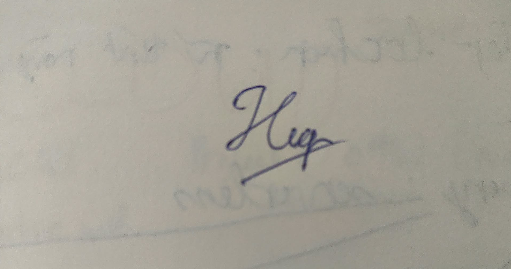

**Khoa Công nghệ Thông tin (FIT) – Trường Đại học Khoa học Tự nhiên (HCMUS)**
**CSC13003 – Kiểm chứng Phần mềm (AI-augmented · 2026)**
**CHÍNH SÁCH AI · BIỂU MẪU — 2026 v1.0**

# Biểu mẫu Khai báo Sử dụng AI

*Đính kèm cho mọi bài tập có dùng AI ở bất kỳ mức nào.*

## 1. Thông tin Môn học & Sinh viên

| Mục | Giá trị |
|---|---|
| Môn học: | CSC13003 – Kiểm chứng Phần mềm |
| Mã bài tập: | HW02-AI |
| Tên bài tập: | Domain Testing on EShop |
| Cấp độ AI (1–5): | Cấp 4 |
| Ngày: | 21/10/2026 |
| Họ tên sinh viên: | Lê Tấn Hiệp |
| MSSV: | 23120255 |

## 2. Câu hỏi Khai báo

### 1. Công cụ AI đã dùng:

- **Claude Sonnet 4.6** – 94 lượt
- **Claude Opus 5.5** – 307 lượt
- **Claude (không rõ model)** – 3 lượt (#118, #272, #387)
- **Claude Haiku 5.5** – 6 lượt
- Tổng 407 lượt theo dòng "Tổng" của `appendix/A_prompt_log.md`; 3 lượt có output từ hơn một model nên được đếm ở cả hai. Danh sách mã `#n` từng model ở dòng đó.
- Trong đó 10 lượt chép tay vào `appendix/prompt_log_extra.toml` (2026-10-19 16:04 – 2026-10-19 17:22; công cụ ghi: Claude Opus 5.5), vì không có trong transcript tự động.
- Các lượt ghi "Claude (không rõ model)" (#118, #272, #387): transcript không ghi model; giữ nguyên theo P3, lý do từng lượt em ghi trong `appendix/prompt_log_notes.toml`.
- Kênh: Claude Code (chạy lệnh, sửa file, commit trong repo) và claude.ai (phiên thảo luận, lập lệnh, review). Không dùng GitHub Copilot, Cursor, Gemini, ChatGPT.

### 2. Giai đoạn nào của bài tập có dùng AI:

[x] brainstorm [x] outline [x] viết nháp [x] phản hồi [x] sửa chữa [x] code [x] phân tích dữ liệu [ ] thiết kế đồ hoạ [x] khác (thiết kế test case theo từng bước, chạy lệnh, gom dữ kiện bug)

Theo section em ghi trong prompt log:

| Section (theo `prompt_log_notes.toml`) | Lượt | Thời gian |
|---|---|---|
| Khởi tạo môi trường & Harness | #1–#16 | 21:20 12/10 – 16:07 19/10 |
| 3.1 A_FR01 Bước 1 – Phân tích biến vào/ra | #17–#20 | 16:10 19/10 – 16:36 19/10 |
| 3.2 A_FR01 Bước 2 – Phân lớp tương đương | #21–#23 | 16:39 19/10 – 16:47 19/10 |
| 3.3 A_FR01 Bước 3 – Sinh test case Domain | #24–#30 | 16:51 19/10 – 17:17 19/10 |
| 3.4 A_FR01 Bước 4 – Sinh test case BVA | #31–#34 | 17:22 19/10 – 17:45 19/10 |
| 3.5 A_FR01 Bước 5 – SV bổ sung TC & AI gap analysis | #35–#43 | 19:14 19/10 – 22:09 19/10 |
| 3.6 A_FR01 Bước 6 – Thực thi kịch bản kiểm thử | #44–#57 | 22:38 19/10 – 23:29 19/10 |
| 3.7 A_FR01 Bước 7 – Báo cáo lỗi (Bug report) | #58–#100 | 23:31 19/10 – 09:18 20/10 |
| 3.8 A_FR01 Tổng kết & Vá Harness | #101–#115 | 09:21 20/10 – 10:08 20/10 |
| 4.1 B_FR07 Bước 1 – Phân tích biến vào/ra & Giả định | #116–#117 | 10:13 20/10 – 10:14 20/10 |
| 4.1 B_FR07 Bước 1 | #118–#118 | 10:14 20/10 – 10:14 20/10 |
| 4.1 B_FR07 Bước 1 – Phân tích biến vào/ra & Giả định | #119–#129 | 10:14 20/10 – 10:33 20/10 |
| 4.3 B_FR07 Bước 3 – Sinh test case Domain | #130–#142 | 10:38 20/10 – 11:09 20/10 |
| 4.5 B_FR07 Bước 5 – SV bổ sung TC & AI gap analysis | #143–#150 | 11:11 20/10 – 12:41 20/10 |
| 4.6 B_FR07 Bước 6 – Thực thi kịch bản kiểm thử | #151–#161 | 12:43 20/10 – 13:23 20/10 |
| 4.7 B_FR07 Bước 7 – Báo cáo lỗi (Bug report) | #162–#209 | 13:29 20/10 – 16:06 20/10 |
| 5.1 C_FR15 Bước 1 – Phân tích biến vào/ra & Giả định | #210–#219 | 16:10 20/10 – 16:35 20/10 |
| 5.2 C_FR15 Bước 2 – Phân lớp tương đương | #220–#225 | 16:40 20/10 – 16:46 20/10 |
| 5.3 C_FR15 Bước 3 – Sinh test case Domain | #226–#228 | 16:52 20/10 – 16:56 20/10 |
| 5.5 C_FR15 Bước 5 – SV bổ sung TC & AI gap analysis | #229–#244 | 16:59 20/10 – 18:05 20/10 |
| 5.6 C_FR15 Bước 6 – Thực thi kịch bản kiểm thử | #245–#254 | 18:06 20/10 – 19:05 20/10 |
| 5.7 C_FR15 Bước 7 – Báo cáo lỗi (Bug report) | #255–#271 | 19:12 20/10 – 20:42 20/10 |
| 5.7 C_FR15 Bước 7 | #272–#272 | 20:44 20/10 – 20:44 20/10 |
| 5.7 C_FR15 Bước 7 – Báo cáo lỗi (Bug report) | #273–#292 | 21:14 20/10 – 22:12 20/10 |
| 6.1 D_FR20 Bước 1 – Phân tích biến vào/ra & Giả định | #293–#299 | 22:16 20/10 – 22:39 20/10 |
| 6.2 D_FR20 Bước 2 – Phân lớp tương đương | #300–#301 | 22:43 20/10 – 22:44 20/10 |
| 6.3 D_FR20 Bước 3 – Sinh test case Domain | #302–#303 | 22:49 20/10 – 22:50 20/10 |
| 6.5 D_FR20 Bước 5 – SV bổ sung TC & AI gap analysis | #304–#316 | 22:53 20/10 – 23:44 20/10 |
| 6.6 D_FR20 Bước 6 – Thực thi kịch bản kiểm thử | #317–#337 | 23:47 20/10 – 02:09 21/10 |
| 6.7 D_FR20 Bước 7 – Báo cáo lỗi (Bug report) | #338–#360 | 02:19 21/10 – 03:49 21/10 |
| Báo cáo HW02 – Điền dữ kiện | #361–#380 | 06:36 21/10 – 07:44 21/10 |
| Báo cáo HW02 – AI Critique & Hoàn thiện | #381–#386 | 07:52 21/10 – 08:12 21/10 |
| Báo cáo HW02 – Hoàn thiện | #387–#387 | 08:13 21/10 – 08:13 21/10 |
| Báo cáo HW02 – AI Critique & Hoàn thiện | #388–#391 | 08:13 21/10 – 08:23 21/10 |
| Báo cáo HW02 – Hoàn thiện | #392–#407 | 08:26 21/10 – 10:30 21/10 |

### 3. Prompt / nhiệm vụ chính cho AI:

*Nguyên văn đầy đủ ở `appendix/A_prompt_log.md` theo mã `#n`.*

1. **#17 – 16:10 19/10/2026 | Claude Opus 5.5 | 3.1 A_FR01 Bước 1 – Phân tích biến vào/ra** — A_FR01 bước 0–1 (gọi skill, giới hạn test basis):

   ```
   /domain-bva-testing HW02/A_FR01 0
   Xong bước 0 thì làm tiếp bước 1 cho cùng feature.
   
   Feature: FR-01 Đăng ký tài khoản (Pool A, HW02).
   Test basis: ../eshop-sut/README.md mục FR-01 (và FR-22 nếu liên quan tới form). SRS là oracle.
   Mã nguồn chỉ dùng để lấy đúng tên nhãn, trường, nút, thông báo, endpoint: ../eshop-sut/frontend-web/src/pages/Register.jsx, route POST /api/register trong ../eshop-sut/backend/server.js.
   Phạm vi tầng: UI + API  
   
   Yêu cầu:
   - Bước 0: tạo HW02/A_FR01/testcases.json. meta.sut_version = "eshop-sut 85af3ba"; meta.references ghi file + dòng đã đọc; tách FR-01 thành các yêu cầu có mã FR-01.1, FR-01.2…
   - Bước 1: domain.variables gồm cả biến đầu vào và biến đầu ra; cột source ghi đúng nơi biến xuất hiện.
   - Chỗ nào SRS không nói rõ thì ghi vào meta.assumptions, không tự quyết ngầm.
   - Chạy: freeze.py --step 1 --note "Claude Code bước 0-1", check_domain.py, render_md.py -o HW02/A_FR01/testcases.md.
   - KHÔNG làm bước 2 trở đi. KHÔNG commit, chờ em review.
   - Kết thúc bằng khối "Báo cáo cho phiên thảo luận".
   ```

2. **#35 – 19:14 19/10/2026 | Claude Opus 5.5 | 3.5 A_FR01 Bước 5 – SV bổ sung TC & AI gap analysis** — A_FR01 bước 5 (hỏi AI vì sao bỏ sót, sau khi em tự thêm case):

   ```
   Chép các case trong HW02/A_FR01/sv_cases.md vào suite TS-SV (mã từ TC-FR01-200, origin "Human"), giữ nguyên ý của em, chỉ chuẩn hoá theo schema (tiêu đề Action+Function+Condition, covers nếu khớp EC có sẵn, nếu không khớp EC nào thì ghi rõ "lớp mới"). Không thêm, bớt hay sửa expected.
      Sau đó, với TỪNG case của em, đối chiếu với các bản đóng băng bước 2–4 trong appendix/ai-outputs/ và trả lời trung thực:
      (a) case này đã có trong bản nháp của AI chưa (ghi mã EC/TC nếu có);
      (b) nếu chưa: AI đã nghĩ tới nhưng không đưa vào output, hay không nghĩ tới;
      (c) nguyên nhân thuộc loại nào: thông tin trong prompt chưa đủ, giới hạn của công cụ, hay độ phức tạp của feature — kèm 1–2 câu giải thích.
      Không đề xuất thêm case mới. Chạy check_domain, render. Commit "HW02[A-FR01] 5/7: đưa case SV vào TS-SV + câu trả lời gap analysis của AI".
      Báo cáo cho phiên thảo luận.
   ```

3. **#31 – 17:22 19/10/2026 | Claude Opus 5.5 | 3.4 A_FR01 Bước 4 – Sinh test case BVA** — A_FR01 bước 4 (BVA):

   ```
   Check giúp mình nhé:
   ### Báo cáo cho phiên thảo luận
   - Nhiệm vụ: (a) vá harness + quyết định dải mã · (b) render lại bước 3 · (d) /domain-bva-testing HW02/A_FR01 4
   - File đã tạo/sửa:
     - (a) .claude/skills/domain-bva-testing/SKILL.md, scripts/render_md.py, CLAUDE.md (dải mã TC)
     - (b) HW02/A_FR01/testcases.md
     - (d) testcases.json (thêm TS-BVA-UI 19 TC: 60–78; TS-BVA-API 19 TC: 79–89 + 100–107; các phần khác không đổi, diff chỉ có dòng thêm) · testcases.md · ai-outputs/A_FR01_step4_20261019-1719.{json,md} + INDEX.md
   - Số TC mỗi suite: TS-DOM-UI 27 · TS-DOM-API 30 · TS-BVA-UI 19 · TS-BVA-API 19 · TS-GUI 5 → tổng 100 (AI 100, Not run 100)
   - Kết quả kiểm tra: check_domain 0 lỗi / 1 cảnh báo (thiếu UB do A4, đã ghi lý do) · 50/50 EC · lint 0 lỗi / 2 cảnh báo (TS-DOM > 25 dòng, đã ghi notes) · test Not run
   - Commit: 1816c8a HW02: vá harness (SKILL.md…; render_md…) · 1e5f539 HW02[A-FR01] 3/7: render lại (bước chi tiết TS-GUI, ghi chú suite) · bước 4: chưa commit (chờ SV review) → dự kiến "HW02[A-FR01] 4/7: Test case BVA"
   - Cần quyết định / câu hỏi:
     1. BVA cho số ký tự mỗi loại (count ≥ 1) có được tính là "lớp có thứ tự" không? Nếu bỏ thì còn 7 điểm/tầng (14 TC).
     2. Điểm LB-1 trùng dữ liệu với case TS-DOM: giữ (bảng BVA đủ điểm) hay thay bằng tham chiếu tới TC của TS-DOM?
     3. Mã TS-BVA-API tràn sang 100–107 theo quy tắc; nếu muốn liền mạch thì chỉ giữ BVA tầng API cho độ dài Mật khẩu.
     4. Trường mới "bva_dimension" (chiều đang xét) không có trong schema của test-case-writing
   … (cắt ở 1500 ký tự; nguyên văn đầy đủ ở #31)
   ```

### 4. Phần cụ thể AI đóng góp:

Harness: `CLAUDE.md`, Agent Skill `domain-bva-testing` (SKILL.md, references, `freeze.py`, `check_domain.py`, `render_md.py`, `merge_results.py`), hook Stop + `tools/extract_prompt_log.py`, `tools/summary.py`, `tools/compress_manual.py`, `tools/export_commit_log.ps1`, `tools/report_tables.py`, `tools/audit_tables.py`. Bản nháp bước 1–4 (biến, lớp, TC Domain, TC BVA) của A_FR01, B_FR07, C_FR15, D_FR20 — đóng băng ở `appendix/ai-outputs/`. Ghi chú bước 1 (`B_FR07/notes_step1.md`, `D_FR20/step1_notes.md`). Câu trả lời gap analysis (`*/ai_gap_answer.md`) và câu hỏi chuẩn hoá case SV (`sv_questions.md`). Khung trống `sv_cases.md`. Script Playwright A/B/C, `RUN.md` B/C/D. Dữ kiện bug `bugs/_groups_*.md`, `D_FR20/compare_web_mobile.md`, khung BUG-xx trống (chỉ dữ kiện), bản che ảnh `bugs/_issue_redacted/`. `report_plan.md`, khung report, khung `README.md`, bảng dữ kiện của report (sinh bằng script), 21 khối 📝 AI nháp giải thích từng bước (§2, x.1–x.4, x.6) và các mục chung 1, 7, 12

**Phần AI KHÔNG đóng góp (em tự làm):** Case TS-SV; mô tả mọi bug (`bugs/BUG-xx.md`, danh sách ở mục 9) và nội dung GitHub Issues; phân tích "vì sao AI bỏ sót" (x.5); AI Critique (mục 11); verdict và lý do Audit (10.2, 10.3, 10.5); điểm tự đánh giá; thuyết minh video demo skill

**Danh mục AI không được làm:** Không viết/nháp mô tả bug (tóm tắt, bước, expected/actual) và nội dung issue; không gợi ý edge case/boundary/security khi em đang tự tìm (bước 5); không viết AI Critique, phân tích gap, verdict Audit, điểm tự chấm; không tạo giọng thuyết minh video, ảnh có username/hostname, chữ ký; không tick mục cam kết cá nhân AI-05; không sửa `appendix/ai-outputs/`; không sửa tay prompt log

### 5. Cách em rà soát / chỉnh sửa / xác minh đầu ra AI:

- Review từng bước 1–4 của mỗi feature và chốt giả định (commit `x/7b`, `x/7c`…, "SV chốt …"); sửa Expected/quy trình trước khi chạy; chạy toàn bộ test trên máy em (Playwright A/B/C, chạy tay D trên Android); chốt verdict cuối theo quy tắc mục 2.6; duyệt dữ kiện bug AI sửa (7/7c); duyệt các khối 📝 AI nháp; Section/Mục đích/Xử lý của prompt log
- Bản nháp AI mỗi bước được đóng băng ở `appendix/ai-outputs/` trước khi em sửa; chạy `check_domain.py` (độ phủ EC), linter `lint_testcases.py`, `render_md.py`.
- Expected đối chiếu SRS; chỗ SRS im lặng ghi giả định và em chốt trước khi dùng.
- Chạy thật toàn bộ test trên máy em (Playwright cho A, B, C; chạy tay trên Android cho D); bug kiểm tái hiện, so UI với API trước khi kết luận.
- Đối chiếu dữ kiện bằng script: `appendix/gap_check.md` (gap analysis ↔ JSON), `appendix/audit_check.md` (Lý do Audit ↔ git), `tools/summary.py` (số liệu report ↔ JSON).
- Cách tạo prompt log: Trích tự động bằng `tools/extract_prompt_log.py` (chạy qua hook Stop `tools/hooks/on_stop.py` sau mỗi lượt), chép nguyên văn prompt/output từ transcript Claude Code và bản tải về của phiên claude.ai, giờ Asia/Saigon, ghi model từng lượt; em tự ghi Section/Mục đích/Xử lý trong `appendix/prompt_log_notes.toml`. Các lượt 'Claude (không rõ model)' theo P3 (số liệu lấy ở lần trích cuối) — giữ nguyên, không vá script; lý do từng lượt em ghi trong `appendix/prompt_log_notes.toml`

### 6. Trích dẫn tool AI sử dụng:

[1] Anthropic. (2026). *Claude Sonnet 4.6* [Large language model]. https://claude.ai

[2] Anthropic. (2026). *Claude Opus 5.5* [Large language model]. https://claude.ai

[3] Anthropic. (2026). *Claude Haiku 5.5* [Large language model]. https://claude.ai

[4] Anthropic. (2026). *Claude Code* [Software]. https://claude.com/claude-code

## 3. Cam đoan Trung thực

*Bằng việc ký tên dưới đây, em cam đoan thông tin khai báo ở trên là chính xác và đầy đủ. Em hiểu rằng việc không khai báo hoặc khai báo sai lệch về việc dùng AI sẽ bị coi là vi phạm liêm chính học thuật và có thể dẫn đến điểm 0 cho bài tập cùng việc bị chuyển lên hội đồng kỷ luật.*

## Chữ ký

| Mục | Giá trị |
|---|---|
| Họ tên sinh viên (in hoa): | LÊ TẤN HIỆP |
| MSSV: | 23120255 |
| Lớp / Khoá: | Software Testing - 23_3 |
| Môn học: | CSC13003 – Kiểm chứng Phần mềm |
| Giảng viên: | Thầy Lâm Quang Vũ, Thầy Trần Duy Hoàng, Cô Trần Thị Bích Hạnh, Thầy Trương Phước Lộc, Thầy Hồ Tuấn Thanh |
| Ngày: | 21/10/2026 |
| Chữ ký: |  |

## Tham khảo

- Kharbach, M. (2026). AI Use Policy Templates for Higher Education. CC BY-NC-SA 4.0.
- ISTQB Foundation Level Syllabus (latest version).
- Hardman, P. (2025). A Post-AI Learning Taxonomy.
- Fuster Rabella, M. (2025). OECD Education Working Paper No. 338.
- Anthropic (2025). Building reliable AI test agents — engineering blog.
