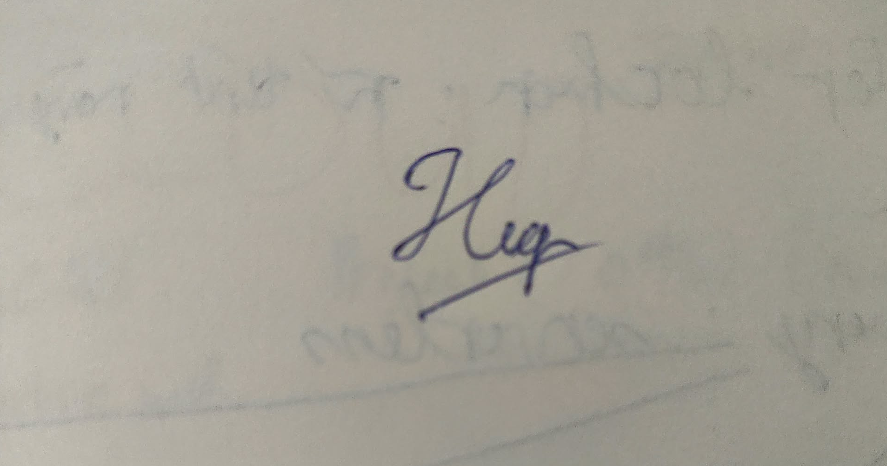

**Khoa Công nghệ Thông tin (FIT) – Trường Đại học Khoa học Tự nhiên (HCMUS)**
**CSC13003 – Kiểm chứng Phần mềm (AI-augmented · 2026)**
**CHÍNH SÁCH AI · BIỂU MẪU — 2026 v1.0**

# Bảng Kiểm Quyền Riêng tư & Sử dụng AI Có Trách nhiệm

**Bài tập:** HW02-AI – Domain Testing on EShop
**Công cụ AI:** Claude Sonnet 4.6 94 lượt; Claude Opus 5.5 303 lượt; Claude (không rõ model) 3 lượt (tổng 397 lượt, khớp AI-03 mục 1) – chi tiết ở AI-03 và `appendix/A_prompt_log.md`

*Chỉ tick mục có bằng chứng trong repo (ghi ở cuối dòng). Mục cam kết cá nhân để trống cho em tự xác nhận.*

## 1. Trước khi dùng AI

- [x] Đã xác nhận Cấp độ AI cho bài tập này. — *report chính, bảng đầu: Cấp 4*
- [x] Dùng tài khoản Claude tự chọn
- [x] Đã đọc Thoả thuận AI của môn học.
- [x] Hiểu rõ artifact nào KHÔNG được sinh bằng AI. — *danh mục cấm ở report §12 và `CLAUDE.md` §3*

## 2. Trong khi dùng AI

- [x] Không nhập dữ liệu cá nhân của bạn, khách hàng, bệnh nhân.
- [x] Không paste nguyên si tài liệu có bản quyền lên AI.
- [x] Không paste code công ty / code open-source giới hạn license.
- [x] Đã ghi mọi prompt + phản hồi AI vào prompt log có timestamp. — *`appendix/A_prompt_log.md` (397 lượt, trích tự động)*

## 3. Trước khi nộp bài

- [x] Mọi artifact AI sinh đã được gắn tag trong AI Audit Report. — *report §10.1–10.3, AI-02*
- [x] Mọi trích dẫn AI đã được xác minh (nguồn thực sự tồn tại).
- [x] Mọi code AI sinh đã được thực thi và test. — *bằng chứng một phần: kết quả lượt chính thức ở `tests/results/`, `D_FR20/results/`*
- [x] AI Critique 200–300 chữ đã có trong báo cáo. — *report §11, đếm script ≈ 287 từ*
- [x] Đoạn Mandatory Disclosure ở cuối báo cáo. — *report §12*
- [x] Đính kèm AI Use Disclosure Form. — *`ai-forms/AI-03_Disclosure_Form_23120255.md`*
- [x] Sẵn sàng cho vấn đáp ngẫu nhiên 5–7 phút tuần kế nộp bài.

## 4. Cam đoan Cuối cùng

*Em xác nhận đã rà soát danh sách trên; các mục chưa tick do em tự xác nhận trước khi ký.*

## Chữ ký

| Mục | Giá trị |
|---|---|
| Họ tên sinh viên (in hoa): | LÊ TẤN HIỆP |
| MSSV: | 23120255 |
| Lớp / Khoá: | Software Testing - 23_3 |
| Môn học: | CSC13003 – Kiểm chứng Phần mềm |
| Giảng viên: | Thầy Lâm Quang Vũ, Thầy Trần Duy Hoàng, Cô Trần Thị Bích Hạnh, Thầy Trương Phước Lộc, Thầy Hồ Tuấn Thanh |
| Ngày: | 21/10/2026 |
| Chữ ký: |  |

## Tham khảo

- Kharbach, M. (2026). AI Use Policy Templates for Higher Education. CC BY-NC-SA 4.0.
- ISTQB Foundation Level Syllabus (latest version).
- Hardman, P. (2025). A Post-AI Learning Taxonomy.
- Fuster Rabella, M. (2025). OECD Education Working Paper No. 338.
- Anthropic (2025). Building reliable AI test agents — engineering blog.
