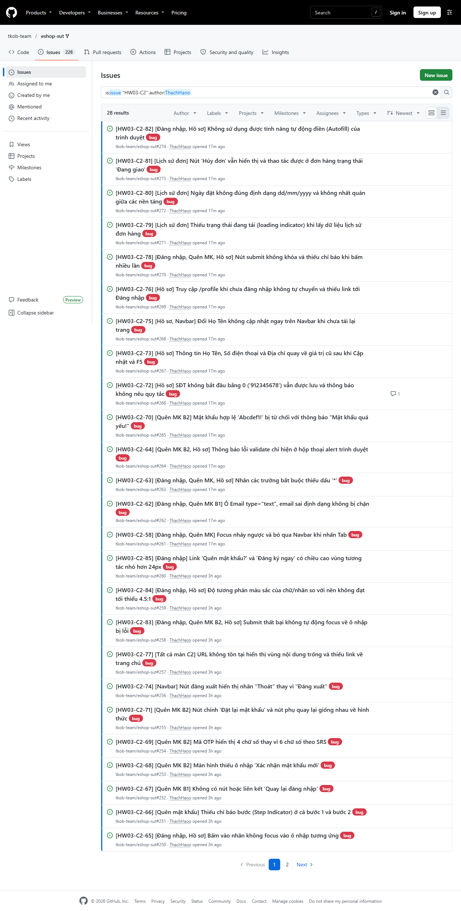
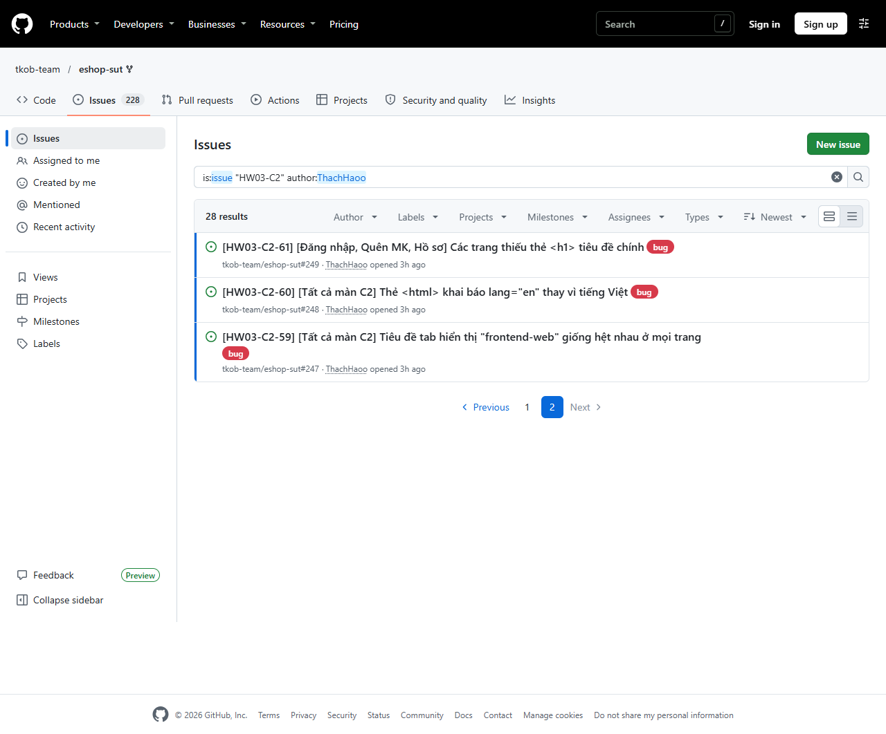

# HW03 – GUI & Usability on EShop

Lê Tấn Hiệp – 23120255 – Software Testing 23_3 · Cấp độ AI: Cấp 4 · Bloom-AI: G9.3 + G9.4

> Quy ước: 📝 = chỗ em viết · 🔒 = phần AI không được viết hộ (em viết toàn bộ).

## Mục lục

📝 (sinh khi hoàn thiện)

## 1. Môi trường và SUT

- SUT: `tkob-team/eshop-sut` @ `de0f48f` (= `85af3ba` + `.gitignore`) · Task 2: nhánh local `usability-tunnel` @ `e33212d` · backend :3000, web :5173 (`--host 127.0.0.1`).
- Nền tảng:
  - P1: Cốc Cốc 160 / Windows 11 (lượt auto tham chiếu Chrome 157, Playwright 1.48.2 – Q1).
  - P2: Firefox 159 / Windows 11 (lượt auto: Firefox 131 của Playwright).
  - P3: Chrome Android 156 / POCO F5 / Android 14 (`adb reverse tcp:5173` + `tcp:3000`).
- Không dùng BrowserStack/LambdaTest (M11): trial 30 phút Live, 1 phút/thiết bị (BrowserStack), phiên 2 phút (LambdaTest/TestMu AI) → không đủ chạy toàn bộ checklist (M2). Đề cho phép thiết bị thật.
- Tài khoản dùng: `test@eshop.com`; backend seed lại mỗi lần khởi động.

## 2. Phạm vi và test basis

### 2.1 Phân chia trong nhóm (M4)

Tấn Hiệp (ThachHaoo): C2 – U1 · Thái Hoà (henry-banana): C1 – U2 · Phúc Hoàng (nphoang-itus): C3 – U3

### 2.2 Ánh xạ IA ↔ FR (M10)

| IA (đề §4) | FR trong SRS `README.md` §8 | Ghi chú |
|---|---|---|
| IA-01 General UI standards | 📝 | |
| IA-02 Forms | 📝 | |
| IA-03 Navigation | 📝 | |
| IA-04 Feedback / state | 📝 | |

### 2.3 Quy ước

- Kết quả item: Passed / Failed / N/A (M3) — 📝 giả định khi dùng N/A.
- Chạy toàn bộ checklist trên mỗi nền tảng (M2).
- Overlay ảnh: email SV + MSSV + họ tên (M1) — 📝 cách làm.

## 3. Task 1 – GUI Checklist (C2 – Tài khoản)

### 3.1 Màn hình trong phạm vi

📝 Đăng nhập, Quên mật khẩu (2 bước), Hồ sơ + Lịch sử đơn/huỷ đơn, navbar khi đã đăng nhập.

### 3.2 Các bước thiết kế với AI

Em dẫn AI (Claude Code, skill `gui-checklist-testing`) qua từng bước, mỗi bước một commit; bản nháp của AI được đóng băng trước khi em sửa. Prompt nguyên văn ở `appendix/A_prompt_log.md`.

| Bước | Commit | AI làm | Em làm | Output |
|---|---|---|---|---|
| 1 – Khảo sát + nháp 3 nguồn | `39f685c` (04/11) | Khảo sát control C2 (`checklist/c2_inventory.md`), nháp 65 item theo SRS / checklist control / heuristic | – | Đóng băng `appendix/ai-outputs/T1_checklist_ai_v1.json` |
| 2 – Review + bổ sung 🔒 | `a8b8560` → `17f747d` (04/11) | Chỉ dựng khung trống `sv_items.md`; sau khi em commit item mới trả lời "vì sao bỏ sót" (`checklist/ai_gap_answer.md`, `de4c69a`) | Review (G1–G4, S, S2 trong `meta.review_log`): sửa ngưỡng, tách CL-17 → CL-66, CL-43 → CL-67, CL-68; thêm SV-01…SV-06 | `checklist.json` v2: 74 item (AI 48, AI + SV sửa 20, SV 6) |
| 3 – RUN.md + Playwright | `07982fc` → `9dfb111` (04–05/11) | Phân loại cách chạy (auto 59, mixed 12, manual 3); test Playwright đọc ngưỡng từ oracle khoá theo sha1(expected); `RUN.md` cho phần chạy tay; thêm project P3 qua `_android` | Chốt ngưỡng màu (H1), tiền điều kiện CL-58/59 (R2) | `tests/`, `checklist/RUN.md`, `dom_probe.js` |
| 4 – Chạy + gộp | `7ba0785` → `3ee3158` (05–10/11), `090cabb` (10/11) | Kiểm ảnh/kết quả (`checklist/run_check.md`), gộp lượt auto + tay theo V1 (`tools/merge_hw03.py`), Excel | Chạy Playwright P1–P3, chạy tay P1–P3 + chụp ảnh overlay; chốt verdict lệch (Q1, Q2, R9, R11) | `checklist.json` có kết quả, `excel/23120255_HW03_Checklist.xlsx` |
| 5 – Gom dữ kiện bug | `0679e25` → `e9a2c85` (10/11) | Danh sách Failed + đối chiếu trùng issue (`bugs/failed_list.md`, `bugs/dup_check.md`), đề xuất nhóm, khung BUG chỉ chép dữ kiện | Chốt trùng, chốt 28 nhóm (G-SV), viết bug 🔒 | `bugs/` |

AI không chấm item chỉ quan sát được bằng mắt, không viết mô tả bug; verdict chính thức lấy từ lượt chạy tay trên trình duyệt/thiết bị thật (V1).

### 3.3 Checklist (> 40 item, đủ IA-01…IA-04)

<!-- REPORT:T1:checklist_table:START -->
| ID | IA | Màn hình | Item | Căn cứ | Loại nguồn | Nguồn | Ưu tiên | P1 | P2 | P3 | Ghi chú |
|---|---|---|---|---|---|---|---|---|---|---|---|
| CL-01 | IA-01 | Tất cả màn C2 | Ngôn ngữ giao diện nhất quán tiếng Việt | FR-21.1 (README.md:244) | SRS | AI | Mandatory | Failed | Failed | Failed | xem 3.6 |
| CL-02 | IA-01 | Đăng nhập, Quên mật khẩu, Hồ sơ | Mỗi trang có đúng 1 thẻ <h1> | FR-21.4 (README.md:247) | SRS | AI | Mandatory | Failed | Failed | Failed | xem 3.6 |
| CL-03 | IA-01 | Đăng nhập | Tiêu đề trang mô tả đúng chức năng Đăng nhập | FR-21.4 (README.md:247); Nielsen #2 (khớp hệ thống – thế gi… | SRS | AI | Mandatory | Failed | Failed | Failed | xem 3.6 |
| CL-04 | IA-01 | Tất cả màn C2 | Nút hành động tích cực màu xanh dương | FR-21.2 (README.md:245) | SRS | AI | Mandatory | Failed | Failed | Failed | xem 3.6 |
| CL-05 | IA-01 | Navbar, Lịch sử đơn | Nút nguy hiểm/huỷ bỏ màu đỏ | FR-21.2 (README.md:245) | SRS | AI | Mandatory | Passed | Passed | Passed |  |
| CL-06 | IA-01 | Quên mật khẩu (bước 2) | Nút chính và nút phụ phân biệt được bằng hình thức | Shneiderman #1 (nhất quán); checklist Button – 'colour sign… | Heuristic | AI | Optional | Failed | Failed | Failed | xem 3.6 |
| CL-07 | IA-01 | Quên mật khẩu (bước 2) | Các nút trên cùng form đồng nhất kích thước và font | Checklist Button – 'All buttons similar size/shape, same fo… | Control | AI + SV sửa | Optional | Passed | Passed | Passed |  |
| CL-08 | IA-01 | Lịch sử đơn | Tổng tiền dùng ký hiệu ₫ và phân cách hàng nghìn | FR-21.3 (README.md:246); FR-11.1 (README.md:167) | SRS | AI | Mandatory | Failed | Failed | Failed | xem 3.6 |
| CL-09 | IA-01 | Lịch sử đơn | Ngày đặt hiển thị nhất quán theo định dạng Việt Nam | Nielsen #4 (nhất quán và chuẩn); SRS im lặng → giả định GA1 | Heuristic | AI | Mandatory | Failed | Failed | Failed | giả định GA1: ngày hiển thị theo chuẩn Việt Nam dd/mm/yyyy, độc lập ngôn ngữ trình duyệt.; xem 3.6 |
| CL-10 | IA-01 | Đăng nhập | Thứ tự Tab theo vị trí hiển thị (trên→dưới, trái→phải) | FR-21.5 (README.md:248) | SRS | AI + SV sửa | Mandatory | Failed | Failed | N/A | N/A: {'P3': 'Giả định NA1: P3 dùng bàn phím ảo cảm ứng…; xem 3.6 |
| CL-11 | IA-01 | Hồ sơ | Thứ tự Tab theo vị trí hiển thị (trên→dưới, trái→phải) | FR-21.5 (README.md:248) | SRS | AI + SV sửa | Mandatory | Passed | Passed | N/A | N/A: {'P3': 'Giả định NA1: P3 dùng bàn phím ảo cảm ứng… |
| CL-12 | IA-01 | Quên mật khẩu (bước 2) | Thứ tự Tab ở bước 2 theo vị trí hiển thị (trên→dưới, trái→phải) | FR-21.5 (README.md:248) | SRS | AI + SV sửa | Mandatory | Failed | Failed | N/A | N/A: {'P3': 'Giả định NA1: P3 dùng bàn phím ảo cảm ứng…; xem 3.6 |
| CL-13 | IA-01 | Tất cả màn C2 | Tiêu đề tab trình duyệt mô tả trang | Nielsen #1 (hiển thị trạng thái hệ thống); WCAG 2.2 SC 2.4.2 | Heuristic | AI + SV sửa | Optional | Failed | Failed | Failed | xem 3.6 |
| CL-14 | IA-01 | Tất cả màn C2 | Khai báo ngôn ngữ trang là tiếng Việt | WCAG 2.2 SC 3.1.1 (Language of Page) | Heuristic | AI | Optional | Failed | Failed | Failed | xem 3.6 |
| CL-15 | IA-01 | Hồ sơ + Lịch sử đơn | Bố cục không vỡ ở màn hình hẹp | Slide 'Broken layout on resize'; Nielsen #8 (thiết kế tối g… | Heuristic | AI | Mandatory | Passed | Passed | Passed |  |
| CL-16 | IA-01 | Navbar | Tên người dùng hiển thị an toàn (không render HTML) | SEC-04 (README.md:281) | SRS | AI | Mandatory | Failed | Failed | Failed | xem 3.6 |
| CL-17 | IA-02 | Đăng nhập, Quên mật khẩu (bước 1) | Ô Email dùng type="email" | FR-02.4 (README.md:44); FR-22.2 (README.md:253) | SRS | AI + SV sửa | Mandatory | Failed | Failed | Failed | xem 3.6 |
| CL-66 | IA-02 | Đăng nhập, Quên mật khẩu (bước 1) | Email sai định dạng bị chặn trước khi gửi | FR-02.4 (README.md:44); FR-22.2 (README.md:253) | SRS | AI + SV sửa | Mandatory | Failed | Failed | Failed | xem 3.6 |
| CL-18 | IA-02 | Đăng nhập | Nhãn ô đăng nhập là 'Email' | FR-02.1 (README.md:40); Nielsen #2 | SRS | AI | Mandatory | Failed | Failed | Failed | xem 3.6 |
| CL-19 | IA-02 | Đăng nhập, Quên mật khẩu (bước 2) | Ô mật khẩu che ký tự | FR-22.3 (README.md:254) | SRS | AI | Mandatory | Failed | Failed | Failed | xem 3.6 |
| CL-20 | IA-02 | Đăng nhập, Quên mật khẩu | Dấu * trên nhãn trường bắt buộc | FR-22.1 (README.md:252); checklist Text box – 'Red asterisk… | SRS | AI | Mandatory | Failed | Failed | Failed | xem 3.6 |
| CL-21 | IA-02 | Hồ sơ | Dấu * trên trường mà form bắt buộc nhập | FR-22.1 (README.md:252) | SRS | AI | Mandatory | Failed | Failed | Failed | xem 3.6 |
| CL-22 | IA-02 | Đăng nhập | Thông báo lỗi đăng nhập nằm phía trên nút submit | FR-22.4 (README.md:255) | SRS | AI | Mandatory | Failed | Failed | Failed | xem 3.6 |
| CL-23 | IA-02 | Quên mật khẩu, Hồ sơ | Thông báo lỗi validate hiển thị trong trang, phía trên nút submit | FR-22.4 (README.md:255); giả định GA3 | SRS | AI + SV sửa | Mandatory | Failed | Failed | Failed | giả định GA3: thông báo lỗi chỉ ở hộp thoại alert() không thoả FR-22.4.; xem 3.6 |
| CL-24 | IA-02 | Quên mật khẩu | Có chỉ báo bước (Step Indicator) | FR-03.3 (README.md:52); FR-22.5 (README.md:256) | SRS | AI | Mandatory | Failed | Failed | Failed | xem 3.6 |
| CL-25 | IA-02 | Quên mật khẩu (bước 1) | Có nút 'Quay lại đăng nhập' | FR-03.4 (README.md:53) | SRS | AI | Mandatory | Failed | Failed | Failed | xem 3.6 |
| CL-26 | IA-02 | Quên mật khẩu (bước 2) | Có ô 'Xác nhận mật khẩu mới' | FR-03.5 (README.md:57) | SRS | AI | Mandatory | Failed | Failed | Failed | xem 3.6 |
| CL-27 | IA-02 | Quên mật khẩu (bước 2) | Hai mật khẩu không khớp bị chặn | FR-03.7 (README.md:59) | SRS | AI | Mandatory | Blocked | Blocked | Blocked | Blocked – notes ở Excel |
| CL-28 | IA-02 | Quên mật khẩu (bước 2) | Mã OTP hiển thị có đúng 6 chữ số | FR-03.2 (README.md:51) | SRS | AI + SV sửa | Mandatory | Failed | Failed | Failed | xem 3.6 |
| CL-29 | IA-02 | Quên mật khẩu (bước 2) | Mật khẩu mới hợp lệ theo FR-01 được chấp nhận | FR-03.6 (README.md:58, 34) | SRS | AI | Mandatory | Failed | Failed | Failed | xem 3.6 |
| CL-30 | IA-02 | Quên mật khẩu (bước 2) | Mật khẩu yếu bị từ chối với thông báo nêu đúng quy tắc | FR-03.6 (README.md:58, 34); Nielsen #9 (giúp nhận biết và k… | SRS | AI | Mandatory | Passed | Passed | Blocked | Blocked – notes ở Excel |
| CL-31 | IA-02 | Hồ sơ | SĐT hợp lệ (bắt đầu 0, 10–11 số) được chấp nhận | FR-04.2 (README.md:65) | SRS | AI | Mandatory | Failed | Failed | Failed | xem 3.6 |
| CL-32 | IA-02 | Hồ sơ | SĐT không hợp lệ bị từ chối, thông báo nêu đúng quy tắc | FR-04.2 (README.md:65); Nielsen #9 | SRS | AI | Mandatory | Failed | Failed | Failed | xem 3.6 |
| CL-33 | IA-02 | Hồ sơ | Email không sửa được và trông như trường bị khoá | FR-04.3 (README.md:66); checklist Text box – 'disabled = gr… | SRS | AI + SV sửa | Mandatory | Passed | Passed | Passed |  |
| CL-34 | IA-02 | Hồ sơ | Họ Tên chỉ gồm khoảng trắng bị từ chối | Checklist Text box – 'Rejects spaces-only' | Control | AI | Optional | Passed | Failed | Passed | xem 3.6 |
| CL-35 | IA-02 | Đăng nhập | Giữ lại Email sau khi đăng nhập thất bại | Shneiderman #8 (giảm tải trí nhớ); Nielsen #5 | Heuristic | AI | Optional | Passed | Passed | Passed |  |
| CL-36 | IA-02 | Đăng nhập | Phím Enter gửi form đăng nhập | Checklist Button – 'One default button fires on Enter' | Control | AI | Optional | Passed | Passed | Passed |  |
| CL-37 | IA-02 | Hồ sơ | Cập nhật hồ sơ được lưu bền | FR-04.1 (README.md:64) | SRS | AI | Mandatory | Failed | Failed | Failed | xem 3.6 |
| CL-38 | IA-02 | Đăng nhập, Hồ sơ | Nhãn gắn với ô nhập (bấm nhãn → focus ô) | Checklist Text box – 'Correct label'; WCAG 2.2 SC 1.3.1 | Control | AI | Optional | Failed | Failed | Failed | xem 3.6 |
| CL-39 | IA-02 | Quên mật khẩu | Quay lại bước 1 vẫn giữ email đã nhập | Shneiderman #8 (giảm tải trí nhớ); Shneiderman #6 (cho phép… | Heuristic | AI | Optional | Passed | Passed | Passed |  |
| CL-40 | IA-03 | Navbar | Navbar highlight trang đang chọn | FR-23.1 (README.md:260) | SRS | AI + SV sửa | Mandatory | Failed | Failed | Failed | xem 3.6 |
| CL-41 | IA-03 | Navbar | Link 'Giỏ hàng' có badge số lượng | FR-23.2 (README.md:261) | SRS | AI + SV sửa | Mandatory | Failed | Failed | Failed | xem 3.6 |
| CL-42 | IA-03 | Navbar | Nút đăng xuất có nhãn 'Đăng xuất' | FR-23.3 (README.md:262) | SRS | AI | Mandatory | Failed | Failed | Failed | xem 3.6 |
| CL-43 | IA-03 | Navbar | Đăng xuất: navbar về trạng thái chưa đăng nhập | FR-02.3 (README.md:43); Norman – Feedback | SRS | AI + SV sửa | Mandatory | Passed | Passed | Passed |  |
| CL-67 | IA-03 | Navbar | Đăng xuất giữ nguyên sau khi tải lại trang | FR-02.3 (README.md:43); Norman – Feedback | SRS | AI + SV sửa | Mandatory | Passed | Passed | Passed |  |
| CL-68 | IA-03 | Navbar | Sau đăng xuất, /profile không hiển thị dữ liệu tài khoản cũ | FR-02.3 (README.md:43); Norman – Feedback | SRS | AI + SV sửa | Mandatory | Passed | Passed | Passed |  |
| CL-44 | IA-03 | Đăng nhập | Đăng nhập thành công rời trang đăng nhập và navbar cập nhật | Shneiderman #4 (hội thoại có điểm kết); Nielsen – response … | Heuristic | AI + SV sửa | Mandatory | Passed | Passed | Passed |  |
| CL-45 | IA-03 | Đăng nhập | Link 'Quên mật khẩu?' tới đúng /forgot-password | Checklist Hyperlink – 'goes to the correct page' | Control | AI + SV sửa | Optional | Passed | Passed | Passed |  |
| CL-46 | IA-03 | Đăng nhập | Link 'Đăng ký ngay' tới trang Đăng ký | Checklist Hyperlink – 'goes to the correct page' | Control | AI | Optional | Passed | Passed | Passed |  |
| CL-47 | IA-03 | Navbar | Logo 'EShop' về trang chủ từ mọi màn C2 | Checklist Hyperlink; Nielsen #3 (người dùng làm chủ, có lối… | Control | AI | Mandatory | Passed | Passed | Passed |  |
| CL-48 | IA-03 | Quên mật khẩu | Đặt lại mật khẩu thành công có lối đi tới đăng nhập | Shneiderman #4 (hội thoại có điểm kết) | Heuristic | AI | Mandatory | Blocked | Blocked | Blocked | Blocked – notes ở Excel |
| CL-49 | IA-03 | Hồ sơ | /profile khi chưa đăng nhập dẫn được tới Đăng nhập | Nielsen #3 (lối thoát); Nielsen #9 | Heuristic | AI | Optional | Failed | Failed | Failed | xem 3.6 |
| CL-50 | IA-03 | Tất cả màn C2 | URL không tồn tại hiển thị trang 404 có lối về | Nielsen #9; Nielsen #3 | Heuristic | AI | Optional | Failed | Failed | Failed | xem 3.6 |
| CL-51 | IA-04 | Đăng nhập | Thông báo đăng nhập sai không lộ nguyên nhân | FR-02.2 (README.md:42) | SRS | AI | Mandatory | Passed | Passed | Passed |  |
| CL-52 | IA-04 | Đăng nhập | Sai 3 lần liên tiếp → khoá 30 giây | FR-02.2 (README.md:42) | SRS | AI | Mandatory | Failed | Failed | Failed | xem 3.6 |
| CL-53 | IA-04 | Đăng nhập | Có chỉ báo đang xử lý và chống gửi trùng | Norman – Feedback; Shneiderman #3 (phản hồi đầy đủ) | Heuristic | AI | Optional | Failed | Failed | Failed | xem 3.6 |
| CL-54 | IA-04 | Quên mật khẩu (bước 2) | OTP hiển thị trên màn hình (môi trường demo) | FR-03.2 (README.md:51) | SRS | AI | Mandatory | Passed | Passed | Passed |  |
| CL-55 | IA-04 | Hồ sơ | Cập nhật thành công có phản hồi rõ ràng | Nielsen #1; Shneiderman #3; Nielsen – response time limits … | Heuristic | AI + SV sửa | Mandatory | Passed | Passed | Passed |  |
| CL-56 | IA-04 | Hồ sơ, Navbar | Đổi Họ Tên cập nhật ngay trên navbar | Nielsen #1 (hiển thị trạng thái hệ thống); Shneiderman #1 | Heuristic | AI | Optional | Failed | Failed | Failed | xem 3.6 |
| CL-57 | IA-04 | Lịch sử đơn | Bảng đơn hiển thị đủ thông tin | FR-11.1 (README.md:167) | SRS | AI | Mandatory | Passed | Passed | Passed |  |
| CL-58 | IA-04 | Lịch sử đơn | Trạng thái tiếng Việt và phân biệt màu | FR-11.2 (README.md:168) | SRS | AI + SV sửa | Mandatory | Passed | Passed | Passed |  |
| CL-59 | IA-04 | Lịch sử đơn | Không cho người dùng huỷ đơn ở trạng thái không được huỷ | FR-10 (README.md:160–161) | SRS | AI + SV sửa | Mandatory | Failed | Failed | Failed | xem 3.6 |
| CL-60 | IA-04 | Lịch sử đơn | Huỷ đơn có hộp xác nhận | Shneiderman #6 (cho phép đảo ngược); checklist Button – 'Un… | Control | AI | Mandatory | Failed | Failed | Failed | xem 3.6 |
| CL-61 | IA-04 | Lịch sử đơn | Sau huỷ, trạng thái cập nhật ngay | Nielsen #1; Shneiderman #3 | Heuristic | AI | Mandatory | Passed | Passed | Passed |  |
| CL-62 | IA-04 | Lịch sử đơn | Empty state có hình minh hoạ và thông báo thân thiện | FR-24.3 (README.md:269) | SRS | AI | Mandatory | Failed | Failed | Failed | xem 3.6 |
| CL-63 | IA-04 | Lịch sử đơn | Có trạng thái đang tải khi lấy lịch sử đơn | Nielsen #1 (hiển thị trạng thái hệ thống) | Heuristic | AI | Optional | Failed | Failed | Failed | xem 3.6 |
| CL-64 | IA-04 | Hồ sơ | Lỗi kết nối khi cập nhật có thông báo dễ hiểu, không mất dữ liệu | Nielsen #9 (giúp nhận biết, chẩn đoán, khắc phục lỗi) | Heuristic | AI | Optional | Blocked | Blocked | Blocked | Blocked – notes ở Excel |
| CL-65 | IA-04 | Tất cả màn C2 | Phiên đăng nhập giữ sau khi tải lại trang | FR-02.3 (README.md:43) | SRS | AI | Mandatory | Passed | Passed | Passed |  |
| SV-01 | IA-01 | Đăng nhập, Quên mật khẩu B1 / B2, Hồ sơ | Hiển thị con trỏ focus (Focus Ring/Indicator) rõ ràng khi duyệt bằng bàn phím | WCAG 2.2 SC 2.4.7 (Focus Visible); Norman #1 (Visibility); … | Heuristic | SV | Mandatory | Passed | Passed | N/A | N/A: {'P3': 'P3 N/A theo NA1'} |
| SV-02 | IA-02 | Đăng nhập, Quên mật khẩu B1 / B2, Hồ sơ | Khả năng tự động điền (Autofill/Autocompletion) và dán (Paste) dữ liệu vào các … | Shneiderman #8 (Giảm tải trí nhớ ngắn hạn); Nielsen #7 (Lin… | Heuristic | SV | Optional | Failed | Failed | Failed | xem 3.6 |
| SV-03 | IA-02 | Đăng nhập, Quên mật khẩu B2, Hồ sơ | Trả lại con trỏ focus về đúng trường nhập liệu bị lỗi sau khi submit thất bại | Slide "Checklist - input-field validation" (Golden Rule: "O… | Control | SV | Optional | Failed | Failed | Failed | xem 3.6 |
| SV-04 | IA-01 | Đăng nhập, Quên mật khẩu B1 / B2, Hồ sơ | Độ tương phản màu sắc của văn bản và nhãn so với nền (Color Contrast Ratio) | WCAG 2.2 SC 1.4.3 (Contrast Minimum) | Heuristic | SV | Optional | Failed | Failed | Failed | xem 3.6 |
| SV-05 | IA-01 | Đăng nhập, Quên mật khẩu B1 / B2, Hồ sơ | Kích thước vùng tương tác của con trỏ (Target Size) đối với các nút và link | WCAG 2.2 SC 2.5.8 (Target Size Minimum - 24x24px) | Heuristic | SV | Mandatory | Failed | Failed | Failed | xem 3.6 |
| SV-06 | IA-04 | Quên mật khẩu B1 / B2, Hồ sơ | Chống gửi trùng dữ liệu (Debounce/Disable) khi nhấp đúp/nhấp liên tiếp vào nút … | Slide "Double-submit on double-click"; Nielsen #5 (Phòng ng… | Heuristic | SV | Mandatory | Failed | Failed | Failed | xem 3.6 |

74 item · IA: IA-01 19, IA-02 26, IA-03 13, IA-04 16 · loại nguồn: SRS 43, Heuristic 22, Control 9 · nguồn: AI 48, AI + SV sửa 20, SV 6. Expected đầy đủ, tiền điều kiện, notes: `checklist/checklist.md` và Excel sheet Checklist. Sinh bằng `tools/report_t1_hw03.py`.
<!-- REPORT:T1:checklist_table:END -->

### 3.4 Item em bổ sung + vì sao AI bỏ sót 🔒

*Các nguyên nhân bỏ sót dưới đây được tổng hợp dựa trên câu trả lời tự đánh giá của AI tại `ai_gap_answer.md` (được em đối chiếu lại với bản nháp `v1`), ngoại trừ mục SV-05 do em tự đánh giá và đối chiếu sau khi điều chỉnh nội dung item.*

- **SV-01 – Hiển thị con trỏ focus (Focus Ring/Indicator) rõ ràng khi duyệt bằng bàn phím:**
  * *Nội dung kiểm tra:* Kiểm tra phần tử đang nhận focus khi bấm phím Tab điều hướng trên các form (Đăng nhập, Quên mật khẩu B1/B2, Hồ sơ) có xuất hiện viền đổi màu hoặc viền bao quanh (focus ring) rõ ràng hay không.
  * *AI có nghĩ ra không:* **Không nghĩ tới** (Nhóm 2). Trong bản nháp v1 của AI, khái niệm "focus" chỉ xuất hiện ở các item kiểm tra thứ tự phím Tab (CL-10, CL-11, CL-12) hoặc hành động nhảy con trỏ gõ văn bản khi bấm vào nhãn (CL-38), hoàn toàn không có item nào kiểm tra sự hiển thị trực quan của viền focus (`focus ring`/`outline`).
  * *Nguyên nhân bỏ sót:* Có thể do prompt ở bước 1 không yêu cầu nguồn tiêu chuẩn khả năng truy cập (Accessibility/WCAG). Đồng thời, tập dữ liệu `c2_inventory.md` lập từ mã nguồn JSX tĩnh không lưu trữ lớp CSS trạng thái focus của từng control, nên AI không có dữ kiện đầu vào để gợi ý khía cạnh thị giác này.

- **SV-02 – Khả năng tự động điền (Autofill/Autocompletion) và dán (Paste) dữ liệu:**
  * *Nội dung kiểm tra:* Kiểm tra các ô nhập liệu dạng văn bản (Email, OTP, Mật khẩu) có cho phép dán dữ liệu từ clipboard (Ctrl+V) và chấp nhận giá trị tự động điền từ trình quản lý mật khẩu/autofill của trình duyệt hay không.
  * *AI có nghĩ ra không:* **Không nghĩ tới** (Nhóm 2). Bản v1 và file inventory hoàn toàn không có dấu vết của các từ khóa "autofill", "autocomplete", "paste" hay "dán".
  * *Nguyên nhân bỏ sót:* Có thể do AI bám sát theo danh sách thuộc tính tĩnh trong slide "Checklist - Text Box" (trạng thái, giới hạn độ dài, lớp ký tự) và prompt lập ra từ mã nguồn. Các hành vi tương tác động do trình duyệt hoặc hệ điều hành cung cấp nằm ngoài mã nguồn SUT nên AI đã bỏ qua.

- **SV-03 – Trả lại con trỏ focus về đúng trường nhập liệu bị lỗi sau khi submit thất bại:**
  * *Nội dung kiểm tra:* Kiểm tra xem sau khi bấm submit form thất bại (do nhập dữ liệu sai quy tắc ở form Hồ sơ hoặc Quên mật khẩu B2) và thông báo lỗi xuất hiện, con trỏ gõ phím (`cursor`) có tự động quay lại focus ở đúng ô bị lỗi hay không.
  * *AI có nghĩ ra không:* **Không nghĩ tới** (Nhóm 2). Mặc dù quy tắc *"Golden Rule: On error, return focus to the offending field"* nằm trong đoạn slide "Checklist - input-field validation" thuộc phạm vi văn bản AI đã đọc ở bước 1/6 (dòng 203), nhưng bản v1 hoàn toàn không sinh ra item nào kiểm tra quy tắc này.
  * *Nguyên nhân bỏ sót:* Có thể do khi khởi tạo checklist v1, AI tập trung ưu tiên phủ các điều khoản SRS theo yêu cầu prompt (với 40/65 item bám SRS) nên chỉ sinh các item kiểm tra vị trí và nội dung hiển thị của thông báo lỗi (bám theo điều khoản FR-22.4) mà bỏ sót quy tắc xử lý con trỏ focus trong slide.

- **SV-04 – Độ tương phản màu sắc của văn bản và nhãn so với màu nền (Color Contrast Ratio):**
  * *Nội dung kiểm tra:* Sử dụng công cụ DevTools Accessibility / Lighthouse để đo tỉ lệ tương phản màu sắc của chữ (nhãn, văn bản, placeholder, chữ trên nút) so với nền, đảm bảo đạt ngưỡng tối thiểu 4.5:1 theo WCAG 2.2 SC 1.4.3.
  * *AI có nghĩ ra không:* **Không nghĩ tới** (Nhóm 2). Bản v1 không xuất hiện các từ khóa "tương phản" hay "contrast". Inventory chỉ ghi tên lớp màu Tailwind dưới dạng thuộc tính tĩnh (`text-yellow-300`) mà không có đánh giá tương phản.
  * *Nguyên nhân bỏ sót:* Có thể do prompt ở bước 1 không yêu cầu tiêu chuẩn Accessibility. Ngoài ra, AI không trực tiếp chạy SUT (do prompt cấm chỉnh Expected theo quan sát thực tế) nên không có giao diện render thực tế để tính toán tỷ lệ tương phản trực quan.

- **SV-05 – Kích thước vùng tương tác của con trỏ (Target Size) đối với nút và liên kết:**
  * *Nội dung kiểm tra:* Kiểm tra chiều cao và chiều rộng vùng nhận tác động con trỏ (chuột hoặc cảm ứng) của các nút bấm và liên kết trên màn hình C2, đảm bảo đạt kích thước tối thiểu 24x24 px theo WCAG 2.2 SC 2.5.8.
  * *AI có nghĩ ra không:* **Không nghĩ tới** (Nhóm 2, em tự đối chiếu). Trong `ai_gap_answer.md`, AI trả lời cho SV-05 bản cũ (*"Bố cục form khi bàn phím ảo hiện trên di động"*). Sau khi em điều chỉnh SV-05 thành *Target Size*, em không hỏi lại AI mà tự đối chiếu lại file `v1` và xác nhận hoàn toàn không xuất hiện các từ khóa hay item nào về "24px", "target size", "vùng bấm" hay đo đạc kích thước phần tử.
  * *Nguyên nhân bỏ sót:* Có thể do AI chỉ quét cấu trúc mã nguồn tĩnh và đọc các thuộc tính CSS mặc định mà không đóng vai trò người dùng tương tác trực tiếp để đo đạc diện tích vùng bấm thực tế theo các tiêu chuẩn khả năng truy cập (Accessibility).

- **SV-06 – Chống gửi trùng dữ liệu (Debounce/Disable) khi nhấp đúp vào nút submit ở điều kiện mạng bình thường:**
  * *Nội dung kiểm tra:* Ở điều kiện mạng bình thường, thực hiện nhấp đúp chuột nhanh vào các nút submit ('Lấy mã OTP', 'Đặt lại mật khẩu', 'Cập nhật'), kiểm tra hệ thống có tự động khóa nút hoặc debounce để chỉ phát sinh đúng 1 request API hay không.
  * *AI có nghĩ ra không:* **Đã nghĩ tới nhưng chưa đưa vào đầy đủ** (Nhóm 1). Ở bản v1, AI đã có item CL-53 kiểm tra chống gửi trùng nhưng chỉ áp dụng cho duy nhất **màn hình Đăng nhập** và đặt trong điều kiện **mạng chậm (Slow 3G)**.
  * *Nguyên nhân bỏ sót:* AI viết CL-53 dựa trên heuristic về phản hồi (Norman Feedback), lấy kịch bản "đang chờ xử lý" khi mạng chậm làm trọng tâm. Ngoài ra, đoạn slide *"Double-submit on double-click"* nằm ngoài đoạn phạm vi slide mà AI được cấp ở lượt prompt 1/6 (AI chỉ đọc các dòng 56–210 và 401–460), có thể dẫn đến việc AI không mở rộng kiểm tra thao tác nhấp đúp nhanh ở điều kiện mạng bình thường cho các form còn lại ngoại trừ Đăng nhập.

### 3.5 Thực thi

<!-- REPORT:T1:execution:START -->
| # | Nền tảng | Lượt | File | Môi trường | Thời gian (lượt tay: nguyên văn file lượt; auto: run_at giờ VN) | Số item lấy kết quả từ lượt này |
|---|---|---|---|---|---|---|
| 1 | P1 | auto (Playwright) | `runs/P1_auto_20261109-2236.json` | Google Chrome đã cài (Playwright channel "chrome") | 22:36 09/11/2026 | 59 |
| 2 | P2 | auto (Playwright) | `runs/P2_auto_20261109-2240.json` | Firefox bản build của Playwright (không phải Firefox đã cài) | 22:40 09/11/2026 | 59 |
| 3 | P3 | auto (Playwright) | `runs/P3_auto_20261109-2244.json` | Chrome Android thật trên POCO F5 (Playwright _android, adb reverse) | 22:44 09/11/2026 | 57 |
| 4 | P1 | tay | `runs/P1_manual_20261109-2257.md` | Cốc Cốc / Phiên bản 160.0.106 (Phiên bản chính thức) (64 bit) · Windows 11 Home / Asus Vivobook X1505VA_A1505VA | 22:58 09/11/2026 - 00:10 10/11/2026 (restart backend: 22:56 09/11/2026) | 15 |
| 5 | P2 | tay | `runs/P2_manual_20261110-0010.md` | Firefox / Version 159.0.1 (64-bit) · Windows 11 Home / Asus Vivobook X1505VA_A1505VA | 00:10 10/11/2026 - 00:38 10/11/2026 (restart backend: 00:08) | 15 |
| 6 | P3 | tay | `runs/P3_manual_20261110-0046.md` | Mozilla/5.0 (Linux; Android 10; K) AppleWebKit/537.36 (KHTML, like Gecko) Chrome/156.0.0.0 Mobile Safari/537.36 · Android 14 / PO… | 00:46 10/11/2026 - 01:54 10/11/2026 (restart backend: 00:44 10/11/2026) | 13 |

Thứ tự: lượt auto P1 → P2 → P3 (lệnh `npm run p1|p2|p3` đã gồm restart backend), sau đó chạy tay P1 → P2 → P3 trên trình duyệt/thiết bị thật, restart backend trước mỗi lượt tay. Thời gian lượt tay chép nguyên văn file lượt; giờ P1 đã sửa theo R4 (mtime ảnh .png gốc, 4/6d). Sinh bằng `tools/report_t1_hw03.py`.
<!-- REPORT:T1:execution:END -->

<!-- REPORT:T1:checklist_summary:START -->
| Chỉ số | P1 – Cốc Cốc (Chromium) trên Windows | P2 – Firefox trên Windows | P3 – Chrome Android (POCO F5, adb reverse) |
|---|---|---|---|
| Item thiết kế | 74 | 74 | 74 |
| Đã chạy (trừ N/A) | 74 | 74 | 70 |
| Passed | 25 | 24 | 22 |
| Failed | 46 | 47 | 44 |
| N/A | 0 | 0 | 4 |
| Blocked | 3 | 3 | 4 |
| Tỉ lệ Passed / đã chạy | 33,8% | 32,4% | 31,4% |
| Kết quả từ lượt tay / lượt auto | 15 / 59 | 15 / 59 | 13 / 57 |

| IA | Số item | Failed P1 | Failed P2 | Failed P3 |
|---|---|---|---|---|
| IA-01 | 19 | 14 | 14 | 12 |
| IA-02 | 26 | 19 | 20 | 19 |
| IA-03 | 13 | 5 | 5 | 5 |
| IA-04 | 16 | 8 | 8 | 8 |

Lượt gộp: `runs/P1_auto_20261109-2236.json`, `runs/P1_manual_20261109-2257.csv`, `runs/P2_auto_20261109-2240.json`, `runs/P2_manual_20261110-0010.csv`, `runs/P3_auto_20261109-2244.json`, `runs/P3_manual_20261110-0046.csv`. Verdict: lượt tay trên trình duyệt thật; item không có trong lượt tay lấy lượt auto (V1, Q1). Sinh bằng `tools/report_t1_hw03.py`.
<!-- REPORT:T1:checklist_summary:END -->

### 3.6 Item Failed (Notes + ảnh)

<!-- REPORT:T1:failed_items:START -->
| ID | Màn hình | Item | Failed trên | Notes (theo nền tảng) | Ảnh | Issue trùng / nhóm bug |
|---|---|---|---|---|---|---|
| CL-01 | Tất cả màn C2 | Ngôn ngữ giao diện nhất quán tiếng Việt | P1, P2, P3 | P1: Tất cả giao diện đều tiếng Việt ngoại trừ ô tên người dùng và button đăng nhập ở giao diện đăng nhập<br>P2: Tất cả giao diện đều tiếng Việt ngoại trừ ô tên người dùng và button đăng nhập ở giao diện đăng nhập<br>P3: Tất cả giao diện đều tiếng Việt ngoại trừ ô tên người dùng và button đăng nhập ở giao diện đăng nhập | `P1_CL-01_1.png`<br>`P1_CL-01_2.png`<br>`P2_CL-01_1.png`<br>`P2_CL-01_2.png`<br>`P3_CL-01_1.png`<br>`P3_CL-01_2.png` | trùng #9 |
| CL-02 | Đăng nhập, Quên mật khẩu, Hồ sơ | Mỗi trang có đúng 1 thẻ <h1> | P1, P2, P3 | P1 (auto): /login: có 0 thẻ <h1> · /forgot-password: có 0 thẻ <h1> · /profile: có 0 thẻ <h1> · /login: 0 h1 · /forgot-password: 0 h1 · /profile: 0 h1<br>P2 (auto): /login: có 0 thẻ <h1> · /forgot-password: có 0 thẻ <h1> · /profile: có 0 thẻ <h1> · /login: 0 h1 · /forgot-password: 0 h1 · /profile: 0 h1<br>P3 (auto): /login: có 0 thẻ <h1> · /forgot-password: có 0 thẻ <h1> · /profile: có 0 thẻ <h1> · /login: 0 h1 · /forgot-password: 0 h1 · /profile: 0 h1 | `P1_CL-02_1.png`<br>`P2_CL-02_1.png`<br>`P3_CL-02_1.png` | G-04 → BUG-61 |
| CL-03 | Đăng nhập | Tiêu đề trang mô tả đúng chức năng Đăng nhập | P1, P2, P3 | P1 (auto): tiêu đề là "Đăng Ký" · tiêu đề chính: "Đăng Ký"<br>P2 (auto): tiêu đề là "Đăng Ký" · tiêu đề chính: "Đăng Ký"<br>P3 (auto): tiêu đề là "Đăng Ký" · tiêu đề chính: "Đăng Ký" | `P1_CL-03_1.png`<br>`P1_CL-03_2.png`<br>`P2_CL-03_1.png`<br>`P2_CL-03_2.png`<br>`P3_CL-03_1.png`<br>`P3_CL-03_2.png` | trùng #9 |
| CL-04 | Tất cả màn C2 | Nút hành động tích cực màu xanh dương | P1, P2, P3 | P1 (auto): nút Đặt lại mật khẩu màu rgb(22, 163, 74) · {"Đăng nhập":"rgb(37, 99, 235)","Lấy mã OTP":"rgb(37, 99, 235)","Đặt lại mật khẩu":"rgb(22, 163…<br>P2 (auto): nút Đặt lại mật khẩu màu rgb(22, 163, 74) · {"Đăng nhập":"rgb(37, 99, 235)","Lấy mã OTP":"rgb(37, 99, 235)","Đặt lại mật khẩu":"rgb(22, 163…<br>P3 (auto): nút Đặt lại mật khẩu màu rgb(22, 163, 74) · {"Đăng nhập":"rgb(37, 99, 235)","Lấy mã OTP":"rgb(37, 99, 235)","Đặt lại mật khẩu":"rgb(22, 163… | `P1_CL-04_1.png`<br>`P2_CL-04_1.png`<br>`P3_CL-04_1.png` | trùng #160 |
| CL-06 | Quên mật khẩu (bước 2) | Nút chính và nút phụ phân biệt được bằng hình thức | P1, P2, P3 | P1: Nút chính và nút phụ giống nhau<br>P2: Nút chính và nút phụ giống nhau<br>P3: Nút chính và nút phụ giống nhau | `P1_CL-06_1.png`<br>`P2_CL-06_1.png`<br>`P3_CL-06_1.png` | G-14 → BUG-71 |
| CL-08 | Lịch sử đơn | Tổng tiền dùng ký hiệu ₫ và phân cách hàng nghìn | P1, P2, P3 | P1: [SV chốt R9=b: Expected "cùng một kiểu phân cách trên cả 3 nền tảng" áp cho cả P1; P1 hiện "30.000.000 ₫", P2/P3 hiện "6,000,000 ₫" → kiểu …<br>P2: Có sử dụng ký hiệu nhưng phân cách hàng nghìn lại dùng ','<br>P3: Có sử dụng ký hiệu nhưng phân cách hàng nghìn lại dùng ',' | `P1_CL-08_1.png`<br>`P2_CL-08_1.png`<br>`P3_CL-08_1.png` | trùng #170 (BUG-24) |
| CL-09 | Lịch sử đơn | Ngày đặt hiển thị nhất quán theo định dạng Việt Nam | P1, P2, P3 | P1: [SV chốt R11=b: Expected "dd/mm/yyyy và giống nhau trên P1, P2, P3" áp cho cả P1; ảnh P1_CL-09_1 hiện "9/11/2026" (ngày 1 chữ số, không phả…<br>P2: Sử dụng định dạng mm/dd/yyyy thay vì dd/mm/yyyy của người Việt<br>P3: Sử dụng định dạng mm/dd/yyyy thay vì dd/mm/yyyy của người Việt | `P1_CL-09_1.png`<br>`P2_CL-09_1.png`<br>`P3_CL-09_1.png` | G-23 → BUG-80 |
| CL-10 | Đăng nhập | Thứ tự Tab theo vị trí hiển thị (trên→dưới, trái→phải) | P1, P2 | P1 (auto): nhảy ngược: 'Sign In'(449,425) → 'EShop'(16,16) · chuỗi Tab: button'Sign In'@(449,425) → a'EShop'@(16,16) → a'Giỏ hàng'@(1032,20) → a'Đăng …<br>P2 (auto): nhảy ngược: 'Sign In'(449,425) → 'EShop'(16,16) · chuỗi Tab: button'Sign In'@(449,425) → a'EShop'@(16,16) → a'Giỏ hàng'@(1032,20) → a'Đăng … | `P1_CL-10_1.png`<br>`P2_CL-10_1.png` | G-01 → BUG-58 |
| CL-12 | Quên mật khẩu (bước 2) | Thứ tự Tab ở bước 2 theo vị trí hiển thị (trên→dưới, trái→phải) | P1, P2 | P1 (auto): bỏ qua: a'EShop'@(16,16) → a'Giỏ hàng'@(1032,20) → a'Đăng nhập'@(1112,20) → a'Đăng ký'@(1206,20) · chuỗi Tab: input'text'@(449,301) → input…<br>P2 (auto): bỏ qua: a'EShop'@(16,16) → a'Giỏ hàng'@(1032,20) → a'Đăng nhập'@(1112,20) → a'Đăng ký'@(1206,20) · chuỗi Tab: input'text'@(449,301) → input… | `P1_CL-12_1.png`<br>`P2_CL-12_1.png` | G-01 → BUG-58 |
| CL-13 | Tất cả màn C2 | Tiêu đề tab trình duyệt mô tả trang | P1, P2, P3 | P1 (auto): title "frontend-web" không chứa tên ứng dụng/tên trang · title "frontend-web" không chứa tên ứng dụng/tên trang · title "frontend-web" khôn…<br>P2 (auto): title "frontend-web" không chứa tên ứng dụng/tên trang · title "frontend-web" không chứa tên ứng dụng/tên trang · title "frontend-web" khôn…<br>P3 (auto): title "frontend-web" không chứa tên ứng dụng/tên trang · title "frontend-web" không chứa tên ứng dụng/tên trang · title "frontend-web" khôn… | `P1_CL-13_1.png`<br>`P2_CL-13_1.png`<br>`P3_CL-13_1.png` | G-02 → BUG-59 |
| CL-14 | Tất cả màn C2 | Khai báo ngôn ngữ trang là tiếng Việt | P1, P2, P3 | P1 (auto): lang = "en" · <html lang="en"><br>P2 (auto): lang = "en" · <html lang="en"><br>P3 (auto): lang = "en" · <html lang="en"> | `P1_CL-14_1.png`<br>`P2_CL-14_1.png`<br>`P3_CL-14_1.png` | G-03 → BUG-60 |
| CL-16 | Navbar | Tên người dùng hiển thị an toàn (không render HTML) | P1, P2, P3 | P1 (auto): chuỗi HTML bị render (mất dấu < >) · navbar: "Chào, Test"; số thẻ <b>: 1<br>P2 (auto): chuỗi HTML bị render (mất dấu < >) · navbar: "Chào, Test"; số thẻ <b>: 1<br>P3 (auto): chuỗi HTML bị render (mất dấu < >) · navbar: "Chào, Test"; số thẻ <b>: 1 | `P1_CL-16_1.png`<br>`P1_CL-16_2.png`<br>`P2_CL-16_1.png`<br>`P2_CL-16_2.png`<br>`P3_CL-16_1.png`<br>`P3_CL-16_2.png` | trùng #122 |
| CL-17 | Đăng nhập, Quên mật khẩu (bước 1) | Ô Email dùng type="email" | P1, P2, P3 | P1 (auto): /login ô Email type="text" · /forgot-password ô Email type="text" · /login: type="text"; /forgot-password bước 1: type="text"<br>P2 (auto): /login ô Email type="text" · /forgot-password ô Email type="text" · /login: type="text"; /forgot-password bước 1: type="text"<br>P3 (auto): /login ô Email type="text" · /forgot-password ô Email type="text" · /login: type="text"; /forgot-password bước 1: type="text" | `P1_CL-17_1.png`<br>`P2_CL-17_1.png`<br>`P3_CL-17_1.png` | trùng một phần #4 + MỚI; G-05 → BUG-62 |
| CL-66 | Đăng nhập, Quên mật khẩu (bước 1) | Email sai định dạng bị chặn trước khi gửi | P1, P2, P3 | P1 (auto): /login: form gửi 1 request /api/login · /login: không có thông báo validate · /forgot-password: form gửi 1 request /api/forgot-password · /…<br>P2 (auto): /login: form gửi 1 request /api/login · /login: không có thông báo validate · /forgot-password: form gửi 1 request /api/forgot-password · /…<br>P3 (auto): /login: form gửi 1 request /api/login · /login: không có thông báo validate · /forgot-password: form gửi 1 request /api/forgot-password · /… | `P1_CL-66_1.png`<br>`P2_CL-66_1.png`<br>`P3_CL-66_1.png` | trùng một phần #4 + MỚI; G-05 → BUG-62 |
| CL-18 | Đăng nhập | Nhãn ô đăng nhập là 'Email' | P1, P2, P3 | P1 (auto): nhãn là "Username" · nhãn ô thứ nhất: "Username"<br>P2 (auto): nhãn là "Username" · nhãn ô thứ nhất: "Username"<br>P3 (auto): nhãn là "Username" · nhãn ô thứ nhất: "Username" | `P1_CL-18_1.png`<br>`P2_CL-18_1.png`<br>`P3_CL-18_1.png` | trùng #9 |
| CL-19 | Đăng nhập, Quên mật khẩu (bước 2) | Ô mật khẩu che ký tự | P1, P2, P3 | P1 (auto): /login ô Mật khẩu type="text" · /login ô Mật khẩu type="text" · bước 2 "Mật khẩu mới": type="password"<br>P2 (auto): /login ô Mật khẩu type="text" · /login ô Mật khẩu type="text" · bước 2 "Mật khẩu mới": type="password"<br>P3 (auto): /login ô Mật khẩu type="text" · /login ô Mật khẩu type="text" · bước 2 "Mật khẩu mới": type="password" | `P1_CL-19_1.png`<br>`P2_CL-19_1.png`<br>`P3_CL-19_1.png` | trùng #5 |
| CL-20 | Đăng nhập, Quên mật khẩu | Dấu * trên nhãn trường bắt buộc | P1, P2, P3 | P1 (auto): /login: nhãn "Username" thiếu '*' · /login: nhãn "Mật khẩu" thiếu '*' · bước 1: nhãn "Nhập Email của bạn" thiếu '*' · bước 2: nhãn "Mã OTP …<br>P2 (auto): /login: nhãn "Username" thiếu '*' · /login: nhãn "Mật khẩu" thiếu '*' · bước 1: nhãn "Nhập Email của bạn" thiếu '*' · bước 2: nhãn "Mã OTP …<br>P3 (auto): /login: nhãn "Username" thiếu '*' · /login: nhãn "Mật khẩu" thiếu '*' · bước 1: nhãn "Nhập Email của bạn" thiếu '*' · bước 2: nhãn "Mã OTP … | `P1_CL-20_1.png`<br>`P2_CL-20_1.png`<br>`P3_CL-20_1.png` | trùng một phần #7 + MỚI; G-06 → BUG-63 |
| CL-21 | Hồ sơ | Dấu * trên trường mà form bắt buộc nhập | P1, P2, P3 | P1 (auto): "Họ Tên" bị chặn khi trống nhưng nhãn không có '*' · "Số điện thoại" bị chặn khi trống nhưng nhãn không có '*' · "Địa chỉ giao hàng" bị chặ…<br>P2 (auto): "Họ Tên" bị chặn khi trống nhưng nhãn không có '*' · "Số điện thoại" bị chặn khi trống nhưng nhãn không có '*' · "Địa chỉ giao hàng" bị chặ…<br>P3 (auto): "Họ Tên" bị chặn khi trống nhưng nhãn không có '*' · "Số điện thoại" bị chặn khi trống nhưng nhãn không có '*' · "Địa chỉ giao hàng" bị chặ… | `P1_CL-21_1.png`<br>`P2_CL-21_1.png`<br>`P3_CL-21_1.png` | G-06 → BUG-63 |
| CL-22 | Đăng nhập | Thông báo lỗi đăng nhập nằm phía trên nút submit | P1, P2, P3 | P1 (auto): thông báo "Đăng nhập thất bại. Vui lòng kiểm tra lại." nằm dưới nút submit · chữ mới: ["Đăng nhập thất bại. Vui lòng kiểm tra lại."]; hộp t…<br>P2 (auto): thông báo "Đăng nhập thất bại. Vui lòng kiểm tra lại." nằm dưới nút submit · chữ mới: ["Đăng nhập thất bại. Vui lòng kiểm tra lại."]; hộp t…<br>P3 (auto): thông báo "Đăng nhập thất bại. Vui lòng kiểm tra lại." nằm dưới nút submit · chữ mới: ["Đăng nhập thất bại. Vui lòng kiểm tra lại."]; hộp t… | `P1_CL-22_1.png`<br>`P1_CL-22_2.png`<br>`P2_CL-22_1.png`<br>`P2_CL-22_2.png`<br>`P3_CL-22_1.png`<br>`P3_CL-22_2.png` | trùng #6 |
| CL-23 | Quên mật khẩu, Hồ sơ | Thông báo lỗi validate hiển thị trong trang, phía trên nút submit | P1, P2, P3 | P1 (auto): bước 2 mật khẩu yếu: lỗi chỉ ở hộp thoại hoặc không có (GA3) · Hồ sơ SĐT sai: lỗi chỉ ở hộp thoại hoặc không có (GA3) · bước 2 mật khẩu yếu…<br>P2 (auto): bước 2 mật khẩu yếu: lỗi chỉ ở hộp thoại hoặc không có (GA3) · Hồ sơ SĐT sai: lỗi chỉ ở hộp thoại hoặc không có (GA3) · Protocol error (Bro…<br>P3 (auto): bước 2 mật khẩu yếu: lỗi chỉ ở hộp thoại hoặc không có (GA3) · Hồ sơ SĐT sai: lỗi chỉ ở hộp thoại hoặc không có (GA3) · bước 2 mật khẩu yếu… | `P1_CL-23_1.png`<br>`P2_CL-23_1.png`<br>`P3_CL-23_1.png` | G-07 → BUG-64 |
| CL-24 | Quên mật khẩu | Có chỉ báo bước (Step Indicator) | P1, P2, P3 | P1: Không có chỉ báo bước<br>P2: Không có chỉ báo bước<br>P3: Không có chỉ báo bước | `P1_CL-24_1.png`<br>`P2_CL-24_1.png`<br>`P3_CL-24_1.png` | G-09 → BUG-66 |
| CL-25 | Quên mật khẩu (bước 1) | Có nút 'Quay lại đăng nhập' | P1, P2, P3 | P1 (auto): bước 1 không có "Quay lại đăng nhập" · bước 1 có "Quay lại đăng nhập": false<br>P2 (auto): bước 1 không có "Quay lại đăng nhập" · bước 1 có "Quay lại đăng nhập": false<br>P3 (auto): bước 1 không có "Quay lại đăng nhập" · bước 1 có "Quay lại đăng nhập": false | `P1_CL-25_1.png`<br>`P2_CL-25_1.png`<br>`P3_CL-25_1.png` | G-10 → BUG-67 |
| CL-26 | Quên mật khẩu (bước 2) | Có ô 'Xác nhận mật khẩu mới' | P1, P2, P3 | P1 (auto): không có ô Xác nhận mật khẩu mới · bước 2: 2 ô – ["Mã OTP (4 số)","Mật khẩu mới"]<br>P2 (auto): không có ô Xác nhận mật khẩu mới · bước 2: 2 ô – ["Mã OTP (4 số)","Mật khẩu mới"]<br>P3 (auto): không có ô Xác nhận mật khẩu mới · bước 2: 2 ô – ["Mã OTP (4 số)","Mật khẩu mới"] | `P1_CL-26_1.png`<br>`P2_CL-26_1.png`<br>`P3_CL-26_1.png` | MỚI (liên quan #30 (BUG-14)); G-11 → BUG-68 |
| CL-28 | Quên mật khẩu (bước 2) | Mã OTP hiển thị có đúng 6 chữ số | P1, P2, P3 | P1 (auto): mã có 4 chữ số · mã hiển thị: 1846<br>P2 (auto): mã có 4 chữ số · mã hiển thị: 9894<br>P3 (auto): mã có 4 chữ số · mã hiển thị: 8382 | `P1_CL-28_1.png`<br>`P1_CL-28_2.png`<br>`P2_CL-28_1.png`<br>`P2_CL-28_2.png`<br>`P3_CL-28_1.png`<br>`P3_CL-28_2.png` | G-12 → BUG-69 |
| CL-29 | Quên mật khẩu (bước 2) | Mật khẩu mới hợp lệ theo FR-01 được chấp nhận | P1, P2, P3 | P1 (auto): mật khẩu "Abcdef1!" không được chấp nhận · đăng nhập bằng "Abcdef1!": false; thông báo: ["Mật khẩu quá yếu! Phải dài tối thiểu 8 ký tự, gồm…<br>P2 (auto): mật khẩu "Abcdef1!" không được chấp nhận · đăng nhập bằng "Abcdef1!": false; thông báo: ["Mật khẩu quá yếu! Phải dài tối thiểu 8 ký tự, gồm…<br>P3 (auto): mật khẩu "Abcdef1!" không được chấp nhận · đăng nhập bằng "Abcdef1!": false; thông báo: ["Mật khẩu quá yếu! Phải dài tối thiểu 8 ký tự, gồm… | `P1_CL-29_1.png`<br>`P2_CL-29_1.png`<br>`P3_CL-29_1.png` | MỚI (liên quan #17 (BUG-01)); G-13 → BUG-70 |
| CL-31 | Hồ sơ | SĐT hợp lệ (bắt đầu 0, 10–11 số) được chấp nhận | P1, P2, P3 | P1 (auto): 0912345678 không được lưu (sau F5: "") · 09123456789 không được lưu (sau F5: "") · nhập 0912345678 → sau F5: "" · nhập 09123456789 → sau F5…<br>P2 (auto): 0912345678 không được lưu (sau F5: "") · 09123456789 không được lưu (sau F5: "") · nhập 0912345678 → sau F5: "" · nhập 09123456789 → sau F5…<br>P3 (auto): 0912345678 không được lưu (sau F5: "") · 09123456789 không được lưu (sau F5: "") · nhập 0912345678 → sau F5: "" · nhập 09123456789 → sau F5… | `P1_CL-31_1.png`<br>`P2_CL-31_1.png`<br>`P3_CL-31_1.png` | trùng #111, #112 |
| CL-32 | Hồ sơ | SĐT không hợp lệ bị từ chối, thông báo nêu đúng quy tắc | P1, P2, P3 | P1 (auto): 912345678 được lưu · thông báo không nêu: 0, 10, 11 · thông báo: "Cập nhật thành công!"; sau F5: "912345678"<br>P2 (auto): 912345678 được lưu · thông báo không nêu: 0, 10, 11 · thông báo: "Cập nhật thành công!"; sau F5: "912345678"<br>P3 (auto): 912345678 được lưu · thông báo không nêu: 0, 10, 11 · thông báo: "Cập nhật thành công!"; sau F5: "912345678" | `P1_CL-32_1.png`<br>`P2_CL-32_1.png`<br>`P3_CL-32_1.png` | trùng một phần #97, #113 + MỚI; G-15 → BUG-72 |
| CL-34 | Hồ sơ | Họ Tên chỉ gồm khoảng trắng bị từ chối | P2 | P2 (auto): Họ Tên được lưu thành "" · thông báo: ["Số điện thoại không hợp lệ. Vui lòng nhập đúng 9-10 chữ số."]; Họ Tên sau F5: "" · [chỉ Firefox Pla… | `P2_CL-34_1.png` | loại khỏi lập bug (5/6a); không lập bug (5/6a) |
| CL-37 | Hồ sơ | Cập nhật hồ sơ được lưu bền | P1, P2, P3 | P1 (auto): có trường quay về giá trị cũ · sau F5: ["Test User","",""]<br>P2 (auto): có trường quay về giá trị cũ · sau F5: ["Test User","",""]<br>P3 (auto): có trường quay về giá trị cũ · sau F5: ["Test User","",""] | `P1_CL-37_1.png`<br>`P2_CL-37_1.png`<br>`P3_CL-37_1.png` | MỚI (liên quan #111, #123); G-16 → BUG-73 |
| CL-38 | Đăng nhập, Hồ sơ | Nhãn gắn với ô nhập (bấm nhãn → focus ô) | P1, P2, P3 | P1 (auto): /login: bấm nhãn "Username" không focus ô · /login: bấm nhãn "Mật khẩu" không focus ô · /profile: bấm nhãn "Họ Tên" không focus ô · /profil…<br>P2 (auto): /login: bấm nhãn "Username" không focus ô · /login: bấm nhãn "Mật khẩu" không focus ô · /profile: bấm nhãn "Họ Tên" không focus ô · /profil…<br>P3 (auto): /login: bấm nhãn "Username" không focus ô · /login: bấm nhãn "Mật khẩu" không focus ô · /profile: bấm nhãn "Họ Tên" không focus ô · /profil… | `P1_CL-38_1.png`<br>`P2_CL-38_1.png`<br>`P3_CL-38_1.png` | G-08 → BUG-65 |
| CL-40 | Navbar | Navbar highlight trang đang chọn | P1, P2, P3 | P1 (auto): kiểu link không đổi theo trang hiện tại · link hồ sơ ở /profile {"color":"rgb(253, 224, 71)","background-color":"rgba(0, 0, 0, 0)","text-de…<br>P2 (auto): kiểu link không đổi theo trang hiện tại · link hồ sơ ở /profile {"color":"rgb(253, 224, 71)","background-color":"rgba(0, 0, 0, 0)","text-de…<br>P3 (auto): kiểu link không đổi theo trang hiện tại · link hồ sơ ở /profile {"color":"rgb(253, 224, 71)","background-color":"rgba(0, 0, 0, 0)","text-de… | `P1_CL-40_1.png`<br>`P2_CL-40_1.png`<br>`P3_CL-40_1.png` | trùng #169 (BUG-23) |
| CL-41 | Navbar | Link 'Giỏ hàng' có badge số lượng | P1, P2, P3 | P1 (auto): không có badge số > 0 · link Giỏ hàng: "Giỏ hàng"<br>P2 (auto): không có badge số > 0 · link Giỏ hàng: "Giỏ hàng"<br>P3 (auto): không có badge số > 0 · link Giỏ hàng: "Giỏ hàng" | `P1_CL-41_1.png`<br>`P1_CL-41_2.png`<br>`P2_CL-41_1.png`<br>`P2_CL-41_2.png`<br>`P3_CL-41_1.png`<br>`P3_CL-41_2.png` | trùng #166 (BUG-20) |
| CL-42 | Navbar | Nút đăng xuất có nhãn 'Đăng xuất' | P1, P2, P3 | P1 (auto): nhãn là "Thoát" · nhãn nút: "Thoát"<br>P2 (auto): nhãn là "Thoát" · nhãn nút: "Thoát"<br>P3 (auto): nhãn là "Thoát" · nhãn nút: "Thoát" | `P1_CL-42_1.png`<br>`P2_CL-42_1.png`<br>`P3_CL-42_1.png` | G-17 → BUG-74 |
| CL-49 | Hồ sơ | /profile khi chưa đăng nhập dẫn được tới Đăng nhập | P1, P2, P3 | P1 (auto): không tự chuyển và không có link/nút tới Đăng nhập · URL: /profile; link/nút tới Đăng nhập trong trang: 0<br>P2 (auto): không tự chuyển và không có link/nút tới Đăng nhập · URL: /profile; link/nút tới Đăng nhập trong trang: 0<br>P3 (auto): không tự chuyển và không có link/nút tới Đăng nhập · URL: /profile; link/nút tới Đăng nhập trong trang: 0 | `P1_CL-49_1.png`<br>`P1_CL-49_2.png`<br>`P2_CL-49_1.png`<br>`P2_CL-49_2.png`<br>`P3_CL-49_1.png`<br>`P3_CL-49_2.png` | G-19 → BUG-76 |
| CL-50 | Tất cả màn C2 | URL không tồn tại hiển thị trang 404 có lối về | P1, P2, P3 | P1 (auto): không có thông báo không tìm thấy · không có link về trang chủ trong trang · nội dung main: ""; link về '/': 0<br>P2 (auto): không có thông báo không tìm thấy · không có link về trang chủ trong trang · nội dung main: ""; link về '/': 0<br>P3 (auto): không có thông báo không tìm thấy · không có link về trang chủ trong trang · nội dung main: ""; link về '/': 0 | `P1_CL-50_1.png`<br>`P1_CL-50_2.png`<br>`P2_CL-50_1.png`<br>`P2_CL-50_2.png`<br>`P3_CL-50_1.png`<br>`P3_CL-50_2.png` | G-20 → BUG-77 |
| CL-52 | Đăng nhập | Sai 3 lần liên tiếp → khoá 30 giây | P1, P2, P3 | P1: Không hề gửi thông báo, check request thì lần thì đã bị chặn, tức là chặn sau 2 lần sai<br>P2: Không hề gửi thông báo, check request thì lần thì đã bị chặn, tức là chặn sau 2 lần sai<br>P3: Không hề gửi thông báo, check request thì lần thì đã bị chặn, tức là chặn sau 2 lần sai · [thiếu ảnh (ảnh P3_CL-52_1 chỉ thấy "Đăng nhập th… | `P1_CL-52_1.png`<br>`P1_CL-52_2.png`<br>`P2_CL-52_1.png`<br>`P3_CL-52_1.png` | trùng #1, #2, #3 |
| CL-53 | Đăng nhập | Có chỉ báo đang xử lý và chống gửi trùng | P1, P2, P3 | P1: Không có đang xử lý và chống gửi trùng<br>P2: Không có đang xử lý và chống gửi trùng<br>P3: Không có đang xử lý và chống gửi trùng | `P1_CL-53_1.png`<br>`P2_CL-53_1.png`<br>`P3_CL-53_1.png` | G-21 → BUG-78 |
| CL-56 | Hồ sơ, Navbar | Đổi Họ Tên cập nhật ngay trên navbar | P1, P2, P3 | P1 (auto): navbar vẫn tên cũ khi chưa tải lại · navbar sau 3000 ms (không tải lại): "EShop / Giỏ hàng / Chào, Test User / Thoát"<br>P2 (auto): navbar vẫn tên cũ khi chưa tải lại · navbar sau 3000 ms (không tải lại): "EShop / Giỏ hàng / Chào, Test User / Thoát"<br>P3 (auto): navbar vẫn tên cũ khi chưa tải lại · navbar sau 3000 ms (không tải lại): "EShop / Giỏ hàng / Chào, Test User / Thoát" | `P1_CL-56_1.png`<br>`P2_CL-56_1.png`<br>`P3_CL-56_1.png` | G-18 → BUG-75 |
| CL-59 | Lịch sử đơn | Không cho người dùng huỷ đơn ở trạng thái không được huỷ | P1, P2, P3 | P1 (auto): shipping: nút "Hủy đơn" dùng được · pending (#8): nút "Hủy đơn" dùng được = true · confirmed (#9): nút "Hủy đơn" dùng được = true · shippin…<br>P2 (auto): shipping: nút "Hủy đơn" dùng được · pending (#8): nút "Hủy đơn" dùng được = true · confirmed (#9): nút "Hủy đơn" dùng được = true · shippin…<br>P3 (auto): shipping: nút "Hủy đơn" dùng được · pending (#8): nút "Hủy đơn" dùng được = true · confirmed (#9): nút "Hủy đơn" dùng được = true · shippin… | `P1_CL-59_1.png`<br>`P1_CL-59_2.png`<br>`P2_CL-59_1.png`<br>`P2_CL-59_2.png`<br>`P3_CL-59_1.png`<br>`P3_CL-59_2.png` | G-24 → BUG-81 |
| CL-60 | Lịch sử đơn | Huỷ đơn có hộp xác nhận | P1, P2, P3 | P1 (auto): không có hộp xác nhận · đơn bị huỷ ngay (trạng thái canceled) · hộp thoại: ["alert: Hủy đơn thành công!"]; trạng thái đơn sau khi chọn "khô…<br>P2 (auto): không có hộp xác nhận · đơn bị huỷ ngay (trạng thái canceled) · hộp thoại: ["alert: Hủy đơn thành công!"]; trạng thái đơn sau khi chọn "khô…<br>P3 (auto): không có hộp xác nhận · đơn bị huỷ ngay (trạng thái canceled) · hộp thoại: ["alert: Hủy đơn thành công!"]; trạng thái đơn sau khi chọn "khô… | `P1_CL-60_1.png`<br>`P2_CL-60_1.png`<br>`P3_CL-60_1.png` | trùng #165 (BUG-19) |
| CL-62 | Lịch sử đơn | Empty state có hình minh hoạ và thông báo thân thiện | P1, P2, P3 | P1: Mặc dù có thông báo thân thiện nhưng không có img/svg/icon<br>P2: Mặc dù có thông báo thân thiện nhưng không có img/svg/icon<br>P3: Mặc dù có thông báo thân thiện nhưng không có img/svg/icon | `P1_CL-62_1.png`<br>`P2_CL-62_1.png`<br>`P3_CL-62_1.png` | trùng #167 (BUG-21) |
| CL-63 | Lịch sử đơn | Có trạng thái đang tải khi lấy lịch sử đơn | P1, P2, P3 | P1: Không có trạng thái đang tải<br>P2: Không có trạng thái đang tải, trang tải xong là tất cả dữ liệu cũng xong hết (không giống Chrome khi tải từng phần)<br>P3: Không có trạng thái đang tải, trang tải xong là tất cả dữ liệu cũng xong hết (không giống Chrome khi tải từng phần) | `P1_CL-63_1.png`<br>`P1_CL-63_2.png`<br>`P2_CL-63_1.png`<br>`P3_CL-63_1.png`<br>`P3_CL-63_2.png` | G-22 → BUG-79 |
| SV-02 | Đăng nhập, Quên mật khẩu B1 / B2, Hồ sơ | Khả năng tự động điền (Autofill/Autocompletion) và dán (Paste) dữ liệ… | P1, P2, P3 | P1: Tất cả đều có thể Paste vào, nhưng Autofill chỉ có ở Forgot Password.<br>P2: Tất cả đều có thể Paste vào, nhưng không thể Autofill<br>P3: Tất cả đều có thể Paste vào, nhưng không thể Autofill | `P1_SV-02_1.png`<br>`P1_SV-02_2.png`<br>`P2_SV-02_1.png`<br>`P2_SV-02_2.png`<br>`P3_SV-02_1.png`<br>`P3_SV-02_2.png` | G-25 → BUG-82 |
| SV-03 | Đăng nhập, Quên mật khẩu B2, Hồ sơ | Trả lại con trỏ focus về đúng trường nhập liệu bị lỗi sau khi submit … | P1, P2, P3 | P1 (auto): Đăng nhập: focus không về ô Mật khẩu · Quên mật khẩu B2: focus không về ô Mật khẩu mới · Hồ sơ: focus không về ô Số điện thoại · focus về ô…<br>P2 (auto): Đăng nhập: focus không về ô Mật khẩu · Quên mật khẩu B2: focus không về ô Mật khẩu mới · Hồ sơ: focus không về ô Số điện thoại · focus về ô…<br>P3 (auto): Đăng nhập: focus không về ô Mật khẩu · Quên mật khẩu B2: focus không về ô Mật khẩu mới · Hồ sơ: focus không về ô Số điện thoại · focus về ô… | `P1_SV-03_1.png`<br>`P2_SV-03_1.png`<br>`P3_SV-03_1.png` | G-26 → BUG-83 |
| SV-04 | Đăng nhập, Quên mật khẩu B1 / B2, Hồ sơ | Độ tương phản màu sắc của văn bản và nhãn so với nền (Color Contrast … | P1, P2, P3 | P1: Quên mật khẩu đạt nhưng mà Đăng nhập và Hồ sơ thì không<br>P2: Quên mật khẩu đạt nhưng mà Đăng nhập và Hồ sơ thì không<br>P3: Quên mật khẩu đạt nhưng mà Đăng nhập và Hồ sơ thì không | `P1_SV-04_1.png`<br>`P1_SV-04_2.png`<br>`P2_SV-04_1.png`<br>`P2_SV-04_2.png`<br>`P3_SV-04_1.png`<br>`P3_SV-04_2.png` | G-27 → BUG-84 |
| SV-05 | Đăng nhập, Quên mật khẩu B1 / B2, Hồ sơ | Kích thước vùng tương tác của con trỏ (Target Size) đối với các nút v… | P1, P2, P3 | P1 (auto): Quên mật khẩu? < 24×24 px · Đăng ký ngay < 24×24 px · Sign In: 382×40 · Quên mật khẩu?: 102×19 · Đăng ký ngay: 85×19 · Lấy mã OTP: 382×40 ·…<br>P2 (auto): Quên mật khẩu? < 24×24 px · Đăng ký ngay < 24×24 px · Sign In: 382×40 · Quên mật khẩu?: 102×19 · Đăng ký ngay: 85×19 · Lấy mã OTP: 382×40 ·…<br>P3 (auto): Quên mật khẩu? < 24×24 px · Đăng ký ngay < 24×24 px · Sign In: 295×40 · Quên mật khẩu?: 100×16 · Đăng ký ngay: 82×16 · Lấy mã OTP: 295×40 ·… | `P1_SV-05_1.png`<br>`P2_SV-05_1.png`<br>`P3_SV-05_1.png` | G-28 → BUG-85 |
| SV-06 | Quên mật khẩu B1 / B2, Hồ sơ | Chống gửi trùng dữ liệu (Debounce/Disable) khi nhấp đúp/nhấp liên tiế… | P1, P2, P3 | P1 (auto): Lấy mã OTP: 2 request · Đặt lại mật khẩu: 0 request, 2 hộp thoại · Cập nhật: 0 request PUT, 2 hộp thoại · Lấy mã OTP: 2 request · Đặt lại m…<br>P2 (auto): Lấy mã OTP: 2 request · Đặt lại mật khẩu: 0 request, 2 hộp thoại · Cập nhật: 0 request PUT, 2 hộp thoại · Lấy mã OTP: 2 request · Đặt lại m…<br>P3 (auto): Lấy mã OTP: 2 request · Lỗi: TimeoutError: locator.dblclick: Timeout 30000ms exceeded. · Lấy mã OTP: 2 request | `P1_SV-06_1.png`<br>`P2_SV-06_1.png`<br>`P3_SV-06_1.png` | G-21 → BUG-78 |

47 item Failed trên ít nhất 1 nền tảng. Notes chép từ lượt chạy (auto: số đo Playwright). Ảnh: `checklist/evidence/<Px>_*/` (lượt tay), `checklist/evidence/auto/` (lượt auto); bảng này hiện tối đa 2 ảnh/nền tảng. Đối chiếu trùng đầy đủ: `bugs/failed_list.md`, `bugs/dup_check.md`; nhóm bug: `bugs/bug_groups.md`. Sinh bằng `tools/report_t1_hw03.py`.
<!-- REPORT:T1:failed_items:END -->

## 4. Task 3 – Cross-Browser / Cross-Platform

### 4.1 Ma trận kết quả theo nền tảng

📝

<!-- REPORT:T1:cross_platform:START -->
**Item có kết quả khác nhau giữa các nền tảng**

| Item | Mục kiểm tra | P1 | P2 | P3 | Ghi chú (notes theo nền tảng) |
|---|---|---|---|---|---|
| CL-30 | Mật khẩu yếu bị từ chối với thông báo nêu đúng quy tắc | Passed | Passed | Blocked | P3 (auto): Lỗi: TimeoutError: locator.click: Timeout 30000ms exceeded. · [Blocked (T-P3): Playwright… |
| CL-34 | Họ Tên chỉ gồm khoảng trắng bị từ chối | Passed | Failed | Passed | P2 (auto): Họ Tên được lưu thành "" · thông báo: ["Số điện thoại không hợp lệ. Vui lòng nhập đúng 9-… |

**Lệch lượt auto ↔ lượt tay (cùng item, cùng nền tảng) – lấy lượt tay (V1)**

| Item | Nền tảng | Auto | Tay | Nguyên nhân lệch |
|---|---|---|---|---|
| CL-08 | P1 | Passed | Failed | auto chấm riêng từng nền tảng (P1 thấy "6.000.000 ₫", đạt ngưỡng ký hiệu + phân cách); Failed do so kiểu phân cách giữa P1/P2/P3 theo R9=b (override) |
| CL-08 | P2 | Passed | Failed | auto ép locale vi-VN (playwright.config) nên hiện "6.000.000 ₫"; trình duyệt thật của SV theo locale máy hiện "6,000,000 ₫" |
| CL-08 | P3 | Passed | Failed | auto ép locale vi-VN (playwright.config) nên hiện "6.000.000 ₫"; trình duyệt thật của SV theo locale máy hiện "6,000,000 ₫" |
| CL-11 | P1 | Failed | Passed | auto so toạ độ, bố cục 2 cột nên 'Cập nhật' → 'Hủy đơn' bị tính là nhảy ngược; SV đọc chuỗi Tab theo cột/hàng |
| CL-11 | P2 | Failed | Passed | auto so toạ độ, bố cục 2 cột nên 'Cập nhật' → 'Hủy đơn' bị tính là nhảy ngược; SV đọc chuỗi Tab theo cột/hàng |
| CL-15 | P1 | Failed | Passed | auto đo ở viewport 375 px: scrollWidth 381 > 375; lượt tay không đo ở đúng 375 px (ảnh chụp cửa sổ hẹp, không thấy thanh cuộn) |
| CL-15 | P2 | Failed | Passed | auto đo ở viewport 375 px: scrollWidth 382 > 375; lượt tay không đo ở đúng 375 px (ảnh chụp cửa sổ hẹp, không thấy thanh cuộn) |
| SV-02 | P1 | Passed | Failed | auto chỉ kiểm vế dán (Ctrl+V); vế autofill kiểm tay |
<!-- REPORT:T1:cross_platform:END -->

### 4.2 Khác biệt giữa các nền tảng

Phần lớn lỗi giống nhau trên cả 3 nền tảng: 44 item Failed trên cả P1, P2, P3 (bảng 3.6), tức là lỗi nằm ở chính giao diện web chứ không do trình duyệt. Khác biệt em ghi nhận:

- **Định dạng tiền (CL-08) và ngày (CL-09) theo locale của trình duyệt.** Lượt tay: P1 (Cốc Cốc) hiện "30.000.000 ₫" và "9/11/2026"; P2 (Firefox) và P3 (Chrome Android) hiện "6,000,000 ₫" và "11/9/2026". Lượt auto ép `locale: 'vi-VN'` thì cả 3 nền tảng đều ra "6.000.000 ₫", "9/11/2026". Hai item Failed trên cả 3 nền tảng vì Expected yêu cầu giống nhau giữa các nền tảng (em chốt R9, R11 cho P1).
- **CL-34 (Họ Tên chỉ khoảng trắng):** chỉ Failed ở P2, và chỉ ở Firefox bản build của Playwright; chưa xác nhận trên Firefox thật nên không lập bug (5/6a).
- **CL-30 trên P3:** Blocked do Playwright `TimeoutError`, không có assertion nào fail (T-P3); P1, P2 Passed.
- **P3 không có phím Tab:** CL-10, CL-11, CL-12, SV-01 là N/A trên P3 (giả định NA1). CL-10 và CL-12 Failed trên P1, P2.
- **Lệch giữa lượt auto và lượt tay trên cùng nền tảng** (bảng 4.1, lấy lượt tay): CL-11 (bố cục 2 cột làm phép so toạ độ của auto tính là nhảy ngược), CL-15 (auto đo ở viewport 375 px thấy thanh cuộn ngang, lượt tay không đo đúng 375 px), SV-02 (auto chỉ kiểm vế dán), CL-08 P1 (auto chấm riêng từng nền tảng).
- **Môi trường:** P1 chính thức là Cốc Cốc 160 (nhân Chromium) thay cho Chrome; 59 item auto của P1 lấy từ Chrome 157 qua Playwright (Q1, Q1-auto). P3 chạy trên điện thoại thật qua `adb reverse`, không dùng giả lập.

### 4.3 Ảnh có overlay

<!-- REPORT:T1:overlay:START -->
| Nền tảng | Thư mục | Ảnh item (lượt tay) | Ảnh tổng quan màn |
|---|---|---|---|
| P1 – Cốc Cốc (Chromium) trên Windows | `checklist/evidence/P1_chrome/` | 29 | 5 |
| P2 – Firefox trên Windows | `checklist/evidence/P2_firefox/` | 27 | 5 |
| P3 – Chrome Android (POCO F5, adb reverse) | `checklist/evidence/P3_android/` | 23 | 5 |

**Ảnh tổng quan Task 3 (mỗi màn × nền tảng)**

| Màn | P1 | P2 | P3 |
|---|---|---|---|
| M1 – Đăng nhập | `P1_M1_1` | `P2_M1_1` | `P3_M1_1` |
| M2 – Quên mật khẩu (B1, B2) | `P1_M2_1`, `P1_M2_2` | `P2_M2_1`, `P2_M2_2` | `P3_M2_1`, `P3_M2_2` |
| M3 – Hồ sơ | `P1_M3_1` | `P2_M3_1` | `P3_M3_1` |
| M4 – Lịch sử đơn | `P1_M4_1` | `P2_M4_1` | `P3_M4_1` (lịch sử đơn trống lúc chụp) |
| M5 – Navbar khi đã đăng nhập | dùng lại `P1_M4_1` | dùng lại `P2_M4_1` | dùng lại `P3_M3_1` |

Overlay (O2): `23120255 - Lê Tấn Hiệp - 23120255@student.hcmus.edu.vn`; P1/P2 bằng Sticky Notes trên ảnh chụp toàn màn hình (thấy tên trình duyệt + URL), P3 thêm chữ bằng trình sửa ảnh ngay sau khi chụp. Ảnh lượt auto (`evidence/auto/`, ảnh phần tử Playwright chụp) không có overlay, chỉ là bằng chứng phụ. Sinh bằng `tools/report_t1_hw03.py`.
<!-- REPORT:T1:overlay:END -->

## 5. Task 2 – Usability Evaluation (U1)

### 5.1 Phase 1 – Mục tiêu

Giai đoạn đầu của đợt đánh giá khả năng sử dụng (Usability Evaluation - U1) tập trung xác định rõ các mục tiêu cốt lõi và câu hỏi nghiên cứu dựa trên kế hoạch 9 phần (`usability/plan.md`):

* **Mục đích:** Đánh giá khả năng tự thao tác của người dùng cuối trong lần đầu trải nghiệm hệ thống thương mại điện tử (EShop web) để thực hiện thành công luồng mua sắm chính: đăng nhập tài khoản, tìm kiếm sản phẩm, thêm vào giỏ hàng, áp dụng mã giảm giá (voucher), tiến hành thanh toán và tự kiểm tra lại trạng thái đơn hàng vừa đặt trong hồ sơ cá nhân. Đồng thời, qua đó phát hiện các điểm nghẽn trải nghiệm (UX bottlenecks) và lỗi logic trên luồng nghiệp vụ này.
* **Câu hỏi cần trả lời (Problem Statements):**
  1. Người dùng có tìm kiếm và lựa chọn sản phẩm nhanh chóng không (mất bao lâu)?
  2. Từ giỏ hàng đến màn hình thanh toán, người dùng có nhận biết rõ bước đi tiếp theo hay gặp vướng mắc, do dự ở đâu?
  3. Người dùng có tìm thấy ô nhập mã giảm giá và hiểu rõ cách tính toán số tiền sau giảm không?
  4. Sau khi đặt hàng thành công, người dùng có dễ dàng tìm lại lịch sử đơn hàng và hiểu đúng trạng thái đơn không?
  5. Khi gặp sự cố hoặc thao tác nhầm, người dùng có khả năng tự khôi phục lỗi không, kết hợp đo lường mức độ hài lòng và độ tin cậy thông qua thang điểm SEQ, SUS và các câu hỏi mở?
* **Mục tiêu nhiệm vụ và tiêu chí thành công:** Người dùng hoàn thành việc mua sắm 1 chiếc tai nghe chống ồn, áp dụng mã giảm giá hợp lệ (`VIP100`) và xác thực trạng thái ghi nhận đơn hàng trong lịch sử cá nhân trong mốc thời gian benchmark dưới 6 phút mà không cần sự trợ giúp từ người điều phối.

Kế hoạch 9 phần: `usability/plan.md` (mục 1 Mục đích, mục 2 Câu hỏi cần trả lời, mục 3 Mục tiêu và nhiệm vụ).

### 5.2 Kịch bản nhiệm vụ

U1: đăng nhập (tài khoản cho sẵn) → tìm SP → thêm giỏ → thanh toán có mã giảm giá (`VIP100`, K1) → xem đơn trong Hồ sơ. Mốc thời gian chuẩn 06:00 (`sus_score.py --benchmark`).

Nhiệm vụ dạng mục tiêu: `usability/plan.md` mục 3, `usability/participant_kit.md` (mục Nhiệm vụ).

### 5.3 Công cụ: thang đo + câu hỏi probe

SEQ (1–7) + SUS (10 câu, 0–100) (`usability/plan.md` mục 8) · 4 câu hỏi mở: Rõ ràng, Khôi phục lỗi, Tốc độ, Tin cậy. Thu qua Google Form (CSV trả lời không commit – có họ tên/SĐT).

Phiếu cho người tham gia (SEQ, SUS 10 câu, 4 câu hỏi mở): `usability/participant_kit.md`; phiếu quan sát của người điều phối: `usability/observation_sheet.md`; đo lường: `usability/plan.md` mục 8.

### 5.4 Người tham gia 🔒

| Mã phiên | Người tham gia | Lĩnh vực chuyên môn | Nhóm hồ sơ | Zalo / SĐT liên hệ (đã che 4 số giữa) | Thiết bị & Trình duyệt | Đồng ý TA liên hệ |
| :---: | :---: | :---: | :---: | :---: | :---: | :---: |
| **S01** | P01 | Software Engineer (SWE) | IT | `091****280` | Brave / Windows 11 | Có |
| **S02** | P02 | Data Engineer (DE) | IT | `035****689` | Chrome / Linux | Có |
| **S03** | P03 | Vật lý học | Non-IT | `079****218` | Edge / Windows 10 | Có |
| **S04** | P04 | Tự động hoá | Non-IT | `091****230` | Cốc Cốc / Windows 11 | Có |
| **S05** | P05 | Dược | Non-IT | `097****074` | Safari / MacOS | Có |
| **S06** | P06 | Thực phẩm | Non-IT | `036****273` | Cốc Cốc / Windows 11 | Có |
| **S07** | P07 | IT | IT | `086****517` | Chrome / Windows 11 | Không |

### 5.5 Pilot và điều chỉnh

- **S00 = pilot** (P00, phiên đầu tiên, 10/11/2026), không tính vào thống kê; phiếu `usability/sessions/S00.json` (`"pilot": true`).
- Sau pilot **giữ nguyên kịch bản nhiệm vụ**; từ S01 người điều phối bổ sung **"hỏi lại ngay khi nhận xét mơ hồ"** (SV chốt 11/11).
- S01–S07 = 7 phiên chính.

### 5.6 Phase 2 – Tiến hành phiên

- Hình thức: từ xa qua Google Meet, người tham gia chia sẻ màn hình, think-aloud; ngày 10–11/11/2026.
- Mỗi phiên: `tools/usability_session.ps1` restart backend (CSDL seed lại) → Vite → cloudflared tunnel, link mới cho từng phiên; `reset_du_lieu = true` ở cả 8 phiếu.
- Kịch bản: `usability/moderator_script.md` (mục C–I); phiếu: `usability/sessions/S00…S07.json`, ghi chú tay `usability/sessions/notes/`.
- Đồng ý (Google Form, M7): quay màn hình 8/8, ghi âm 8/8, để trợ giảng liên hệ xác nhận 7/8 (S07 không đồng ý).
- Nền tảng người tham gia: Brave, Chrome (Windows 11, Linux), Edge (Windows 10), Cốc Cốc ×2, Safari (macOS) – cột `nen_tang` từng phiếu.

<!-- REPORT:U1:usability_sessions:START -->
| Phiên | Người TG | Nhóm | Kết quả | Thời gian | Lỗi (L) | Do dự (D) | Trợ giúp | SEQ (1–7) | SUS (0–100) |
|---|---|---|---|---|---|---|---|---|---|
| S01 | P01 | – | Hoàn thành, không trợ giúp | 06:27 | 0 | 0 | 0 | 6 | 55,0 |
| S02 | P02 | – | Hoàn thành, không trợ giúp | 03:10 | 0 | 0 | 0 | 7 | 90,0 |
| S03 | P03 | – | Hoàn thành, không trợ giúp | 05:12 | 0 | 0 | 0 | 7 | 97,5 |
| S04 | P04 | – | Hoàn thành, không trợ giúp | 10:35 | 0 | 0 | 0 | 4 | 52,5 |
| S05 | P05 | – | Hoàn thành, không trợ giúp | 02:30 | 0 | 0 | 0 | 7 | 90,0 |
| S06 | P06 | – | Hoàn thành, không trợ giúp | 02:15 | 0 | 0 | 0 | 6 | 75,0 |
| S07 | P07 | – | Hoàn thành, không trợ giúp | 02:02 | 0 | 0 | 0 | 7 | 85,0 |
<!-- REPORT:U1:usability_sessions:END -->

### 5.7 Phase 3 – Kết quả SUS / UEQ-S

📝

<!-- REPORT:U1:usability_summary:START -->
| Chỉ số | Giá trị |
|---|---|
| Số phiên chính tính được | 7 / 7 dự kiến |
| SUS: trung bình ± SD | 77,9 ± 17,8 |
| SUS: median · min – max | 85,0 · 52,5 – 97,5 |
| SEQ: trung bình ± SD | 6,3 ± 1,1 |
| SEQ: median · min – max | 7,0 · 4 – 7 |
| Hoàn thành, không trợ giúp | 7/7 (100%) |
| Hoàn thành, có trợ giúp | 0/7 (0%) |
| Không hoàn thành | 0/7 (0%) |
| Tỉ lệ hoàn thành (bất kể trợ giúp) | 7/7 (100%) |
| Hoàn thành trong benchmark 06:00 | 5/7 (71%) |
| Thời gian (phiên hoàn thành): trung bình ± SD | 04:36 ± 03:07 |
| Thời gian: median · khoảng | 03:10 · 02:02 – 10:35 |
| Lỗi / do dự / trợ giúp trung bình mỗi phiên | 0,00 / 0,00 / 0,00 |

SUS: câu lẻ (x − 1), câu chẵn (5 − x), tổng × 2,5. SD = độ lệch chuẩn mẫu (n − 1). Pilot không tính. Sinh bằng `sus_score.py`.
<!-- REPORT:U1:usability_summary:END -->

### 5.8 Tổng hợp pain point (lỗi riêng lẻ ↔ vấn đề thiết kế hệ thống) 🔒

| Nhóm pain point | Phiên gặp (S0x) | Bằng chứng (câu nói / sự kiện) | Lỗi riêng lẻ hay vấn đề thiết kế | Liên quan bug/issue |
|---|---|---|---|---|
| **Cho phép tự điều chỉnh tổng tiền thanh toán** | S01, S04 | • S01: *"Mình tự giảm số tiền khi checkout... Đã giảm tổng giá trị xuống 300000"*<br>• S04: *"Ủa, sao tổng tiền thanh toán có thể điều chỉnh được... Trả 100000 thôi được không, ok thanh toán thành công luôn"* | **Vấn đề thiết kế hệ thống & Lỗ hổng bảo mật logic** (API `/api/checkout` đọc trực tiếp `total_amount` từ body request thay vì Server tự tính toán lại dựa trên cơ sở dữ liệu). | Trùng #13; liên quan #10 |
| **Nút "Thêm vào giỏ" ở trang danh sách không hoạt động & thiếu UI Feedback** | S01, S04, S05 | • S01: *"Thêm giỏ hàng ở detail thì được, còn ở list thì không được"*<br>• S04: *"Có vẻ như nút thêm vào giỏ chả làm gì cả (ở list, trang chủ)... bấm không có tín hiệu gì"*<br>• S05: *"Khi ấn thêm vào giỏ thì phải hiện thông báo... hiển thị số 1 ở giỏ hàng"* | **Vấn đề thiết kế giao diện & Lỗi xử lý state/event ở Client** (Thiếu phản hồi trạng thái Toast/Badge + lỗi xử lý sự kiện click trên nút giỏ hàng ở trang danh sách). | Trùng #162 (BUG-16); liên quan #166, #161 |
| **Bỏ qua kiểm tra thông tin giao hàng & Quy trình thanh toán bị ngược** | S04, S07 | • S04: *"Thanh toán đơn hàng rồi mới nhập số điện thoại và địa chỉ giao hàng à"*<br>• S07: *"Không cần nhập địa chỉ, số điện thoại vẫn đặt được đơn... Tên cũng không cần đổi vẫn đặt được"* | **Vấn đề thiết kế quy trình nghiệp vụ (Workflow)** (Đặt bước thanh toán trước bước nhập địa chỉ và thiếu Validation ràng buộc Form giao hàng). | Một phần #65; chưa có issue riêng |
| **Tạo trùng đơn hàng khi thao tác (Duplicate submission)** | S07 | • S07: *"Bấm 1 đơn thành 2 đơn."* | **Lỗi xử lý sự kiện riêng lẻ** (Chưa khống chế lượt bấm liên tục - `(chưa kiểm chứng)`). | Chưa xác định. Nếu S07 nói 2 dòng trong giỏ: trùng #163; 2 đơn hàng: chưa có issue |
| **Bối rối về luồng dữ liệu khi thêm vào giỏ hàng lúc chưa đăng nhập** | S04 | • S04: *"Ý là mình thậm chí còn chưa đăng nhập vào nữa sao có thể thêm vào giỏ hàng. Là mình thêm vào giỏ hàng nào á."* | **Vấn đề thiết kế quản lý phiên người dùng (Session Management)** (Không làm rõ trạng thái giỏ hàng tạm/khách vô danh). | Liên quan #242, #69; chưa có issue riêng |
| **Khó tìm vị trí theo dõi đơn hàng sau khi thanh toán** | S02, S04 | • S02: *"Ủa kiểm tra đơn hàng ở đâu vậy"*<br>• S04: *"xem đơn hàng đã được ghi nhận chưa... Là mình về trang chủ và sau đó... chỉ xem được giỏ hàng thôi. À đây đây (ở profile)"* | **Vấn đề thiết kế điều hướng (Navigation hierarchy)** (Lối vào lịch sử đơn hàng nằm sâu trong trang Profile, thiếu liên kết truy cập nhanh - `(chưa kiểm chứng)`). | Chưa có issue (vấn đề điều hướng/usability) |
| **Sai tiêu đề Form Đăng nhập & Thiếu hình ảnh sản phẩm** | S01, S03 | • S01: *"Bấm đăng nhập mà thấy chữ đăng ký"*<br>• S03: *"Chưa thấy hình của sản phẩm"* | **Lỗi giao diện riêng lẻ (UI Copywriting / Assets)** (Tiêu đề form `Login.jsx:24` hiển thị "Đăng Ký" trên trang Đăng nhập và thiếu ảnh sản phẩm). | 7a: Trùng #9<br>7b: Liên quan #171; chưa có issue riêng |

---

### 5.9 Findings xếp theo severity 🔒

| # | Finding | Severity | Tần suất (x/7) | Ảnh hưởng tới hoàn thành nhiệm vụ | Đề xuất |
|---|---|---|---|---|---|
| 1 | **Lỗ hổng cho phép người dùng tự chỉnh sửa tổng tiền thanh toán** | **Critical** | 2/7 (S01, S04) | Không cản trở hoàn thành nhiệm vụ nhưng làm suy giảm nghiêm trọng lòng tin về độ tin cậy (Trust) và tính bảo mật của hệ thống. | **Trùng #13**: Vô hiệu hóa ô input tổng tiền; Backend không đọc `total_amount` từ body request `/api/checkout` mà bắt buộc tự tính toán dựa trên DB (liên quan #10). |
| 2 | **Cho phép đặt đơn hàng thành công mà không cần SĐT / Địa chỉ giao hàng** | **Critical** | 2/7 (S04, S07) | Đơn hàng tạo ra không thể thực hiện giao vận thực tế; luồng yêu cầu thanh toán trước rồi mới nhập địa chỉ làm người dùng bối rối. | **Một phần #65**: Đảo lại quy trình checkout (Điền thông tin giao hàng → Chọn phương thức thanh toán → Xác nhận). Thêm thuộc tính `required` validate SĐT/Địa chỉ (chưa có issue riêng). |
| 3 | **Nút "Thêm vào giỏ" ở trang danh sách không hoạt động và thiếu phản hồi Toast/Badge** | **High** | 3/7 (S01, S04, S05) | Người dùng ngỡ hỏng tính năng, phải tốn thêm thao tác chuyển sang trang chi tiết sản phẩm mới thêm được vào giỏ. | **Trùng #162 (BUG-16)**: Sửa lỗi event handler trên nút ở trang danh sách. Bổ sung Toast notification (*"Đã thêm sản phẩm vào giỏ"*) và cập nhật Badge số lượng trên Icon giỏ hàng (liên quan #166, #161). |
| 4 | **Tạo trùng nhiều đơn hàng cho 1 thao tác click (Double Submit)** | **Medium** | 1/7 (S07) | Phát sinh đơn hàng thừa gây nhầm lẫn cho người dùng khi kiểm tra lại danh sách đơn hàng đã đặt. | **Chưa xác định issue**: Vô hiệu hóa (disable) nút Đặt hàng ngay sau khi click đầu tiên `(chưa kiểm chứng)`. Nếu là 2 dòng trong giỏ: trùng #163; 2 đơn hàng: chưa có issue. |
| 5 | **Đường dẫn đến trang Kiểm tra / Lịch sử đơn hàng khó tìm** | **Medium** | 2/7 (S02, S04) | Người dùng thanh toán xong phải loay hoay tìm nơi xác nhận trạng thái đơn hàng (chờ xác nhận/đã đặt). | **Chưa có issue**: Bổ sung lối tắt *"Đơn hàng của tôi"* rõ ràng hơn trên Header và thêm nút *"Xem đơn hàng ngay"* tại màn hình Thông báo đặt hàng thành công. |
| 6 | **Cho phép thêm sản phẩm vào giỏ khi chưa đăng nhập gây hoang mang về lưu trữ** | **Medium** | 1/7 (S04) | Người dùng nghi ngờ tính chính xác của giỏ hàng và không biết dữ liệu sẽ được đồng bộ ra sao. | **Liên quan #242, #69**: Yêu cầu Đăng nhập trước khi thêm giỏ, hoặc hiển thị thông báo rõ ràng: *"Sản phẩm đã được lưu vào giỏ hàng tạm, vui lòng đăng nhập để hoàn tất"* (chưa có issue riêng). |
| 7 | **Sai tiêu đề Form (Đăng nhập hiện "Đăng Ký") & Thiếu hình ảnh sản phẩm** | **Low** | 2/7 (S01, S03) | Gây khựng lại trong giây lát (do dự), làm giảm mức độ chỉn chu của giao diện nhưng người dùng vẫn tự vượt qua được. | **Trùng #9**: Đổi tiêu đề form tại `Login.jsx:24` thành "Đăng Nhập". **Liên quan #171**: Bổ sung bộ ảnh placeholder mặc định cho sản phẩm (chưa có issue riêng). |

#### Quy định mức độ nghiêm trọng (Severity Scale):
* **Critical:** Lỗi logic nghiệp vụ hoặc lỗ hổng bảo mật nghiêm trọng (dù người dùng vẫn có thể hoàn thành nhiệm vụ trong thử nghiệm nhờ thao tác lách/thủ công).
* **High:** Lỗi chức năng trực tiếp cản trở trải nghiệm, làm gián đoạn hoặc buộc người dùng phải thực hiện các thao tác vòng vèo phụ để hoàn tất.
* **Medium:** Lỗi gây bối rối, hoang mang hoặc làm phát sinh đơn hàng/thao tác thừa nhưng người dùng vẫn tự khắc phục được.
* **Low:** Lỗi về hiển thị, văn bản nhãn hoặc thiếu tài nguyên đồ họa nhỏ, không ảnh hưởng tới tiến trình thực hiện nhiệm vụ.

## 6. Bug report 🔒

*(AI chép nguyên văn Tiêu đề / Severity / Priority / link issue từ `bugs/BUG-xx.md`)*

| Bug | Tiêu đề | Severity | Priority | Issue |
|---|---|---|---|---|
| [BUG-58](bugs/BUG-58.md) | [Đăng nhập, Quên MK] Focus nhảy ngược và bỏ qua Navbar khi nhấn Tab | Low | Low | [#261](https://github.com/tkob-team/eshop-sut/issues/261) |
| [BUG-59](bugs/BUG-59.md) | [Tất cả màn C2] Tiêu đề tab hiển thị "frontend-web" giống hệt nhau ở mọi trang | Low | Low | [#247](https://github.com/tkob-team/eshop-sut/issues/247) |
| [BUG-60](bugs/BUG-60.md) | [Tất cả màn C2] Thẻ &lt;html&gt; khai báo lang="en" thay vì tiếng Việt | Low | Low | [#248](https://github.com/tkob-team/eshop-sut/issues/248) |
| [BUG-61](bugs/BUG-61.md) | [Đăng nhập, Quên MK, Hồ sơ] Các trang thiếu thẻ &lt;h1&gt; tiêu đề chính | Low | Low | [#249](https://github.com/tkob-team/eshop-sut/issues/249) |
| [BUG-62](bugs/BUG-62.md) | [Đăng nhập, Quên MK B1] Ô Email type="text", email sai định dạng không bị chặn | High | Medium | [#262](https://github.com/tkob-team/eshop-sut/issues/262) |
| [BUG-63](bugs/BUG-63.md) | [Đăng nhập, Quên MK, Hồ sơ] Nhãn các trường bắt buộc thiếu dấu '*' | Low | Low | [#263](https://github.com/tkob-team/eshop-sut/issues/263) |
| [BUG-64](bugs/BUG-64.md) | [Quên MK B2, Hồ sơ] Thông báo lỗi validate chỉ hiện ở hộp thoại alert trình duyệt | Medium | Medium | [#264](https://github.com/tkob-team/eshop-sut/issues/264) |
| [BUG-65](bugs/BUG-65.md) | [Đăng nhập, Hồ sơ] Bấm vào nhãn không focus vào ô nhập tương ứng | Low | Low | [#250](https://github.com/tkob-team/eshop-sut/issues/250) |
| [BUG-66](bugs/BUG-66.md) | [Quên mật khẩu] Thiếu chỉ báo bước (Step Indicator) ở cả bước 1 và bước 2 | Low | Low | [#251](https://github.com/tkob-team/eshop-sut/issues/251) |
| [BUG-67](bugs/BUG-67.md) | [Quên MK B1] Không có nút hoặc liên kết 'Quay lại đăng nhập' | Medium | Medium | [#252](https://github.com/tkob-team/eshop-sut/issues/252) |
| [BUG-68](bugs/BUG-68.md) | [Quên MK B2] Màn hình thiếu ô nhập 'Xác nhận mật khẩu mới' | High | High | [#253](https://github.com/tkob-team/eshop-sut/issues/253) |
| [BUG-69](bugs/BUG-69.md) | [Quên MK B2] Mã OTP hiển thị 4 chữ số thay vì 6 chữ số theo SRS | High | High | [#254](https://github.com/tkob-team/eshop-sut/issues/254) |
| [BUG-70](bugs/BUG-70.md) | [Quên MK B2] Mật khẩu hợp lệ 'Abcdef1!' bị từ chối với thông báo "Mật khẩu quá yếu!" | High | High | [#265](https://github.com/tkob-team/eshop-sut/issues/265) |
| [BUG-71](bugs/BUG-71.md) | [Quên MK B2] Nút chính 'Đặt lại mật khẩu' và nút phụ quay lại giống nhau về hình thức | Low | Low | [#255](https://github.com/tkob-team/eshop-sut/issues/255) |
| [BUG-72](bugs/BUG-72.md) | [Hồ sơ] SĐT không bắt đầu bằng 0 ('912345678') vẫn được lưu và thông báo không nêu quy tắc | High | Medium | [#266](https://github.com/tkob-team/eshop-sut/issues/266) |
| [BUG-73](bugs/BUG-73.md) | [Hồ sơ] Thông tin Họ Tên, Số điện thoại và Địa chỉ quay về giá trị cũ sau khi Cập nhật và F5 | High | High | [#267](https://github.com/tkob-team/eshop-sut/issues/267) |
| [BUG-74](bugs/BUG-74.md) | [Navbar] Nút đăng xuất hiển thị nhãn "Thoát" thay vì "Đăng xuất" | Low | Low | [#256](https://github.com/tkob-team/eshop-sut/issues/256) |
| [BUG-75](bugs/BUG-75.md) | [Hồ sơ, Navbar] Đổi Họ Tên không cập nhật ngay trên Navbar khi chưa tải lại trang | Low | Low | [#268](https://github.com/tkob-team/eshop-sut/issues/268) |
| [BUG-76](bugs/BUG-76.md) | [Hồ sơ] Truy cập /profile khi chưa đăng nhập không tự chuyển và thiếu link tới Đăng nhập | Medium | Medium | [#269](https://github.com/tkob-team/eshop-sut/issues/269) |
| [BUG-77](bugs/BUG-77.md) | [Tất cả màn C2] URL không tồn tại hiển thị vùng nội dung trống và thiếu link về trang chủ | Low | Low | [#257](https://github.com/tkob-team/eshop-sut/issues/257) |
| [BUG-78](bugs/BUG-78.md) | [Đăng nhập, Quên MK, Hồ sơ] Nút submit không khóa và thiếu chỉ báo khi bấm nhiều lần | Medium | Medium | [#270](https://github.com/tkob-team/eshop-sut/issues/270) |
| [BUG-79](bugs/BUG-79.md) | [Lịch sử đơn] Thiếu trạng thái đang tải (loading indicator) khi lấy dữ liệu lịch sử đơn hàng | Low | Low | [#271](https://github.com/tkob-team/eshop-sut/issues/271) |
| [BUG-80](bugs/BUG-80.md) | [Lịch sử đơn] Ngày đặt không đúng định dạng dd/mm/yyyy và không nhất quán giữa các nền tảng | Low | Low | [#272](https://github.com/tkob-team/eshop-sut/issues/272) |
| [BUG-81](bugs/BUG-81.md) | [Lịch sử đơn] Nút 'Hủy đơn' vẫn hiển thị và thao tác được ở đơn hàng trạng thái 'Đang giao' | High | High | [#273](https://github.com/tkob-team/eshop-sut/issues/273) |
| [BUG-82](bugs/BUG-82.md) | [Đăng nhập, Hồ sơ] Không sử dụng được tính năng tự động điền (Autofill) của trình duyệt | Low | Low | [#274](https://github.com/tkob-team/eshop-sut/issues/274) |
| [BUG-83](bugs/BUG-83.md) | [Đăng nhập, Quên MK B2, Hồ sơ] Submit thất bại không tự động focus về ô nhập bị lỗi | Low | Low | [#258](https://github.com/tkob-team/eshop-sut/issues/258) |
| [BUG-84](bugs/BUG-84.md) | [Đăng nhập, Hồ sơ] Độ tương phản màu sắc của chữ/nhãn so với nền không đạt tối thiểu 4.5:1 | Low | Low | [#259](https://github.com/tkob-team/eshop-sut/issues/259) |
| [BUG-85](bugs/BUG-85.md) | [Đăng nhập] Link 'Quên mật khẩu?' và 'Đăng ký ngay' có chiều cao vùng tương tác nhỏ hơn 24px | Low | Low | [#260](https://github.com/tkob-team/eshop-sut/issues/260) |

Trang Issues của nhóm lọc `is:issue "HW03-C2" author:ThachHaoo` (28 issue #247–#274, chụp 11/11/2026): [link tìm kiếm](https://github.com/tkob-team/eshop-sut/issues?q=is%3Aissue%20%22HW03-C2%22%20author%3AThachHaoo)





## 7. Agent Skill

| Skill | Thư mục | Thành phần | Video |
|---|---|---|---|
| `gui-checklist-testing` | `skills/gui-checklist-testing/` | SKILL.md, 1 reference, 3 asset, 8 script | `skills/VideoLinks.md` |
| `usability-evaluation` | `skills/usability-evaluation/` | SKILL.md, 2 reference, 3 asset, 6 script | `skills/VideoLinks.md` |

**Cách dùng**

Cả hai skill chạy trong Claude Code, **mỗi lần gọi làm một bước rồi dừng** để em review và commit. Output AI của từng bước được đóng băng (`scripts/freeze.py`) trước khi em sửa. Quy định môn học (AI-01, `CLAUDE.md`) thắng skill khi mâu thuẫn.

- **`gui-checklist-testing`** – gọi `/gui-checklist-testing <thư-mục-checklist> <bước>` (vd `HW03/checklist 1`). Toàn bộ dữ liệu của một phạm vi nằm trong một file `checklist.json`; bảng Markdown, Excel, danh sách Failed, nhóm bug đều sinh từ file này.
  - Bước 0 khảo sát control và điều khoản UI → `<scope>_inventory.md`.
  - Bước 1 AI nháp checklist từ 3 nguồn (đặc tả UI, checklist theo control, heuristic Nielsen/Norman/Shneiderman/WCAG); mỗi item có Expected quan sát được, có ngưỡng "Fail nếu…".
  - Bước 2 SV bổ sung item (AI không gợi ý, chỉ dựng khung trống) → AI trả lời vì sao bỏ sót.
  - Bước 3 phân loại item auto / manual / mixed, sinh `RUN.md`, `dom_probe.js` (tuỳ chọn Playwright, oracle khoá theo sha1 của Expected).
  - Bước 4 chạy từng nền tảng, gộp bằng `merge_runs.py` (verdict chính thức = lượt chạy tay).
  - Bước 5–6 Excel + test summary (`build_excel.py`), danh sách Failed, gom nhóm bug (`failed_list.py`, `bug_groups.py`) – SV viết bug.
- **`usability-evaluation`** – gọi `/usability-evaluation <thư-mục> <bước>` (vd `HW03/usability 4`).
  - Bước 0 kế hoạch 9 phần (Rubin & Chisnell, slide) → `plan.md`; bước 1 participant kit + phiếu quan sát (`check_kit.py`).
  - Bước 2 pilot (`S00`) → `kit_diff.py` ghi thay đổi, SV ghi lý do.
  - Bước 3 mỗi phiên `new_session.py` tạo khung JSON trống, SV nhập (mã ẩn danh P0x, không SĐT/email).
  - Bước 4 `sus_score.py --check` / `--report` tính SUS, SEQ, tỉ lệ hoàn thành, thời gian vào marker report.
  - Bước 5–6 khung findings và gom dữ kiện bug (`bug_facts.py`) – SV viết findings và bug.

Trong HW03, skill `gui-checklist-testing` được dùng cho toàn bộ Task 1 và Task 3 (C2, 3 nền tảng); `usability-evaluation` cho Task 2 (pilot S00 + 7 phiên S01–S07).

## 8. Test summary

<!-- SUMMARY:START -->
| Chỉ số | P1 – Cốc Cốc (Chromium) trên Windows | P2 – Firefox trên Windows | P3 – Chrome Android (POCO F5, adb reverse) | Tổng |
|---|---|---|---|---|
| Màn hình kiểm (M1–M5) | 5 | 5 | 5 | 5 |
| Item checklist thiết kế | 74 | 74 | 74 | 74 |
| Item đã chạy (trừ N/A) | 74 | 74 | 70 | 218 ô |
| Passed | 25 | 24 | 22 | 71 ô |
| Failed | 46 | 47 | 44 | 137 ô |
| N/A | 0 | 0 | 4 | 4 ô |
| Blocked | 3 | 3 | 4 | 10 ô |

- Bug: item Failed đối chiếu issue nhóm → **trùng 14**, **trùng một phần 4**, **MỚI 28** (`bugs/failed_list.md`, `bugs/dup_check.md`); MỚI + phần mới gom thành **28 bug** `BUG-58…85` (`bugs/bug_groups.md`); đã có link GitHub Issue: 28/28.
- Nguồn item checklist: AI 48 · AI + SV sửa 20 · SV bổ sung 6.
- Usability (Task 2, U1): 7 phiên chính S01–S07 + 1 pilot S00; hoàn thành 7/7; **SUS TB 77,9**, **SEQ TB 6,3** (report §5.6–5.7, `usability/sessions/`).
- Video Agent Skill: `skills/VideoLinks.md`.
- Sinh bằng `tools/summary_hw03.py` từ `checklist/checklist.json`, `bugs/`.
<!-- SUMMARY:END -->

## 9. AI Audit Report

📝 tham chiếu `ai-forms/AI-02_Audit_Report_23120255.md`; verdict 🔒.

## 10. AI Critique (200–300 từ) 🔒

Về điểm sai, việc Playwright tự động ép locale `vi-VN` làm lệch kết quả so với khi em thao tác tay thực tế (khiến CL-08 ở P2/P3 bị nhận diện sai), đồng thời tính toán sai tọa độ ở bố cục 2 cột (CL-11). Bộ harness do AI viết cũng ghi nhầm lỗi `TimeoutError` của chính test thành kết quả auto của SV-06 trên P3 (lọt vào BUG-78), hay dựng thiếu trường `loai_nguon` trong biểu mẫu `sv_items.md`.

Về sự thiên lệch, bản nháp v1 phụ thuộc quá nhiều vào tài liệu SRS (chiếm 40/65 item) mà bỏ qua các quy tắc thiết kế trong slide, như việc quên trả focus về ô lỗi (Golden Rule ở SV-03). Thêm vào đó, các khía cạnh về khả năng truy cập (Accessibility như SV-01, SV-04, SV-05) vắng bóng có thể vì prompt ban đầu em đưa vào chưa nhắc tới WCAG.

Về điểm thiếu, có thể do AI chỉ đọc một phần slide (dòng 56–210 và 401–460), kịch bản chống gửi trùng (SV-06) chỉ được phủ cho màn Đăng nhập khi mạng chậm chứ chưa mở rộng sang form khác. AI cũng khó hình dung những hành vi chỉ lộ ra khi trải nghiệm trên thiết bị thật như dán văn bản hay hiển thị viền focus. Đến Task 2, khoảng trống này càng rõ khi AI không thể thay thế con người quan sát, bởi các điểm nghẽn cảm xúc em thu được đều xuất phát từ người tham gia thử nghiệm thực tế.

Nguyên nhân một phần có thể do prompt bước 1 của em chưa đủ bao quát, kết hợp với các chỉ dẫn trong skill được lập ra trước khi quy trình chốt hạ.

## 11. Mandatory Disclosure

<!-- REPORT:HW03:disclosure:START -->
📝 AI nháp – SV xác nhận

*"I use AI tools for the following tasks,"*

1. Dựng harness bài làm (`HW03/CLAUDE.md`, kế hoạch nộp, script gộp/sinh bảng trong `tools/`), Agent Skill `gui-checklist-testing` và `usability-evaluation` (`skills/`).
2. Khảo sát control C2 và nháp checklist 65 item theo 3 nguồn (SRS / control / heuristic); bản nháp đóng băng ở `appendix/ai-outputs/T1_checklist_ai_v1.json` trước khi em review.
3. Trả lời "vì sao AI bỏ sót" sau khi em đã commit item của mình (`checklist/ai_gap_answer.md`).
4. Viết test Playwright cho 59 item auto (P1, P2, P3), `RUN.md` cho phần chạy tay, `dom_probe.js`; kiểm ảnh/kết quả chạy tay (`checklist/run_check.md`), nén ảnh, gộp lượt auto + tay, Excel.
5. Đối chiếu item Failed với issue nhóm (`bugs/failed_list.md`, `bugs/dup_check.md`), đề xuất nhóm dữ kiện bug, dựng khung `BUG-58…85` chỉ chứa dữ kiện.
6. Nháp gói usability (plan 9 phần, participant kit, phiếu quan sát; đóng băng ở `appendix/ai-outputs/T2_*`) và script môi trường usability từ xa.
7. Sinh bảng cho report/README (§3.3, §3.5, §3.6, §4.1, §4.3, §8), nháp §3.2, §4.2 (đánh dấu 📝 AI nháp), khung AI-02, AI-03.
8. Kiểm trùng 179 issue nhóm (`bugs/dup_check.md`), dựng khung `BUG-58…85` theo mẫu HW02 (chỉ dữ kiện); kiểm dữ kiện bug em viết và tái hiện Steps bằng Playwright (`bugs/bug_check.md`, `bugs/bug_check2.md`, `tests/repro_bugs.spec.ts`) – chỉ liệt kê điểm lệch, không đề xuất câu chữ.
9. Tạo 28 GitHub Issue bằng `gh issue create --body-file` với file BUG em viết, sửa body #266 + comment theo lệnh em (`bugs/issue_edits.md`), chụp ảnh trang Issues cho §6.
10. Phiên thảo luận claude.ai dựng Google Form (Apps Script) cho SEQ + SUS + 4 câu hỏi mở và nháp kịch bản điều phối `usability/moderator_script.md`.
11. Chép phiếu phiên `usability/sessions/S00…S07.json` từ ghi chú tay của em + CSV Google Form (chỉ cột mã phiên, đồng ý, SEQ, SUS, câu hỏi mở) bằng `tools/usability_fill_hw03.py`; tính SUS/SEQ (`sus_score.py`); đối chiếu pain point với issue nhóm (chỉ đọc).
12. Dữ liệu cá nhân: CSV Google Form có họ tên/SĐT người tham gia đã được em gửi cho phiên thảo luận claude.ai (00:43 11/11); AI chỉ dùng cột SEQ/SUS. CSV không commit (`usability/evidence_raw/` trong .gitignore) – khai ở AI-05.

Em xem xét và sửa: `<SV viết>`

Em tự làm hoàn toàn: `<SV viết>`

Prompt log: trích tự động bằng `tools/extract_prompt_log.py` (hook `tools/hooks/on_stop.py`); Section / Mục đích / Xử lý do em ghi. Danh mục artifact AI: `ai-forms/AI-02_Audit_Report_23120255.md`.

*Sinh bằng `tools/forms_hw03.py` từ `report_plan.md` mục f, g.*
<!-- REPORT:HW03:disclosure:END -->

## 12. Tự đánh giá 🔒

📝 (đồng bộ với README)

| No. | Tiêu chí | Điểm | Tự đánh giá |
|---|---|---|---|
| 1 | Task 1 – GUI Checklist | 30 | 28/30 |
| 2 | Task 2 – Usability Evaluation | 40 | 38/40 |
| 3 | Task 3 – Cross-Browser / Cross-Platform | 20 | 19/20 |
| 4 | Agent Skills (+ video) | 10 | 9/10|
|  | **Tổng** | **100** | **94/100** |

Tên zip: `23120255_HW03_AI_GUIUsability_<ggg>.zip` – `<ggg>` chờ điểm tự chấm.

## 13. Phụ lục

- A. Prompt log: `appendix/A_prompt_log.md`
- B. Output AI gốc: `appendix/ai-outputs/`
- C. Git commit log: `commit_log.txt`
- D. Cây thư mục nộp bài:

*(git ls-files tại HEAD, bỏ file export-ignore; chưa gồm PDF và `commit_log.txt`)*

```
HW03/
├── .gitattributes
├── 23120255_HW03_Report.md
├── README.md
├── ai-forms/ (3 file)
├── appendix/ (8 file)
│   ├── ai-outputs/ (4)
├── bugs/ (40 file)
│   ├── repro/ (2)
├── checklist/ (291 file)
│   ├── evidence/ (264)
│   ├── runs/ (15)
├── env/ (1 file)
├── excel/ (2 file)
├── skills/ (26 file)
│   ├── gui-checklist-testing/ (13)
│   ├── usability-evaluation/ (12)
├── tests/ (14 file)
├── usability/ (21 file)
│   ├── sessions/ (17)
```
