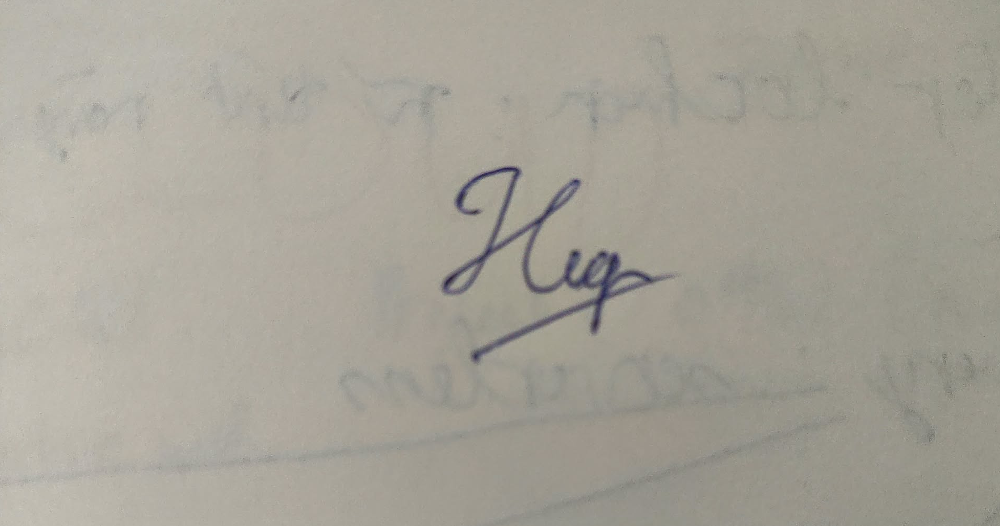

**Khoa Công nghệ Thông tin (FIT) – Trường Đại học Khoa học Tự nhiên (HCMUS)**
**CSC13003 – Kiểm chứng Phần mềm (AI-augmented · 2026)**
**CHÍNH SÁCH AI · BIỂU MẪU — 2026 v1.0**

# Biểu mẫu Khai báo Sử dụng AI

*Đính kèm cho mọi bài tập có dùng AI ở bất kỳ mức nào.*

## 1. Thông tin Môn học & Sinh viên

| Mục | Giá trị |
|---|---|
| Môn học: | CSC13003 – Kiểm chứng Phần mềm |
| Mã bài tập: | HW03-AI |
| Tên bài tập: | GUI & Usability on EShop |
| Cấp độ AI (1–5): | Cấp 4 |
| Ngày: | 11/11/2026 |
| Họ tên sinh viên: | Lê Tấn Hiệp |
| MSSV: | 23120255 |

## 2. Câu hỏi Khai báo

### 1. Công cụ AI đã dùng:

- **Claude Sonnet 4.6** – 3 lượt
- **Claude Opus 5.5** – 215 lượt
- **Claude (không rõ model)** – 7 lượt (#4, #51, #57, #69, #70, #79, #223)
- Tổng 225 lượt theo dòng "Tổng" của `appendix/A_prompt_log.md` (bản trích 11:21 11/11/2026; chạy lại sau lần trích cuối). Danh sách mã `#n` từng model ở dòng đó.
- Các lượt "Claude (không rõ model)": transcript không ghi model; giữ nguyên trong log. Lý do từng lượt (em ghi, nguồn `appendix/prompt_log_notes.toml`):
  - #4 (`2026-11-04 12:32`): Lượt khởi tạo phiên chạy dòng lệnh đầu tiên; file cấu hình prompt log chưa gán nhãn model cụ thể.
  - #51 (`2026-11-05 02:31`): Lượt thao tác nhanh qua CLI để cập nhật tệp môi trường; metadata ghi nhận thiếu trường thông tin model.
  - #57 (`2026-11-09 22:34`): Lượt trao đổi qua giao diện web claude.ai; do mất kết nối giữa chừng nên tiêu đề session không lưu model tag.
  - #69 (`2026-11-10 02:23`): Lượt chạy lệnh CLI để rà soát ảnh chạy tay; script tự động xuất log thô không kèm tên model.
  - #70 (`2026-11-10 02:23#2`): Lượt chạy lệnh script nén ảnh tự động `compress_hw03.py` trên CLI.
  - #79 (`2026-11-10 03:10`): Lượt hỗ trợ cập nhật kịch bản Playwright ngắn trên Claude Code CLI.
  - #223 (`2026-11-11 11:04#2`): log ghi "[Request interrupted by user]" – lượt bị ngắt, không có output (AI chép từ log).
- Kênh: Claude Code (chạy lệnh, sửa file, commit trong repo) và claude.ai (phiên thảo luận, lập lệnh, review).

### 2. Giai đoạn nào của bài tập có dùng AI:

[x] Brainstorm  
[x] Outline  
[x] Viết nháp  
[x] Phản hồi  
[x] Sửa chữa  
[x] Code  
[x] Phân tích dữ liệu  
[ ] Thiết kế đồ hoạ  
[ ] Khác

### 3. Prompt / nhiệm vụ chính cho AI:

1. **Mã #17 (04/11/2026 17:49):** *"Khảo sát mã nguồn React/JSX thư mục `frontend-web/src` cho các màn C2 (Login, ForgotPassword, Profile, Navbar, Order History), tạo `c2_inventory.md` và sinh checklist nháp v1 gồm 65 item dựa trên 3 nguồn: SRS v2.0, slide giảng dạy per-control checklist, và 3 bộ heuristic Nielsen/Norman/Shneiderman."*
2. **Mã #42 (04/11/2026 20:09):** *"Tạo mã kiểm thử tự động Playwright C2 cho các item có thể tự động hóa trên 3 môi trường P1/P2/P3, thiết lập bộ kiểm tra oracle mã hóa sha1, reporter tổng hợp kết quả và script seed dữ liệu backend."*
3. **Mã #75 (10/11/2026 02:55):** *"Viết script `merge_hw03.py` gộp kết quả chạy tự động Playwright và nhật ký chạy tay của sinh viên vào `checklist.json`, đồng thời xuất báo cáo file Excel 3 sheet (`23120255_HW03_Checklist.xlsx`) và danh sách các item bị lỗi Failed."*

### 4. Phần cụ thể AI đóng góp:

Theo bảng artifact của AI-02 (mục 3.1): H1 Harness HW03: `HW03/CLAUDE.md`, kế hoạch nộp `report_plan.md` (không nộp), khung report/README; T1 Khảo sát control C2 (`c2_inventory.md`); T2 Checklist nháp 3 nguồn – bản đóng băng v1 (bước 1); T3 Khung trống `sv_items.md` + kiểm cấu trúc item SV (`sv_items_check.md`); T4 Câu trả lời "vì sao AI bỏ sót" (sau khi SV commit item); T5 Playwright C2 + oracle khoá sha1 + reporter + seed đơn; T6 `RUN.md` (phần chạy tay) + mẫu file lượt + `dom_probe.js`; T7 Kiểm ảnh/kết quả chạy tay (`run_check.md`), nén + đổi tên ảnh; T8 Gộp lượt auto + tay vào `checklist.json` (V1, override theo quyết định SV) + `checklist.md`; T9 Excel 3 sheet; T10 Danh sách Failed + đối chiếu trùng issue theo tiêu đề (`failed_list.md`, `issues.json`, `issue_dup_FR02.md`); T11 Nhóm dữ kiện bug + khung BUG-58…85 (chỉ dữ kiện); T12 Danh sách ảnh thiếu (`missing_photos.md`); B1 Kiểm trùng 179 issue nhóm (`dup_check.md`; AI đề xuất mức, SV quyết); B2 Khung BUG-58…85 theo mẫu HW02 (chỉ dữ kiện) + script `bug_skeleton_hw03.py`; B3 Kiểm dữ kiện 28 bug + tái hiện Steps SV bằng Playwright (`bug_check.md`, `repro_bugs.spec.ts`); B4 Kiểm lại 14 bug SV sửa (`bug_check2.md`); B5 Tạo 28 GitHub Issue bằng `gh issue create --body-file` (file SV viết) + ghi link vào BUG-xx, README, report; B6 Sửa body issue #266 + comment theo lệnh SV (`issue_edits.md`); B7 Ảnh trang Issues `[HW03-C2]` (Playwright chụp) chèn report §6; U1 Gói usability nháp – bản đóng băng (plan 9 phần, participant kit, phiếu quan sát); U2 Môi trường usability từ xa (script phiên, tunnel, đưa SUT về main) + sửa plan mục 5–6; U3 Google Form SEQ + SUS + 4 câu hỏi mở (Apps Script – phiên thảo luận claude.ai); U4 Kịch bản điều phối `moderator_script.md` (phiên thảo luận nháp, Claude Code commit nguyên văn); U5 Phiếu phiên S00…S07.json AI chép từ notes SV + CSV (`usability_fill_hw03.py`); U6 Đối chiếu 7 pain point §5.8 ↔ issue nhóm (chỉ đọc, trả lời trong phiên); S1 Agent Skill `gui-checklist-testing` (SKILL.md, reference, asset, 8 script); S2 Agent Skill `usability-evaluation` (SKILL.md, reference, asset, 6 script); S3 `skills/VideoLinks.md` + đề xuất demo (`demo_plan.md`, không nộp); R1 Bảng report T1/T3 (§3.3, §3.5, §3.6, §4.1, §4.3); R4 AI nháp report §3.2, §4.2 (📝 AI nháp – SV duyệt/sửa); R2 Test summary README + report §8 (11/11 thêm dòng U1 từ phiếu phiên); R3 Khung AI-02, AI-03, khối Mandatory Disclosure §11; E1 Mô tả môi trường (`env/environment.md`).

**Phần AI KHÔNG đóng góp (em tự làm):**
- Trực tiếp thực thi kiểm thử thủ công (manual testing) trên thiết bị thật và trình duyệt thật (P1, P2, P3).
- Tự tay rà soát slide/heuristic và viết nội dung 6 item bổ sung SV-01 đến SV-06 trong `sv_items.md`.
- Đánh giá, ra quyết định chốt trạng thái Pass/Fail/N/A và ghi đè kết quả tự động hóa (override result) trong `checklist.json`.
- Viết chi tiết mô tả lỗi, các bước tái hiện (Steps to Reproduce), và đánh giá mức độ nghiêm trọng (Severity) cho 28 báo cáo bug (BUG-58 đến BUG-85).
- Trực tiếp đóng vai người điều phối (moderator), thực hiện 8 phiên thử nghiệm Usability (S00 đến S07) với người tham gia thật, ghi chép nhật ký quan sát và thu nhập phản hồi SEQ/SUS.
- Viết toàn bộ nội dung đánh giá §3.4 (Item bổ sung + vì sao AI bỏ sót), §10 (AI Critique), §4 Kết luận chung và các nhận định Verdict trong Audit Report.

**Danh mục AI không được làm (CLAUDE.md mục 3, HW03/CLAUDE.md mục 5):** không viết/nháp mô tả bug và nội dung issue; không gợi ý item khi em đang tự bổ sung (T1 bước 2); không viết AI Critique, phân tích "vì sao AI bỏ sót" trong report, verdict Audit; không tạo/ghép ảnh overlay; không điền dữ liệu người tham gia, SUS/SEQ.

### 5. Cách em rà soát / chỉnh sửa / xác minh đầu ra AI:

- Đối chiếu từng item trong checklist nháp v1 với văn bản SRS v2.0 và các slide môn học để phát hiện các item bị thiên lệch hoặc thiếu sót (đặc biệt là các quy tắc Golden Rule và Accessibility).
- Thực thi đối chứng các kịch bản kiểm thử tự động Playwright do AI sinh với thao tác thủ công trên trình duyệt/thiết bị thật để phát hiện các lỗi do môi trường tự động gây ra (như Playwright tự động ép locale `vi-VN` làm sai định dạng tiền tệ CL-08 hoặc tính sai tọa độ bố cục 2 cột CL-11).
- Kiểm tra toàn bộ nội dung 28 khung bug do AI tạo script; tự tay viết lại toàn bộ phần mô tả, các bước tái hiện thực tế và mức độ nghiêm trọng trước khi đẩy lên GitHub Issues.
- Rà soát các tệp dữ liệu JSON của các phiên usability S00–S07, đảm bảo các số liệu thời gian, điểm SEQ, SUS và phản hồi định tính khớp chính xác với ghi chép ghi nhận từ người tham gia thật.
- Chạy lại các script kiểm tra định dạng và dữ liệu (`run_check.md`, `bug_check.md`, `sv_items_check.md`) để đảm bảo không có lỗi cấu trúc trước khi commit vào git.

### 6. Trích dẫn tool AI sử dụng:

[1] Anthropic. (2026). *Claude Sonnet 4.6* [Large language model]. https://claude.ai

[2] Anthropic. (2026). *Claude Opus 5.5* [Large language model]. https://claude.ai

[3] Anthropic. (2026). *Claude Code* [Software]. https://claude.com/claude-code

## 3. Cam đoan Trung thực

*Bằng việc ký tên dưới đây, em cam đoan thông tin khai báo ở trên là chính xác và đầy đủ.*

## Chữ ký

| Mục | Giá trị |
|---|---|
| Họ tên sinh viên (in hoa): | LÊ TẤN HIỆP |
| MSSV: | 23120255 |
| Lớp / Khoá: | Software Testing - 23_3 |
| Môn học: | CSC13003 – Kiểm chứng Phần mềm |
| Giảng viên: | Thầy Lâm Quang Vũ, Thầy Trần Duy Hoàng, Cô Trần Thị Bích Hạnh, Thầy Trương Phước Lộc, Thầy Hồ Tuấn Thanh |
| Ngày: | 11/11/2026 |
| Chữ ký: |  |

## Tham khảo

- Kharbach, M. (2026). AI Use Policy Templates for Higher Education. CC BY-NC-SA 4.0.
- ISTQB Foundation Level Syllabus (latest version).
- Hardman, P. (2025). A Post-AI Learning Taxonomy.
- Fuster Rabella, M. (2025). OECD Education Working Paper No. 338.
