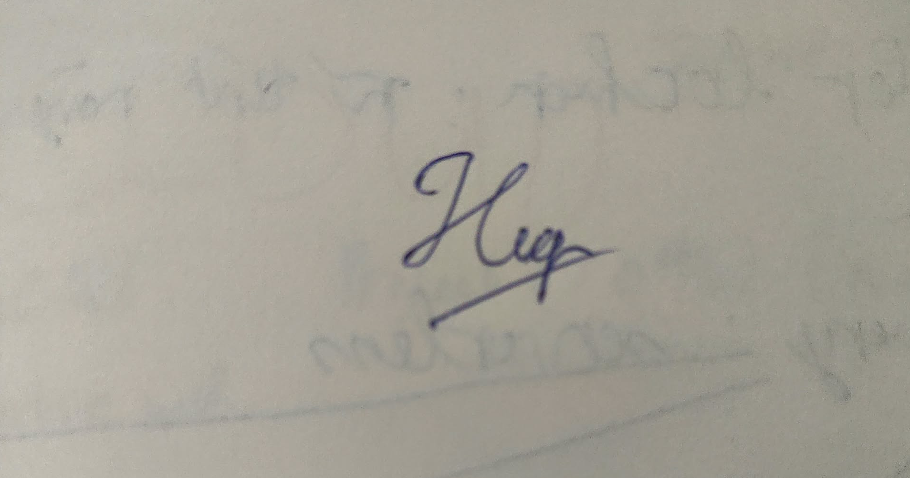

**Khoa Công nghệ Thông tin (FIT) – Trường Đại học Khoa học Tự nhiên (HCMUS)**
**CSC13003 – Kiểm chứng Phần mềm (AI-augmented · 2026)**
**CHÍNH SÁCH AI · BIỂU MẪU — 2026 v1.0**

# Bảng Kiểm Quyền Riêng tư & Sử dụng AI Có Trách nhiệm

**Bài tập:** HW03-AI – GUI & Usability on EShop
**Công cụ AI:** Claude Sonnet 4.6 3 lượt; Claude Opus 5.5 215 lượt; Claude (không rõ model) 7 lượt (tổng 225 lượt theo dòng Tổng của `appendix/A_prompt_log.md`, khớp AI-03 mục 1)

*Chỉ tick mục có bằng chứng trong repo (ghi ở cuối dòng). Mục cam kết cá nhân để trống "(em tự xác nhận)".*

## 1. Trước khi dùng AI

- [x] Đã xác nhận Cấp độ AI cho bài tập này. — *report dòng đầu: Cấp 4; AI-03 mục 1*
- [ ] Dùng tài khoản Claude tự chọn. *(em tự xác nhận)*
- [ ] Đã đọc Thoả thuận AI của môn học. *(em tự xác nhận)*
- [x] Hiểu rõ artifact nào KHÔNG được sinh bằng AI. — *AI-03 mục 4 "Danh mục AI không được làm"; `CLAUDE.md` §3, `HW03/CLAUDE.md` §5*

## 2. Trong khi dùng AI

- [ ] Không nhập dữ liệu cá nhân của bạn, khách hàng, bệnh nhân. *(em tự xác nhận)*
  - **Minh bạch:** SV đã gửi CSV có họ tên/SĐT người tham gia cho phiên thảo luận claude.ai 00:43 11/11; AI chỉ dùng cột SEQ/SUS. CSV không commit (`usability/evidence_raw/` trong `.gitignore`); Claude Code chỉ đọc cột mã phiên, đồng ý, SEQ, SUS, câu hỏi mở (`tools/usability_fill_hw03.py`). Report §11 mục 12.
- [ ] Không paste nguyên si tài liệu có bản quyền lên AI. *(em tự xác nhận)*
- [ ] Không paste code công ty / code open-source giới hạn license. *(em tự xác nhận)*
- [x] Đã ghi mọi prompt + phản hồi AI vào prompt log có timestamp. — *`appendix/A_prompt_log.md` (225 lượt, trích tự động, giờ Asia/Saigon)*

## 3. Trước khi nộp bài

- [x] Mọi artifact AI sinh đã được gắn tag trong AI Audit Report. — *AI-02 mục 3.1 (36 artifact), report §9*
- [ ] Mọi trích dẫn AI đã được xác minh (nguồn thực sự tồn tại). *(em tự xác nhận)*
- [x] Mọi code AI sinh đã được thực thi và test. — *bằng chứng một phần: lượt Playwright `checklist/runs/P*_auto_*.json`, tái hiện bug `bugs/repro/repro_P1.json`, `repro_P2.json`*
- [x] AI Critique 200–300 chữ đã có trong báo cáo. — *report §10*
- [x] Đoạn Mandatory Disclosure ở cuối báo cáo. — *report §11*
- [x] Đính kèm AI Use Disclosure Form. — *`ai-forms/AI-03_Disclosure_Form_23120255.md`*
- [ ] Sẵn sàng cho vấn đáp ngẫu nhiên 5–7 phút tuần kế nộp bài. *(em tự xác nhận)*

## 4. Cam đoan Cuối cùng

*Em xác nhận đã rà soát danh sách trên; các mục chưa tick do em tự xác nhận trước khi ký.*

## Chữ ký

| Mục | Giá trị |
|---|---|
| Họ tên sinh viên (in hoa): | LÊ TẤN HIỆP |
| MSSV: | 23120255 |
| Lớp / Khoá: | Software Testing - 23_3 |
| Môn học: | CSC13003 – Kiểm chứng Phần mềm |
| Giảng viên: | Thầy Lâm Quang Vũ, Thầy Trần Duy Hoàng, Cô Trần Thị Bích Hạnh, Thầy Trương Phước Lộc, Thầy Hồ Tuấn Thanh |
| Ngày: | 11/11/2026 |
| Chữ ký: |  |

## Tham khảo

- Kharbach, M. (2026). AI Use Policy Templates for Higher Education. CC BY-NC-SA 4.0.
- ISTQB Foundation Level Syllabus (latest version).
- Hardman, P. (2025). A Post-AI Learning Taxonomy.
- Fuster Rabella, M. (2025). OECD Education Working Paper No. 338.
